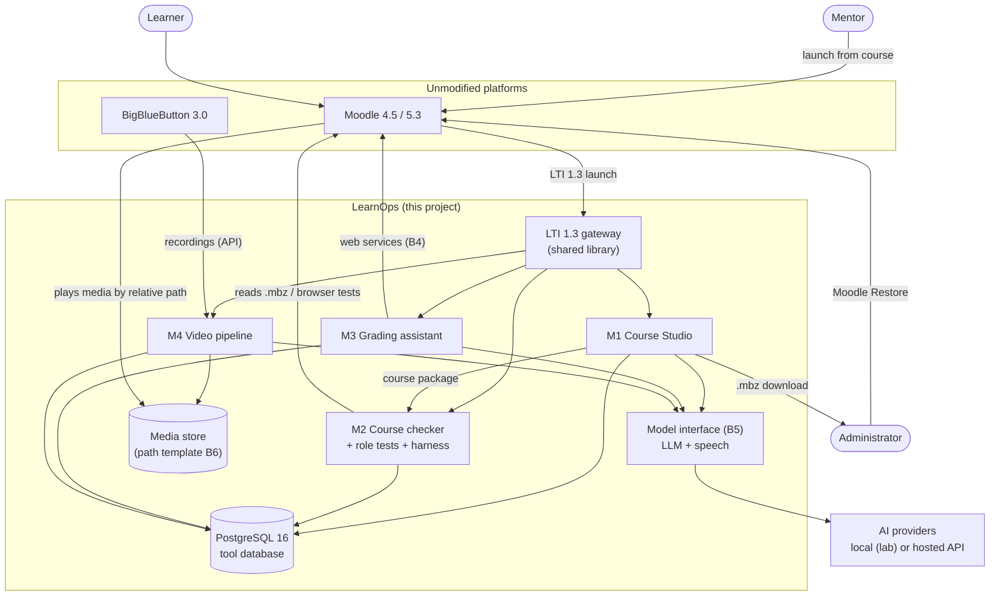

# LearnOps — An AI-Assisted Toolkit for Course Authoring, Quality Assurance, Assessment and Video on Moodle

## Product Requirements Document (PRD)

| Field | Value |
|---|---|
| Document | `docs/PRD.md` |
| Version | 1.0 (draft for approval) |
| Owner | Project guide |
| Contributors | Student 1–4 (module owners) |
| Status | Draft. Becomes binding when the guide approves it. |
| Change rule | Changes only by pull request. Sections marked **Contract** also need approval from every affected module owner and the guide (§B.0). |

> **How to read this document.** Part A describes the whole system and its fixed rules. Part B is
> the set of **shared contracts**: the exact formats and interfaces between modules. Part C has one
> chapter per module, all with the same headings: the **baseline** (C1–C5, Releases 0–5) and the
> **extension track** (C6 fully specified, C7 outline; Releases 6+), which can be continued after the
> baseline is complete. Part D is the **release plan**. Part E covers
> verification. Requirement IDs (FR-, NFR-, SEC-, EXT-, …) are used in tests, pull requests and the
> final demonstration.

---

# Part A — System

## A1. Purpose

LearnOps is a set of open-source tools that work **beside an unmodified Moodle** (and an unmodified
BigBlueButton) to cut the time mentors spend creating courses, checking them, grading project work,
and handling video. Every tool is measured: the project succeeds only if the numbers in §A3 are
reached.

This PRD is the single agreed specification for all four modules, so they integrate without
rework.

## A2. Problem statement

Moodle-based platforms that run **project-based courses** depend on mentors who teach alongside
other work. Five tasks consume most of their time:

| # | Problem | Today |
|---|---|---|
| P1 | **Course creation is slow and error-prone.** Each week is built activity by activity through many settings screens. | 2–3 hours to load one course by hand |
| P2 | **Course mistakes are found late.** Restrictions, completion rules and grade totals interact invisibly: a week that never opens, a completion rule that can never be met, points that don't add up. | Traced by hand |
| P3 | **Grading project submissions takes hours.** | ~10 min per learner; ~5 h per mentor per week for 30 learners |
| P4 | **Videos are hard to handle and to use.** Large files are hard to upload; lectures and live-class recordings have no captions, chapters or index. | No captions; manual upload |
| P5 | **Learning stays passive.** Interactive practice helps learners remember, but building it by hand takes 15–40 minutes per activity. | Rarely built |

## A3. Goals and success metrics

| Goal | Metric | Target | Delivered in |
|---|---|---|---|
| G-1 Fast course creation | Mentor time to load a 4-week course | ≤ 15 min (vs 2–3 h) | Release 2 |
| G-2 Course errors caught before learners see them | Planted errors detected (test set B8.3) | 100 % | Release 1 |
| G-3 Every role works on every screen | Role tests passing: 5 roles × 3 screen profiles × Moodle 4.5 and 5.3 | 100 % | Release 1 |
| G-4 Less grading time | Minutes per submission, assisted vs manual | ≥ 50 % reduction | Release 4 |
| G-5 Trustworthy grading drafts | Draft grade within one band of the mentor's grade (B8.4) | ≥ 80 % | Release 4 |
| G-6 Every video usable | Caption word error rate on Indian-English lectures (B8.5) | Measured and reported; target fixed in Release 0 | Release 3 |
| G-7 Recordings processed quickly | Time from a 90-min recording becoming available to captions, chapters and index ready | ≤ 30 min | Release 3 |
| G-8 Large uploads work | 700 MB file through a proxy that limits requests to 100 MB, with one interruption | Succeeds and resumes | Release 3 |
| G-9 Practice with little effort (stretch) | Mentor review time for one week's practice | ≤ 5 min | Release 5 |
| G-10 Evidence for model choice | Local small model vs hosted API on quality, review time and cost | Comparison report | Release 4 |
| G-11 *(Extension)* Readable, navigable lectures | Dual-stream lessons playable in all modes on phone and laptop; track drift | ≤ 150 ms drift over 60 min | Release 6 |
| G-12 *(Extension)* Low-data viewing | Data transferred in low-data mode vs dual mode | ≥ 60 % less | Release 6 |

## A4. Users

| User | Who | Main need | How they reach LearnOps |
|---|---|---|---|
| **Mentor** | Teacher of a course (Moodle role *Teacher*; LTI role *Instructor*) | Create courses fast, grade fast, upload video easily | Launches tools from inside the Moodle course (LTI 1.3) |
| **Learner** | Enrolled student (Moodle role *Student*; LTI role *Learner*) | Clear, working courses; usable videos; quick feedback | Uses Moodle only. **No direct tool access in this version** (see EXT-07) |
| **Site administrator** | Moodle site admin | Restore courses safely; run checks; configure tools | CLI on the tools host; tool admin pages via LTI with the Administrator role |
| **Project guide** | Supervises the project; runs the lab | Approve releases; review measurements | Same as site administrator in the lab |

## A5. Roles and permissions

Identity and role always come from Moodle (via the LTI 1.3 launch, §B3). LearnOps keeps **no
passwords**.

| Capability | Mentor (Instructor) | Learner | Administrator |
|---|---|---|---|
| Course Studio: edit packages for courses where the user is Instructor | ✅ | ❌ | ✅ (all courses) |
| Course Studio: generate and download `.mbz` | ✅ | ❌ | ✅ |
| Restore `.mbz` into Moodle | ❌ (sends file to admin) | ❌ | ✅ (Moodle's own Restore) |
| Course checker: run on own course | ✅ (web) | ❌ | ✅ (web + CLI) |
| Role tests: run | ❌ | ❌ | ✅ (CLI / CI) |
| Video upload to own course's lessons | ✅ | ❌ | ✅ |
| View processing status and outputs | ✅ (own courses) | ❌ | ✅ |
| Grading assistant: review and approve drafts for own course | ✅ | ❌ | ✅ |
| Grading assistant: write approved drafts to Moodle | ✅ (through the service account, §B4) | ❌ | ✅ |
| Release grades to learners | In **Moodle** only | ❌ | In Moodle only |
| Practice review (stretch) | ✅ | ❌ | ✅ |
| Tool configuration, model provider, keys | ❌ | ❌ | ✅ (environment only) |
| *(Extension, Release 6)* Watch lessons in the dual-stream player; answer cue activities | ✅ (preview) | ✅ (enrolled courses only) | ✅ |

Rules: a launch with any role not listed is refused with a clear message. A user sees only data
for the course (LTI context) they launched from, except administrators.

## A6. Scope

**In scope**
1. **Course Studio** (Module 1): author, validate and generate Moodle course backups.
2. **Course checker and role tests** (Module 2): find course-design errors; test every role in a browser; integration harness.
3. **Grading assistant** (Module 3): repository checks and draft grades/feedback; the shared model interface; model comparison study.
4. **Video pipeline** (Module 4): upload, processing, captions, chapters, summaries, slide index, lesson manifest, BigBlueButton recording intake.
5. **Practice activities** (Module 1 + Module 4, *stretch*, Release 5): AI-drafted, mentor-approved, ungraded H5P practice.

**Extension track (optional; Releases 6+; may continue after the baseline is complete)**

The baseline (Releases 0–5) is built so these plug in without rework (§A9).
- F-1 Dual-stream lecture player: camera and teaching surface side by side, layout modes, slide thumbnails, chapters, captions, low-data mode, interactive pane for experiential activities (fully specified in §C6, Release 6).
- F-2 Import of BigBlueButton's separate camera and slide streams into F-1 (§C6, Release 7).
- F-3 Course-grounded tutor for learners (outline, §C7).
- F-4 Fine-tuned small language model (outline, §C7).
- F-5 Learning analytics for mentors (outline, §C7).

**Out of scope**
- Moodle plugins, themes, filters, or any change to Moodle or BigBlueButton source code.
- Payments, enrolment, marketing, email sending (Moodle handles notifications).
- Points, levels, leaderboards.
- Real learner data of any kind.
- Re-running a course for a new cohort (Moodle's Copy course does this).
- Production hosting.

## A7. Non-negotiable constraints

| ID | Constraint |
|---|---|
| C-01 | Moodle and BigBlueButton are installed **as released and never modified**. No plugins, no patches, no edits to their code or database. |
| C-02 | Tools connect to Moodle **only** through: Moodle backup files restored with Moodle's own Restore; Moodle's standard web-services API; LTI 1.3 External tool launches; a browser (tests only). |
| C-03 | Everything works on **Moodle 4.5 and Moodle 5.3**. |
| C-04 | Generated course content follows the course pattern in §B1.2 and never alters protected activities (§B1.4). |
| C-05 | Every command-line tool supports `--dry-run`, `--check` and has a documented undo. |
| C-06 | No secrets (API keys, tokens, passwords) in the repository. Configuration through environment variables; `.env.example` documents them. |
| C-07 | Test data only (§B8). |
| C-08 | Any media URL stored by a tool is a **relative path**, never a full fixed URL (media may be served through expiring signed links). |
| C-09 | AI output is always a **draft** until a mentor approves it. Grades are never released by a tool. |
| C-10 | All AI calls go through the shared model interface (§B5); all speech-to-text through the speech interface (§B5.4). |
| C-11 | Open source under Apache-2.0. Third-party libraries must have compatible licences (MIT, BSD, Apache-2.0; LGPL only as an unmodified library). |
| C-12 | Students work only inside the lab virtual machines and the lab AI services provided by the guide. |

## A8. System overview



## A9. Architecture for extension (build the baseline now, extend later)

The rule: **future features must be new consumers of data that already exists, never a redesign.**

| ID | Principle | What it means in practice |
|---|---|---|
| EXT-01 | **Contracts first** | Every exchange between modules uses a versioned contract in Part B. A new feature reads existing contracts. |
| EXT-02 | **Additive change only** | After Release 0, contracts change only by adding optional fields. A breaking change needs a new contract version (`v2`) and the guide's approval. Readers ignore unknown fields. |
| EXT-03 | **Manifests, not hard-wired files** | Each lesson has a manifest (`lesson.json`, §B6.3) listing all its tracks and derived files. Today: one video track. Later: camera and screen tracks for F-1, with no change to existing lessons. |
| EXT-04 | **Adapters at every external dependency** | Model provider, speech provider, storage backend (local folder or S3-compatible) and Moodle access sit behind interfaces with one adapter each. Swapping one is configuration, not code. |
| EXT-05 | **Feature flags** | Optional features (practice, summaries, slide index, BigBlueButton intake) can be switched on or off per deployment. |
| EXT-06 | **Stable identifiers** | Activities identified by Moodle `idnumber`; lessons by slug; never by position or display name. |
| EXT-07 | **Reserved extension points** | The LTI gateway already validates the Learner role and refuses it with "not available in this version". F-1 (player) and F-3 (tutor) will enable Learner launches without changing the gateway. |
| EXT-08 | **Data produced now for features built later** | The video pipeline produces the slide index (`slides.json`) and cue file (`cues.json`) now; F-1 will display them. |
| EXT-09 | **One shared library per cross-cutting concern** | `lti`, `moodle_ws`, `model_interface`, `contracts` (schemas + validators), `media_paths`. Modules import them; they never copy code. |

## A10. Technology stack (fixed)

| Layer | Choice |
|---|---|
| Language (back ends, CLIs, processing) | Python 3.12 |
| Web framework | FastAPI |
| Front end (where a UI is needed) | React + TypeScript, built to static files served by the tool |
| Database | PostgreSQL 16 (one database, one schema per module: `studio`, `checker`, `grading`, `video`, plus `shared`) |
| LTI 1.3 | A maintained open-source Python LTI 1.3 library with a compatible licence (chosen and recorded in Release 0) |
| Browser tests | Playwright (Python) |
| Media processing | ffmpeg |
| Speech-to-text (lab) | Whisper-family model through the speech interface (§B5.4) |
| Language models (lab) | Local small models through the model interface (§B5) |
| Containers | Docker + Docker Compose |
| CI | Runs unit tests, schema validation, lint on every pull request |

### Repository layout

```
/docs            PRD.md, design/ (one design document per module), decisions/ (ADRs)
/contracts       JSON Schemas for B1–B8, with example files
/libs            lti/, moodle_ws/, model_interface/, contracts/, media_paths/
/modules         studio/, checker/, grading/, video/
/lab             docker-compose files for tools; setup notes for Moodle and BBB VMs
/testdata        B8 data sets (or download scripts where licences require)
/tests           integration/ (harness), e2e/ (Playwright)
```

## A11. Lab environment

The lab mirrors a typical production stack so results transfer.

| Machine (VM) | Contents |
|---|---|
| `moodle45` | Ubuntu 22.04, nginx, PHP 8.3, PostgreSQL 16, Moodle 4.5 (latest point release) |
| `moodle53` | Same stack, Moodle 5.3 |
| `bbb` | BigBlueButton 3.0 on Ubuntu 22.04, with the **video** recording format enabled |
| `tools` | Docker host running all LearnOps services and the tool database |
| Lab AI services | Provided by the guide over the lab network: a local LLM endpoint and a speech-to-text endpoint |

Moodle sites have: completion tracking on; web services enabled with a dedicated service account
(§B4); LTI 1.3 tools registered (§B3); H5P enabled with the pinned content types (§B7).

## A12. Deployment and operations

| ID | Requirement |
|---|---|
| OPS-01 | One `docker compose up` starts all services on the tools host. |
| OPS-02 | All configuration through environment variables; `.env.example` lists every variable with a safe default or a placeholder. |
| OPS-03 | Each service exposes `GET /health` returning status and version. |
| OPS-04 | Logs are structured JSON to stdout, with request id, user (LTI `sub`), course (LTI context id) and action. No secrets or file contents in logs. |
| OPS-05 | Every CLI: `--dry-run` (prints intended changes, changes nothing), `--check` (read-only status, exit code 0 = OK, 1 = problems found), `--config <file>`; exit code 2 = error. |
| OPS-06 | Every state-changing operation records an audit entry (who, what, when, course) in `shared.audit_log`. |
| OPS-07 | Database migrations are versioned and reversible. |
| OPS-08 | A documented backup and restore procedure for the tool database and media store. |
| OPS-09 | Each module's README gives install, configure, run, check and undo steps. |
| OPS-10 | Heavy work (transcoding, transcription, scene detection, the grading sandbox) runs in separate **worker** containers fed by a job queue, never inside web request handlers. Workers can be deployed on a different host from the web services by configuration alone, so an adopting site can keep heavy processing off its web server. |
| OPS-11 | Every AI or speech provider can be a hosted API (pay per use) in production; no module may require a local GPU to run. |

## A13. Security and privacy

| ID | Requirement |
|---|---|
| SEC-01 | LTI launches validated fully (signature, issuer, audience, nonce, expiry, deployment id). |
| SEC-02 | Authorisation on every request from the LTI session: role + course context (§A5). |
| SEC-03 | The Moodle service-account token has only the capabilities listed in §B4 and is stored only in the environment. |
| SEC-04 | Untrusted learner code (Module 3) runs only in an isolated sandbox (§C3.5): no network, non-root, CPU/memory/time limits, read-only base image, destroyed after each run, on a host that runs no other LearnOps service. |
| SEC-05 | Uploads: size limit, type check by content (not only extension), virus-free assumption documented, stored outside any web root until processed. |
| SEC-06 | No personal data beyond what LTI provides (name, email if shared, role). Test data only in the lab (C-07). |
| SEC-07 | Data sent to a hosted AI API is limited to what the task needs; the provider and data sent are documented in the data map (§E6). |
| SEC-08 | Dependencies scanned in CI; no known critical vulnerabilities at release. |
| SEC-09 | CSRF protection on all state-changing web requests; secure, same-site cookies for LTI sessions. |

## A14. UI and accessibility baseline

| ID | Requirement |
|---|---|
| UI-01 | Plain, consistent layout using a Bootstrap-compatible component style, so the adopting site can restyle it to match Moodle. |
| UI-02 | Works on three screen profiles: phone 375×812; laptop 1366×768 at 100 %, 125 % and 150 % zoom; half-width window 683×768. No horizontal scrolling. |
| UI-03 | Keyboard operable; visible focus; form fields labelled; colour contrast at least WCAG 2.1 AA. |
| UI-04 | Every long operation shows progress and can be left and resumed (status page). |
| UI-05 | Error messages say what happened and what to do next, in plain English (§C.x.8). |
| UI-06 | Pages load in under 2 s on the lab network (excluding processing jobs). |
| UI-07 | English only in this version; all user-facing strings in one place per module so they can be translated later. |

## A15. Assumptions

1. The lab VMs and AI services are available from Release 0.
2. Moodle's standard web-services functions listed in §B4 exist on 4.5 and 5.3 (verified in Release 0; see §App-C).
3. Moodle's Restore can merge sections from a backup into an existing course (verified in Release 0).
4. Lecture videos with reference transcripts can be obtained with permission (§B8.5).
5. A hosted-API key with a spending cap is provided by the guide for the comparison study.
6. Course reuse for a new cohort is done with Moodle's own **Copy course**. Course Studio is the
   **loading tool** for a new course (or new weeks), not the long-term master: after a course's
   first run, the Moodle course is the master, and reverse import (FR-S-08) brings it back to text
   when larger edits are needed.

## A16. Ways of working

| ID | Practice |
|---|---|
| WW-01 | One Git repository; `main` is protected; one branch per change; every change through a pull request reviewed by a member of another module. |
| WW-02 | One Claude Code account per member; accounts are never shared. |
| WW-03 | A `CLAUDE.md` at the repository root states the project rules (C-01…C-12, EXT-01…EXT-09, WW-01…WW-07) so AI-assisted work follows them. |
| WW-04 | Decisions that change design are recorded as short decision records in `docs/decisions/`. |
| WW-05 | Every pull request that adds or changes a requirement updates the traceability table (§E4). |
| WW-06 | Work is tracked as issues labelled by module and release. |
| WW-07 | AI-generated code is reviewed like any other code: the reviewer runs the tests and reads the diff. |

---

# Part B — Shared contracts

## B.0 Contract rules

1. Each contract has an owner, a version (`v1`, `v2`, …) and a JSON Schema in `/contracts`, with at least one valid example file.
2. **Frozen at the end of Release 0.** After that: additive, optional fields only (EXT-02).
3. A change is a pull request that updates the schema, the examples, this PRD section, and the tests of every module that uses the contract, approved by all affected owners and the guide.
4. Every module validates contract data it reads and writes against the schema; invalid data is rejected with a clear error.

| Contract | Owner | Used by |
|---|---|---|
| B1 Course package | Student 1 | M1, M2, M3, M5 |
| B2 Course model | Student 2 | M1, M2 |
| B3 LTI 1.3 launch | Student 2 (as integration lead) | M1, M2, M3, M4 |
| B4 Moodle web-services usage | Student 3 | M2, M3 |
| B5 Model and speech interface | Student 3 | M1, M3, M4 |
| B6 Media paths and lesson manifest | Student 4 | M1, M4, F-1 |
| B7 H5P practice output | Student 1 | M1, M4 |
| B8 Test data sets | Students 1, 3, 4 (per set) | All |

## B1. Course package (v1)

The text form of a course that Course Studio edits and turns into a Moodle backup.

### B1.1 Structure

A course package is a folder (or zip) containing `course.yaml` plus Markdown files and assets:

```yaml
schema: learnops.course/v1
course:
  shortname: DEMO-AI-101          # stable; matches Moodle course shortname
  fullname: "Build an AI Assistant"
  slug: build-ai-assistant        # lowercase ASCII, hyphens; immutable (media paths use it)
  total_points: 100
  mode: full                      # full | sections-only (see B1.4)
sections:
  - number: 1
    title: "Week 1 — Set up your tools"
    idnumber: wk-01
    unlock:
      after: null                 # first week: open
      start_date: null            # optional ISO date
    activities:
      - type: page
        idnumber: wk-01-guide
        title: "Week 1 guide"
        body: weeks/01-guide.md
      - type: assignment
        idnumber: wk-01-task
        title: "Week 1 task"
        body: weeks/01-task.md     # must contain a marking table (B1.3)
        points: 10
        submission: [onlinetext, file]
        completion: submit
  - number: 2
    title: "Week 2 — …"
    idnumber: wk-02
    unlock:
      after: wk-01-task            # opens when this activity is complete (submitted)
    activities: [...]
```

### B1.2 Course pattern rules (validated)

1. Each week section contains exactly **one guide Page and one task Assignment**. Optional extra activities: URL, Label, ungraded H5P practice (B7).
2. Week *N* unlocks when the week *N−1* task is submitted (`completion: submit`); an optional start date can be added.
3. Graded points across the course sum to `total_points` (default 100).
4. Assignments use marking workflow (so grades stay hidden until released, §B4).
5. Completion tracking is on for every activity used in an unlock rule.
6. All `idnumber`s are unique within the course, lowercase ASCII with hyphens, and never reused for a different activity.

### B1.3 Marking table format

Each assignment body contains one marking table in this exact Markdown form (Studio renders it to an
HTML table in the Moodle assignment description; the grading assistant parses it):

```markdown
<!-- marking-table v1 -->
| Criterion | Points | Full marks when | Check |
|---|---|---|---|
| Working demo | 4 | Demo link opens and the assistant answers a test question | http_ok:demo_url |
| Code quality | 3 | Repo builds; README explains setup | repo_file:README.md; command:setup |
| Reflection | 3 | 200+ words covering what worked and what didn't | — |
<!-- /marking-table -->
```

- `Points` sum to the assignment's `points`.
- `Check` is optional; allowed values are defined in §C3.5 (machine checks). `—` means mentor judgement only.
- The HTML rendering keeps the `data-marking-table="v1"` attribute so the table can be parsed back.

### B1.4 Protected activities and output modes

Some activities are owned by the course template and **must never be generated, changed or
duplicated** by LearnOps:

| Protected item | Identified by (default, configurable) |
|---|---|
| Final project assignment | `idnumber: final-project` |
| Course feedback activity | `idnumber: course-feedback` |
| Course completion criteria and course badge | Point to the two items above |

- `mode: full` generates a whole course (used for new test courses in the lab).
- `mode: sections-only` generates **only the week sections listed**, for an administrator to restore
  by **merging** into a course created from the template. Protected items and their section are
  excluded. The generated sections' numbers must not collide with the template's protected section
  (configurable `protected_section` number).
- The validator rejects a package that contains a protected `idnumber` in either mode.

## B2. Course model (v1)

A normalised JSON description of a course, read by the checker. Produced from a Moodle backup
(`.mbz`) or from a course package.

Key fields: course (shortname, completion enabled), sections (number, idnumber, visibility,
availability rules), activities (type, idnumber, visibility, availability rules, completion rule,
grade item and max grade, marking-workflow flag, presence of a marking table), course completion
criteria, badges (criteria), H5P activities (graded or not). The schema in `/contracts/course-model.v1.json`
is the authority; availability rules are kept in Moodle's own availability JSON form so no
information is lost.

## B3. LTI 1.3 launch (v1)

| Item | Value |
|---|---|
| Moodle role | Platform; each LearnOps tool registered as an External tool (LTI 1.3) by the administrator |
| Tool endpoints | Login initiation, launch (redirect), JWKS; one registration per tool (Studio, Checker, Grading, Video) |
| Message type | `LtiResourceLinkRequest` (Deep Linking not required in v1) |
| Claims used | `sub`, `name`, `email` (if shared), `roles`, `context` (course id, title), `resource_link`, `deployment_id` |
| Role mapping | `…/membership#Instructor` → Mentor; `…/institution/person#Administrator` → Administrator; `…/membership#Learner` → refused by the baseline tools (EXT-07); accepted only by the player tool from Release 6 (§C6) |
| Grade/completion return | Not used by the baseline. The player (Release 6) may use LTI Assignment and Grade Services for watch completion (FR-X-13, feature flag) |
| Session | Server-side session bound to (`sub`, context id); expires after 2 h idle; re-launch from Moodle to continue |
| Course binding | The LTI context id is mapped to the Moodle course id (via web services, §B4) and stored in `shared.course_link` |

## B4. Moodle web-services usage (v1)

- One dedicated **service account** per Moodle site, with a token restricted to an external service containing only the functions below.
- The account has only the capabilities those functions need, in the courses where it is enrolled for grading.
- Function list (each verified on 4.5 and 5.3 in Release 0; replacements recorded here if names differ):

| Purpose | Function |
|---|---|
| Course structure | `core_course_get_courses_by_field`, `core_course_get_contents` |
| Enrolled users | `core_enrol_get_enrolled_users` |
| Assignments | `mod_assign_get_assignments` |
| Submissions | `mod_assign_get_submissions`, `mod_assign_get_submission_status` |
| Submission files | Download through the token-authenticated file URL returned by the API |
| Write draft grade + feedback | `mod_assign_save_grade` with marking-workflow state **`readyforrelease`** and feedback comments; never `released` |
| Workflow state | `mod_assign_set_user_flags` (only if needed to set the state) |

- **Draft rule:** grades written by LearnOps stay invisible to learners until the mentor releases them in Moodle (marking workflow). Only mentor-approved drafts are written.

## B5. Model and speech interface (v1)

### B5.1 Language-model call

One Python call for every AI step:

```python
result = model.run(
    task="grade_draft",            # registered task name
    inputs={...},                  # task-specific
    output_schema=GradeDraftV1,    # JSON Schema / Pydantic model
)
# result.data      -> validated object matching output_schema
# result.meta      -> provider, model, input/output tokens, latency_ms, cost_estimate, prompt_version
```

`cost_estimate` is a numeric estimate in US dollars (USD). For a local model with no billed inference cost, report `0.0`. If cost is unknown or the provider does not report it, report `null`; unknown cost must never be represented as zero. `input_tokens` and `output_tokens` may also be `null` when the provider does not report usage.

### B5.2 Providers

- `local`: the lab LLM endpoint (default in the lab).
- `hosted`: one hosted LLM API, through the provider's official SDK.
- `fake`: a deterministic provider for automated tests that calls no model. The service refuses it unless an explicit test-only setting is on, and that setting is refused in the lab and in production.
- Chosen by `MODEL_PROVIDER` and `MODEL_NAME`; keys from environment variables only.
- Structured output is validated; on invalid output: one retry, then a clear error (never a silent partial result).

### B5.3 Prompts and logging

- Prompts are versioned files in `/libs/model_interface/prompts/` with a `prompt_version`.
- Every call logs `meta` to `shared.model_calls` (no raw learner content in logs).

### B5.4 Speech interface

```python
transcript = speech.transcribe(audio_path, language="en")
# transcript.segments -> [{start, end, text, words:[{start, end, word}]}]
# transcript.meta     -> provider, model, duration_s, latency_ms, cost_estimate
```

- `start`, `end` and `duration_s` are seconds. Segment and word times count from the start of the original audio, also when the audio is processed in chunks.
- Every segment's `end` is greater than or equal to its `start`.
- `segments` may be `[]` (for example, silent audio), a segment's `text` may be empty, and `words` may be `[]`.
- `cost_estimate` follows B5.1 (USD; `0.0` for a local model with no billed cost; `null` when unknown).

Providers: `local` (lab Whisper-family service), `hosted` (a speech-to-text API) or `fake` (automated tests only). Same rules as B5.2.

## B6. Media paths and lesson manifest (v1)

### B6.1 Path template (configurable)

```
courses/{course_slug}/{module_nn}-{module_slug}/{lesson_nn}-{lesson_slug}/
courses/{course_slug}/live-{cohort}/{nn}-{topic_slug}/          # live-class recordings
```

Slugs: lowercase ASCII, hyphens, immutable. Numbers zero-padded to two digits.

### B6.2 Files in a lesson folder

| File | Meaning | Required |
|---|---|---|
| `720p.mp4` | Main video track, H.264/AAC, 1280×720 | Yes |
| `360p.mp4` | Low-bandwidth copy | Optional (feature flag) |
| `poster.jpg` | Poster frame | Yes |
| `captions.en.vtt` | WebVTT captions | Yes |
| `transcript.en.json` | Segments with word timings (B5.4 shape) | Yes |
| `chapters.json` | `[{start, end, title}]` | Yes |
| `summary.en.md` | Short summary | Optional (feature flag) |
| `slides.json` + `slides/NNN.jpg` | Slide-change index: `[{t, thumb, text?}]`, thumbnails 320 px wide | Optional (feature flag, on by default) |
| `cues.json` | `[{t, type, ref, label}]`: moments where an activity should appear | Optional |
| `camera.mp4`, `screen.mp4` | Separate tracks for F-1 | Optional; accepted and listed, not played in v1 |
| `lesson.json` | The manifest (B6.3) | Yes |

### B6.3 Lesson manifest

```json
{
  "schema": "learnops.lesson/v1",
  "course_slug": "build-ai-assistant",
  "lesson_id": "01-setup/02-install-python",
  "title": "Install Python",
  "duration_s": 742,
  "tracks": [
    {"role": "main", "file": "720p.mp4", "height": 720},
    {"role": "main-low", "file": "360p.mp4", "height": 360}
  ],
  "captions": [{"lang": "en", "file": "captions.en.vtt"}],
  "transcript": "transcript.en.json",
  "chapters": "chapters.json",
  "slides": "slides.json",
  "cues": "cues.json",
  "summary": "summary.en.md",
  "source": {"kind": "upload", "uploaded_by": "<lti sub>", "original_name": "lecture2.mov"},
  "processing": {"pipeline_version": "1.0.0", "completed_at": "…"}
}
```

- All paths are **relative to the lesson folder** (C-08).
- Track roles reserved for F-1: `camera`, `screen`. A v1 reader ignores roles it doesn't play.

### B6.4 Media signing interface (v1, used by the extension track)

Defined now so the baseline never stores URLs it would later need to replace.

```python
url = media_signing.sign(relative_path, ttl_seconds=3600)
# returns a time-limited URL for the media store
```

- Implementations: `none` (lab: plain URL from the media base URL), `hmac` (query-string signature
  with expiry; the secret and parameter names are configuration), `s3` (pre-signed URL).
- The baseline video pipeline never calls it; the player (F-1, §C6) is the first user.
- Part of the `media_paths` shared library from Release 0 (one implementation, `none`, is enough for the baseline).

## B7. H5P practice output (v1, stretch)

- Content types pinned in Release 0 (exact library versions recorded): question set (checkpoints), drag-the-words or drag-and-drop / ordering, branching scenario. Interactive video only in lab demonstrations (with openly licensed videos).
- Each practice item is a standard `.h5p` file plus an entry in `course.yaml` (`type: h5p`, `idnumber`, `graded: false`).
- Placed after the week's guide Page; **never graded** (no grade item; the checker enforces this).
- Video checkpoints are produced in two modes: a separate activity after the video (default), and `cues.json` entries for the future player (F-1).

## B8. Test data sets (v1)

| Set | Contents | Owner |
|---|---|---|
| B8.1 Template course | A course backup with the protected items (B1.4), course completion and a badge | Student 1 |
| B8.2 Sample course | A fictional 4-week project-based course package following B1 | Student 1 |
| B8.3 Planted-error courses | Variants of B8.2, each with known errors from the checker catalogue (§C2.3), with an answer file | Student 2 |
| B8.4 Synthetic submissions | ≥ 30 submissions (repo + demo link + short report) across quality levels, with reference grades from at least one mentor | Student 3 |
| B8.5 Lecture videos | ≥ 5 Indian-English technical lectures (≥ 3 h total) with reference transcripts; recorded with written consent or openly licensed (licence verified and recorded) | Student 4 |
| B8.6 Model comparison set | Fixed inputs and expected outputs for practice drafts, grading drafts, chapters and summaries | Student 3 |

No real learner data in any set.

---

# Part C — Modules

Every module chapter uses the same headings: 1 Overview · 2 User stories · 3 Functional
requirements · 4 UI · 5 Technical requirements · 6 Contracts · 7 Acceptance criteria · 8 Error
handling · 9 Metrics · 10 Releases · 11 Out of scope · 12 Bloom mapping.

## C1. Module 1 — Course Studio (owner: Student 1)

### C1.1 Overview
Lets a mentor write a course as structured text or through forms, validates it against the course
pattern, previews it, and produces a Moodle backup file that Moodle's own Restore loads.
Value: P1 (≤ 15 min per course instead of 2–3 h).

### C1.2 User stories
- As a mentor, I write a week's guide and task in Markdown and get a validated course file to send to the admin.
- As a mentor, I see exactly what is wrong (e.g. "points add up to 90, expected 100") before I generate anything.
- As a mentor, I preview what a learner will see for each week.
- As an administrator, I restore a sections-only backup into a template course without touching its final project, feedback or badge.
- As a mentor, I turn an existing Moodle course backup back into a course package, edit it and regenerate it.
- *Edge:* As a mentor, when I rename a week, its `idnumber` and media paths stay the same.

### C1.3 Functional requirements

| ID | Requirement | Release |
|---|---|---|
| FR-S-01 | Create and edit a course package through a web editor (forms for structure; Markdown editor for bodies). | R2 |
| FR-S-02 | Import and export a course package as a zip (so it can live in Git). | R2 |
| FR-S-03 | Validate against B1 and the checker rule library (shared with M2) on every save; show errors and warnings per item. | R2 |
| FR-S-04 | Render the marking table (B1.3) to HTML with `data-marking-table="v1"`. | R2 |
| FR-S-05 | Learner-view preview per week (HTML render of Page and Assignment as Moodle would show them, approximately). | R2 |
| FR-S-06 | Generate a Moodle backup (`.mbz`) in `full` mode. | R2 |
| FR-S-07 | Generate a Moodle backup in `sections-only` mode that never contains protected items (B1.4). | R2 |
| FR-S-08 | Reverse import: `.mbz` → course package (pages, assignments, marking tables, unlock rules, idnumbers). | R2 |
| FR-S-09 | Keep every generated `.mbz` with a version number and the package hash; allow download of any previous version. | R2 |
| FR-S-10 | Mentor sees and edits only packages linked to courses where they are Instructor (A5). | R2 |
| FR-S-11 | CLI: `studio validate`, `studio build --mode full|sections-only`, `studio import-mbz`, each with `--dry-run`/`--check`. | R2 |
| FR-S-12 | *(Stretch)* Practice step: AI drafts (via B5) of checkpoint questions, drag-and-drop/ordering and one branching scenario; review cards (question, correct answer, distractors, explanation; keep / edit / regenerate / drop); preview with an open-source H5P player; approved items packed as ungraded H5P (B7). | R5 |

### C1.4 UI requirements
Course outline (sections and activities, drag to reorder within rules); item editor with live
validation panel; preview pane; build page (mode, result, download, history). Phone: outline and
editor stacked; preview behind a tab. Meets A14.

### C1.5 Technical requirements
- `.mbz` generation writes Moodle's backup structure for the activity types used (page, assign, url, label, h5pactivity) with completion, availability, grade items and marking workflow.
- Generated backups target the Moodle 4.5 backup format and must restore on 4.5 **and** 5.3 (C-03).
- Every build is restored automatically in CI or the harness (M2) on fresh 4.5 and 5.3 sites.
- Data: `studio.package` (id, course link, current version), `studio.package_version` (hash, author, created), `studio.build` (mode, mbz path, result).

### C1.6 Contracts
Provides: B1, B7. Uses: B2 (validation via checker library), B3, B5 (stretch), B6 (lesson slugs).

### C1.7 Acceptance criteria
- [ ] B8.2 sample course: package → `.mbz` (full) → restored on fresh 4.5 and 5.3 → M2 checker reports 0 errors.
- [ ] Sections-only build restored by merge into B8.1 template: protected items unchanged (same idnumbers, same count, badge and completion criteria intact).
- [ ] A package containing a protected idnumber is rejected with a clear message.
- [ ] Reverse import of the restored course → package → rebuild produces an equivalent course (checker diff: no differences in structure, rules or points).
- [ ] Measured mentor time for loading B8.2 (from finished text to restored course) ≤ 15 min.
- [ ] *(Stretch)* Mentor review of one week's AI-drafted practice ≤ 5 min; practice activities restore ungraded.

### C1.8 Error handling
Validation errors block building and name the item and rule; warnings allow building. Build failure
shows which element failed and keeps the previous good version. Restore problems reported by the
harness are linked to the build. Messages, e.g. *"Week 3 task: marking table points add up to 8;
the task is worth 10."*

### C1.9 Metrics
Time to load a course; validation errors caught before build; restore success rate per Moodle version.

### C1.10 Releases
Release 2 (core); Release 5 (practice, stretch).

### C1.11 Out of scope
Editing a live Moodle course directly; quizzes and Moodle-stored rubrics; workshops; question banks.

### C1.12 Bloom mapping
Survey (L2): Moodle backup format, IMS Common Cartridge limits, course-as-code. Analyze (L4): map the
course pattern to backup elements. Design (L6): schema, validator, generator. Develop (L3): editor,
generator, reverse import. Integrate (L3): restore on 4.5 and 5.3. Evaluate (L5): restore tests,
time-to-load measurement.

## C2. Module 2 — Course checker, role tests and integration harness (owner: Student 2)

### C2.1 Overview
Finds course-design errors before learners meet them, tests what each role can and cannot do in a
real browser, and runs the integration test of the whole toolkit. Value: P2; protects every release.

### C2.2 User stories
- As a mentor, I run the checker on my course and get a list of problems with the exact fix.
- As an administrator, I run role tests after any change and see pass/fail per role and screen size.
- As the integration lead, I run one command that builds the sample course, checks it, restores it on both Moodle versions and runs all role tests.

### C2.3 Functional requirements

| ID | Requirement | Release |
|---|---|---|
| FR-C-01 | Build the course model (B2) from a `.mbz` and from a course package. | R1 |
| FR-C-02 | Simulate a learner's path through sections and activities, applying availability and completion rules, and report every unreachable item. | R1 |
| FR-C-03 | Rule catalogue v1 (each rule with id, severity, message, fix hint): **CK-01** unreachable section or activity; **CK-02** completion rule that can never be met; **CK-03** graded points ≠ target total; **CK-04** unlock rule refers to a missing activity; **CK-05** circular unlock rules; **CK-06** duplicate or invalid idnumber; **CK-07** protected item missing, duplicated or changed; **CK-08** course completion or badge criteria refer to missing items; **CK-09** assignment without a valid marking table, or marking-table points ≠ assignment points; **CK-10** assignment without marking workflow; **CK-11** practice (H5P) activity with a grade item; **CK-12** media referenced by a full fixed URL instead of a relative path; **CK-13** activity used in an unlock rule without completion tracking. | R1 |
| FR-C-04 | Output: human-readable report (web + CLI) and machine-readable JSON; exit code per OPS-05. | R1 |
| FR-C-05 | Compare two course models (diff of structure, rules, points), used by M1's reverse-import test. | R1 |
| FR-C-06 | Role tests (Playwright) for visitor, signed-in non-member, learner, mentor, administrator, on the three screen profiles (UI-02), on Moodle 4.5 and 5.3. | R1 |
| FR-C-07 | Role expectations are data: a YAML file per course listing what each role must see and must **not** see (negative tests are mandatory). | R1 |
| FR-C-08 | Integration harness: one command runs sample build (M1) → check → restore on fresh 4.5 and 5.3 → role tests → grading and video smoke tests (when those releases exist); produces one report. | R1, extended each release |
| FR-C-09 | Mentor web view (opened via LTI from the course): run the checker on a course package from Course Studio, or on a `.mbz` the mentor uploads after making it with Moodle's own Backup page (no automatic backups are taken by LearnOps). | R1 |

### C2.4 UI requirements
Report page grouped by severity, each problem linking to the section/activity and showing the fix
hint. Role-test results as a matrix (role × screen × Moodle version) with screenshots of failures.

### C2.5 Technical requirements
Parser for Moodle backup XML for the activity types in scope; availability JSON evaluator; Playwright
with fixed test accounts created by a setup script on each lab Moodle; harness runnable locally and
in CI. Data: `checker.run` (input, version, results), `checker.role_run` (matrix, artefacts).

### C2.6 Contracts
Provides: B2, B3 (as integration lead). Uses: B1, B4 (course lookup), B6 (CK-12), B7 (CK-11).

### C2.7 Acceptance criteria
- [ ] Detects 100 % of planted errors in B8.3, with no false errors on B8.2.
- [ ] Role tests: 5 roles × 3 profiles × 2 Moodle versions, all passing on the restored sample course; at least one negative check per role.
- [ ] Harness runs end to end from a clean state with one command and produces a single report.

### C2.8 Error handling
Unparseable backup → clear message naming the file and element. Unknown activity type → reported as
"not checked" (never silently skipped). Flaky browser step → one automatic retry, then fail with a
screenshot.

### C2.9 Metrics
Detection rate; false-positive rate; role-test pass rate; harness run time.

### C2.10 Releases
Release 1 (core); harness extended in every later release.

### C2.11 Out of scope
Fixing courses automatically; load testing; checking quiz or workshop settings.

### C2.12 Bloom mapping
Survey (L2): course-design quality, Moodle availability model, browser test automation. Analyze (L4):
error classification, role × screen matrix. Design (L6): course model, path simulation, rule
catalogue. Develop (L3): checker, tests, harness. Integrate (L3): on M1 output and exported courses.
Evaluate (L5): detection rate and pass rates.

## C3. Module 3 — Grading assistant, model interface and comparison study (owner: Student 3)

### C3.1 Overview
Runs machine checks on project submissions and drafts a grade and feedback per marking-table
criterion, with evidence, for the mentor to approve. Also owns the shared model interface (B5) and
the local-vs-hosted model comparison. Value: P3.

### C3.2 User stories
- As a mentor, I open the grading view from my course, see every submission with a draft score per criterion and the evidence behind it, and approve or edit each in seconds.
- As a mentor, nothing reaches learners until I release grades in Moodle.
- As a mentor, I see a warning when two submissions are suspiciously similar.
- *Edge:* As a mentor, a submission whose repository won't clone shows "check failed: repository not reachable" and still gets a draft for the criteria that need only judgement.

### C3.3 Functional requirements

| ID | Requirement | Release |
|---|---|---|
| FR-G-01 | Fetch assignments, the marking table (B1.3) and submissions for a course through B4. | R4 |
| FR-G-02 | Run machine checks per submission in the sandbox (C3.5). | R4 |
| FR-G-03 | Draft per criterion: score, evidence (check results, quoted lines), feedback text; overall draft grade = sum. | R4 |
| FR-G-04 | Similarity check across the cohort's repositories and reports; flag pairs above a configurable threshold. | R4 |
| FR-G-05 | Review view: list, per-submission detail, approve / edit / reject; bulk approve for unchanged drafts. | R4 |
| FR-G-06 | Write **only approved** drafts to Moodle via B4 (grade + feedback, workflow state `readyforrelease`); never release. | R4 |
| FR-G-07 | Record who approved what and what changed from the draft (audit, OPS-06). | R4 |
| FR-G-08 | Re-run a submission after resubmission without losing earlier approvals' history. | R4 |
| FR-M-01 | Shared model interface library (B5.1–B5.3) used by every AI step. | R0 |
| FR-M-02 | Speech interface library (B5.4). | R0 |
| FR-M-03 | Comparison study: run B8.6 on the local small model and the hosted API; report quality (wrong-answer rate, agreement), mentor review time and cost per task. | R4 |

### C3.4 UI requirements
Submission table (learner, draft total, flags, state). Detail page: criteria rows with draft score,
evidence, editable feedback; approve/reject buttons; similarity flags. Works on laptop and phone
(phone: one criterion per card).

### C3.5 Technical requirements
**Machine checks (values allowed in the marking table's `Check` column):**
`repo_clone` (repository URL in the submission clones), `repo_file:<path>` (file exists),
`readme_sections:<list>`, `command:<name>` (named command from the course's check config runs and
exits 0), `http_ok:<field>` (URL from the submission returns HTTP 2xx within 10 s; run outside the
sandbox), `word_count:<min>` (report or text). Unknown check names fail validation (CK-09 in M2).

**Sandbox:** one container per submission; no network after the clone step; non-root; 2 CPU, 2 GB
RAM, 10-minute limit; read-only base image; destroyed after the run; on a host with no other
LearnOps service (SEC-04).

Data: `grading.job`, `grading.submission_check`, `grading.draft` (per criterion), `grading.approval`.

### C3.6 Contracts
Provides: B4, B5. Uses: B1 (marking table), B3, B8.4, B8.6.

### C3.7 Acceptance criteria
- [ ] On B8.4: draft within one band of the mentor reference grade for ≥ 80 % of submissions.
- [ ] Measured grading time per submission reduced by ≥ 50 % against manual grading of the same set.
- [ ] No grade visible to a test learner before the mentor releases it in Moodle (verified by a role test).
- [ ] A malicious test repository (network access attempt, fork bomb, file-system write outside work dir) is contained and reported.
- [ ] Comparison report delivered with all three measures for both providers.

### C3.8 Error handling
Clone/check failures recorded per check and shown as evidence; AI output invalid → one retry, then
"draft unavailable, grade manually"; Moodle write failure → draft kept as approved-not-written with a
retry button; never partial writes.

### C3.9 Metrics
Agreement rate; minutes per submission; edits per draft; check failure rate; cost per submission.

### C3.10 Releases
Release 0 (model and speech interfaces); Release 4 (grading assistant, comparison report).

### C3.11 Out of scope
Automatic release of grades; plagiarism decisions (flags only); grading quizzes or workshops.

### C3.12 Bloom mapping
Survey (L2): automated assessment, LLM-as-grader studies, similarity detection. Analyze (L4):
marking tables and what is machine-checkable. Design (L6): sandbox pipeline, scoring, approval flow.
Develop (L3): checks, drafts, review UI, web-services client. Integrate (L3): draft writes through
B4. Evaluate (L5): agreement, time saved, model comparison.

## C4. Module 4 — Video pipeline (owner: Student 4)

### C4.1 Overview
Accepts large lecture videos and live-class recordings, processes them into the standard lesson
folder (B6) with captions, transcript, chapters, summary, slide index and manifest, ready for Moodle
to play by relative path. Built so the future dual-stream player (F-1) needs no rework. Value: P4.

### C4.2 User stories
- As a mentor, I upload a 700 MB lecture from my browser; if my connection drops, it resumes.
- As a mentor, my live-class recording appears in the right course folder with captions and chapters without me doing anything.
- As a mentor, I see the processing status of every lesson and fix a wrong chapter title.
- As an administrator, I re-run processing for a lesson after a pipeline upgrade.

### C4.3 Functional requirements

| ID | Requirement | Release |
|---|---|---|
| FR-V-01 | Resumable chunked upload (tus protocol), chunk size configurable (default 90 MB, below a 100 MB proxy limit), max file 4 GB; accepts mp4, mov, mkv, webm. | R3 |
| FR-V-02 | Upload form chooses course (from LTI context), module and lesson (number + title → slug); accepts optional `camera` and `screen` tracks (stored and listed, not processed beyond validation in v1). | R3 |
| FR-V-03 | Transcode to `720p.mp4` (H.264/AAC) when needed; optional `360p.mp4`; extract `poster.jpg`. | R3 |
| FR-V-04 | Transcribe via B5.4; write `transcript.en.json` and `captions.en.vtt`. | R3 |
| FR-V-05 | Chapters via B5.1 from the transcript; write `chapters.json`; mentor can edit titles. | R3 |
| FR-V-06 | Summary via B5.1; write `summary.en.md` (feature flag). | R3 |
| FR-V-07 | Slide index: detect slide changes, write `slides.json` and thumbnails (feature flag, on by default). | R3 |
| FR-V-08 | Write `lesson.json` (B6.3) last, only when all required files exist. | R3 |
| FR-V-09 | BigBlueButton intake: poll recordings via the BigBlueButton API (shared secret), fetch the **video** format output, map it to course and cohort using the recording metadata set by Moodle's BigBlueButton activity, and process it into the live-class path. | R3 |
| FR-V-10 | Status page per course: queued / processing (step) / ready / failed, with retry. | R3 |
| FR-V-11 | Re-process a lesson (new `pipeline_version`) without changing its path or deleting the previous outputs until the new ones are complete. | R3 |
| FR-V-12 | Storage adapter: local folder or S3-compatible bucket, chosen by configuration (EXT-04). | R3 |
| FR-V-13 | Embed snippet: give the mentor the relative path and an HTML snippet (video + captions track) to paste into a Moodle Page. | R3 |
| FR-V-14 | *(Stretch)* Checkpoint questions per chapter via B5 → B7 items (separate activity) and `cues.json` entries. | R5 |
| FR-V-15 | Retention: raw uploads and BigBlueButton intake files are deleted a configurable number of days after the lesson is ready (default 30); published lesson folders are never deleted automatically; a CLI lists and, with confirmation, removes lessons older than a configurable age (default off). | R3 |

### C4.4 UI requirements
Upload page (drag-and-drop, per-file progress, resume after reload); status list; lesson detail
(chapters editable, slide thumbnails, captions preview, copy-snippet button). Meets A14.

### C4.5 Technical requirements
Job queue with persistent state (survives restart); ffmpeg for transcode, poster and scene detection;
idempotent steps (re-running a step overwrites only its own outputs); outputs written to a temporary
folder and moved into place atomically. Data: `video.lesson`, `video.upload`, `video.job`,
`video.step`.

### C4.6 Contracts
Provides: B6. Uses: B3, B5 (model and speech), B7 (stretch), B8.5.

### C4.7 Acceptance criteria
- [ ] 700 MB file uploaded through a 100 MB-limited proxy with one forced interruption: completes and plays.
- [ ] For a 90-minute recording: lesson ready (captions, transcript, chapters, slide index, manifest) ≤ 30 min after it becomes available.
- [ ] Caption word error rate measured on B8.5 and reported against the Release 0 target.
- [ ] `lesson.json` validates against B6.3; all paths relative; existing single-track lessons remain valid when `camera`/`screen` tracks are added later.
- [ ] A BigBlueButton recording from a lab course appears in the correct live-class folder without manual steps.
- [ ] Pasted snippet plays the video with captions in a Moodle Page on 4.5 and 5.3.

### C4.8 Error handling
Upload: resumable; clear messages for type/size. Processing: failed step shown with reason and retry;
partial outputs never exposed (FR-V-08). BigBlueButton unreachable: retry with back-off; status shows
last successful poll.

### C4.9 Metrics
Processing time per minute of video; word error rate; upload success rate; manual chapter edits per lesson.

### C4.10 Releases
Release 3 (core); Release 5 (checkpoints, stretch).

### C4.11 Out of scope
The dual-stream player (F-1) and importing BigBlueButton's separate streams (F-2): both belong to the extension track (§C6); live streaming;
video editing.

### C4.12 Bloom mapping
Survey (L2): Indian-English speech recognition, lecture segmentation, summarisation, resumable
upload protocols. Analyze (L4): formats, sizes, proxy limit, folder template. Design (L6): upload
service, processing pipeline, manifest. Develop (L3): upload, transcode, transcription, chapters,
slide index. Integrate (L3): BigBlueButton intake; playback in Moodle. Evaluate (L5): word error
rate, processing time, upload robustness.

## C5. Practice activities (stretch, Release 5)

Specified inside C1 (FR-S-12) and C4 (FR-V-14), using B5 and B7. Rules: AI-drafted only,
mentor-approved, ungraded; no points, levels or leaderboards. Starts only when Releases 1–4 meet
their exit criteria.

## C6. Extension F-1/F-2 — Dual-stream lecture player (owner: whoever continues after Release 5)

> **Status: extension track.** Fully specified so the baseline is built to fit it and so students
> (or a later group) can continue after the final baseline release. It is not required for the
> baseline releases (0–5). It reuses existing contracts (B3, B6, B7) and adds only B6.4.

### C6.1 Overview
A learner-facing lecture player that shows the **camera** and the **teaching surface** (slides,
board, screen) side by side, in sync, with layout modes, a slide thumbnail strip, chapters,
captions and speed control. At chosen moments the teaching pane switches to an **interactive
activity** (board, H5P practice, branching scenario, simulation) for experiential learning. It
opens from Moodle through the existing LTI gateway, and also imports BigBlueButton recordings as
separate camera and slide streams (F-2).
Value: slides stay readable (also on phones); long lectures become navigable; practice appears at
the right moment instead of after the video; recorded and live lessons look the same.

### C6.2 User stories
- As a learner, I watch a lecture with the camera on one side and readable slides on the other, and switch to camera-only, slides-only or picture-in-picture.
- As a learner, I click a slide thumbnail or a chapter to jump to that moment.
- As a learner on mobile data, I switch to a low-data mode (slides + audio) without losing my place.
- As a learner, when the lecture reaches a checkpoint, the slide pane shows a short activity; I answer it and continue.
- As a mentor, I record camera and screen as two files (one-time recording-software profile), upload them as one lesson, and the player shows both.
- As a mentor, my live-class recording on BigBlueButton appears in the player with camera and slides separated.
- As a mentor, older lessons with a single video still play.
- *Edge:* As a learner, if one stream fails to load, the other keeps playing with a clear notice.

### C6.3 Functional requirements

| ID | Requirement | Release |
|---|---|---|
| FR-X-01 | Learner launch through the LTI gateway (enables Learner role for the player only, per EXT-07); course and lesson from the launch. | R6 |
| FR-X-02 | Read `lesson.json` (B6.3); play tracks by role: `camera` + `screen` → dual modes; `main` only → single-video mode. | R6 |
| FR-X-03 | Layout modes: **dual** (screen large, camera small), **side-by-side** (equal), **picture-in-picture** (camera over screen) and **picture-in-picture swapped**, **camera only**, **slides only**. The learner's last mode is remembered per course. | R6 |
| FR-X-04 | Synchronisation: one master clock; drift between tracks corrected when it exceeds 150 ms; seek, pause and speed apply to both. | R6 |
| FR-X-05 | Speed control 0.5×–2× in 0.25 steps. | R6 |
| FR-X-06 | Slide thumbnail strip from `slides.json`; current slide highlighted; click to seek; keyboard navigation. | R6 |
| FR-X-07 | Chapter list from `chapters.json`; click to seek. | R6 |
| FR-X-08 | Captions from `captions.*.vtt`, on/off, language choice when more than one. | R6 |
| FR-X-09 | Low-data mode: slides + audio (camera off) or `360p` tracks; automatic suggestion when playback stalls twice within a minute. | R6 |
| FR-X-10 | Phone layout: stacked (screen above camera) or picture-in-picture; full-screen per pane. | R6 |
| FR-X-11 | Media fetched only through time-limited URLs from the signing interface (B6.4); never fixed URLs. | R6 |
| FR-X-12 | Interactive pane: at each `cues.json` moment, pause and show the referenced activity in the teaching pane (H5P from B7, a whiteboard image, a scenario, or an external activity URL allowed by configuration); "continue" resumes playback. Learner can skip unless the cue is marked `required`. | R6 |
| FR-X-13 | Progress: record watched segments per learner; optionally report completion (watched ≥ configurable %) to Moodle through LTI Assignment and Grade Services (feature flag). | R6 |
| FR-X-14 | Accessibility: all controls keyboard-operable with labels; captions and transcript panel; reduced-motion respected. | R6 |
| FR-X-15 | Transcript panel from `transcript.en.json`, current line highlighted, click to seek, search within the lecture. | R6 |
| FR-X-16 | Mentor recording profile: documented one-time setup of free recording software to produce `camera` and `screen` files; upload (FR-V-02) processes both tracks (transcode, poster, slide index from the `screen` track). | R6 |
| FR-X-17 | **F-2 BigBlueButton stream import:** from the BigBlueButton presentation recording, produce `camera` (webcams) and `screen` (slides/deskshare) tracks and a `slides.json` from slide-change events; write the lesson manifest so the player shows the live class in dual mode. | R7 |

### C6.4 UI requirements
Two panes with a draggable divider (desktop); mode switcher; thumbnail strip above or beside the
panes (collapsible); chapter and transcript side panel; standard controls (play, seek bar with
chapter marks, speed, captions, full screen per pane). Phone: stacked or picture-in-picture, strip
as a horizontal scroller. Meets A14. The layout follows the reference sketch: camera pane, teaching
pane, slide thumbnail strip, mode buttons, speed selector.

### C6.5 Technical requirements
- Player is a static React + TypeScript build served by the video service; LTI launch issues a short-lived player session.
- Synchronised playback of two HTML5 video elements (or one media source per track) with a shared clock.
- Adaptive delivery optional (HLS) behind the storage adapter; MP4 progressive download is the baseline.
- F-2 reads BigBlueButton's published presentation-recording files; their layout is not a formal API, so F-2 must isolate it behind one adapter and test it against each BigBlueButton version used.
- Data: `video.watch` (learner, lesson, segments, last position, mode), `video.cue_response` (learner, cue, result if the activity reports one).

### C6.6 Contracts
Uses: B3 (Learner launch), B6.3 (manifest), B6.4 (signing), B7 (H5P), B5 (none required).
Adds: **B6.4 media signing interface** (below). Changes to B6.3: none (track roles `camera` and `screen` already reserved).

### C6.7 Acceptance criteria
- [ ] A lesson with `camera` + `screen` plays in all six modes on laptop and phone profiles; drift stays ≤ 150 ms over a 60-minute lecture.
- [ ] A lesson with only `main` plays in single mode with chapters, captions and thumbnails.
- [ ] Clicking a thumbnail or chapter seeks both tracks to the same moment.
- [ ] Low-data mode reduces transferred data by ≥ 60 % compared with dual mode for the same 10 minutes.
- [ ] A `required` cue pauses playback and shows the activity; playback resumes after it; an optional cue can be skipped.
- [ ] No media request uses a URL older than its expiry; an expired URL is refreshed without interrupting playback.
- [ ] With the progress flag on, Moodle shows completion for a learner who watched the configured percentage.
- [ ] *(F-2)* A BigBlueButton recording from the lab plays in dual mode with a correct slide strip.

### C6.8 Error handling
One track fails → keep the other playing, show "camera unavailable" or "slides unavailable", offer
single mode. Expired URL → refresh silently; if refresh fails, ask the learner to relaunch from
Moodle. Activity in a cue fails to load → show "activity unavailable, continue" and log it.

### C6.9 Metrics
Mode usage; seeks via thumbnails and chapters; low-data mode usage; cue completion rate; playback
errors per hour; learner rating (optional one-question survey).

### C6.10 Releases
Release 6 (player, interactive pane, progress); Release 7 (BigBlueButton stream import).

### C6.11 Out of scope
Live streaming; video editing; drawing on the board inside the player (the board is shown as recorded
or as an activity); offline download.

### C6.12 Bloom mapping
Survey (L2): multi-stream lecture players, slide-video alignment, learning-video design research.
Analyze (L4): learner needs per device and bandwidth. Design (L6): player architecture, sync, mode
design, cue handling. Develop (L3): player, interactive pane, F-2 adapter. Integrate (L3): LTI
learner launch, signing, progress to Moodle. Evaluate (L5): drift, data savings, usage and cue
completion.

## C7. Further extensions (outline)

Specified at outline level; a team choosing one writes its chapter in the C1–C6 format before starting.

| ID | Extension | Builds on | Key requirements |
|---|---|---|---|
| F-3 | **Course-grounded tutor** for learners | B3 (Learner launch), B5, transcripts and course packages | Answers only from the course's pages and transcripts, with citations (week, video, time); refuses to solve graded tasks; mentor can see question logs; measured answer accuracy and refusal robustness |
| F-4 | **Fine-tuned small model** | B5, B8.6 | Fine-tune a small model for practice and grading drafts on the lab GPUs; compare with the baseline local and hosted models using the same comparison set; adopt only if quality is equal or better |
| F-5 | **Learning analytics for mentors** | `video.watch`, grading data | Per-learner and per-week view of watching, submissions and draft-vs-final grades; early warning for learners falling behind |

---

# Part D — Release plan

## D1. Releases

Each release is **frozen, tagged and adoptable on its own**. Releases are numbered, not dated.

| Release | Name | Contents | Depends on |
|---|---|---|---|
| **Release 0** | Foundation | Lab VMs ready (A11); repository, CI, coding standards; contracts B1–B8 v1 **frozen**; shared libraries `lti`, `moodle_ws`, `model_interface` (FR-M-01, FR-M-02), `contracts`, `media_paths`; test data B8 v1; verification of assumptions (App-C); design document per module approved | — |
| **Release 1** | Course quality | Module 2: checker (FR-C-01…05, 09), role tests (FR-C-06, 07), harness v1 (FR-C-08) | R0 |
| **Release 2** | Course creation | Module 1: Course Studio (FR-S-01…11); harness extended to build → check → restore | R0, R1 |
| **Release 3** | Video | Module 4: video pipeline (FR-V-01…13, FR-V-15) incl. BigBlueButton intake, summaries, slide index, manifest, retention; harness smoke test | R0 |
| **Release 4** | Grading | Module 3: grading assistant (FR-G-01…08); comparison report (FR-M-03); harness smoke test | R0, R1 (CK-09) |
| **Release 5** | Practice (stretch) | FR-S-12, FR-V-14; harness extended | R2, R3 |
| **Release 6** | *Extension:* dual-stream player | F-1: FR-X-01…16 (player, modes, sync, thumbnails, chapters, captions, transcript, low-data mode, interactive pane, progress, mentor recording profile); harness extended with player tests | R3 (R5 for H5P cues) |
| **Release 7** | *Extension:* BigBlueButton stream import | F-2: FR-X-17 | R6 |
| Release 8+ | *Extension:* further ideas | F-3, F-4, F-5 — each needs its own chapter (C1–C6 format) approved before work starts | As stated in §C7 |

**Baseline = Releases 0–5. Extension track = Releases 6+.** The baseline is complete and adoptable
without any extension release. Extension releases follow the same exit criteria (§D2) and may be
built by this team after the baseline or by a later team.

Work on later releases may start in parallel (e.g. Modules 3 and 4 build on Release 0 while
Module 2 finishes Release 1); **freezing** follows the order above.

## D2. Release exit criteria (all must hold)

1. Every FR tagged for the release is implemented and linked to passing tests (traceability, E4).
2. The module's acceptance criteria (§C.x.7) pass.
3. Restore and role-test matrix passes on Moodle 4.5 and 5.3 (harness report attached).
4. Contracts unchanged, or changed only additively under B.0.
5. README (install, configure, run, check, undo), `.env.example`, changelog updated.
6. Security items for the release reviewed (A13), dependency scan clean.
7. Tagged as `rN-v1.0`; release notes list contents, known limitations and upgrade steps.
8. The guide's **adoption test** passes: the release is installed from its tag on a separate copy of the target environment, using only the README.

## D3. After a release is frozen

- Bug fixes ship as patch releases (`rN-v1.0.1`) with release notes; no new features in patches.
- New features go into the next release.
- Feedback from adoption arrives as written issues only (no real data).
- Each student keeps at most about one day a week for patch work on frozen releases.

---

# Part E — Verification

## E1. Test levels

| Level | What | Where |
|---|---|---|
| Unit | Functions and validators (contracts, rules, parsers) | CI, every PR |
| Contract | Every example and generated file validates against its schema | CI, every PR |
| Integration | Harness: build → check → restore (4.5, 5.3) → role tests → module smoke tests | Lab, every two weeks and before each release |
| End-to-end | Role tests and mentor flows in a real browser | Lab, before each release |
| Measurement | G-1…G-10 with logged evidence | At the release that delivers each goal |

## E2. Moodle compatibility matrix

Every release: restore + role tests + module smoke tests on fresh Moodle 4.5 and 5.3 sites,
recorded in the release's harness report.

## E3. Measurement rules
Numbers come from logs or recorded sessions, never estimates. Each measurement states the data set,
method, date and who measured.

## E4. Traceability
A table in `docs/traceability.md` maps every FR → test(s) → demonstration step → Bloom level, updated
in every pull request that adds or changes an FR. A release cannot be tagged with an untested FR.

## E5. Final demonstration (about 20 minutes, fresh lab sites)
1. A mentor writes the 4-week sample course in Course Studio; validation catches a planted error; one `.mbz` is generated (R2).
2. The admin restores it on Moodle; the checker reports 0 errors; role tests pass for 5 roles on phone and laptop (R1).
3. A lecture is uploaded from the browser (with an interruption); a live class runs on BigBlueButton and is recorded; both appear with captions, chapters and slide index; the snippet plays in a Moodle Page (R3).
4. Synthetic submissions are drafted and graded; the mentor approves; grades appear in Moodle only after release (R4).
5. *(If Release 5 exists)* AI-drafted practice is reviewed in under 5 minutes and restored ungraded.
6. Results: G-1…G-10 with evidence; model comparison summary.

## E6. Data map (privacy)
`docs/data-map.md` lists every data item each module stores or sends (including to hosted AI APIs),
where, for how long, and why. Updated each release. It is written so an adopting site can use it
for its privacy notice under applicable data-protection law (for example, India's Digital Personal
Data Protection Act).

---

# Appendices

## App-A. Module ownership and effort

| Student | Module | Difficulty (1–5) | Also owns |
|---|---|---|---|
| Student 1 | M1 Course Studio | 4 | B1, B7; sample and template courses |
| Student 2 | M2 Checker, role tests, harness | 3 (+ integration lead) | B2, B3; lab Moodle sites |
| Student 3 | M3 Grading assistant | 4 | B4, B5; model comparison; synthetic submissions |
| Student 4 | M4 Video pipeline | 3.5 | B6; lab BigBlueButton; lecture-video set |
| *Extension team* | F-1/F-2 Dual-stream player (Releases 6–7) | 3.5 (player) + 4 (BBB import) | Uses B3, B6, B7; effort about 5–6 person-weeks (F-1) + 2–3 (F-2) |

Everyone: literature survey for their module; design document; reviews another module's pull
requests; report chapter; final-demo segment.

## App-B. Bloom's levels used

| Phase | Level |
|---|---|
| Literature survey | L2 Understand |
| Requirement analysis | L4 Analyze |
| Design | L6 Create |
| Development | L3 Apply |
| Integration | L3 Apply |
| Testing and evaluation | L5 Evaluate |

## App-C. To verify in Release 0 (record results in `docs/decisions/`)

1. Every web-services function in B4 exists on 4.5 and 5.3 with the parameters used (incl. `workflowstate` on `mod_assign_save_grade`).
2. Moodle Restore merges a sections-only backup into a template course without touching protected items.
3. A CLI restore route for the harness (Moodle's admin CLI if available on both versions; otherwise browser automation).
4. BigBlueButton recording metadata fields set by Moodle's BigBlueButton activity (for course mapping) and the video-format output location.
5. Exact H5P content-type versions available on both Moodle versions.
6. The LTI 1.3 library choice and its licence.
7. Caption word-error-rate target (G-6) from a first baseline run.
8. Licence or consent for every B8.5 video.
9. Which AI features Moodle 5.3 itself provides, so LearnOps doesn't duplicate them (record any overlap and adjust scope).
10. Which Moodle roles hold the backup and restore capabilities by default (FR-C-09 relies on mentors making a backup; restores remain administrator-only).

## App-D. Risks (project level)

| Risk | Mitigation |
|---|---|
| Undocumented Moodle backup format changes between versions | Restore tests on both versions every build (E2) |
| Contract drift between modules | Freeze at Release 0; B.0 change rule; contract tests in CI |
| Sandbox escape in grading | SEC-04; malicious-repository acceptance test |
| AI drafts wrong | Draft-only (C-09); measured agreement and wrong-answer rate |
| Browser tests brittle across Moodle versions | Expectations as data (FR-C-07); retry once; screenshots |
| Lab downtime | VM images backed up; tools rebuildable with `docker compose` |
| Scope pressure | Releases are independent; stretch only after Releases 1–4 |

## App-E. Glossary

| Term | Meaning |
|---|---|
| `.mbz` | Moodle backup file |
| Restore (merge) | Moodle's built-in import of a backup into an existing course |
| idnumber | Moodle's optional stable identifier for an activity or section |
| Marking workflow | Moodle assignment setting that keeps grades hidden until released |
| LTI 1.3 | Standard for launching external tools from an LMS with signed identity |
| H5P | Open format for interactive content; built into Moodle |
| WebVTT | Caption file format (`.vtt`) |
| tus | Open protocol for resumable uploads |
| Manifest | `lesson.json`: lists everything that belongs to a lesson |
| Cohort | One run of a course with a group of learners |

## App-F. PRD validation checklist (used before approval and at each release)

- [ ] Every requirement is testable and has an ID; no undefined words like "fast" or "simple" without a number.
- [ ] Every FR maps to an acceptance criterion and a release.
- [ ] Every contract has an owner, schema, example and list of users.
- [ ] Constraints C-01…C-12 are respected by every module chapter.
- [ ] Security (A13) and privacy (E6) covered for every module.
- [ ] Performance targets stated where users wait (UI-06, G-7).
- [ ] Extension points (A9) are not blocked by any v1 design choice.
- [ ] No real data, secrets or environment-specific hostnames anywhere in the repository.
