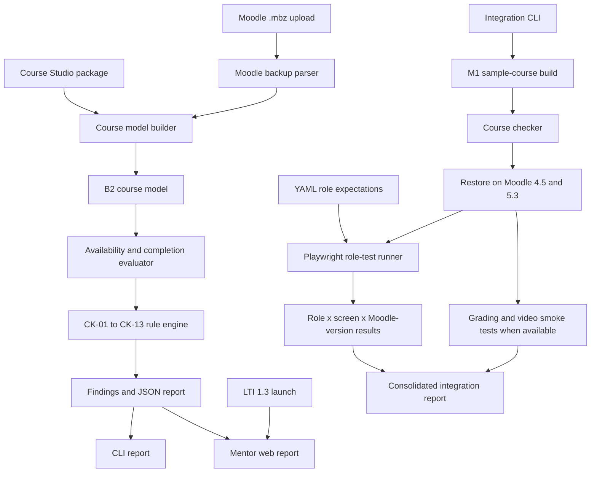

# Design document: Course checker, role tests, integration harness


**Module:** checker
**Owner:** @shraddha0103 · **Peer reviewer:** @Harshithamanjunatha (independent review; this version was drafted by @Akshita21-09 for the owner, PR #148)
**Release(s):** Release 1 (core); harness extended each later release
**Status:** Draft
**Contract decisions:** B2 decision record `docs/decisions/0003-b2-course-model.md`, item 21 (CK-07 reference model; see risk 11 in section 12).

## 1. Purpose and scope

The Course Checker identifies course-design errors before learners encounter them, verifies what different user roles can and cannot access through a real browser, and runs an integration test of the LearnOps toolkit. It checks course structure, activity availability, completion rules, grading totals, and other defined validation rules, then produces reports describing detected problems and suggested fixes. It also runs browser-based role tests across three screen profiles and Moodle versions 4.5 and 5.3. As integration lead, this module provides a single-command harness that builds a sample course, checks it, restores it on both Moodle versions, runs role tests, and generates a consolidated report.

**PRD chapter and goals served:** Part C, Section C2 — Course Checker. The module supports Release 1 (core), with the integration harness extended in subsequent releases. Its goals include detecting planted course-design errors without false positives, validating role permissions across screen profiles and Moodle versions, and verifying end-to-end integration.

**Out of scope:** Automatically fixing course errors, load testing, and checking quiz or workshop settings. The checker reports problems and suggests fixes; it does not automatically modify courses.

## 2. Requirements covered

| Requirement | Release | Approach in one line | Main components |
|---|---|---|---|
| FR-C-01 | R1 | Convert Moodle `.mbz` backups and Course Studio packages into the normalised B2 course model. | Backup parser, package reader, course-model validator |
| FR-C-02 | R1 | Simulate learner progression through sections and activities using availability and completion rules, identifying unreachable items. | Availability evaluator, completion-rule evaluator, path simulator |
| FR-C-03 | R1 | Apply CK-01 through CK-13 validation rules and report severity, explanation and suggested fix for every finding. | Rule catalogue, rule engine, report generator |
| FR-C-04 | R1 | Generate human-readable web and CLI reports plus machine-readable JSON, using the standard CLI exit codes. | Web report, CLI, JSON serializer |
| FR-C-05 | R1 | Compare two normalised course models and report differences in structure, rules and grading points. | Course-model diff engine |
| FR-C-06 | R1 | Run Playwright browser tests for five roles, three screen profiles and Moodle 4.5 and 5.3. | Playwright runner, role fixtures, screen profiles |
| FR-C-07 | R1 | Store per-course role expectations in YAML and test both permitted and prohibited access. | YAML expectation loader, assertion engine |
| FR-C-08 | R1; extended each later release | Provide one integration command to build, check, restore, test roles and run available grading/video smoke tests, producing one report. | Integration CLI, M1 build interface, Moodle test environments, Playwright, report aggregator |
| FR-C-09 | R1 | Provide a mentor-facing web interface launched through LTI to check a Course Studio package or mentor-uploaded Moodle backup. | LTI gateway, upload validation, checker service, report view |

All nine functional requirements are included. The implementation must also meet the acceptance criteria in PRD §C2.7.

## 3. Architecture

### 3.1 Component overview

The Course Checker consists of a shared checking library, a CLI, a mentor-facing web interface, a browser-role-test runner and an integration harness.



### 3.2 Component responsibilities

- **Course-model builder:** Reads a Course Studio package or parses a Moodle backup and produces the B2 normalised course model. For package models, it copies the package's declared `total_points` into `course.total_points`. For an `.mbz` model, including a merged course, it receives the independently declared target as a separate input and writes that value to `course.total_points`; it never derives the target from the gradebook items. A merged course remains `source.kind = mbz`.
- **Rule engine:** Applies the defined validation rules to the course model. Each finding includes a rule ID, severity, message and fix hint.
- **Availability evaluator:** Evaluates Moodle availability and completion rules and simulates whether a learner can reach each section and activity.
- **Course-model diff:** Compares two course models for structural, rule and point differences.
- **CLI:** Supports course checking, model comparison and integration-test execution.
- **Mentor web interface:** Accepts supported course inputs and displays findings grouped by severity, with links to the affected item and suggested fixes.
- **Role-test runner:** Uses Playwright, fixed test accounts and YAML expectations to test permitted and prohibited access.
- **Integration harness:** Coordinates sample-course generation, checking, restoration, role tests and available module smoke tests.

#### CK-03: independent grading target

CK-03 compares the sum of graded activity points with an independent course target. It must not use the computed gradebook total as its own target.

- **Package model (`source.kind = package`):** use the package's declared `total_points`. If it is absent or null, use the B1 default of 100.
- **Moodle backup model (`source.kind = mbz`):** use `course.total_points` only when the model builder was supplied an independent target. This includes merged courses; the merged target is supplied separately to the builder and written into `course.total_points`. The merged course remains `source.kind = mbz`.
- **No independent target:** if an `.mbz` model has no independently supplied target, `course.total_points` remains absent or null and CK-03 returns `cannot judge`. Do not apply the package default of 100 and do not infer a target from gradebook items.
- **Calculation:** sum `grade_item.max_grade` across graded activities and exclude ungraded activities. Compare that sum with the independent target. A matching sum is `pass`; a mismatch is `finding`.
- **Report:** include the target, calculated sum, difference and the grade items counted.
- **Open (not decided):** how to compare when points are not integers (exact, rounded to a precision or within a tolerance) is not specified and no rule is implemented. This section says `cannot judge` where risk 11 and PRD C2.8 say `not checked`; whether these are one report state or two is not decided. See decision 0003, section 3.

For a merged course, the final project is part of the course and counts in the graded sum. The intended merged total must be declared independently before the test when the merged package adds graded points. The builder's exact API/input mechanism remains an implementation detail to be specified when FR-C-01 is designed; this document does not invent a CLI flag or another source for the target.

### 3.3 Execution boundaries

The shared checker library performs parsing, validation and model comparison. The web interface handles requests and presents results. The CLI supports local and CI execution. Browser automation runs through Playwright against dedicated lab Moodle instances.

Long-running integration tasks must execute outside web request handlers, in accordance with PRD OPS-10.

The module interacts with Moodle through supported backup files, Moodle's standard web-services API, LTI 1.3 and browser automation for tests. It must not modify Moodle's source code, database directly or install Moodle plugins.

### 3.4 Rule catalogue CK-01 to CK-13 (FR-C-03)

PRD §C2.3 names the thirteen rules and says each has an id, a severity, a message and a fix hint. It gives
**only the rule names**. Everything below that is not the PRD name is a **Proposal** for the guide: the
trigger written in B2 terms, the severity, the message and the fix hint. The rule names are copied from
the PRD unchanged. Every rule reads only the B2 course model (decision 0003); none reads the raw `.mbz`
or package.

**Severity (decided by the guide, §12 item 12).** In v1 every rule is an **error**: each one enforces a PRD rule
(B1.2, B1.3, B1.4, B7, C-08, C-09) whose breach either stops a learner, gives a wrong grade or breaks
a protected item. No rule is a warning in v1. The report still groups by severity (C2.4), so a later
warning-level rule is an additive change. If a mentor finds a rule too strict in use, its severity is
changed through this design, never in code.

**Report state per rule (§3.6).** For each rule and each item it applies to, the result is `pass`,
`finding` or `not checked` (the last when the model lacks the data: a null value, decision 7, or a
package model without completion or badge data). A `not checked` is listed in the report and is never
counted as a pass.

**Messages** follow UI-05: what happened, naming the item, then what to do. `{title}`, `{idnumber}` and
`{section}` are filled from the model; an item without an `idnumber` is named by its title and section
number.

| Rule (PRD name) | Triggers when (B2 terms) | Input it can judge | Message (Proposal) | Fix hint (Proposal) |
|---|---|---|---|---|
| **CK-01** Unreachable section or activity | The path simulation (§3.5) **proves** the section or activity can never open for a learner: its availability, or its section's, evaluates to `false`, and no CK-04, CK-05 or CK-13 finding explains why (then the item is listed as unreachable, "explained by CK-0x", and is not a CK-01 finding: "Rules that fire together" below). An item whose availability is `unknown` (an unsupported or grade condition, `visible: null`, unknown completion of the item it waits for) is `not checked`, never CK-01. An item with `visible: false` is hidden on purpose and is not CK-01 | Package and `.mbz` | "{title} ({idnumber}) in section {section} can never be reached by a learner: its access condition can never be met." | "Change the access condition of {title}, or of the item it waits for, so a learner who works through the course in order can reach it." |
| **CK-02** Completion rule that can never be met | An activity's `completion` asks for something the activity cannot give: `use_grade` or `pass_grade` with `grade_item` null; `submit` on a type with no submission (for example `page`, `url`, `label`) | Package and `.mbz` | "{title} ({idnumber}) can never be marked complete: its completion rule asks for {condition}, which this activity does not have." | "Change the completion rule of {title} to one the activity supports, for example 'view' for a page, or add the missing grade item." |
| **CK-03** Graded points ≠ target total | The sum of `grade_item.max_grade` over graded activities differs from the independent target `course.total_points` (rules in §3.2 "CK-03: independent grading target") | Package always; `.mbz` only with an independent target, else `not checked` | "The graded activities add up to {sum} points, but the course target is {target} (difference {difference})." | "Change the points of the graded activities, or the course target, so they are equal. Graded items counted: {list}." |
| **CK-04** Unlock rule refers to a missing activity | An `availability` completion condition names a `cm` that is no activity in the model, or a `cm = -1` (previous activity) that resolves to nothing (decision 5) | Package and `.mbz` | "The access condition of {title} ({idnumber}) waits for an activity that is not in the course." | "Point the condition at an activity that exists in this course, or remove the condition." |
| **CK-05** Circular unlock rules | The availability completion conditions form a cycle: A waits for B and B, directly or through others, waits for A | Package and `.mbz` | "{title list} wait for each other in a circle, so none of them can open." | "Remove one condition from the circle so at least one of these items opens first." |
| **CK-06** Duplicate or invalid idnumber | Two sections or activities share one `idnumber`, or an `idnumber` does not have the B1.2 rule 6 form (lowercase letters and digits joined by single hyphens) | `.mbz`. A package with a duplicate or invalid `idnumber` fails B1 first and is reported as the B1 error, not CK-06 (boundary below). An activity with a null `idnumber` is an open question (§12 item 14) | "The idnumber '{idnumber}' is used by {count} items: {items}." / "'{idnumber}' on {title} is not a valid idnumber." | "Give every item its own idnumber of lowercase letters and digits joined by hyphens, for example wk-02-task." |
| **CK-07** Protected item missing, duplicated or changed | Compared with the supplied reference model of the B8.1 template (decision 0003 #21): a protected `idnumber` (`final-project`, `course-feedback` or a configured one) is absent, appears twice, or differs field by field (as FR-C-05), including the course completion criteria and the badge | `.mbz` with `--reference-model`; without it, `not checked` for the comparison (risk 11). Missing or duplicated is still judged by `idnumber` | "The protected item {idnumber} is {missing / present {count} times / changed: {field} was {old}, now {new}}." | "Restore the protected item from the template course. LearnOps never generates or changes protected items (PRD B1.4)." |
| **CK-08** Course completion or badge criteria refer to missing items | A `course_completion.criteria` entry or a `badges[].criteria` entry names a `cmid` or `idnumber` that is no activity in the model. The **proposed B8.3 case, pending guide approval,** changes one criterion's `cmid` to a value absent from the course model and leaves `idnumber` absent; it does not delete an activity | `.mbz`; package models have `course_completion` and `badges` null, so `not checked` (B8.2 answer A7) | "The {course completion / badge '{name}'} criteria name {idnumber or cmid}, which is not in the course." | "Point the criteria at activities that exist, or remove the stale criterion." |
| **CK-09** Assignment without a valid marking table, or marking-table points ≠ assignment points | An `assignment` has `marking_table.present` false, or `marking_table.points_total` differs from `grade_item.max_grade` (decision 15). What makes a table "valid" beyond presence and points is open (§12 item 15) | Package and `.mbz` (the builder fills `marking_table`) | "{title} ({idnumber}) has {no marking table / a marking table worth {table} points but is graded out of {points}}." | "Add a marking table to the task description (PRD B1.3), with rows that add up to the assignment's points." |
| **CK-10** Assignment without marking workflow | An `assignment` has `marking_workflow` false. Null is `not checked` (decision 7; package models, §12 item 16) | `.mbz`; package models `not checked` until §12 item 16 is decided | "{title} ({idnumber}) does not use marking workflow, so a saved grade can reach learners before a mentor releases it." | "Turn on 'Use marking workflow' in the assignment's grade settings (PRD B1.2 rule 4, C-09)." |
| **CK-11** Practice (H5P) activity with a grade item | An activity of `type` `h5p` has a non-null `grade_item` | Package and `.mbz` | "The practice activity {title} ({idnumber}) has a grade item; practice must stay ungraded." | "Remove the grade from the H5P activity (set its grade type to none). Practice is never graded (PRD B7)." |
| **CK-12** Media referenced by a full fixed URL instead of a relative path | **Scope decided by the guide ([issue #232](https://github.com/narenccode/learnops/issues/232#issuecomment-7176861868), item 6; B2 `media_refs` description, decision 0003 #16):** the embedded-media scope listed below is the v1 definition; `data:` URIs are not flagged; Moodle `@@PLUGINFILE@@/...` references pass; ordinary links (including PDF links) and `iframe` embeds are not checked in v1; one shared extractor in the FR-C-01 model builder, reused by Course Studio. **Extraction and flagging are two steps.** *Extraction, as confirmed by Akshita as the affected M1 owner ([issue #232 comment](https://github.com/narenccode/learnops/issues/232#issuecomment-7183976351)):* `media_refs` lists every in-scope embedded-media reference as written, including relative paths, `@@PLUGINFILE@@/...` references and `data:` URIs, and each URL of an `srcset` is its own entry. The guide's decision does not state this listing in so many words. *Flagging, as in the guide's list:* CK-12 flags a listed reference only when it is `http://`, `https://` or a protocol-relative reference beginning `//host/`. Relative paths, `@@PLUGINFILE@@/...` references and `data:` URIs are listed but not flagged. Other URI schemes are an open decision (decision 0003, section 3); this row adds no rule for them. If `media_refs` is absent, `not checked` (decision 16). The v1 scope covers Markdown images (including reference-style images); HTML `img` (`src`, `srcset`), `video` (`src`, `poster`), `audio`, `source` (`src`, `srcset`) and `track` elements in activity bodies, including HTML bodies from `.mbz` backups. Ordinary links (including PDF links) and `iframe` embeds are not in scope: they are not listed and not checked in v1. The extractor (one implementation in the FR-C-01 model builder, reused by Course Studio) is not implemented. The shared test vectors (24 cases) are in `contracts/test-vectors/media-refs.v1.json`, checked by `libs/contracts/tests/test_media_refs_vectors_v1.py`; the extractor and CK-12 must pass them. They keep the two steps apart: extraction lists every in-scope reference as written (Akshita's listing interpretation), and flagging is limited to the decided forms. One point is left open: whether CK-12 flags a URI scheme other than `http:`, `https:` and `data:` (decision 0003, section 3). Akshita's formal approval of the B2 `/contract-change` is given on the pull request. | Package and `.mbz` when the builder fills `media_refs` | "{title} ({idnumber}) refers to media by a full address: {url}." | "Store the media file with the course and refer to it by a relative path, for example media/week-01/diagram.png (PRD C-08)." |
| **CK-13** Activity used in an unlock rule without completion tracking | An activity is named by an availability completion condition with an explicit `cm`, and its `completion.tracking` is `none`. **Null:** B2 requires `completion.tracking` on every activity (`none`, `manual` or `automatic`), so it is never null in a valid model; a source the builder cannot read gives no model (§10), not a CK-13 result. **Unsupported activity types:** CK-13 reads only `completion.tracking`, which every activity has whatever its type, so it applies to types outside the B1 mapping too (decision 0003: "not checked" covers type-specific rules only). **`cm = -1`:** not CK-13, because it skips untracked activities by definition (decision 5); an unresolved `-1` is CK-04 | Package and `.mbz` (a package cannot plant it, §11.3) | "{title} ({idnumber}) unlocks {dependants} but has no completion tracking, so it can never count as complete." | "Turn on completion tracking for {title} (PRD B1.2 rule 5)." |

**Small examples that trigger each rule** (B2 fragments; only the fields that matter; `cm` values are
the `cmid` of another activity in the same model):

| Rule | Example |
|---|---|
| CK-01 | An activity with `availability: {"op": "&", "c": [{"type": "date", "d": "<", "t": 1577836800}]}` (only before 1 January 2020): no learner can reach it now |
| CK-02 | `{"type": "page", "completion": {"tracking": "automatic", "submit": true}}`: a page has no submission |
| CK-03 | `course.total_points: 120` with graded `max_grade` values 25 + 25 + 25 + 25 = 100 |
| CK-04 | A condition `{"type": "completion", "cm": 999, "e": 1}` where no activity has `cmid` 999 |
| CK-05 | Activity A (`cmid` 3) waits for `cm` 7, and activity B (`cmid` 7) waits for `cm` 3 |
| CK-06 | Two activities with `idnumber: "wk-01-task"`, or one with `idnumber: "Week 1 Task"` |
| CK-07 | The reference model has `final-project` with `max_grade` 100; the checked model has it with 80, or has no `final-project` |
| CK-08 | `course_completion.criteria: [{"type": "activity", "idnumber": "old-quiz"}]` and no activity `old-quiz` |
| CK-09 | `{"type": "assignment", "grade_item": {"max_grade": 25}, "marking_table": {"present": true, "points_total": 20}}` |
| CK-10 | `{"type": "assignment", "marking_workflow": false}` |
| CK-11 | `{"type": "h5p", "grade_item": {"max_grade": 10}}` |
| CK-12 | `media_refs: ["https://example.invalid/media/diagram.png"]` |
| CK-13 | Activity B waits for `{"type": "completion", "cm": 4}`, and activity 4 has `completion: {"tracking": "none"}` |

**Rules that fire together: the root cause is reported once (decided by the guide, §12 item 13).** A
cycle (CK-05), a missing target (CK-04) or an untracked activity (CK-13) also leaves the waiting item
unreachable. That item is still listed as unreachable, with its cause (FR-C-02), but it is **not** counted
as a separate CK-01 finding: its report line says "explained by CK-0x" (§3.6). The mentor fixes one thing
and sees why. CK-01 is reported as its own finding only when no CK-04, CK-05 or CK-13 finding explains
the item, for example a date window that has already closed. The alternative, reporting CK-01 as well,
was not chosen because it doubles the findings for one cause.

How "explains" is traced (Proposal): an unreachable item is explained by CK-0x when every condition that
makes its availability, or its section's, `false` is `false` only because of that finding: the condition
names a missing activity (CK-04), is part of a cycle (CK-05), or names an activity whose
`completion.tracking` is `none` (CK-13), directly or through an item that is itself explained. If any
`false` part has another cause, the item is a CK-01 finding. An item explained by more than one finding
lists each of them.

**Boundary between B1 validation and CK rules (decided: the guide confirmed this proposal, §12 item 17).**
A package is first checked by the shared B1 validator (`libs/contracts`), as the B.0 rule 4 asks of
every contract document. Then:

- **The package fails B1** (any `report.errors`): the run reports **only** the B1 validator's errors,
  with their own code and rule (for example `duplicate_idnumber`, B1.2 rule 6; `body_file_missing`,
  B1.1), and no B2 model is built. Every CK rule is listed once as `not checked` with the reason "the
  package failed B1 validation". The exit code is `1`. No CK finding is ever reported for a package
  that fails B1, so the same package always gives the same result.
- **The package passes B1:** the builder makes the B2 model and every CK rule runs on it.
- **An `.mbz`** has no B1 step: the builder makes the B2 model directly, and every CK rule runs.

So a duplicate `idnumber` **in a package** is always the B1 error `duplicate_idnumber`, never CK-06,
because B1.2 rule 6 already rejects it. CK-06 is the rule for models built from an **`.mbz`**, where no B1
step ran, and for the "invalid form" half of the rule there. The B8.3 expectations (§11.3) follow this.

### 3.5 Learner-path simulation (FR-C-02) (Proposal)

The simulation answers one question for CK-01: can a learner who works through the course reach each
section and activity? It never guesses. Every answer is one of three values, and only a **proven** "no"
becomes a finding:

| Result for an item | Meaning | Reported as |
|---|---|---|
| **reachable** | A learner can open it, shown step by step | `pass` |
| **unreachable** | Every way to open it was evaluated, and none can ever be met | CK-01 `finding`; or, when a CK-04, CK-05 or CK-13 finding explains it, listed as unreachable "explained by CK-0x" and not counted as a CK-01 finding (§3.4, §12 item 13) |
| **unknown** | Opening it depends on something the simulation cannot evaluate (below) | `not checked`, with the reason; never CK-01 |

**Conditions (three-valued).** Each availability condition evaluates to `true`, `false` or `unknown`:

- **Date: evaluated over time, not only on the run date.** The question is "can this condition ever be
  true on or after the run date?", because a course is used over weeks:
  - `from t` (`d` is `>=`): it becomes true at `t` and stays true, so it can be met: `true` for
    reachability, even when `t` is still in the future. A future start date is never CK-01.
  - `until t` (`d` is `<`): `true` if `t` is after the run date; `false` if `t` has already passed,
    because it can never become true again (the window has closed).
  - Several date conditions joined by `&` are `false` only when their windows cannot overlap at any time
    on or after the run date (for example `from 1 March` and `until 1 February` of the same year, or an
    `until` date already passed); otherwise `true`.
  - Any other combination the simulator cannot settle this way (for example dates inside a negated group,
    or a date window mixed with conditions that can only be met before it closes) is `unknown`, never
    `false`.
- **Activity completion** (including `cm = -1`, decision 5): `true` once the named activity is
  *completed* in the simulation; `false` when it can never be completed (below); `unknown` when its
  completion is unknown. A `cm` that names no activity is `false` (and CK-04).
- **Any other condition type** (grade, group, grouping, user profile, a negated group `!&` or `!|`, or a
  type the builder does not recognise): `unknown`. Grade conditions stay `unknown` because the simulated
  learner has no grades (§12 item 18).
- **Operators:** `&` is `false` if any part is `false`, otherwise `unknown` if any part is `unknown`,
  otherwise `true`. `|` is `true` if any part is `true`, otherwise `unknown` if any part is `unknown`,
  otherwise `false`. So an unsupported condition next to a proven-false one still proves the item
  unreachable, and an unsupported condition never makes an item unreachable by itself.
- **`visible`:** `false` keeps the item closed to learners on purpose. That is not CK-01, because the
  author chose it. `null` makes the item `unknown` (decision 7).

**Completion is simulated only when its conditions can really be met** by a learner with no help from a
mentor:

| `completion.tracking` | Completed in the simulation when the activity is open, and… |
|---|---|
| `none` | never: it can never count as complete (dependants are then `false`; CK-13) |
| `manual` | always: the learner ticks it themselves |
| `automatic` | every condition that is set can be met by the learner alone: `view` yes; `submit` yes for an `assignment`, and `unknown` for a type outside the B1 mapping (decision 6); `use_grade` or `pass_grade` `unknown`, because a mentor gives the grade; no condition set at all `unknown`. One `unknown` condition makes the completion `unknown`. A condition the activity can never meet is CK-02 and makes the completion "never" |

**Loop.** Start with an enrolled learner, nothing completed, no grades, on the run date. Repeatedly mark
items open (all conditions of the section and the activity `true`) and completed (table above) until
nothing changes. An unreachable activity can never be completed, and one whose reachability is unknown has
unknown completion; both feed back into the conditions that name them, so the loop repeats until neither
the open set nor the never-completed set changes. Then every item is **reachable** (it opened),
**unreachable** (its availability, or its section's, is proven `false`) or **unknown** (anything else).

### 3.6 Report states and output (FR-C-04) (Proposal)

**One run, three outputs:** the CLI report, the mentor web report (§6.1) and JSON, all from the same
result. Findings are grouped by severity (C2.4); each shows the rule id, severity, message, fix hint and
the affected item (section number, title, `idnumber`, and a link in the web report).

**Unreachable items explained by another finding (§3.4, §12 item 13).** They are listed under the finding
that explains them, never as a separate CK-01 finding, and are not counted in `summary.errors`. The CLI
and web line reads, for example: "Week 3 (wk-03) cannot be reached: explained by CK-04." In JSON they are
in `unreachable_explained` (field name a Proposal, §12 item 19).

**JSON (Proposal; field names to be fixed before FR-C-04 starts, §12 item 19):**

```json
{
  "checker_version": "0.1.0",
  "input": {"kind": "package", "name": "sample-course"},
  "summary": {"errors": 1, "warnings": 0, "not_checked": 2},
  "findings": [
    {"rule": "CK-03", "severity": "error",
     "message": "The graded activities add up to 100 points, but the course target is 120 (difference 20).",
     "fix_hint": "Change the points of the graded activities, or the course target, so they are equal.",
     "item": {"section": null, "idnumber": null, "title": null}}
  ],
  "unreachable_explained": [],
  "not_checked": [
    {"rule": "CK-08", "reason": "The package model has no course completion or badge data."}
  ]
}
```

With a CK-04 finding on week 3, `unreachable_explained` holds one entry instead of a CK-01 finding:

```json
{"item": {"section": 3, "idnumber": "wk-03", "title": "Week 3"}, "explained_by": ["CK-04"]}
```

The JSON never contains file contents, tokens or personal data (§9.3).

**Exit codes (OPS-05):** `0` = no error finding; `1` = at least one error finding; `2` = the checker
could not run (for example an unreadable input or bad configuration, §10). Whether `not checked` items
affect the exit code, and whether `cannot judge` (decision 25) and `not checked` (C2.8, risk 11) are one
state or two, is decision 0003's open question and is still open (§12 item 20).

## 4. Contracts

| Contract | Provided / used | Fields or functions I rely on | Change needed? |
|---|---|---|---|
| B1 — Course package | Used | Course metadata, sections, activities, IDs, availability, completion, points and activity content references | None planned |
| B2 — Course model | Provided and used | Course metadata, sections, activities, availability, completion, grade items, marking workflow, protected items and badges. The fields each CK rule reads are in §3.4 | None: the schema is merged (`contracts/course-model.v1.schema.json`, #46); its decisions are in `docs/decisions/0003-b2-course-model.md`, with the items still open listed there |
| B3 — LTI 1.3 launch | Provided as integration lead | Subject, role, context, resource link and deployment identity; validated launch and course binding | No change planned |
| B4 — Moodle web services | Used | Course lookup and course-structure retrieval through approved functions | None planned |
| B6 — Media paths and lesson manifest | Used | Relative media paths needed to detect CK-12 violations | None planned |
| B7 — H5P practice output | Used | H5P activity type and grading information needed for CK-11 | None planned |
| B8 — Test data sets | Used | B8.1 template (its B2 model is CK-07's reference), B8.2 clean sample (zero findings expected), B8.3 planted errors (the mapping is §11.3) | None to the contract; the B8.3 variants still to build are listed in §11.3 |

B2 and B3 are provided by this module, with B3 owned as part of the integration-lead responsibility. The other listed contracts are dependencies.

Every contract payload must be validated against its authoritative schema. After Release 0, contract changes must be additive and optional unless the approved contract-change process permits otherwise.

## 5. Data model

The PRD specifies two module records: `checker.run` and `checker.role_run`.

### 5.1 `checker.run`

Records an individual course-checking or comparison run.

| Field | Proposed type | Purpose |
|---|---|---|
| id | UUID | Unique run identifier |
| input | JSON | Input type and safe reference to the source package or backup |
| version | String | Checker version used |
| results | JSON | Findings, rule IDs, severity, messages and fix hints |
| status | String | Run state, including success or failure |
| created_at | Timestamp | Run creation time |

### 5.2 `checker.role_run`

Records a role-test run and its results matrix.

| Field | Proposed type | Purpose |
|---|---|---|
| id | UUID | Unique role-run identifier |
| matrix | JSON | Results by role, screen profile and Moodle version |
| artefacts | JSON | References to failure screenshots and other test artefacts |
| status | String | Overall test-run state |
| created_at | Timestamp | Run creation time |

These field definitions are a proposed starting point, not a claim that the database schema already exists. Confirm types and mandatory fields during implementation.

### 5.3 Storage and migrations

- Store structured results as JSON where appropriate, with stable identifiers for each run.
- Store references to source inputs and test artefacts rather than duplicating large files in database records.
- Keep uploaded files and test artefacts outside the public web root.
- Do not store passwords, access tokens or secrets in run records.
- Use versioned, reversible database migrations as required by OPS-07.
- Document backup, restoration and undo procedures in the module README.

**For `docs/data-map.md` (SEC-06; added with the implementing pull request):** uploaded `.mbz` files and
packages (kept in `CHECKER_UPLOAD_DIR` until checked, then deleted); `checker.run` results (findings
name course items, never people); `checker.role_run` results and failure screenshots, which show only
the fixed test accounts; the LTI identity (`iss`, `sub`, context id) of the mentor who started a web run.
No name or email is stored (B3 §10.1), and nothing is sent to an AI provider (SEC-07).

The checker does not need to store media URLs for playback. When it detects fixed media URLs, it reports them as validation findings; the expected course representation uses relative paths.

## 6. Interfaces

### 6.1 Mentor web interface

The mentor interface is opened through an authenticated LTI launch.

It must allow an authorised mentor to check a Course Studio package or upload a Moodle `.mbz` backup created through Moodle's own Backup page.

The interface must:

- Display findings grouped by severity.
- Identify the affected section or activity.
- Show the rule ID, explanation and suggested fix.
- Display role-test results as a matrix of role, screen profile and Moodle version, including screenshots for failures.
- Restrict access to the course context associated with the authenticated LTI session.

Exact HTTP route names and request/response schemas will be recorded after the shared application routing conventions are confirmed. They must not be invented independently of the repository's existing contracts.

### 6.2 CLI

Proposed command structure:

```text
checker check <input> [--reference-model <path>] --config <file>
checker diff <model-a> <model-b> --config <file>
checker roles --config <file>
checker integration --config <file>
```

Each command must support the common CLI options:

```text
--dry-run
--check
--config <file>
```

Expected behaviour:

- `--dry-run`: Print the intended operations without making changes.
- `--check`: Perform read-only validation; exit with code `0` if no problems are found, `1` if problems are found and `2` for an execution error.
- `--config`: Read configuration from the specified file.
- `--reference-model <path>` (`checker check` only): supplies the B2 course model of the B8.1 template course, built from its `.mbz` backup. CK-07 uses it to compare protected items field by field (decision 0003 #21). If it is absent, CK-07 cannot perform that comparison. The resulting report state and wording remain subject to the open question in decision 0003, section 3. Planned, not implemented.
- Normal execution: Perform the requested operation and save the results.

The exact subcommand names are proposed and must be aligned with the repository's existing CLI conventions before implementation.

### 6.3 Undo and recovery

Course checking and model comparison are read-only and need no data rollback. Planned design: `--reference-model` only reads the model file it is given, writes nothing and needs no undo; this is not yet implemented or tested.

Every command records what it creates, so its undo removes exactly that and nothing else (Proposal):

| Command | What it creates | `--dry-run` | Undo |
|---|---|---|---|
| `checker check`, `checker diff` | A `checker.run` row (web and harness runs only); nothing on Moodle | Prints the input and the rules it would run; writes nothing | Nothing to undo for the CLI. A stored run is removed with `checker runs delete <run-id>`, which deletes its row and any upload it kept |
| `checker roles` | A `checker.role_run` row and screenshots in `CHECKER_ARTEFACT_DIR`. The **fixed test accounts** are made once by the setup script (PRD §C2.5), not by this command | Prints the roles, profiles and sites it would test; opens no browser | `checker runs delete <run-id>` removes the row and its screenshots |
| Test-account setup script | The fixed test accounts on each lab Moodle, made through the browser as the lab administrator (B4 has no user-creation function, and Moodle is never changed) | Prints the accounts it would create; creates none | `--remove` deletes only the accounts listed in its own record of created accounts, never any other account. Running it twice creates nothing new |
| `checker integration` | Courses restored on the lab sites, a harness report and artefacts. Each restored course is written to the run record (site, course id, time) when it is created | Prints the stages, sites and courses it would create; restores nothing | `checker integration --undo <run-id>` deletes exactly the courses in that run's record (through the browser, as an administrator), then the artefacts. It never touches the template course or a mentor's course. A course it cannot delete is listed for manual removal |

`checker runs delete` and `checker integration --undo` support `--dry-run` (list what would be removed)
and `--check` (exit `1` if anything recorded is still present). The harness never modifies a mentor's
live course.

### 6.4 Configuration

All configuration must be supplied through environment variables or the supported configuration file. `.env.example` must document every required variable with a safe default or placeholder.

Proposed variables (Proposal; each is added to `.env.example` with a placeholder in the pull request
that first reads it). Names use the `CHECKER_` prefix, so nothing collides with `libs/lti`
(`LTI_*`, `GATEWAY_*`) or `libs/moodle_ws`, which keep their own variables.

| Variable | Purpose | Placeholder in `.env.example` | First used by |
|---|---|---|---|
| `CHECKER_DATABASE_URL` | PostgreSQL connection, schema `checker` (§5) | `postgresql://checker:CHANGE_ME@db:5432/learnops` | FR-C-04, FR-C-09 |
| `CHECKER_UPLOAD_DIR` | Where uploaded `.mbz` files wait until checked; outside any web root (SEC-05) | `/var/lib/learnops/checker/uploads` | FR-C-09 |
| `CHECKER_MAX_UPLOAD_MB` | Size limit of an uploaded `.mbz` or package (SEC-05) | `50` | FR-C-01, FR-C-09 |
| `CHECKER_MAX_UNPACKED_MB`, `CHECKER_MAX_ARCHIVE_ENTRIES` | Zip-bomb limits when a backup is unpacked (§9.2) | `500`, `20000` | FR-C-01 |
| `CHECKER_ARTEFACT_DIR` | Role-test screenshots and harness reports | `/var/lib/learnops/checker/artefacts` | FR-C-06, FR-C-08 |
| `CHECKER_MOODLE45_URL`, `CHECKER_MOODLE53_URL` | The two lab Moodle sites for role tests and the harness | `https://moodle45.lab.invalid`, `https://moodle53.lab.invalid` | FR-C-06, FR-C-08 |
| `CHECKER_TEST_ACCOUNTS_FILE` | Path to the file with the fixed test accounts' usernames and passwords; the file lives outside the repository (C-06) | `/run/secrets/checker_test_accounts.yaml` | FR-C-06 |
| `CHECKER_HARNESS_TIMEOUT_SECONDS` | Limit for one harness stage | `1800` | FR-C-08 |
| `CHECKER_TEMPLATE_MODEL` | **Reserved, not read.** Only if the guide approves a default under §12 item 21; until then the checker ignores it | (not listed until the guide decides) | — |

**CK-07's reference model is given per run.** As decision 0003 #21 says, a run names it with
`--reference-model <path>`; there is **no default**. Without the option, CK-07's comparison is `not
checked` for that run (risk 11). A default through `CHECKER_TEMPLATE_MODEL` exists only if the guide
approves it (§12 item 21). Secrets stay outside version control: the test-account
passwords are in the file that `CHECKER_TEST_ACCOUNTS_FILE` names, never in `.env.example`.

## 7. Key decisions and alternatives

| Decision | Alternatives considered | Why this one | Record |
|---|---|---|---|
| Use B2 as the internal course representation | Validate every input format separately | A shared model allows the same rules to apply to packages and Moodle backups | Create a decision record before implementation |
| Keep validation rules in a catalogue | Embed checks throughout parsing code | A catalogue makes rule IDs, severity, messages and fixes consistent and testable | Create a decision record before implementation |
| Use Playwright for role tests | Manual testing or a different browser automation tool | The PRD explicitly requires Playwright and repeatable browser tests | Create a decision record before implementation |
| Express role expectations as YAML | Hard-code role expectations in test functions | YAML keeps expected permissions separate from test execution and supports per-course configuration | Create a decision record before implementation |
| Produce one consolidated harness report | Separate unrelated reports for each stage | One report supports the required end-to-end acceptance check | Create a decision record before implementation |
| Keep web requests separate from long-running test execution | Run all testing synchronously in the web request | Separating heavy work prevents long-running tests from blocking the web interface | Create a decision record before implementation |

The decision records should be added under `docs/decisions/` using the repository's expected numbering and naming convention. Do not create arbitrary record numbers without checking existing records.

## 8. Libraries and licences

Proposed pins. Versions and licences were read from PyPI on 2026-11-20. Each line goes into the root
`requirements.txt` (runtime) or `requirements-dev.txt` (tests) in the pull request that first uses it,
with its licence as a comment (root `CLAUDE.md` rule 10). Where the repository already pins a package,
the same pin is used.

| Library | Pinned version | Licence (PyPI) | Why needed | Alternative |
|---|---|---|---|---|
| Python | 3.12 (PRD §A10) | PSF-2.0 | Runtime, `zipfile`, `json`, `argparse` | Not applicable |
| `defusedxml` | 0.7.1 | PSF-2.0 | Parse Moodle backup XML from an **untrusted** `.mbz` without entity-expansion or external-entity attacks (§9.2); wraps the standard library parser | The standard library alone is not safe for untrusted XML |
| `PyYAML` | 6.0.3 (already pinned in `requirements-dev.txt`) | MIT | Read role-expectation YAML (FR-C-07) and course packages (B1) with `safe_load` only | JSON expectations |
| `jsonschema` | 4.26.0 (already pinned) | MIT | Validate the B2 model and B1 packages against their schemas (B.0 rule 4) | None needed |
| `playwright` | 1.65.2 | Apache-2.0 | Browser automation for role tests (FR-C-06, PRD §A10) | None: the PRD fixes Playwright |
| `pytest-playwright` | 0.10.0 | Apache-2.0 | Runs Playwright role tests under pytest with fixtures per screen profile | Plain Playwright API calls from pytest |
| `pytest` | 9.1.1 (already pinned) | MIT | Unit, contract, dataset and harness tests | None needed |
| FastAPI and its server | The repository pins, once `libs/lti` adds them (#136 proposes `fastapi==0.116.1`, MIT) | MIT / BSD-3-Clause | Mentor web interface (FR-C-09) | None: the PRD fixes FastAPI |

All licences are allowed by PRD C-11 (MIT, BSD, Apache-2.0, PSF-2.0). Playwright downloads browser
binaries at install time; they are not Python packages and are not committed. Re-check each version for
known vulnerabilities when it is added (SEC-08).

## 9. Security and privacy

### 9.1 Applicable security requirements

| Requirement | Application to the Course Checker |
|---|---|
| SEC-01 | Validate LTI launches fully, including signature, issuer, audience, nonce, expiry and deployment ID, and **refuse a Learner launch** (EXT-07; module rule 7). This module owns B3 and `libs/lti` (module `CLAUDE.md`); the checker's web interface uses that shared gateway and never validates a launch itself. The LTI library choice is decision record `docs/decisions/0001-lti-library.md`, still **Proposed**: its library choice and its security design both need the guide's approval before `libs/lti` is merged (§12 item 23). |
| SEC-02 | Authorise every web request using the authenticated role and course context. Mentors may only access permitted course data; administrator capabilities follow the PRD. |
| SEC-03 | Use only the approved Moodle web-service functions. Store service-account credentials in environment configuration, never in source code or logs. |
| SEC-04 | The checker does not execute learner-submitted code as part of normal course validation. If the integration harness invokes grading tests, the grading module remains responsible for its required isolated sandbox. |
| SEC-05 | Validate uploaded backup size and file content, not only the extension. Reject unsupported or malformed inputs and store uploads outside the public web root until processed. |
| SEC-06 | Use only the approved synthetic test data in the lab. Do not collect unnecessary personal data. |
| SEC-07 | The Course Checker does not require an AI provider for its core validation or role testing. If future functionality sends data to a hosted AI provider, document the provider and data in `docs/data-map.md` first. |
| SEC-08 | Scan dependencies in CI and address known critical vulnerabilities before release. |
| SEC-09 | Protect state-changing web requests against CSRF and use secure, same-site cookies for LTI sessions. |

### 9.2 Untrusted input

Course packages, `.mbz` files, XML elements and YAML role expectations are untrusted inputs.

The checker must:

- Validate required structure and supported activity types.
- Reject malformed or unsupported input with a clear error.
- Avoid extracting archive contents to unsafe paths.
- Apply input-size limits and timeouts where appropriate.
- Avoid executing content embedded in uploaded files.
- Never silently skip an activity type that cannot be checked; report it as not checked.
- Avoid logging credentials, raw file contents or unnecessary personal information.

### 9.3 Logging and audit

Write structured logs to standard output. Include the available request ID, LTI subject, course context and action, without secrets or file contents.

Any state-changing operation must record the appropriate audit entry according to OPS-06. Read-only checking should not create unnecessary audit events beyond the agreed run records and operational logs.

## 10. Error handling

| Scenario | Expected behaviour | Recovery |
|---|---|---|
| Malformed or unparseable `.mbz` | Show a clear error naming the file and element when available | Correct the input and rerun |
| Invalid course package | Report the validation failure and affected field or item | Correct the package and rerun |
| Unknown activity type | Report the activity as not checked; never silently skip it | Add supported parsing or document the limitation |
| Invalid availability or completion rule | Report the relevant rule and affected item | Correct the course configuration |
| Validation finding | Include rule ID, severity, message and suggested fix | Mentor fixes the course manually |
| Moodle 4.5 or 5.3 unavailable | Mark the affected integration stage as failed | Restore service and rerun |
| Browser step fails | Retry once automatically; if it still fails, mark the test failed and capture a screenshot | Inspect the screenshot and rerun |
| Invalid role-expectation YAML | Show a configuration error with the affected file or field | Correct the YAML and rerun |
| CLI configuration missing or invalid | Return exit code `2` and a clear message | Correct the configuration |
| Course findings exist | Complete report generation and return exit code `1` for `--check` | Review findings and fix the course |
| Internal execution error | Return exit code `2`, log diagnostic context without secrets and mark the run failed | Investigate and rerun |

If Moodle is unavailable, the checker may still perform offline parsing and validation when the input is available, but browser-based role tests and restoration checks must be marked as blocked or failed. They must not be reported as successful.

The checker does not automatically repair a course or modify its live configuration.

## 11. Test plan

| Level | What is tested | Test data | Requirement IDs |
|---|---|---|---|
| Unit | Course-model parsing, availability evaluation, completion rules, each CK rule (one test per rule with the §3.4 example, plus a passing case), model comparison and report formatting | Small synthetic B2 fixtures, including valid courses and individual planted errors | FR-C-01–FR-C-05 |
| Unit (rules that fire together) | An item made unreachable by a CK-04, CK-05 or CK-13 finding is listed "explained by CK-0x" and is not a CK-01 finding; CK-01 still fires when no other rule explains the item (§3.4, §12 item 13). The B8.3 data already holds both cases: `test_ck_01_is_not_a_separate_finding_when_another_rule_explains_the_item` and `test_ck_01_fires_on_its_own_when_nothing_explains_the_item` (#201) | B2 fixtures; B8.3 `expected-findings.yaml` | FR-C-02, FR-C-03 |
| Dataset | The checker finds every planted error of B8.3 with the expected rule (§11.3) and nothing on B8.2 | B8.2, B8.3 | FR-C-03, C2.7 |
| Contract | B1 package parsing, B2 model validation, B3 launch handling, B4 lookup usage and B6/B7 fields relevant to CK-12/CK-11 | Valid and invalid contract examples from the repository | FR-C-01, FR-C-03, FR-C-05, FR-C-09 |
| Integration (harness) | Sample build, check, restoration on fresh Moodle 4.5 and 5.3, role tests and available module smoke tests | Approved B8 sample courses and lab Moodle environments | FR-C-08 |
| End-to-end | Mentor launches checker, submits a supported input, receives a report and can inspect findings; role matrix is generated | Synthetic course data and fixed lab accounts | FR-C-04, FR-C-06, FR-C-07, FR-C-09 |

### 11.1 Acceptance criteria

The test suite must demonstrate the following PRD §C2.7 criteria:

1. Detect **100% of the planted errors in B8.3**, with no false errors on B8.2.
2. Pass role tests for **5 roles × 3 screen profiles × 2 Moodle versions**, with at least one negative check per role.
3. Run the integration harness end to end from a clean state with one command and produce one report.

The role-test matrix must cover visitor, signed-in non-member, learner, mentor and administrator on all three screen profiles and both supported Moodle versions. The three profiles (PRD UI-02; module rule 3) are: **phone** 375×812; **laptop** 1366×768 at 100 %, 125 % and 150 % zoom; **half-screen** 683×768. Every role has at least one negative check (something it must not see or do).

### 11.2 Metrics

- **Detection rate:** Number of planted errors correctly detected divided by the total number of planted errors in B8.3.
- **False-positive rate:** Number of false findings on B8.2 divided by the total number of checks evaluated on the valid sample.
- **Role-test pass rate:** Passing required role/profile/version checks divided by total required checks.
- **Harness runtime:** Elapsed time from the start of a clean integration run until the consolidated report is produced.

Store test results and reports as CI artefacts where appropriate. Use synthetic data only. Record the environment and tool versions so results can be reproduced.

### 11.3 B8.3 planted-error mapping (waits for the design owner's confirmation)

**Status.** The guide decided the four points this mapping depended on (§12 items 12, 13, 17 and 22,
issue #112, 2026-11-23), and `testdata/b8-3-planted-errors/expected-findings.yaml` follows them (#201).
The mapping stays `mapping_status: proposed` until Shraddha, as design owner, confirms it.

PRD C2.7 asks the checker to find 100 % of the planted errors in B8.3 with no false error on B8.2. This
table is the **target mapping** from each CK rule to the planted error that tests it. It is not the
dataset. The dataset is B8.3 (PRD §B8: owner Student 2), started in #118 with four package variants;
the mapping is coordinated with Nagashree, who is preparing the dataset files. Each variant changes one thing from its applicable baseline: B8.2 for all variants except CK-07 and the proposed CK-08 case, which use the merged course with the B8.1 template. **B8.2 itself is never changed:** it stays the clean
baseline with zero findings.

| Rule | Planted error | Where it is planted | Input kind | Expected finding | Severity | Testable on its own? |
|---|---|---|---|---|---|---|
| CK-01 | Week 3 guide Page opens only before 1 January 2020 (a past date condition) | `.mbz`: the activity's availability. A package can only express `unlock.start_date`, which opens a section, never closes it | `.mbz` | CK-01 on the week 3 guide. No other rule explains it, so CK-01 is its own finding (§12 item 13) | error | Yes |
| CK-02 | Week 1 guide Page given the completion rule "submit" | Package: `course.yaml`, the week 1 guide Page gets `completion: submit` (the B1 schema allows `completion` on any activity type and requires it only on assignments) | Package | CK-02 on the week 1 guide | error | Yes, if nothing waits on that Page |
| CK-03 | `total_points` declared as 120; the graded tasks still add up to 100 | Package: `course.yaml` → `course.total_points` | Package | CK-03 (target 120, sum 100) | error | Yes: changing the target, not a task's points, avoids a CK-09 finding |
| CK-04 | Week 3 unlock waits for an activity that is not in the course | `.mbz`: the section's availability names a removed `cm`. In a package, the B1 validator already rejects an unknown `unlock.after` in full mode | `.mbz` | CK-04 on week 3. Week 3 is listed "explained by CK-04", not as a CK-01 finding (§12 item 13) | error | Yes |
| CK-05 | Week 2 waits for the week 3 task, and week 3 waits for the week 2 task | `.mbz`: change only Week 2's section availability from waiting for `wk-01-task` to waiting for `wk-03-task`; Week 3 already waits for `wk-02-task` in the B8.2 baseline. A package rejects a later reference (decision 0003 #23) | `.mbz` | CK-05 on weeks 2 and 3. Both are listed "explained by CK-05", not as CK-01 findings (§12 item 13) | error | Yes |
| CK-06 | Two activities share `wk-01-task`, and one activity has the idnumber `Week 1 Task` | `.mbz`: the activities' ID number fields (two variants, one change each) | `.mbz` (lab) | CK-06 on the two activities; CK-06 on `Week 1 Task` | error | Yes. The package variant `duplicate-id` (#118) is **not** a CK-06 case: it fails B1 and gives `duplicate_idnumber` (B1.2 rule 6) with every CK rule `not checked` (§3.4 boundary) |
| CK-07 | The Final project's points changed from 100 to 80 after the merge | `.mbz` of a merged course, checked with `--reference-model` (B8.1 model) | `.mbz` + reference model (lab) | CK-07: `final-project` changed, `max_grade` 100 → 80 | error | Yes. A package using `final-project` is rejected by B1 (#118 `protected-id`, `schema_not`): that is a B1 error, not CK-07 |
| CK-08 | **Proposed, pending guide approval:** one course-completion criterion is changed to a `cmid` absent from the merged course model; `idnumber` remains absent and no activity is deleted | Proposed `.mbz`-level XML edit to the completion criterion after creating the merged course with the B8.1 template. This is not a normal Moodle setting change; it is an explicit manual-backup-edit exception and must not be used until the guide approves the method | `.mbz` (lab) | CK-08 on the course completion criteria | error | Only if the guide approves the backup-edit method |
| CK-09 | Week 2 task's marking table rows add up to 20; the task is worth 25 | Package: `weeks/02-task.md`, one marking-table row | Package | CK-09 on `wk-02-task` | error | Yes: the B1 validator lists the marking table as not checked, so only CK-09 fires |
| CK-10 | Week 1 task with marking workflow off | `.mbz`: assignment grade settings | `.mbz` (lab) | CK-10 on `wk-01-task` | error | Yes |
| CK-11 | A week 1 practice H5P activity with a grade of 10 | `.mbz`: the H5P activity's grade. In a package, `graded: true` on an `h5p` item is rejected by the B1 schema (`graded` must be `false`, PRD B7): that is a B1 error, not CK-11 | `.mbz` (lab) | CK-11 on the practice item | error | Yes |
| CK-12 | Week 1 guide refers to an image by `https://example.invalid/diagram.png` | Package: `weeks/01-guide.md` body; the shared extractor in the FR-C-01 builder fills `media_refs` from it (scope decided, §12 item 19; the extractor is not implemented) | Package | CK-12 on the week 1 guide | error | Yes, once the builder's shared extractor exists (§12 item 19) |
| CK-13 | The week 1 task, which unlocks week 2, has completion tracking off | `.mbz`: the task's completion tracking. A package cannot say it: the B1 schema requires `completion: submit` on every assignment | `.mbz` (lab) | CK-13 on `wk-01-task`. Week 2 is listed "explained by CK-13", not as a CK-01 finding (§12 item 13) | error | Yes |

**The four variants already in #118** test the B1 step, not CK rules. Under the §3.4 boundary each gives
exactly one B1 error and every CK rule `not checked`, exit code `1`:

| #118 variant | Expected result (deterministic) |
|---|---|
| `missing-body` | `body_file_missing` (B1.1) |
| `invalid-mode` | `schema_enum` (B1.1) |
| `duplicate-id` | `duplicate_idnumber` (B1.2 rule 6) |
| `protected-id` | `schema_not` (B1.1; the B1.4 protected idnumber) |

They stay useful as checks that an invalid package is refused with a clear message (C2.8), and they are
the expected results of `answer.yaml`. The guide confirmed this boundary (§12 item 17), so the four
variants keep these expected results.

**What can be built without the lab:** the package variants (CK-02, CK-03, CK-09, CK-12). The `.mbz`
variants (CK-01, 04, 05, 06, 07, 08, 10, 11, 13) need a lab session: these are **9 CK rule categories**
represented by **10 separate variants**, because CK-06 has two independent cases (duplicate and invalid
`idnumber`). Each variant is based on a course restored from B8.2 with one setting changed, then backed up with
user data off, except CK-07 and the proposed CK-08 case, which use the merged course with the B8.1
template. CK-08 would require a manual edit to the `.mbz` completion-criterion XML rather than a
Moodle setting; this exception remains a proposal pending guide approval. PRD C-03 now requires **Moodle 5.3 only**. [Decision 0017](../decisions/0017-moodle-5-3-only.md)
supersedes earlier references to Moodle 4.5 throughout LearnOps. Decision 0014 records the earlier
B8.3 variant-specific restriction.

## 12. Risks and open questions

| # | Risk or question | Needs the lab? | Plan or owner |
|---|---|---|---|
| 1 | Moodle backup XML may differ between Moodle 4.5 and 5.3 | Yes | Test real backups from both supported versions; document format differences |
| 2 | Availability and completion rules may be more complex than the initial evaluator supports | Yes | Build unit fixtures for supported rules and explicitly report unsupported cases |
| 3 | The rule engine may produce false positives on valid courses | Yes | Use B8.2 as the clean baseline and B8.3 as the planted-error test set |
| 4 | Fixed test accounts or lab Moodle services may be unavailable | Yes | Provide a documented setup script and clear failed/blocked test reporting |
| 5 | Browser tests may be flaky across screen profiles or Moodle versions | Yes | Use stable selectors, fixed fixtures, one retry and failure screenshots |
| 6 | A role expectation may be incomplete or incorrect | Yes | Review YAML expectations against PRD §A5 and require negative tests |
| 7 | Integration with M1, M3 or M4 may change as later releases arrive | Yes | Keep contract usage explicit and extend the harness as each module becomes available |
| 8 | Uploaded backups may be malformed or contain unsafe archive paths | No for basic unit tests; yes for lab validation | Validate inputs and test archive handling with synthetic malformed fixtures |
| 9 | The exact CLI subcommands, API routes and environment variables have not yet been confirmed against existing repository conventions | No | Inspect repository configuration before implementation and document final interfaces |
| 10 | Exact library versions and licence compatibility remain to be verified | No | Pin dependencies and run the project's dependency and licence checks before release |
| 11 | CK-07 needs a reference for the template course. Decided by the guide (decision 0003 #21), not yet implemented: the reference is the B2 course model of the B8.1 template, built from its `.mbz` backup by the checker's own builder, and it is supplied per run with `--reference-model <path>` on the check command. If it is absent, CK-07 reports `not checked` for that run, not a fault, and says the protected items were not compared. It is compared field by field, the same way as FR-C-05, and cannot show changes to body text or attached files, which B2 does not hold | Yes | Implement the option and the comparison with CK-07; the B8.1 README then names the model file that the lab run uses |

| 12 | **Severity of each rule.** §3.4 proposes `error` for all thirteen, because each enforces a PRD rule. Does the guide want any rule as a warning? | No | **Decided** ([guide, issue #112, 2026-11-23](https://github.com/narenccode/learnops/issues/112#issuecomment-7095842207)): all thirteen rules are `error`; a rule found too strict in use changes through this design, not in code (§3.4) |
| 13 | **Rules that fire together.** When an item is unreachable because of a CK-04, CK-05 or CK-13 finding, is CK-01 also reported for it, or suppressed as already explained? The B8.3 expected findings (§11.3) depend on the answer | No | **Decided** ([guide, issue #112, 2026-11-23](https://github.com/narenccode/learnops/issues/112#issuecomment-7095842207)): report the root cause once. The item is listed as unreachable "explained by CK-0x" and is not a separate CK-01 finding; CK-01 still fires when nothing else explains the item (§3.4, §3.5, §3.6, §11, §11.3; B8.3 data in #201) |
| 14 | **Activities without an `idnumber`** in a hand-made `.mbz` (`idnumber: null`). Is that a CK-06 finding ("invalid"), or allowed for items LearnOps did not generate? PRD A9 identifies activities by `idnumber` | No | **Needs guide** |
| 15 | **CK-09 "valid marking table".** B2 holds only `present` and `points_total` (decision 15). Are the B1.3 table rules (markers, columns, the C3.5 check names, as in the check-cell vectors of #110) part of CK-09 for a package, and how much of them for an `.mbz`? | No | **Needs guide** |
| 16 | **CK-10 on package models.** `marking_workflow` is null for a package (decision 0003, unconfirmed item). Should the builder set it from B1.2 rule 4 ("Assignments use marking workflow"), or is CK-10 `not checked` for packages? | No | **Needs guide** (also open in decision 0003) |
| 17 | **Packages that fail B1.** The design proposes (§3.4 boundary): stop with the B1 validator's errors, build no model, list every CK rule as `not checked`. The alternative is to build a partial model and run the CK rules. The proposal keeps the B8.3 results deterministic (§11.3) | No | **Decided** ([guide, issue #112, 2026-11-23](https://github.com/narenccode/learnops/issues/112#issuecomment-7095842207)): the proposal is confirmed; exit code `1`; the four #118 variants keep their expected results |
| 18 | **Grade conditions in availability.** The path simulation (§3.5) has no grades; items behind a grade condition are `not checked` in this proposal | No | Proposal; confirm with the guide |
| 19 | **JSON report field names** (§3.6) and whether Course Studio (FR-S-03) reads the checker's JSON, which would make it a shared interface. The CK-12 `media_refs` scope part of this item is decided by the guide ([issue #232](https://github.com/narenccode/learnops/issues/232#issuecomment-7176861868), item 6): embedded Markdown images and the listed HTML media elements are in scope; `data:` URIs are not flagged; ordinary links, PDF links and `iframe` embeds are not checked in v1; one shared extractor in the FR-C-01 builder is reused by Course Studio rather than a second parser. Akshita confirmed this scope as the affected M1 owner on the same issue. The shared test vectors are in `contracts/test-vectors/media-refs.v1.json` | No | **JSON report field names: needs guide and M1 confirmation (still open).** **CK-12 scope: decided (guide, issue #232 item 6).** The B2 `/contract-change` and the vectors are reviewed on the pull request, where Akshita's formal approval is given. The listing interpretation (relative paths, `@@PLUGINFILE@@` and `data:` references are listed) is Akshita's, as in the CK-12 row. The extractor is not implemented (FR-C-01, Release 1). The flagging of other URI schemes is an open decision (decision 0003, section 3) |
| 20 | **`not checked` and the exit code.** Does a `not checked` count against "0 errors" (C2.7, M1's build gate)? Same open question as decision 0003 ("cannot judge" versus "not checked") | No | **Needs guide** |
| 21 | **Default reference model.** Should `CHECKER_TEMPLATE_MODEL` (§6.4) supply a default for `--reference-model`, or must every run name it (decision 0003 #21 says "per run")? | No | **Needs guide**; until then, no default |
| 22 | **B8.3 `.mbz` variants on 4.5 and 5.3** (§11.3). Built on both (C-03), or 5.3 only with a recorded exception like B8.1 and B8.2? | Yes | **Decided** ([guide, issue #112, 2026-11-23](https://github.com/narenccode/learnops/issues/112#issuecomment-7095842207)): 5.3 only for Release 0, a new narrow exception ending at the Release 1 restore and role-test matrix; recorded in [decision 0014](../decisions/0014-b8-3-mbz-variants-moodle-5-3.md) |
| 23 | **`libs/lti` before approval.** Decision record 0001 says neither approval stage is done, and that `libs/lti` waits for stage 2; implementation branches exist (§13 row 6a) | No | **Needs guide**: approve 0001 or change it to the approach the branches use |

**Compared with PRD Appendix D (project risks).** "Undocumented Moodle backup format changes between
versions" is item 1 here. "Browser tests brittle across Moodle versions" is item 5, with the App-D
mitigation (expectations as data, FR-C-07; one retry; screenshots). "Contract drift between modules"
applies to B2 and B3, which this module owns: they are frozen at Release 0, change only through
`/contract-change`, and their contract tests run in CI. "Lab downtime" is item 4. The other App-D risks
(sandbox escape, AI drafts, scope pressure) belong to other modules. Appendix C items 2 (sections-only
merge) and 3 (CLI restore route for the harness) affect CK-07 and FR-C-08; item 3 is the harness's own
question and is open until the harness is designed (§13 row 8).

## 13. Work breakdown

Implement one requirement or tightly related group per pull request. The order below is proposed; dependencies and release assignments must be checked against the shared contract plan and the guide's approval process.

| Order | Pull request | Requirements | Depends on | Notes |
|---|---|---|---|---|
| 1 | Release 0: checker foundations and CI | Foundation work | Repository setup and approved conventions | Establish test structure, linting, configuration and reproducible checks. Release 0 foundation work may begin before design approval where permitted by the PRD. |
| 2 | Course-model parser | FR-C-01 | B1 and B2 | Parse supported package and backup inputs into the normalised course model. |
| 3 | Availability and completion evaluator | FR-C-02 | B2 | Simulate learner progression and identify unreachable items. |
| 4 | Rule catalogue v1 | FR-C-03 | B2; B6 and B7 fields as needed | Implement CK-01 through CK-13 with rule-level unit tests. |
| 5 | Reports and course-model diff | FR-C-04, FR-C-05 | Course-model parser and rule engine | Provide web/CLI/JSON reports and structural, rule and point comparisons. |
| 6 | Role expectations and browser tests | FR-C-06, FR-C-07 | Lab Moodle setup and test accounts | Implement YAML expectations, Playwright coverage, negative tests and failure screenshots. |
| 6a | LTI gateway and launch validation (`libs/lti`) | B3, SEC-01, SEC-02, EXT-07 | Decision record 0001 approved by the guide (library and security design) | Owned by this module (B3). In progress as the `integration/lti-session-routing` and `integration/lti-authentication` branches; first used by row 7, so it belongs to Release 1 (PRD §D1) |
| 7 | Mentor-facing checker interface | FR-C-09 | B3, checker library and approved web conventions | Support authenticated launches and the two permitted input types. |
| 8 | Initial integration harness | FR-C-08 | M1 build output, checker, Moodle 4.5/5.3 and role tests | Run from a clean state and produce one consolidated report. |
| 9 | Harness extensions | FR-C-08 | M3 and M4 smoke-test interfaces | Add grading and video smoke tests when those releases exist. |
| 10 | Release verification and documentation | FR-C-01–FR-C-09 | All relevant preceding work | Verify acceptance criteria, dependency licences, security requirements, metrics and run/undo instructions. |

The PRD places the core Course Checker requirements in Release 1 and extends the harness in later releases. The sequence above is a proposed work breakdown, not permission to start feature implementation before the design is approved.

## 14. Review and approval

- [ ] **Owner:** I understand and can explain every section of this design document.
- [ ] **Peer reviewer:** The document has been checked against PRD §C2 and the relevant shared contracts; comments have been resolved.
- [ ] **Guide:** The guide has reviewed and approved the design document and sets the status to `Approved`.

The document remains in `Draft` until the guide approves it. Feature implementation must follow the repository's approval process.
