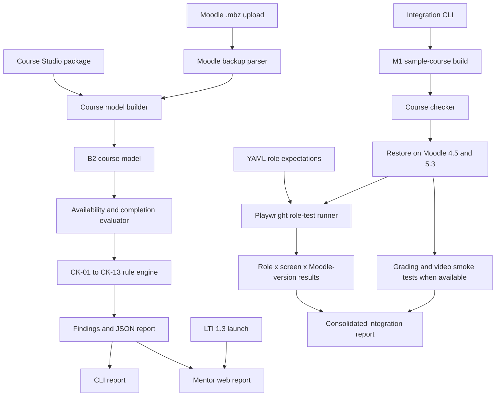

# Design document: Course checker, role tests, integration harness


**Module:** checker
**Owner:** @shraddha0103 · **Peer reviewer:** @Akshita21-09
**Release(s):** Release 1 (core); harness extended each later release
**Status:** Draft

## 1. Purpose and scope

The Course Checker identifies course-design errors before learners encounter them, verifies what different user roles can and cannot access through a real browser, and runs an integration test of the LearnOps toolkit. It checks course structure, activity availability, completion rules, grading totals, and other defined validation rules, then produces reports describing detected problems and suggested fixes. It also runs browser-based role tests across three screen profiles and Moodle versions 4.5 and 5.3. As integration lead, this module provides a single-command harness that builds a sample course, checks it, restores it on both Moodle versions, runs role tests, and generates a consolidated report.

**PRD chapter and goals served:** Part C, Section C2 — Course Checker. The module supports Release 1 (core), with the integration harness extended in subsequent releases. Its goals include detecting planted course-design errors without false positives, validating role permissions across screen profiles and Moodle versions, and verifying end-to-end integration.

**Out of scope:** Automatically fixing course errors, load testing, and checking quiz or workshop settings. The checker reports problems and suggests fixes; it does not automatically modify courses.

## 2. Requirements covered

| Requirement | Release | Approach in one line | Main components |
|---|---|---|---|
| FR-C-01 | R1 | Convert Moodle `.mbz` backups and Course Studio packages into the normalised B2 course model. | Backup parser, package reader, course-model validator |
| FR-C-02 | R1 | Simulate learner progression through sections and activities using availability and completion rules, identifying unreachable items. | Availability evaluator, completion-rule evaluator, path simulator |
| FR-C-03 | R1 | Apply CK-01 through CK-13 validation rules and report severity, explanation and suggested fix for every finding. | Rule catalogue, rule engine, report generator |
| FR-C-04 | R1 | Generate human-readable web and CLI reports plus machine-readable JSON, using the standard CLI exit codes. | Web report, CLI, JSON serializer |
| FR-C-05 | R1 | Compare two normalised course models and report differences in structure, rules and grading points. | Course-model diff engine |
| FR-C-06 | R1 | Run Playwright browser tests for five roles, three screen profiles and Moodle 4.5 and 5.3. | Playwright runner, role fixtures, screen profiles |
| FR-C-07 | R1 | Store per-course role expectations in YAML and test both permitted and prohibited access. | YAML expectation loader, assertion engine |
| FR-C-08 | R1; extended each later release | Provide one integration command to build, check, restore, test roles and run available grading/video smoke tests, producing one report. | Integration CLI, M1 build interface, Moodle test environments, Playwright, report aggregator |
| FR-C-09 | R1 | Provide a mentor-facing web interface launched through LTI to check a Course Studio package or mentor-uploaded Moodle backup. | LTI gateway, upload validation, checker service, report view |

All nine functional requirements are included. The implementation must also meet the acceptance criteria in PRD §C2.7.

## 3. Architecture

### 3.1 Component overview

The Course Checker consists of a shared checking library, a CLI, a mentor-facing web interface, a browser-role-test runner and an integration harness.



### 3.2 Component responsibilities

- **Course-model builder:** Reads a Course Studio package or parses a Moodle backup and produces the B2 normalised course model.
- **Rule engine:** Applies the defined validation rules to the course model. Each finding includes a rule ID, severity, message and fix hint.
- **Availability evaluator:** Evaluates Moodle availability and completion rules and simulates whether a learner can reach each section and activity.
- **Course-model diff:** Compares two course models for structural, rule and point differences.
- **CLI:** Supports course checking, model comparison and integration-test execution.
- **Mentor web interface:** Accepts supported course inputs and displays findings grouped by severity, with links to the affected item and suggested fixes.
- **Role-test runner:** Uses Playwright, fixed test accounts and YAML expectations to test permitted and prohibited access.
- **Integration harness:** Coordinates sample-course generation, checking, restoration, role tests and available module smoke tests.

### 3.3 Execution boundaries

The shared checker library performs parsing, validation and model comparison. The web interface handles requests and presents results. The CLI supports local and CI execution. Browser automation runs through Playwright against dedicated lab Moodle instances.

Long-running integration tasks must execute outside web request handlers, in accordance with PRD OPS-10.

The module interacts with Moodle through supported backup files, Moodle's standard web-services API, LTI 1.3 and browser automation for tests. It must not modify Moodle's source code, database directly or install Moodle plugins.

## 4. Contracts

| Contract | Provided / used | Fields or functions I rely on | Change needed? |
|---|---|---|---|
| B1 — Course package | Used | Course metadata, sections, activities, IDs, availability, completion, points and activity content references | None planned |
| B2 — Course model | Provided and used | Course metadata, sections, activities, availability, completion, grade items, marking workflow, protected items and badges | Confirm exact schema before implementation |
| B3 — LTI 1.3 launch | Provided as integration lead | Subject, role, context, resource link and deployment identity; validated launch and course binding | No change planned |
| B4 — Moodle web services | Used | Course lookup and course-structure retrieval through approved functions | None planned |
| B6 — Media paths and lesson manifest | Used | Relative media paths needed to detect CK-12 violations | None planned |
| B7 — H5P practice output | Used | H5P activity type and grading information needed for CK-11 | None planned |
| B8 — Test data sets | Used | Template courses, valid sample courses and planted-error test cases | Confirm exact fixture files |

B2 and B3 are provided by this module, with B3 owned as part of the integration-lead responsibility. The other listed contracts are dependencies.

Every contract payload must be validated against its authoritative schema. After Release 0, contract changes must be additive and optional unless the approved contract-change process permits otherwise.

## 5. Data model

The PRD specifies two module records: `checker.run` and `checker.role_run`.

### 5.1 `checker.run`

Records an individual course-checking or comparison run.

| Field | Proposed type | Purpose |
|---|---|---|
| id | UUID | Unique run identifier |
| input | JSON | Input type and safe reference to the source package or backup |
| version | String | Checker version used |
| results | JSON | Findings, rule IDs, severity, messages and fix hints |
| status | String | Run state, including success or failure |
| created_at | Timestamp | Run creation time |

### 5.2 `checker.role_run`

Records a role-test run and its results matrix.

| Field | Proposed type | Purpose |
|---|---|---|
| id | UUID | Unique role-run identifier |
| matrix | JSON | Results by role, screen profile and Moodle version |
| artefacts | JSON | References to failure screenshots and other test artefacts |
| status | String | Overall test-run state |
| created_at | Timestamp | Run creation time |

These field definitions are a proposed starting point, not a claim that the database schema already exists. Confirm types and mandatory fields during implementation.

### 5.3 Storage and migrations

- Store structured results as JSON where appropriate, with stable identifiers for each run.
- Store references to source inputs and test artefacts rather than duplicating large files in database records.
- Keep uploaded files and test artefacts outside the public web root.
- Do not store passwords, access tokens or secrets in run records.
- Use versioned, reversible database migrations as required by OPS-07.
- Document backup, restoration and undo procedures in the module README.

The checker does not need to store media URLs for playback. When it detects fixed media URLs, it reports them as validation findings; the expected course representation uses relative paths.

## 6. Interfaces

### 6.1 Mentor web interface

The mentor interface is opened through an authenticated LTI launch.

It must allow an authorised mentor to check a Course Studio package or upload a Moodle `.mbz` backup created through Moodle's own Backup page.

The interface must:

- Display findings grouped by severity.
- Identify the affected section or activity.
- Show the rule ID, explanation and suggested fix.
- Display role-test results as a matrix of role, screen profile and Moodle version, including screenshots for failures.
- Restrict access to the course context associated with the authenticated LTI session.

Exact HTTP route names and request/response schemas will be recorded after the shared application routing conventions are confirmed. They must not be invented independently of the repository's existing contracts.

### 6.2 CLI

Proposed command structure:

```text
checker check <input> --config <file>
checker diff <model-a> <model-b> --config <file>
checker roles --config <file>
checker integration --config <file>
```

Each command must support the common CLI options:

```text
--dry-run
--check
--config <file>
```

Expected behaviour:

- `--dry-run`: Print the intended operations without making changes.
- `--check`: Perform read-only validation; exit with code `0` if no problems are found, `1` if problems are found and `2` for an execution error.
- `--config`: Read configuration from the specified file.
- Normal execution: Perform the requested operation and save the results.

The exact subcommand names are proposed and must be aligned with the repository's existing CLI conventions before implementation.

### 6.3 Undo and recovery

Course checking and model comparison are read-only and need no data rollback. Test-run records and generated artefacts must have a documented cleanup procedure.

The integration harness must document how to clean up disposable test resources and restore the lab to a known clean state. It must not automatically modify a mentor's live course.

### 6.4 Configuration

All configuration must be supplied through environment variables or the supported configuration file. `.env.example` must document every required variable with a safe default or placeholder.

Confirm the existing repository configuration before adding new variables. At minimum, configuration may be needed for:

- Moodle 4.5 and 5.3 lab endpoints.
- Test-account setup and references.
- Input and artefact directories.
- Integration-run timeouts.
- Logging and report output.

Secrets must remain outside version control.

## 7. Key decisions and alternatives

| Decision | Alternatives considered | Why this one | Record |
|---|---|---|---|
| Use B2 as the internal course representation | Validate every input format separately | A shared model allows the same rules to apply to packages and Moodle backups | Create a decision record before implementation |
| Keep validation rules in a catalogue | Embed checks throughout parsing code | A catalogue makes rule IDs, severity, messages and fixes consistent and testable | Create a decision record before implementation |
| Use Playwright for role tests | Manual testing or a different browser automation tool | The PRD explicitly requires Playwright and repeatable browser tests | Create a decision record before implementation |
| Express role expectations as YAML | Hard-code role expectations in test functions | YAML keeps expected permissions separate from test execution and supports per-course configuration | Create a decision record before implementation |
| Produce one consolidated harness report | Separate unrelated reports for each stage | One report supports the required end-to-end acceptance check | Create a decision record before implementation |
| Keep web requests separate from long-running test execution | Run all testing synchronously in the web request | Separating heavy work prevents long-running tests from blocking the web interface | Create a decision record before implementation |

The decision records should be added under `docs/decisions/` using the repository's expected numbering and naming convention. Do not create arbitrary record numbers without checking existing records.

## 8. Libraries and licences

The following are planned dependencies. Pin exact versions in the project dependency files during implementation and verify the licences before release.

| Library | Pinned version | Licence | Why needed | Alternative |
|---|---|---|---|---|
| Python standard library | Runtime version specified by the project | Python Software Foundation License | File handling, data processing and CLI support | Not applicable |
| Playwright | To be pinned | Verify package licence | Browser automation for role tests | Selenium, if the project requirements change |
| YAML parser | To be selected and pinned | MIT or another approved compatible licence | Read role-expectation YAML files | JSON configuration |
| XML parser | Prefer Python standard library where sufficient | Python Software Foundation License | Parse Moodle backup XML | An approved XML library if additional capabilities are needed |
| Test framework | To be selected and pinned | Verify package licence | Unit, contract and integration tests | Another compatible Python test framework |

The project is under Apache-2.0. Dependencies must have compatible licences: MIT, BSD or Apache-2.0; LGPL is permitted only as an unmodified library. Dependency versions and licences must be confirmed rather than guessed.

## 9. Security and privacy

### 9.1 Applicable security requirements

| Requirement | Application to the Course Checker |
|---|---|
| SEC-01 | Validate LTI launches fully, including signature, issuer, audience, nonce, expiry and deployment ID. Use the shared LTI implementation. |
| SEC-02 | Authorise every web request using the authenticated role and course context. Mentors may only access permitted course data; administrator capabilities follow the PRD. |
| SEC-03 | Use only the approved Moodle web-service functions. Store service-account credentials in environment configuration, never in source code or logs. |
| SEC-04 | The checker does not execute learner-submitted code as part of normal course validation. If the integration harness invokes grading tests, the grading module remains responsible for its required isolated sandbox. |
| SEC-05 | Validate uploaded backup size and file content, not only the extension. Reject unsupported or malformed inputs and store uploads outside the public web root until processed. |
| SEC-06 | Use only the approved synthetic test data in the lab. Do not collect unnecessary personal data. |
| SEC-07 | The Course Checker does not require an AI provider for its core validation or role testing. If future functionality sends data to a hosted AI provider, document the provider and data in `docs/data-map.md` first. |
| SEC-08 | Scan dependencies in CI and address known critical vulnerabilities before release. |
| SEC-09 | Protect state-changing web requests against CSRF and use secure, same-site cookies for LTI sessions. |

### 9.2 Untrusted input

Course packages, `.mbz` files, XML elements and YAML role expectations are untrusted inputs.

The checker must:

- Validate required structure and supported activity types.
- Reject malformed or unsupported input with a clear error.
- Avoid extracting archive contents to unsafe paths.
- Apply input-size limits and timeouts where appropriate.
- Avoid executing content embedded in uploaded files.
- Never silently skip an activity type that cannot be checked; report it as not checked.
- Avoid logging credentials, raw file contents or unnecessary personal information.

### 9.3 Logging and audit

Write structured logs to standard output. Include the available request ID, LTI subject, course context and action, without secrets or file contents.

Any state-changing operation must record the appropriate audit entry according to OPS-06. Read-only checking should not create unnecessary audit events beyond the agreed run records and operational logs.

## 10. Error handling

| Scenario | Expected behaviour | Recovery |
|---|---|---|
| Malformed or unparseable `.mbz` | Show a clear error naming the file and element when available | Correct the input and rerun |
| Invalid course package | Report the validation failure and affected field or item | Correct the package and rerun |
| Unknown activity type | Report the activity as not checked; never silently skip it | Add supported parsing or document the limitation |
| Invalid availability or completion rule | Report the relevant rule and affected item | Correct the course configuration |
| Validation finding | Include rule ID, severity, message and suggested fix | Mentor fixes the course manually |
| Moodle 4.5 or 5.3 unavailable | Mark the affected integration stage as failed | Restore service and rerun |
| Browser step fails | Retry once automatically; if it still fails, mark the test failed and capture a screenshot | Inspect the screenshot and rerun |
| Invalid role-expectation YAML | Show a configuration error with the affected file or field | Correct the YAML and rerun |
| CLI configuration missing or invalid | Return exit code `2` and a clear message | Correct the configuration |
| Course findings exist | Complete report generation and return exit code `1` for `--check` | Review findings and fix the course |
| Internal execution error | Return exit code `2`, log diagnostic context without secrets and mark the run failed | Investigate and rerun |

If Moodle is unavailable, the checker may still perform offline parsing and validation when the input is available, but browser-based role tests and restoration checks must be marked as blocked or failed. They must not be reported as successful.

The checker does not automatically repair a course or modify its live configuration.

## 11. Test plan

| Level | What is tested | Test data | Requirement IDs |
|---|---|---|---|
| Unit | Course-model parsing, availability evaluation, completion rules, each CK rule, model comparison and report formatting | Small synthetic fixtures, including valid courses and individual planted errors | FR-C-01–FR-C-05 |
| Contract | B1 package parsing, B2 model validation, B3 launch handling, B4 lookup usage and B6/B7 fields relevant to CK-12/CK-11 | Valid and invalid contract examples from the repository | FR-C-01, FR-C-03, FR-C-05, FR-C-09 |
| Integration (harness) | Sample build, check, restoration on fresh Moodle 4.5 and 5.3, role tests and available module smoke tests | Approved B8 sample courses and lab Moodle environments | FR-C-08 |
| End-to-end | Mentor launches checker, submits a supported input, receives a report and can inspect findings; role matrix is generated | Synthetic course data and fixed lab accounts | FR-C-04, FR-C-06, FR-C-07, FR-C-09 |

### 11.1 Acceptance criteria

The test suite must demonstrate the following PRD §C2.7 criteria:

1. Detect **100% of the planted errors in B8.3**, with no false errors on B8.2.
2. Pass role tests for **5 roles × 3 screen profiles × 2 Moodle versions**, with at least one negative check per role.
3. Run the integration harness end to end from a clean state with one command and produce one report.

The role-test matrix must cover visitor, signed-in non-member, learner, mentor and administrator on all three screen profiles and both supported Moodle versions.

### 11.2 Metrics

- **Detection rate:** Number of planted errors correctly detected divided by the total number of planted errors in B8.3.
- **False-positive rate:** Number of false findings on B8.2 divided by the total number of checks evaluated on the valid sample.
- **Role-test pass rate:** Passing required role/profile/version checks divided by total required checks.
- **Harness runtime:** Elapsed time from the start of a clean integration run until the consolidated report is produced.

Store test results and reports as CI artefacts where appropriate. Use synthetic data only. Record the environment and tool versions so results can be reproduced.

## 12. Risks and open questions

| # | Risk or question | Needs the lab? | Plan or owner |
|---|---|---|---|
| 1 | Moodle backup XML may differ between Moodle 4.5 and 5.3 | Yes | Test real backups from both supported versions; document format differences |
| 2 | Availability and completion rules may be more complex than the initial evaluator supports | Yes | Build unit fixtures for supported rules and explicitly report unsupported cases |
| 3 | The rule engine may produce false positives on valid courses | Yes | Use B8.2 as the clean baseline and B8.3 as the planted-error test set |
| 4 | Fixed test accounts or lab Moodle services may be unavailable | Yes | Provide a documented setup script and clear failed/blocked test reporting |
| 5 | Browser tests may be flaky across screen profiles or Moodle versions | Yes | Use stable selectors, fixed fixtures, one retry and failure screenshots |
| 6 | A role expectation may be incomplete or incorrect | Yes | Review YAML expectations against PRD §A5 and require negative tests |
| 7 | Integration with M1, M3 or M4 may change as later releases arrive | Yes | Keep contract usage explicit and extend the harness as each module becomes available |
| 8 | Uploaded backups may be malformed or contain unsafe archive paths | No for basic unit tests; yes for lab validation | Validate inputs and test archive handling with synthetic malformed fixtures |
| 9 | The exact CLI subcommands, API routes and environment variables have not yet been confirmed against existing repository conventions | No | Inspect repository configuration before implementation and document final interfaces |
| 10 | Exact library versions and licence compatibility remain to be verified | No | Pin dependencies and run the project's dependency and licence checks before release |

Before requesting final approval, compare this table with the risks in the PRD's Appendix C and add any additional risks that specifically affect the Course Checker or integration harness.

## 13. Work breakdown

Implement one requirement or tightly related group per pull request. The order below is proposed; dependencies and release assignments must be checked against the shared contract plan and the guide's approval process.

| Order | Pull request | Requirements | Depends on | Notes |
|---|---|---|---|---|
| 1 | Release 0: checker foundations and CI | Foundation work | Repository setup and approved conventions | Establish test structure, linting, configuration and reproducible checks. Release 0 foundation work may begin before design approval where permitted by the PRD. |
| 2 | Course-model parser | FR-C-01 | B1 and B2 | Parse supported package and backup inputs into the normalised course model. |
| 3 | Availability and completion evaluator | FR-C-02 | B2 | Simulate learner progression and identify unreachable items. |
| 4 | Rule catalogue v1 | FR-C-03 | B2; B6 and B7 fields as needed | Implement CK-01 through CK-13 with rule-level unit tests. |
| 5 | Reports and course-model diff | FR-C-04, FR-C-05 | Course-model parser and rule engine | Provide web/CLI/JSON reports and structural, rule and point comparisons. |
| 6 | Role expectations and browser tests | FR-C-06, FR-C-07 | Lab Moodle setup and test accounts | Implement YAML expectations, Playwright coverage, negative tests and failure screenshots. |
| 7 | Mentor-facing checker interface | FR-C-09 | B3, checker library and approved web conventions | Support authenticated launches and the two permitted input types. |
| 8 | Initial integration harness | FR-C-08 | M1 build output, checker, Moodle 4.5/5.3 and role tests | Run from a clean state and produce one consolidated report. |
| 9 | Harness extensions | FR-C-08 | M3 and M4 smoke-test interfaces | Add grading and video smoke tests when those releases exist. |
| 10 | Release verification and documentation | FR-C-01–FR-C-09 | All relevant preceding work | Verify acceptance criteria, dependency licences, security requirements, metrics and run/undo instructions. |

The PRD places the core Course Checker requirements in Release 1 and extends the harness in later releases. The sequence above is a proposed work breakdown, not permission to start feature implementation before the design is approved.

## 14. Review and approval

- [ ] **Owner:** I understand and can explain every section of this design document.
- [ ] **Peer reviewer:** The document has been checked against PRD §C2 and the relevant shared contracts; comments have been resolved.
- [ ] **Guide:** The guide has reviewed and approved the design document and sets the status to `Approved`.

The document remains in `Draft` until the guide approves it. Feature implementation must follow the repository's approval process.
