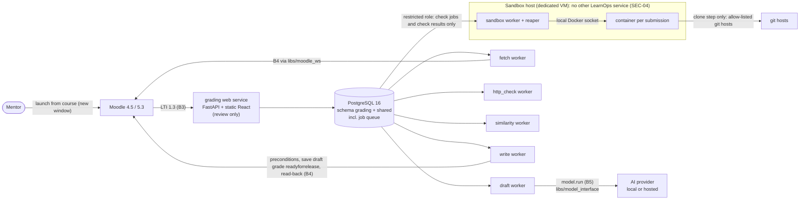

# Design document: Grading assistant and model interface

**Module:** grading
**Owner:** @Harshithamanjunatha · **Peer reviewer:** @vnaags
**Release(s):** Release 0 (FR-M-01, FR-M-02; contracts B4 and B5; test sets B8.4 and B8.6 v1), Release 4 (FR-G-01…08, FR-M-03)
**Status:** Draft

`Status` values: `Draft` → `In review` (peer reviewing) → `Approved`. **Only the guide sets
`Approved`**, in a pull request the guide merges. Feature code for this module starts only when the
status is `Approved` (foundation work listed in §13 under "Release 0" is allowed earlier).

**How to read this document.** Each design statement carries one of four labels:

| Label | Meaning |
|---|---|
| (PRD) | Stated in the PRD, a contract, or a repository rule file; the source is cited |
| (proposed) | A design choice made in this document; not in the PRD; open to review |
| (lab) | Must be verified on the lab Moodle 4.5 and 5.3 sites before it is relied on (PRD App-C) |
| (guide) | Needs a decision or approval from the guide; listed in §12 |

Nothing labelled (proposed), (lab) or (guide) is a fact about Moodle or the PRD. No statement in this
document has been checked against a live Moodle, Moodle's own documentation, or any literature source.

**Revision note.** This revision applies a pre-implementation review in three groups: critical
blockers (§4.1, §5, §9, §10.1), integration (§4, §5, §6.1, §12, §13) and testability and
implementation (§6.2 to §6.4, §10, §11, §13). Every new statement is (proposed), (lab) or (guide).
New open decisions are Q22 to Q55 in §12 (Q40 is not used); proposed PRD amendments are in §12.2. Nothing is approved
and no test has been written or run.

## 1. Purpose and scope

**For a mentor.** The grading assistant takes the project work learners submit in Moodle and does the
first pass of grading for you. For each submission it runs the automatic checks named in the
assignment's marking table. Examples: does the repository clone, is the README there, does the demo
link open. The checks run in an isolated sandbox on a separate machine. The assistant then drafts a
score, the evidence behind it, and feedback for every criterion. You review each draft, then approve,
edit or reject it. Only drafts you approve are written back to Moodle, and they stay hidden from
learners until you release grades in Moodle yourself. The tool refuses to write if Moodle's marking
workflow is off or if the submission changed in Moodle after it was drafted. The module also provides
the shared AI and speech interface that Course Studio and the video pipeline use, and a study
comparing a local small model with a hosted API. (PRD §C3.1, §C3.2)

**PRD chapter and goals.** PRD §C3. Problem P3 (grading takes hours). Goals (PRD §A2, §A3):
- G-4: at least 50 % less grading time per submission
- G-5: draft within one band of the mentor's grade for at least 80 % of B8.4 (band defined in §11.2)
- G-10: comparison report on a local vs a hosted model

**Out of scope** (PRD §C3.11): automatic release of grades (grades are released only by a mentor in
Moodle, C-09); plagiarism decisions (the similarity check raises flags only); grading quizzes or
workshops.

Also out of scope for this document: any learner-facing screen (learner launches are refused by the
baseline tools, PRD EXT-07, §B3); LTI Assignment and Grade Services (not used by the baseline, PRD
§B3); fine-tuning a model (extension F-4, PRD §C7); parsing `.mbz` backups (Module 2) or generating
courses (Module 1); group or team submissions, and grade types other than points (§4.1).

## 2. Requirements covered

All requirements tagged for Module 3 in PRD §C3.3, with the release the PRD assigns. The "approach"
column is (proposed) unless the requirement itself states it.

| Requirement | Release | Approach in one line | Main components |
|---|---|---|---|
| FR-M-01 | R0 | Shared library with one `model.run(task, inputs, output_schema)` call; a task registry that owns each task's input and output models; local, hosted and fake providers; versioned prompts; validated output with one retry; typed errors, timeouts and a budget guard (§4.2) | `libs/model_interface` |
| FR-M-02 | R0 | `speech.transcribe(audio_path, language)` behind the same provider rules; callers always get one transcript with absolute timestamps (§4.2) | `libs/model_interface` (speech part) |
| FR-G-01 | R4 | Fetch job reads assignments, submissions and the report file through B4 (`libs/moodle_ws`, normalized models, §4.1); parses the marking table (B1.3) with the shared parser; reads repository URL, demo link and report by the submission-content rule (§4.3) | `libs/moodle_ws`, fetch worker, shared marking-table parser |
| FR-G-02 | R4 | One sandbox container per submission on a dedicated sandbox host runs the allowed checks (§9.2); `http_ok` runs outside the sandbox (§9.3) (PRD §C3.5) | sandbox worker, http_check worker |
| FR-G-03 | R4 | Draft job calls `model.run(task="grade_draft")` once per submission version; every criterion is validated in code against the marking table, check results and evidence (§4.3, §9.5); the overall draft grade is the sum of criterion scores (PRD), computed in code, not by the model (proposed) | draft worker, `grade_draft` prompt |
| FR-G-04 | R4 | Similarity compares fingerprints computed inside the sandbox (code) and from report text; flags pairs above configurable thresholds (PRD); similarity is never presented as proof (§3.1) | similarity worker |
| FR-G-05 | R4 | Review view: submission list, per-submission detail, approve, edit or reject per criterion; bulk approve only for unchanged drafts with no flags (PRD, §6.1) | web service, React UI |
| FR-G-06 | R4 | Write job sends only approved drafts via `mod_assign_save_grade` with workflow state `readyforrelease`; never released (PRD); guarded by the protocol in §10.1 | write worker, `libs/moodle_ws` |
| FR-G-07 | R4 | Every approve, edit or reject stored as an append-only event with approver and the change from the draft; audit entry in `shared.audit_log` (OPS-06) | `grading.approval` (append-only), audit |
| FR-G-08 | R4 | A resubmission creates a new submission version with new checks and drafts; earlier drafts and approvals are kept, never overwritten (proposed); a changed Moodle submission marks older versions stale (§5.4) | data model (§5) |
| FR-M-03 | R4 | `model-bench run --set b8.6 --provider local\|hosted` runs the same prompts on both providers and reports quality, review time and cost (PRD) | model-bench CLI, B8.6 |

No requirement is proposed for deferral.

**Note on traceability.** The B4 contract and `libs/moodle_ws` are Release 0 work (PRD §D1) but have no
requirement ID of their own, so `docs/traceability.md` (PRD §E4) has nothing to point at. Proposal:
trace them under FR-G-01 (read side) and FR-G-06 (write side) until the guide decides (Q7).

## 3. Architecture



Parts (PRD OPS-10: heavy work never runs inside a web request):

| Part | Kind | Does |
|---|---|---|
| grading web service | web service | LTI launch, review pages and API, approve / edit / reject, status page. Never runs checks or model calls in a request; it only queues jobs. |
| fetch, http_check, draft, similarity, write | workers (tools host) | All heavy or external work except sandboxed checks, fed by the job queue |
| sandbox worker and reaper | worker (sandbox host) | Runs checks in containers through the local Docker socket; reaches only the job database, through a restricted role (§9.2) |
| `grading fetch` / `draft` / `write` / `purge` / `sandbox`, `model-bench run` | CLIs | Same jobs from the command line (names from `modules/grading/CLAUDE.md`, plus proposed `purge`, `sandbox --check`, `write --revert`) |
| `libs/model_interface` | shared library | B5; used by Modules 1, 3 and 4 (PRD §B.0) |
| `libs/moodle_ws` | shared library | B4 client returning normalized models; used by Modules 2 and 3 (PRD §B.0, §C2.6) |
| `libs/lti` | shared library | Used, not changed (CODEOWNERS: Students 2 and 1) |
| `libs/contracts` | shared library | Schemas and validators; the shared marking-table parser lives here (proposed, §4.3). CODEOWNERS lists all four students and the guide as owners, so ownership is shared, not Module 2 alone |

**Job queue** (proposed): a table in the grading schema, claimed by workers with `SELECT … FOR UPDATE
SKIP LOCKED`, with lease, heartbeat, `run_after` and idempotency keys (§5.3). This keeps the fixed
stack (PostgreSQL, no Redis or other broker) (PRD §A10). Workers can run on another host by
configuration (PRD OPS-10).

**Flow of one submission:** fetch, then checks (sandbox and http_check), then draft, then mentor review,
then approve, then write (with preconditions and read-back), then the mentor releases in Moodle. Each
step's state is stored, so the status page can show progress and a stopped job can resume (PRD UI-04).

**Where the module touches other systems** (only the allowed routes, PRD C-02):
- Moodle: LTI 1.3 launch (B3) and the web-services functions in B4 only. No plugin, no database access, no browser automation outside tests.
- BigBlueButton: not touched.
- Model and speech providers: only through `libs/model_interface` (PRD C-10).
- Media store: not used. Any stored report path is relative (PRD C-08).
- Learner repositories and demo links: the clone happens inside the sandbox. `http_ok` requests come from the http_check worker, which never runs learner code. The only Moodle file the module downloads is a report text file (§9.1 SEC-05).

**Sandbox host placement** (guide, lab): SEC-04 requires a host that runs no other LearnOps service. The
lab lists only one Docker host, `tools` (PRD §A11), and OPS-01 says one `docker compose up` starts all
services. Proposal: a dedicated disposable sandbox VM, with the sandbox worker running on it and using
the local Docker socket, so no Docker API is exposed on any network (Q22, Q23). See §9.2 and §12.2.

### 3.1 Similarity method (FR-G-04) (proposed, guide)

This is an engineering choice, not a claim from the literature; the §12.1 entries stay unverified.
- **Code fingerprints** are computed inside the sandbox, after the network is cut and before any `command:` check. Only fingerprints are stored; no learner repository is cloned or parsed outside a sandbox.
- **Files considered:** source and text files only. Excluded: `.git`, vendored or generated directories, lock files, binaries, files above a size cap, and files whose content hash is in the course's starter-code list (carried in the check config, §4.3).
- **Tokenization** is language-agnostic in v1: strip comments by simple per-extension rules; replace identifiers, string literals and numbers by placeholders; keep keywords and operators by a fixed set.
- **Fingerprints:** k-gram hashes selected by a windowed minimum rule (winnowing style); `k` and window are configuration and recorded as `method_version`. Each stores hash, file path and line number so the UI shows matched file and line ranges without storing source.
- **Report text** fingerprints (word shingles) are computed by the fetch worker from the full report text in memory (plain text only); only fingerprints and the capped excerpt are stored.
- **Pair score:** the larger of the two containment ratios, separately for code and report. A pair is flagged if either score reaches its own threshold.
- **Calibration:** a similarity set in `testdata/` with at least 10 pairs per class (unrelated; shared template or boilerplate only; renamed identifiers; reordered functions; partial copy of one file). Thresholds are chosen on the development split so unrelated and boilerplate pairs produce no flags; recall is reported; the test split is used once.
- **Wording:** a flag shows score, matched files and line ranges, and the text "similar to"; never "plagiarism". A submission that could not be fingerprinted shows "not checked", never "no similarity". The mentor's acknowledgement is recorded.
- **Limit:** pairwise comparison is quadratic; accepted for cohorts up to a size the guide names (suggest 200) (Q49).

## 4. Contracts

| Contract | Provided / used | Fields or functions I rely on | Change needed? |
|---|---|---|---|
| B4 Moodle web-services usage | Provided (`contracts/moodle-ws.v1.md`) | Function list in §4.1 | Created in Release 0. Proposed additions: JSON Schema file, normalized models, error classes (§4.1, Q1, Q37) |
| B5 Model and speech interface | Provided (`contracts/model-interface.v1.schema.json`) | `model.run`, `result.data`, `result.meta`, `speech.transcribe`, `transcript.segments`, `transcript.meta` | Created in Release 0. Proposed additive items in §4.2 (registry rule, error types, optional `meta` fields) (Q38) |
| B1.3 Marking table | Used | `<!-- marking-table v1 -->` markers; columns Criterion, Points, Full marks when, Check; `—` means judgement only; `data-marking-table="v1"` in the HTML rendering | Proposed: criterion key rule and argument formats (§4.3, Q39) |
| B1.1 Course package | Used (read only) | `submission: [onlinetext, file]` on assignments | Proposed: submission-content rule (§4.3, Q6, Q32) |
| B3 LTI 1.3 launch | Used | `sub`, `name`, `roles`, `context`; Instructor → Mentor, Administrator; Learner refused; `shared.course_link` | None. Launch container decision (Q35) |
| B8.4 Synthetic submissions | Provided (test data) | §11.3 | — |
| B8.6 Model comparison set | Provided (test data) | §11.4 | — |

File names are those in `contracts/CLAUDE.md` (`moodle-ws.v1.md`, `model-interface.v1.schema.json`).
Before the Release 0 freeze the proposals below are ordinary changes; after the freeze any change goes
through `/contract-change` and is additive only (PRD §B.0, EXT-02). This is why they should be settled
before the freeze.

### 4.1 B4: Moodle web-services usage (summary of `contracts/moodle-ws.v1.md`)

(PRD §B4) One dedicated service account per Moodle site. Its token is restricted to an external
service that contains only the functions below. The account has only the capabilities those functions
need, in the courses where it is enrolled for grading.

| Purpose | Function (PRD §B4) | Used by | Exists with these parameters on 4.5 / 5.3? |
|---|---|---|---|
| Course structure | `core_course_get_courses_by_field`, `core_course_get_contents` | FR-G-01; B3 course binding | (lab) / (lab) |
| Enrolled users | `core_enrol_get_enrolled_users` | FR-G-01 | (lab) / (lab) |
| Assignments | `mod_assign_get_assignments` | FR-G-01 | (lab) / (lab) |
| Submissions | `mod_assign_get_submissions`, `mod_assign_get_submission_status` | FR-G-01, FR-G-08 | (lab) / (lab) |
| Submission files | Download through the token-authenticated file URL returned by the API | FR-G-01 (report file only) | (lab) / (lab) |
| Write draft grade + feedback | `mod_assign_save_grade` with workflow state `readyforrelease` and feedback comments; never `released` | FR-G-06 | (lab), incl. the `workflowstate` parameter (PRD App-C 1) |
| Workflow state | `mod_assign_set_user_flags`, only if needed to set the state | FR-G-06 | (lab) |

- **Parameters.** The PRD names only the `workflowstate` parameter and "feedback comments". Every other parameter name, field name and response shape is recorded in the contract file only after it has been checked on both lab sites (lab). If a name differs, the replacement is recorded in §B4, as the PRD requires.
- **Capabilities.** The PRD gives no list. The minimum capabilities are worked out on the lab sites and recorded in the contract file, and SEC-03 then refers to that list (lab).
- **Allow-list driven by the contract** (proposed): `contracts/moodle-ws.v1.schema.json` holds a manifest of allowed functions (name, purpose, used by, verified on 4.5, verified on 5.3, verified parameters). `libs/moodle_ws` builds its allow-list from that manifest and refuses any other function, and any workflow state other than `readyforrelease` in a grade write. A CI test checks that code and manifest agree. This is a second guard behind the restricted external service.
- **Normalized models** (proposed): the contract is what `libs/moodle_ws` returns, not Moodle's raw responses: `CourseV1`, `AssignmentV1` (idnumber, name, description_html, max_grade, grading type, marking_workflow_enabled, submission_types), `SubmissionV1` (learner_ref, version_snapshot, online_text, file_refs), `SubmissionStatusV1`, `GradeStateV1` (grade, workflow_state, released flag, grader_ref, modified), `GradeWriteRequestV1`, `GradeWriteResultV1`. Field names are LearnOps's own. A field Moodle does not provide on a version is absent and the client raises `NotSupported` when a caller needs it. Every Moodle response is validated into these models; a response that does not parse is `UnexpectedResponse`, never partial data.
- **Error classes** (proposed): `MoodleUnreachable`, `TokenInvalid`, `PermissionDenied`, `UnexpectedResponse`, `NotSupported`.
- **Token** (PRD SEC-03, C-06): environment only, one per site: `MOODLE45_WS_TOKEN` and `MOODLE53_WS_TOKEN`. `.env.example` currently has one `MOODLE_WS_TOKEN` (with a comment saying one per site in real deployments), while B4 asks for one account per site (Q24). `libs/moodle_ws` redacts tokens from every logged URL, exception message and error shown in the UI; request URLs are never logged in full. (lab) If the file download accepts the token in a header, use that instead of a URL parameter.
- **Format** (guide): `contracts/CLAUDE.md` names B4 as a Markdown file. PRD §B.0 rule 1 says every contract has a JSON Schema and at least one example. Proposal: keep the Markdown file as the human text and add the schema file above (Q1).
- **Traceability:** see §2 note (Q7).

**Moodle semantics policy** (proposed; every point confirmed in the lab before it is relied on):
- Graded: submissions in the submitted state only. A draft-state submission is shown as "not submitted" and gets no checks or draft.
- Group or team submissions: not supported in v1. Fetch marks such an assignment `unsupported` ("group submissions are not graded by this tool; grade in Moodle"). If detection is impossible, record it as a known limitation in the README.
- Grading type must be points; other types are refused with a message.
- Suspended or unenrolled learners are skipped and listed as skipped.
- Late or extended submissions are graded; flagged "late" only if B4 provides the information.
- A resubmission or reopened attempt is a new submission version when the identifying fields differ (§5.4).
- The service account is enrolled in each course by an administrator (README step).

**Lab verification list** (replaces PRD App-C item 1; each item on 4.5 and 5.3, recorded in `docs/decisions/` and in B4; until recorded, dependent code uses only fakes):
1. Every B4 function exists with the parameters used, including how workflow state and feedback comments are passed to `mod_assign_save_grade`.
2. What the assignment functions return: description text, `idnumber`, grading type and maximum grade, marking-workflow setting. Where one is missing, name the replacement function and add it to B4.
3. What identifies a submission attempt and its last change (used as the version snapshot).
4. Behaviour when the workflow state is sent for an assignment where marking workflow is off.
5. Behaviour when saving over a grade that is already released, or that another grader entered.
6. Whether feedback comments are enabled on assignments built by Course Studio, and which format Moodle stores.
7. Whether the marking-table markers and `data-marking-table` attribute survive Moodle's HTML handling, and how online text arrives (editor HTML, link wrapping).
8. How suspended users, group submissions, and draft versus submitted statuses appear in the submission functions.
9. Which capabilities the service account minimally needs for exactly the allowed functions (recorded for SEC-03).
10. How the file download authenticates.
11. Whether a grade written by the service account shows the service account as grader, and whether the adopting site accepts that (Q31).

### 4.2 B5: Model and speech interface (summary of `contracts/model-interface.v1.schema.json`)

(PRD §B5.1 to B5.4)

```python
result = model.run(task="grade_draft", inputs={...}, output_schema=GradeDraftV1)
# result.data -> validated object matching output_schema
# result.meta -> provider, model, input/output tokens, latency_ms, cost_estimate, prompt_version

transcript = speech.transcribe(audio_path, language="en")
# transcript.segments -> [{start, end, text, words:[{start, end, word}]}]
# transcript.meta -> provider, model, duration_s, latency_ms, cost_estimate
```

- **Task registry.** Each registered task name maps to its prompt file, `prompt_version`, input model and output model. An unregistered task name is an error (error rule proposed). `output_schema` must be the registered model, otherwise `SchemaMismatch` (resolves the difference between the PRD call and a registry that owns schemas). Inputs are validated before any provider call. Each module registers its own tasks at import with `register_task(name, input_model, output_model, prompt_dir)`; task names are unique across the repo; the registering module owns its prompt folder (proposed).
- **Providers.** `local` is the lab endpoint and `hosted` is one hosted API through the provider's official SDK (PRD §B5.2). `fake` is a deterministic provider for tests (GETTING-STARTED §6): it returns a fixture keyed by task and input hash, or a minimal schema-valid object, and supports failure injection (`fail_next(error)`). A fake speech provider is proposed too. Chosen by `MODEL_PROVIDER` / `MODEL_NAME` and `SPEECH_PROVIDER`. Endpoints and keys come from `MODEL_LOCAL_URL`, `MODEL_HOSTED_API_KEY`, `SPEECH_LOCAL_URL` and `SPEECH_HOSTED_API_KEY` (already in `.env.example`). No module may require a local GPU (PRD OPS-11).
- **Validation and retries** (PRD §B5.2 plus proposals). Output is validated against `output_schema` (Pydantic). On invalid output there is one retry, then a typed error `InvalidOutput`. Never a silent partial result. Transport failures (timeout, unavailable, rate limit) get bounded library retries with backoff (`MODEL_TRANSPORT_RETRIES`), separate from the validation retry. Job-level retries apply only to errors flagged `retryable`. Every attempt is logged, including failed ones.
- **Error types** (proposed, all derive from `ModelError`): `UnregisteredTask`, `SchemaMismatch`, `InputTooLarge`, `InvalidOutput`, `ProviderTimeout`, `ProviderUnavailable`, `RateLimited`, `ProviderAuth`, `BudgetExceeded`.
- **Limits and budget** (proposed): `MODEL_TIMEOUT_S`, `MODEL_MAX_INPUT_TOKENS` (input over the limit is `InputTooLarge`, never silently truncated), `SPEECH_TIMEOUT_S` scaled by audio duration, `MODEL_BUDGET_USD` (the guide supplies the cap, PRD A15.5). The library sums `cost_estimate` from `shared.model_calls` and refuses with `BudgetExceeded` before sending when the cap would be passed.
- **`meta` additions** (optional fields, additive per PRD §B.0): `input_hash` (sha256 of canonical inputs), temperature and seed when set, and `cost_known` (false when no price is configured; `cost_estimate` is then null, not 0). Prices come from a config file; the local provider's cost is 0 and known.
- **Speech.** Callers always receive one transcript with absolute timestamps. Whether the library uploads the whole file or splits it internally is hidden behind the interface and checked in the lab with a 90-minute file (PRD G-7) (lab). `audio_path` must be readable by the calling process; workers on other hosts need the file locally (to be stated in Module 4's design).
- **Prompts.** Versioned files in `libs/model_interface/prompts/`, each with a `prompt_version` (PRD §B5.3). Layout (proposed): `prompts/<task>/v<N>.md` with `prompt_version` in a front-matter header; a published version is never edited; a change is a new file; a check confirms the file name and header agree.
- **Logging.** Every call writes `meta` to `shared.model_calls` through an injectable `CallLogger` (a Postgres implementation for services, an in-memory one for tests), so consumers need no database to run unit tests. No raw learner content, prompt text or model output is logged (PRD §B5.3, OPS-04, module rule 6).

### 4.3 Proposed contract text (for the contract owners, via `/contract-change` or before the freeze)

These are drafts inside this document only. Nothing here changes a contract file.

**(a) Submission-content rule for B1** (owner: Student 1; consumers: Students 2 and 3) (Q32).
- Online text carries labelled lines, case-insensitive, one per line: `Repository: <https URL>`, `Demo: <https URL>`, and `Report:` followed by the report text to the end.
- If submission types include a file, a file named `report.md` or `report.txt` is the report when no `Report:` section exists. Other uploaded files are ignored by grading in v1.
- Markup is stripped before looking for labels, because online text may arrive as editor HTML (lab). Extraction rules are fixed by shared fixtures that have been through Moodle on both sites.
- Mapping: `http_ok:demo_url` reads `Demo`; `repo_clone` reads `Repository`; `word_count` reads the report. A missing label records the check as `error` with reason `field_missing`.
- Examples (at least five): all labels; labels in HTML; missing demo; report as file; report containing the word "Demo:".

**(b) Marking-table parser and model** (format owner Student 1; implementation proposed in `libs/contracts` first used by CK-09; Student 3 imports it; no second parser in this module) (Q39).
- Output: `table_hash`; criteria, each with `key` (slug of the name, unique within the table), `position`, `name`, `points`, `full_marks_when`, `checks` (list of name and argument; empty for judgement only).
- Rules: criterion names unique after slugging; points sum equals the assignment points; check names limited to the six PRD names; checks separated by `;`; one `:` splits name and argument; `—` alone means no check.
- Argument formats: `readme_sections:<a,b,c>` comma-separated list matched case-insensitively against Markdown heading text at any level; `word_count:<n>` whole number of words in the report; `repo_file:<path>` relative path with no `..`; `command:<name>` a key in the check config; `http_ok:<field>` is `demo_url` in v1.

**(c) Check config for `command:<name>`** (owner Student 1 for the schema, Student 3 for the loader) (Q33). A YAML file `GRADING_CHECKS_DIR/<course_shortname>.yaml` on the tools host, validated by a schema: `schema: learnops.checks/v1`; `image` (a key from the configured list of pre-baked check images); `commands` mapping a name to `argv` (a list, never a shell string) and `timeout_s`; optional `starter_hashes` for similarity; optional `limits` that can only reduce platform limits. A name in a marking table that is missing from the file fails with `command_not_configured`. The loader resolves commands when it creates the check job and passes them in the job payload, so the sandbox host never needs the file. Whether this schema is part of B1 or a new contract file is (guide).

**(d) `GradeDraftInputV1` and `GradeDraftV1`** (Q41).
- Input: `assignment_idnumber`; criteria, each with `key`, `name`, `points_max`, `full_marks_when`, `judgement_only`, `checks` (check_id, name, arg, result of pass, fail or error, evidence text) and `excerpts` (excerpt_id, source readme or report, text, capped).
- Output: criteria, each with `key` (must equal an input key), `score` (number), `evidence` (list of kind check or excerpt, id, optional short quote), `feedback` (plain text for the learner), `needs_mentor_attention` (boolean). There is no total field.
- Never in the schema: learner names, email, LTI sub, Moodle ids.
- One model call per submission version (proposed): one `model_call_id` per draft set, consistent criteria, one call's cost. Trade-off: a structural failure after the one retry leaves the whole draft unavailable.
- **Code-side validation after the schema** (enforced regardless of schema, §9.5): returned criteria exactly equal the marking-table criteria by key (no extra, none missing, none renamed); `0 <= score <= points_max` and whole numbers (Q25), out-of-range values rejected, not clamped; every evidence reference resolves to a stored check row, or a quote is an exact substring of the referenced stored text; a required check with result `fail` forbids full marks (cap fraction from the B8.4 pilot, Q25) and flags "check failed"; result `error` flags "check could not run" and never counts as a pass; the total is computed in code. A criterion failing validation is stored as `unavailable` with a reason code, shown as "grade manually", never filled with a default score.

## 5. Data model

All tables are in the `grading` schema unless marked shared. The PRD names four tables (`job`, `submission_check`, `draft`, `approval`, PRD §C3.5); the others are (proposed) implementation detail needed by FR-G-07, FR-G-08 and the write protocol, and are listed in §12.2 for the guide. All columns are (proposed).

### 5.1 Identity

- `site_id` is `moodle45` or `moodle53`. A Moodle course id is not unique across the two lab sites, so a course is always `(site_id, moodle_course_id)`, mapped to the LTI context through `shared.course_link`. The columns and primary key of `shared.course_link` must be documented by Module 2 before foreign keys are written (open interface item, Q36).
- Web routes use the internal course link id. CLIs take `--site` and `--course-shortname` (PRD B1: shortname is stable) and resolve to the same row.
- `learner_ref` is `site_id` plus the Moodle user id from the enrolled-users call, never name, email or LTI `sub`.
- Assignments are identified by Moodle `idnumber`, never by position or name (PRD EXT-06). If B4's assignment function does not return `idnumber` (lab), the replacement is recorded in B4 before the freeze.

### 5.2 Tables

```text
marking_table_snapshot(id uuid pk, site_id, moodle_course_id, assignment_idnumber, table_hash,
  parsed jsonb, fetched_at; unique (site_id, moodle_course_id, assignment_idnumber, table_hash))
submission_version(id uuid pk, site_id, moodle_course_id, assignment_idnumber, learner_ref,
  version_key, moodle_snapshot jsonb, marking_table_snapshot_id fk, state, created_at;
  unique (site_id, moodle_course_id, assignment_idnumber, learner_ref, version_key))
submission_excerpt(id pk, version_id fk, source in (readme, report), text, truncated, created_at, expires_at)
check_run(id pk, version_id fk, job_id, created_at)
submission_check(id pk, check_run_id fk, check_key, check_name, check_arg,
  result in (pass, fail, error), reason_code, evidence, learner_originated, duration_ms;
  unique (check_run_id, check_key))
draft_set(id pk, version_id fk, check_run_id fk, model_call_id fk shared.model_calls,
  prompt_version, status in (ok, unavailable), reason_code, created_at)
draft(id pk, draft_set_id fk, criterion_key, score, evidence jsonb, feedback,
  status in (ok, flagged, unavailable), flags jsonb; unique (draft_set_id, criterion_key))
approval(id pk, version_id fk, draft_set_id fk, criterion_key,
  action in (approve, edit, reject, revoke), based_on_event_id fk null, approver_sub,
  before jsonb, after jsonb, created_at;
  unique index on (draft_set_id, criterion_key, coalesce(based_on_event_id, zero uuid)))
write_attempt(id pk, version_id fk, draft_set_id fk, idempotency_key unique,
  status in (intent, written, unknown, conflict, refused, mismatch, reverted),
  intended jsonb, moodle_snapshot jsonb, previous_state jsonb, error_code, created_at, finished_at)
similarity_fingerprint(id pk, version_id fk, kind in (code, report), method_version, fingerprint jsonb, status)
similarity_flag(id pk, version_a fk, version_b fk, score, threshold, kind, method_version, acknowledged_by)
job(id pk, type, site_id, moodle_course_id, version_id null, payload jsonb,
  status in (queued, running, done, failed, cancelled), attempts, max_attempts, run_after,
  lease_owner, lease_expires_at, idempotency_key unique, error_code, requested_by,
  created_at, started_at, finished_at)
worker_heartbeat(worker, host, last_seen; pk (worker, host))
shared.model_calls    -- defined with B5, owned by Module 3 (PRD §B5.3)
shared.audit_log, shared.course_link    -- owned by Module 2, used not changed (PRD OPS-06, §B3)
```

### 5.3 Rules

- **Append-only approvals.** The application role has no UPDATE or DELETE grant on `grading.approval` (the PRD's table, kept as append-only events), and a trigger rejects both. The unique index gives optimistic concurrency: two mentors acting on the same prior event cannot both succeed; the second gets a "changed by someone else, reload" response.
- **Claiming a job:** select one row with status `queued` and `run_after <= now()`, or status `running` and `lease_expires_at < now()`, with `FOR UPDATE SKIP LOCKED`; set lease owner and expiry in the same transaction. Workers extend the lease with a heartbeat. A lease expiry returns the job to the pool; `attempts >= max_attempts` marks it `failed` with `error_code`.
- **Job types and idempotency keys** (one key per job; queuing the same key returns the existing job):

| Type | Worker | Payload | Idempotency key |
|---|---|---|---|
| `fetch` | fetch | site, course, assignment filter | `fetch:<site>:<course>:<assignment>:<run>` |
| `check` | sandbox | version, check list with resolved commands, image key, limits | `check:<version>:<check_run>` |
| `http_check` | http_check | version, demo URL | `http_check:<version>:<check_run>` |
| `draft` | draft | version, check_run | `draft:<version>:<check_run>:<prompt_version>` |
| `similarity` | similarity | course, assignment | `similarity:<course>:<assignment>:<method_version>` |
| `write` | write | version, approval event ids | `write:<version>:<approval event id>` |
| `revert` | write | write_attempt id | `revert:<write_attempt id>` |

- **What is stored.** Check evidence (size-capped, marked `learner_originated`), capped excerpts (§9.5), fingerprints and references. No submission files and no cloned repositories are stored. Cloned repositories exist only inside the sandbox and are destroyed with it. A retention job removes expired excerpts, fingerprints and check evidence after `GRADING_RETENTION_DAYS` (the guide sets the value, Q34).
- **Migrations.** Versioned, each with an up and a down step (PRD OPS-07), each run in one transaction. The down step drops only what its up step created. A migration touches only objects in the grading schema; the shared schema is owned by Module 2 (`course_link`, `audit_log`) and Module 3 (`model_calls`). One migration tool for the whole repository, chosen by Module 2 (Q36). Shared migrations run before module migrations.
- **Roles.** Application role: read and write on its own schema, read-only on `shared.course_link`, insert-only on `shared.audit_log` and `shared.model_calls`. Sandbox-host role (§9.2): select and update on `check` jobs, insert on `submission_check`, `similarity_fingerprint` and README rows of `submission_excerpt`; nothing else.
- **Media paths.** Not used by this module. Any stored file path is relative (PRD C-08).

### 5.4 Submission version and state machine

- A submission version is identified by `version_key`, built from the Moodle fields (lab) that identify the attempt and its last modification (item 3 of the lab list). `moodle_snapshot` stores those fields as read at fetch. If the identifying fields cannot be obtained, writing is blocked.
- States: `fetched`, `checked`, `drafted`, `in_review`, `approved` (all criteria resolved by approve or edit), `write_queued`, `written`, and the side states `write_unknown`, `conflict`, `refused`, `stale`. Any state moves to `stale` when a new fetch or a write precondition finds that Moodle's identifying fields changed; a `stale` version can never be written and its approvals stay in history; a new version row is created.
- Editing after approval creates a new event and returns the version to `in_review`. The write always uses the latest events' `after` values, never the original draft. Rejecting or leaving any criterion unresolved blocks the write.

## 6. Interfaces

### 6.1 Web / API

**Authorization** (PRD SEC-02, §A5; proposed hardening). Every route requires a valid LTI session; the role and course come from that session. Instructor: only their own course (LTI context). Administrator: any course, through its own Moodle launch (Q35). Learner or any other role: refused with "not available in this version" (PRD EXT-07). Every route except `/health` and the `libs/lti` endpoints is nested under a course; the course comes from the URL; the server loads every object by (course, id); a mismatch returns 404. One `require_course_access` dependency does this check; a test walks the route table and fails if any route lacks it.

State-changing requests need CSRF protection and secure, same-site cookies (PRD SEC-09). Proposal (guide, Q35): register the tool to open in a new window so cookies are first-party and `SameSite=Lax; Secure; HttpOnly` works (lab: confirm the Moodle setting). If an embedded launch is required, use `SameSite=None; Secure` plus CSRF tokens, tested on both sites. Route shapes are (proposed).

| Route | Method | Purpose |
|---|---|---|
| `/health` | GET | Status, version, database reachable, count of workers with a recent heartbeat (PRD OPS-03); no data |
| LTI login, launch, JWKS | as defined by `libs/lti` | Mounted by the library (Module 2); listed so the mounting contract is explicit |
| `/courses/{c}/submissions` | GET | Table: learner, draft total, flags, state (PRD §C3.4); paginated |
| `/courses/{c}/submissions/{v}` | GET | Criteria rows, evidence, similarity flags, and the exact text and total that would be written to Moodle |
| `/courses/{c}/submissions/{v}/criteria/{key}/approve` | POST | Body: `based_on_event_id` |
| `/courses/{c}/submissions/{v}/criteria/{key}/edit` | POST | Body: `based_on_event_id`, new score and feedback |
| `/courses/{c}/submissions/{v}/criteria/{key}/reject` | POST | Body: `based_on_event_id` |
| `/courses/{c}/submissions/{v}/approve-all` | POST | One event per criterion; refused if any criterion is flagged or unavailable |
| `/courses/{c}/approve-unchanged` | POST | Bulk approve for unchanged drafts (PRD FR-G-05); same refusal rule |
| `/courses/{c}/fetch` | POST | Queues a fetch job |
| `/courses/{c}/submissions/{v}/redraft` | POST | Queues check and draft jobs for a new run |
| `/courses/{c}/write` | POST | Queues write jobs for versions that are fully approved and not stale |
| `/courses/{c}/write-attempts/{id}/retry` | POST | Retry after a failed or unknown write (PRD §C3.8), using §10.1 |
| `/courses/{c}/write-attempts/{id}/revert` | POST | Revert before release only (§10.1) |
| `/courses/{c}/flags/{id}/acknowledge` | POST | Mentor acknowledges a similarity flag |
| `/courses/{c}/jobs/{id}` | GET | Progress for the status page (PRD UI-04) |
| `/courses/{c}/jobs/{id}/cancel` | POST | Cancels a queued or running job |

**Errors.** One JSON shape `{code, message, hint}` with an enumerated code list kept in one module and in the OpenAPI document (FastAPI generates it; publish it with each release). All user-facing strings live in one module file (PRD UI-07). Messages say what happened and what to do next (PRD UI-05).

**UI details** (PRD C3.4, UI-02 to UI-06). The detail page shows, per criterion: score, evidence (check rows and verified quotes, marked as learner-originated), feedback, and flags (check failed, check error, unavailable, truncated, needs attention); at the bottom, the exact text and total to be written. Phone: one criterion per card; laptop: table; no horizontal scrolling at the three profiles (UI-02). Edit forms send `based_on_event_id`; on a 409 or an expired session the typed text stays in the form and the message explains how to continue. The status page shows jobs with attempts and worker heartbeat, can be left and resumed, and has a cancel button. Keyboard operable, visible focus, labelled fields, WCAG 2.1 AA contrast (UI-03). The UI works on all three screen profiles (UI-02).

### 6.2 CLI

Every CLI supports `--dry-run` (prints intended changes, changes nothing), `--check` (read-only, exit 0 = OK, 1 = problems found) and `--config <file>`. Exit code 2 means error (PRD OPS-05). Command names come from `modules/grading/CLAUDE.md`; the extra commands and the undo steps are (proposed).

| Command | `--dry-run` shows | `--check` verifies | Undo |
|---|---|---|---|
| `grading fetch --site <s> --course-shortname <n>` | Assignments and submissions it would queue | Moodle reachable, token valid, allow-listed functions answer | `grading purge --run <run>` deletes that run's rows |
| `grading draft --assignment <id>` | Checks and drafts it would queue | Model endpoint reachable, budget remaining, sandbox host reachable | Unapproved drafts of the run can be discarded |
| `grading write --approved-only` | Versions it would write and every precondition result | Preconditions for each approved version | `grading write --revert --attempt <id>` (§10.1) |
| `grading sandbox` (runs the reaper once) | Probes it would run and expired containers and work directories it would remove; starts and removes nothing | Host reachable, image digest correct, no-route probe fails as required, reaper running | Nothing to restore: it removes only expired sandbox containers and work directories, which hold no kept data; an interrupted check job re-queues by lease expiry (§5.3) |
| `grading purge --run <run>` | Rows it would delete and rows it must keep | Lists the run's rows; exit 1 if any is protected | Never deletes rows referenced by `grading.approval`, `write_attempt` or `shared.audit_log`; refuses the run if any exist; writes an audit entry. No restore exists: deleted rows are recovered only by `grading fetch` for the same run (new ids, re-read from Moodle) |
| `model-bench run --set b8.6 --provider local\|hosted` | Calls it would make and estimated cost | Endpoints reachable, budget | Writes only report files and `shared.model_calls` rows; delete the report folder |

`grading write` refuses to run without `--approved-only` (proposed). A command that could send an unapproved draft to Moodle does not exist.

### 6.3 Configuration

Variables are listed here; adding them to `.env.example` is a separate step by the owners of that file (CODEOWNERS), and each default is a starting value to tune in the lab.

| Variable | Default | In `.env.example`? |
|---|---|---|
| `DATABASE_URL` | placeholder | yes |
| `MOODLE45_URL`, `MOODLE53_URL` | placeholder | yes |
| `MOODLE45_WS_TOKEN`, `MOODLE53_WS_TOKEN` | placeholder | to add (proposed); replace `MOODLE_WS_TOKEN` (Q24) |
| `LTI_ISSUER`, `LTI_CLIENT_ID`, `LTI_DEPLOYMENT_ID`, `LTI_PRIVATE_KEY_PATH` | placeholder | yes |
| `MODEL_PROVIDER`, `MODEL_NAME`, `MODEL_LOCAL_URL`, `MODEL_HOSTED_API_KEY` | local in the lab | yes |
| `SPEECH_PROVIDER`, `SPEECH_LOCAL_URL`, `SPEECH_HOSTED_API_KEY` | local in the lab | yes |
| `MODEL_TIMEOUT_S`, `MODEL_TRANSPORT_RETRIES`, `MODEL_MAX_INPUT_TOKENS`, `MODEL_BUDGET_USD`, `MODEL_PRICE_FILE`, `SPEECH_TIMEOUT_S` | 120, 2, from the endpoint, from the guide, path, scaled | to add (proposed) |
| `GRADING_JOB_LEASE_S`, `GRADING_JOB_MAX_ATTEMPTS`, `GRADING_WORKER_CONCURRENCY` | 120, 5, 2 | to add (proposed) |
| `GRADING_CHECKS_DIR`, `GRADING_CLONE_ALLOWED_HOSTS` | placeholder | to add (proposed) |
| `GRADING_SANDBOX_DATABASE_URL` (restricted role) | placeholder | to add (proposed) |
| `GRADING_SANDBOX_CPUS`, `GRADING_SANDBOX_MEMORY`, `GRADING_SANDBOX_TIMEOUT_S` | 2, 2g, 600 (PRD §C3.5) | to add (proposed) |
| `GRADING_SANDBOX_PIDS`, `GRADING_SANDBOX_WORKDIR_MB`, `GRADING_SANDBOX_OUTPUT_KB`, `GRADING_SANDBOX_MAX_CONCURRENT`, `GRADING_CHECK_TIMEOUT_S` | 256, 512, 64, 2, to be set | to add (proposed) |
| `GRADING_HTTP_OK_TIMEOUT_S` | 10 (PRD §C3.5) | to add (proposed) |
| `GRADING_HTTP_OK_MAX_REDIRECTS`, `GRADING_HTTP_OK_MAX_BYTES` | 3, to be set | to add (proposed) |
| `GRADING_EXCERPT_MAX_CHARS_REPORT`, `GRADING_EXCERPT_MAX_CHARS_README` | 8000, 4000 | to add (proposed) |
| `GRADING_RETENTION_DAYS` | placeholder until the guide sets it | to add (proposed) |
| `GRADING_SIMILARITY_K`, `GRADING_SIMILARITY_WINDOW`, `GRADING_SIMILARITY_THRESHOLD_CODE`, `GRADING_SIMILARITY_THRESHOLD_REPORT` | to be fixed from the calibration set | to add (proposed) |

Under the sandbox-on-host proposal `GRADING_SANDBOX_DOCKER_HOST` is not needed; with a remote Docker API it would be added with certificate paths. Keys and tokens never appear in code, tests, logs or this document (PRD C-06).

### 6.4 Operations

- **Logs:** structured JSON with request id, user, course and action (PRD OPS-04). A redaction filter removes Moodle tokens and model API keys from messages and exception text. Never logged: file contents, excerpts, prompts, model output, full Moodle URLs.
- **Audit** (PRD OPS-06): `shared.audit_log` entries (who, what, when, course, object ids) for every human action (fetch, redraft, approve, edit, reject, revoke, approve-all, approve-unchanged, write, retry, revert, cancel, acknowledge) and, under `system:<worker>`, for job failures, lease expiries, write-attempt transitions and retention deletions. Review-page open events are logged (flagged as access events) because the timing metric needs them. Audit never holds tokens, excerpts, prompts or model output.
- **Services** (proposed): `lab/docker-compose.yml` on the tools host starts `grading-web`, the workers (fetch, http_check, draft, similarity, write) and a one-shot `grading-migrate` that finishes before the others start; all use one image with different commands. `lab/docker-compose.sandbox.yml` on the sandbox host starts the sandbox worker, the reaper and the pinned check images. Workers write `worker_heartbeat` rows; `/health` summarises them. On SIGTERM a worker stops claiming and finishes or releases its job; the sandbox worker also destroys its container.
- **Rollout and rollback:** back up the database (PRD OPS-08); run `grading-migrate` (transactional, a failure rolls back and leaves the previous version running); start the new images; run the `--check` commands and the harness smoke test; to roll back, stop, run the down migration, start the previous image tag. Data-changing migrations are preceded by a backup and have a tested down step.
- **README** (PRD OPS-09): install, configure (every variable), run, check, undo, plus operator steps: set up the sandbox VM and firewall; add allowed git hosts and check images; rotate a Moodle token; enrol the service account; read job and write-attempt states; what cannot be undone after release.
- **Backup:** covered by the project-wide procedure for the tool database (PRD OPS-08). The sandbox host holds no persistent data.

## 7. Key decisions and alternatives

Every decision here is (proposed). Each will be recorded in `docs/decisions/` when it is accepted (planned file names; none exists yet).

| Decision | Alternatives considered | Why this one | Record |
|---|---|---|---|
| Job queue in PostgreSQL (SKIP LOCKED, lease, heartbeat) | Redis + a task library; a separate broker | The stack is fixed (PRD §A10); one less service to run and secure | `NNNN-grading-jobqueue.md` |
| One container per submission: clone with network, then detach the network before any check runs | Separate clone container, then a run container | Reads PRD §C3.5 literally ("one container per submission; no network after the clone step"); the guide confirms the reading (Q4) | `NNNN-sandbox-lifecycle.md` |
| Sandbox worker runs on the sandbox host with the local Docker socket | Remote Docker API with mutual TLS | No network-exposed Docker API at all; fewer moving parts (Q22) | `NNNN-sandbox-host.md` |
| Docker with hardening options (§9.2), independent review before use | gVisor, Firecracker or another stronger runtime | No new tool without the guide's approval (root `CLAUDE.md` §8); stronger runtimes stay an option (Q16) | `NNNN-sandbox-runtime.md` |
| Clone egress limited to allow-listed git hosts by destination IP at the host firewall | Checking the URL in the worker only | A URL check can be bypassed by redirects and DNS; the firewall cannot | `NNNN-sandbox-egress.md` |
| Overall grade = sum computed in code | Ask the model for a total | FR-G-03 defines the total as the sum; code cannot get arithmetic wrong | in this document |
| Score each criterion with evidence attached; criteria with no machine check get a judgement-only draft | One holistic score per submission | Module rule 4: no score without evidence | in this document |
| One model call per submission version; code validates every criterion | One call per criterion | Consistent criteria, one call's cost; trade-off in §4.3(d) | in this document |
| Write per submission version with preconditions, read-back and compare-and-set (§10.1) | Write per criterion; write without checks | Moodle receives one grade and one feedback; protects against early release and overwriting | `NNNN-grading-write-protocol.md` |
| Approvals are append-only events; write state in `write_attempt` | Update approval rows in place | Audit integrity (FR-G-07); safe retries | in this document |
| Similarity fingerprints computed inside the sandbox | A similarity worker that re-clones repositories; an external service | Learner code is never parsed outside a sandbox; learner work must not leave the lab (C-07, SEC-07) | `NNNN-similarity-method.md` |
| Check config as a YAML file on the tools host | Config inside the course package | Grading reads only from Moodle (B4); the package is not available to it | `NNNN-grading-check-config.md` |
| Store capped excerpts with retention | Store nothing; store full text | Evidence quotes must be verifiable and reviewable | `NNNN-grading-excerpts.md` |
| Hosted provider and SDK | — | Not decided; needs the guide and a licence check (Q19) | `NNNN-hosted-model-provider.md` |

## 8. Libraries and licences

Versions: latest release on PyPI on 2026-10-25. Licences: read from PyPI metadata and the upstream licence file on the default branch (recheck at the pinned tag when adding). C-11 allows MIT, BSD, Apache-2.0, and LGPL only as an unmodified library. Hosted provider SDK: not chosen (Q19).

| Library | Pinned version | Licence | Why needed | Alternative |
|---|---|---|---|---|
| FastAPI | 0.162.0 | MIT (PyPI; `LICENSE`) | Web service | — |
| Pydantic | 2.14.1 | MIT (`LICENSE`; PyPI field not read) | Models, structured-output validation | — |
| httpx | 0.28.1 | BSD-3-Clause (PyPI; `LICENSE.md`) | Moodle calls, http_ok, provider HTTP | requests |
| psycopg | 3.3.6 | LGPL-3.0-only (PyPI; `LICENSE.txt`): allowed only unmodified | PostgreSQL and the job queue | — |
| jsonschema | 4.26.0 | MIT (PyPI; `COPYING`) | Contract validation | — |
| Alembic | 1.20.1 | MIT (PyPI; `LICENSE`) | Reversible migrations, one tool for the repository (Q36) | Plain SQL files with up and down steps |
| Docker SDK for Python (`docker`) | 7.2.0 | Apache-2.0 (PyPI; `LICENSE`) | Sandbox control on the sandbox host | docker CLI |
| PyYAML | 6.0.3 | MIT (PyPI; `LICENSE`) | Check config (§4.3c) | JSON |
| git (sandbox image only, never on a worker host) | unresolved: pinned with the image digest | GPL-2.0 (`COPYING`): **not in the C-11 list** (Q56) | `repo_clone` | — |

## 9. Security and privacy

### 9.1 SEC items

| Item | How it is met |
|---|---|
| SEC-01 LTI validation | Through `libs/lti`; not reimplemented here |
| SEC-02 Authorisation | Every route checks role and LTI context, and loads objects by (course, id) (§6.1) |
| SEC-03 Service-account token | Restricted external service + contract-driven client allow-list (§4.1); token in environment only, redacted from logs and errors; capability list recorded after lab work |
| SEC-04 Untrusted code | Sandbox on a dedicated host, §9.2 |
| SEC-05 Uploads | The module receives no uploads. The only file downloaded from Moodle is `report.md` or `report.txt` (proposed): size-capped, read as plain text only, never parsed as another format or executed, stored outside any web root until processed, and kept only as a capped excerpt. No other submission file is downloaded or opened in v1 (Q10) |
| SEC-06 Personal data | Only what LTI and B4 provide; learner identity inside grading is `learner_ref`; test data only in the lab (C-07) |
| SEC-07 Data sent to a hosted AI | Only what the task needs (§9.4); listed in `docs/data-map.md` |
| SEC-08 Dependencies | Scanned in CI; no known critical vulnerabilities at release |
| SEC-09 CSRF and cookies | §6.1 |

### 9.2 Sandbox for untrusted learner code

Required by the PRD (PRD §C3.5, SEC-04, module rule 2): one container per submission; no network after the clone step; non-root; 2 CPU, 2 GB RAM, 10-minute limit; read-only base image; destroyed after the run; on a host with no other LearnOps service. Learner code is never run anywhere else, including a developer's own machine. Docker alone is not accepted as proof of isolation: the design below is reviewed by someone outside the module before any learner code runs on any machine (Q30).

**Host** (proposed; guide, lab):
- A dedicated disposable VM that runs no other LearnOps service, holds no LearnOps secrets other than its restricted database credential, and has a deny-by-default firewall (Q22, Q23).
- The sandbox worker runs on that host and uses the local Docker socket. The Docker API is never exposed to a network, the web service, or any container.
- The worker reaches only the database, through a restricted role (§5.3). Check jobs carry everything the worker needs (repository URL, resolved commands, image key, limits), so the sandbox host reads no files from the tools host.
- Outbound network from the host is only what the clone step allows.

**Steps** (proposed):
1. **Create.** From a pinned check image: read-only root filesystem; non-root user; all Linux capabilities dropped and no-new-privileges set; the default seccomp profile; CPU limited to 2 and memory to 2 GB with swap equal to memory; a process-count limit (stops fork bombs); one size-capped writable work directory; a stdout cap; labels with job id and creation time.
2. **Clone.** The only step with network access. The container is attached to a dedicated clone network. The host firewall allows egress from that network only to the configured git hosts (`GRADING_CLONE_ALLOWED_HOSTS`) over HTTPS and denies loopback, private, link-local and cloud-metadata ranges. Enforcement is by destination IP at the firewall, so DNS tricks and redirects cannot reach internal addresses. git runs with only the https protocol allowed, redirects restricted, submodules, LFS and hooks disabled, a shallow clone, and size and time caps (lab: exact options confirmed against the pinned git version). A host not on the allow-list fails `repo_clone` with reason `host_not_allowed`.
3. **Cut the network.** After the clone the container is detached from every network. The worker verifies this from the host side (the container's network list is empty) and runs a probe that must fail. If the cut or the verification fails, the run stops with `error` and the container is destroyed. The in-container runner is not trusted to report this.
4. **Fingerprints and file checks.** Compute similarity fingerprints (§3.1), then run `repo_file`, `readme_sections` and `word_count` with a fixed read-only helper from the image; paths are resolved and checked so they cannot leave the work directory, including through symlinks. README text for excerpts is read here (§9.5).
5. **`command:<name>` checks last,** each as a separate exec with its own time budget. Only a command defined in the course's check config runs, never a command taken from the repository. Pass or fail comes from the exit code observed by the worker on the host, never from text the command prints.
6. **Kill.** A hard kill at 10 minutes wall time, plus a container-side timeout, plus the reaper below.
7. **Destroy.** The container and its work directory are removed after the run, on success, failure or timeout.
8. **Report.** Results come back through the worker's exec output, not through a file in the learner-writable directory, as short size-capped evidence marked `learner_originated`. Learner output is never logged in full. A blocked action (network attempt, process limit hit, write refused, timeout) is recorded as a check result, so it is reported (PRD §C3.7, criterion 4).

**Limits and housekeeping** (proposed; starting values tuned in the lab): process limit, work-directory size and output cap (§6.3); a per-check time budget in addition to the 10-minute total; a maximum number of concurrent containers; a reaper that removes any labelled container older than the limit plus a grace period and any work directory without a live container.

A dependency policy applies to `command:` checks: no package can be installed after the network is cut, so check images are pre-baked per course with dependencies already present, chosen by the `image` key in the check config; no package mirror in v1 (Q27). The PRD's example `command:setup` ("Repo builds") must be read with this policy (§12.2).

### 9.3 http_ok (runs outside the sandbox)

(PRD §C3.5) The URL from the submission must return HTTP 2xx within 10 s. The http_check worker (proposed): runs no learner code; accepts only http(s) URLs; resolves the name once, connects to that address, and refuses private, loopback, link-local and cloud-metadata addresses, repeating the check on every redirect and again for the connected address, so DNS rebinding cannot reach internal lab services; limits the number of redirects and the size of the response; stores only the status code and timing.

### 9.4 Data sent to an AI provider (for `docs/data-map.md`)

| Data item | Sent to | Why |
|---|---|---|
| Marking-table criteria and "full marks when" text | model provider | To draft each criterion |
| Machine-check results (pass / fail / error, short evidence) | model provider | Evidence for the draft |
| Excerpts from the learner's README and report (capped, best-effort scrubbed) | model provider | Judgement criteria; quoted as evidence |
| Never: learner name, email, LTI sub, Moodle ids | — | Not needed for the task (SEC-07) |

With the hosted provider, these items leave the lab. They are listed in the data map, and the comparison study uses only the fixed B8.6 set (module rule 7).

**Rows proposed for `docs/data-map.md`** (columns: item, stored where, sent to, kept for, why; the data map is updated by the owners when the features are built):

| Data item | Stored where | Sent to | Kept for | Why |
|---|---|---|---|---|
| README and report excerpts (capped) | `grading.submission_excerpt` | model provider (scrubbed) | `GRADING_RETENTION_DAYS` | Evidence and judgement criteria |
| Check results and evidence | `grading.submission_check` | model provider (short evidence) | `GRADING_RETENTION_DAYS` | Draft and review |
| Similarity fingerprints and flags | `grading.similarity_*` | not sent | `GRADING_RETENTION_DAYS` | Similarity flags |
| Drafts, approvals, write attempts | `grading.draft`, `grading.approval`, `write_attempt` | Moodle (approved grade and feedback only) | per project retention | Review, audit, revert |
| Model call metadata | `shared.model_calls` | not sent | per project retention | Cost and audit; no content |

### 9.5 Learner-controlled content, injection, reproducibility

- **Escaping.** All learner-originated text (README, report, command output, filenames, evidence) is HTML-escaped wherever shown; no raw HTML rendering anywhere in the review UI; a strict Content-Security-Policy on the grading pages.
- **Prompt injection** (proposed): learner text is passed as clearly marked data, never as instructions. The model has no tools. Scores are accepted only through the code-side validation (§4.3d), so an injected instruction cannot raise a score above what the checks and verified evidence allow. The mentor still approves every draft (C-09).
- **Feedback is untrusted.** The mentor sees the exact text and total that will be written; the mentor-approved text is what is sent, composed by a deterministic plain-text template (one block per criterion with name, score out of maximum, approved feedback). The write format is set explicitly in the call (lab: which format Moodle stores).
- **Grade composition.** The grade written is the sum of the final criterion scores from the latest approval events. The marking table's total points must equal the assignment's maximum grade read through B4; otherwise the write is refused with `grade_scale_mismatch`. No automatic scaling in v1.
- **Excerpts.** The whole README and report up to the caps; if cut, the excerpt is marked `truncated` and any criterion that depends on it is flagged for the mentor. No silent truncation. Best-effort scrubbing before storing and sending removes email addresses, phone-number patterns and URLs that contain credentials; names in free text cannot be removed reliably and the data map says so.
- **Reproducibility.** A draft set records `input_hash`, model name, `prompt_version`, temperature and seed where used; temperature is 0 where the provider supports it. This ties a grade to its inputs; it does not guarantee identical output on re-run, and the README says so. Drafts are immutable once stored.

## 10. Error handling

### 10.1 Grade write protocol (proposed)

A write is made per submission version, never per criterion, and only when every criterion of that version is resolved (approved or edited; none rejected or pending).

**Preconditions,** checked by the write worker immediately before the Moodle call. Any failure stops the write, records the reason and changes nothing in Moodle:
1. The approval events being written are the latest for that version, and the version is not `stale`.
2. Moodle's current submission state equals the snapshot taken at fetch (identifying fields: lab list item 3).
3. The assignment's marking-workflow setting is on (lab: which B4 function exposes it, item 2). If none does, writes are blocked until the guide decides (Q26).
4. The learner's current grade is not already released, and no grade by another grader was entered after the snapshot (lab item 5).
5. The marking table's total equals the assignment's maximum grade, and the grading type is points.
6. The text to be written is exactly the text the mentor saw in the review preview.

**Call order:**
1. Insert a `write_attempt` row with status `intent`, the values to be written, the snapshot, a unique idempotency key (version plus approval event id), and the previous Moodle grade, feedback and state if readable (used for revert).
2. Call `mod_assign_save_grade` with workflow state `readyforrelease` (the only allowed state; the client allow-list refuses others). If a second call (`mod_assign_set_user_flags`) is required, it is part of the same attempt; the attempt is `written` only after both succeed and the read-back passes.
3. Read back grade, feedback presence and workflow state through B4 and compare with the intent.
4. Mark the attempt `written` only if the read-back matches. If it differs, mark `mismatch` and show the mentor the difference. Never retry silently.

**Unknown outcome** (timeout or lost response): the attempt is `unknown`. The retry first runs the preconditions and a read-back: if Moodle already holds exactly the intended values, mark `written` and make no second write; if it holds other values and the identifying fields changed, mark `conflict` and ask the mentor; if it holds the pre-write values, write again under the same idempotency key.

**Revert** (PRD C-05): `grading write --revert --attempt <id>` writes the stored previous values back using the same preconditions, only while the grade is unreleased. After a mentor releases a grade in Moodle LearnOps cannot revert it; the README says so plainly (Q29).

(lab) Every behaviour above must be exercised on Moodle 4.5 and 5.3 before B4 is frozen.

### 10.2 Failure handling

All strings live in one module file (PRD UI-07). Messages say what happened and what to do next (PRD UI-05). Message wording below is draft.

| Code | Situation | State and recovery | Message |
|---|---|---|---|
| `moodle_unreachable` | Moodle not responding (fetch, write, launch lookup) | Job retried with backoff to `max_attempts`, then `failed`; launch shows an error page and no half-created session | "Moodle is not responding. The job will retry; check again in a few minutes." |
| `token_invalid`, `permission_denied`, `unexpected_response` | Token rejected; missing capability or enrolment; B4 response does not parse | Jobs stop with no retry storm; shown on the status page; response shape logged without content | "Moodle rejected the service token or the account cannot do this here. Ask your administrator." |
| `field_missing` | Repository, demo or report label absent | That check `error`; judgement criteria still drafted | "Check could not run: the submission has no (field name)." |
| `host_not_allowed`, `clone_failed`, `clone_timeout`, `repo_too_large` | Clone failures | `repo_clone` `fail` or `error` with the reason; other criteria drafted (PRD §C3.2, §C3.8) | "Check failed: repository not reachable." |
| `check_timeout`, `command_not_configured` | A check exceeded its budget; marking table names a command missing from the check config | That check `error`; others continue | "A check could not run (out of time or not configured). See the detail page." |
| `sandbox_unavailable` | Sandbox host or worker down | Check jobs wait; nothing runs elsewhere (module rule 2) | "Checks are paused: the sandbox is not available." |
| `sandbox_isolation_failed` | Network cut could not be verified | Run stopped, container destroyed, check `error`, audit entry | "A check was stopped for safety. Ask your administrator." |
| `container_orphaned` | Worker died mid-run | Reaper removes the container; lease expiry re-queues the job | internal; status page shows "retrying" |
| `draft_invalid` | Structurally invalid model output after the retry | Draft set `unavailable` (PRD §B5.2, §C3.8) | "Draft unavailable, grade manually." |
| `criterion_unavailable` | Code-side validation failed for one criterion | That criterion `unavailable`; others kept and visibly marked | "Draft unavailable for this criterion, grade it manually." |
| `model_transport` | Provider timeout, unavailable, rate limit | Library retries, then job backoff, then `failed` | "The AI service is not available. Try again later or grade manually." |
| `budget_exceeded`, `input_too_large` | Spend cap or context limit | Job `failed` with the reason; never silent truncation | "The AI budget is used up." / "This submission is too large for the AI step; grade manually." |
| `stale_version`, `conflict`, `workflow_off`, `already_released`, `grade_scale_mismatch` | Moodle changed since fetch; grade changed by someone else; marking workflow off; grade released; points differ from assignment maximum | Write refused, nothing changed in Moodle; a stale version keeps its approvals | "This submission or grade changed in Moodle, or marking workflow is off, or the grade is released or its scale differs. Review in Moodle and fetch again." |
| `write_unknown` | Outcome of a write not known | Attempt `unknown`; retry reads back first | "The write may or may not have gone through. Press retry to check." |
| `read_back_mismatch` | Moodle values differ after the write | Attempt `mismatch`; mentor sees the difference | "Moodle shows different values than the ones sent. Review in Moodle." |
| `edit_conflict` | Stale `based_on_event_id` (409) | Request rejected, view reloads | "Someone else changed this. Reload and review." |
| `session_expired` | LTI session over (2 h idle, PRD B3) | Typed text kept in the form | "Your session ended. Launch again from Moodle; your text is kept." |
| `db_unavailable`, `lease_expired`, `not_checked` | Database down; worker died holding a job; similarity input missing | `/health` reports; workers stop claiming; web returns 503; job returns to the pool, `failed` after `max_attempts`; shown as "not checked" | "The service is temporarily unavailable." |

Marking table missing or invalid: the assignment is skipped; CK-09 in the checker reports this upstream (PRD §C2.3); message "Fix the marking table in Course Studio or Moodle, then fetch again." (proposed). BigBlueButton and the media store are not used by this module.

## 11. Test plan

None of the tests below exists yet and none has been run. "Fake Moodle" is a test double that replays responses recorded in the lab, with fault injection; it is built only after the recordings exist, so it never encodes guesses (Q53).

| Level | What is tested | Test data | Requirement IDs |
|---|---|---|---|
| Unit | Marking-table parser; submission-content parser; check-name validation (six names, unknown rejected); draft validation rules; total = sum; task registry; retry rules; B4 allow-list; http_ok address guard; path guard for file checks | Fixtures in the module and library tests; fake providers | FR-M-01, FR-M-02, FR-G-01 to FR-G-03, FR-G-06 |
| Contract | B4 and B5 schemas and examples validate; B1.3 sample tables parse; contract documents read and written are validated (PRD §B.0 rule 4) | `contracts/examples/` | FR-M-01, FR-M-02, FR-G-01 |
| Integration (harness) | Fetch, checks, draft, approve, write on fresh Moodle 4.5 and 5.3 sites; grading smoke test in the harness (PRD FR-C-08); fake-Moodle fault tests | B8.2 course, B8.4 | FR-G-01 to FR-G-08 |
| End-to-end | Mentor review flow in Playwright on three screen profiles; role test: no grade visible to a test learner before release | B8.4 subset | FR-G-05, FR-G-06 |
| Security | Malicious repository set and tampering set in the sandbox; clone egress tests | Malicious test repos (below) | FR-G-02 |
| Measurement | G-4, G-5, G-10 | B8.4 test split, B8.6 | FR-G-03, FR-M-03 |

### 11.1 Acceptance criteria (PRD §C3.7, extended)

Pass rules are stated; none has been met. Each runs on both Moodle 4.5 and 5.3 where it touches Moodle (PRD C-03, E2).

| # | Criterion | Dataset and method | Pass rule |
|---|---|---|---|
| A1 | Draft agreement (G-5) | B8.4 test split; band definition in §11.2 | Within-one-band rate at least 80 %; interval and extra figures published |
| A2 | Grading time (G-4) | B8.4 subset; timed protocol in §11.2 | Median reduction at least 50 % |
| A3 | No early visibility | Role test in the Module 2 harness: after a write the test learner sees no grade; after release in Moodle the learner sees it; with workflow off the write is refused | As stated |
| A4 | Malicious repositories contained | One test repo per attack in the PRD (network attempt, fork bomb, write outside the work dir) plus (proposed) memory exhaustion, infinite loop, very large output, symlink escape, git-hook payload, internal-URL clone, check tampering; run only on the reviewed sandbox host | Each attack blocked, the container gone, the host unchanged, a check result that reports it, no internal request reached any target |
| A5 | Write safety | Fake-Moodle and lab tests | Stale, conflict, workflow-off, released, scale-mismatch and lost-response cases behave as §10.1 |
| A6 | Data integrity | Concurrency and kill-and-retry tests | No duplicate drafts, writes or approvals; approvals append-only |
| A7 | Comparison report (G-10) | B8.6, both providers | All three measures for both providers, with the fairness notes in §11.2 |
| A8 | Contracts | CI | B1, B4, B5 examples and fixtures validate; allow-list equals the B4 manifest |
| A9 | Privacy | grep and data-map checks | No token, prompt text, model output or excerpt text in logs, errors or stored `error_code`; the data map lists every stored and sent item |

These also make up the grading part of the final demonstration (PRD §E5 step 4).

### 11.2 Metrics (PRD §C3.9, measured per PRD §E3)

Every measurement records the data set, method, date and who measured. Numbers come from logs or recorded sessions, never estimates. Definitions below are (proposed, guide, Q44 to Q48).

- **Band (Q44).** A band is 10 % of the assignment's total points. "Within one band" means the draft total's band index differs from the reference total's by at most 1. Because that is lenient (up to about 19 percentage points), the report also shows exact-band agreement, mean absolute error in points, per-criterion agreement, and the share of drafts more than two bands above the reference (leniency risk, R2). G-5 passes only if the within-one-band rate on the test split is at least 80 %, as the PRD says; the extra figures are reported, not part of the pass rule, unless the guide decides otherwise.
- **Sample size (Q45).** At an observed 80 % the 95 % interval (Wilson) is roughly 63 to 90 % for n = 30, 68 to 88 % for n = 60 and 71 to 87 % for n = 100. The PRD minimum is 30. Proposal: a test split of at least 60 if authoring effort allows, always printing the interval next to the rate.
- **Wrong-answer rate (Q48).** A criterion draft is wrong if a code-side rule it should have failed was missed (counted as a test failure), or its score differs from the mentor reference score by more than 1 point (criteria worth up to 4 points) or 25 % of `points_max` (larger criteria), or a blinded mentor judges its evidence or feedback unsupported or false. Criteria stored as `unavailable` are reported separately as an availability rate. For chapters, summaries and practice drafts (B8.6) a blinded mentor scores each output as acceptable, acceptable with edits, or unusable or factually wrong; "wrong" is the third level; the rubric lives with the test data and is fixed before any comparison run.
- **Grading time (Q46).** Manual baseline: from opening a submission in Moodle to saving the grade and feedback, timed by recorded session or stopwatch log. Assisted: from opening the submission in the review view to the last approve or edit event, from tool logs; machine job time is not counted but reported separately. Idle gaps over 3 minutes between UI events are excluded and the number excluded is reported. Counterbalanced: half the set manual first, half assisted first, then swapped for a second session or mentor; mentor and order are recorded. Pass: the median assisted time is at least 50 % below the median manual time on the same submissions.
- **Other metrics (PRD §C3.9):** edits per draft (edit events per approved submission, from `grading.approval`); check failure rate (`fail` and `error` reported separately; a high `error` share signals infrastructure problems); cost per submission (sum of `cost_estimate` in `shared.model_calls`, `cost_known` false reported separately).
- **Comparison study fairness (FR-M-03, Q48).** Prompts and thresholds are frozen before the comparison and the provider they were developed on is recorded; the report states that same-prompt comparison can favour that provider and may add each provider with its own tuned prompt as a separate column. Transport failures count as reliability, not wrong answers, and retried calls are not double counted in cost. Reviewing mentors are blind to the provider. A run cut off by the spend cap (PRD A15.5) is reported as incomplete.

| Metric | Data set | Who measures |
|---|---|---|
| Agreement rate | B8.4 test split | Owner; checked by the guide |
| Minutes per submission | B8.4 subset | Mentor, logged by the tool |
| Edits per draft | B8.4 | Owner, from data |
| Check failure rate | B8.4 | Owner, from data |
| Cost per submission | B8.4 | Owner, from data |
| Comparison study (wrong-answer rate, agreement, review time, cost per task) | B8.6 | Owner; review time by a mentor |

### 11.3 Test set B8.4: synthetic submissions and reference grades

(PRD §B8) At least 30 submissions (repo + demo link + short report) across quality levels, with reference grades from at least one mentor. No real learner data. Plan (proposed):
- **Mix:** about one third each good, average and poor, written against the marking tables of the 4-week sample course (B8.2), so each exercises real criteria and checks. Good: every check passes, the README has the required sections, the report meets the word count and is specific. Average: some checks fail, the report is thin. Poor: several checks fail, the demo link is dead, the report is under the word count or off topic.
- **Edge cases** (in both splits): a repository that does not clone; a missing README; a demo link that times out; a report just under the word count; one pair of near-duplicate submissions; one resubmission. A separate similarity calibration set (§3.1) and a separate malicious set (§11.1) are not part of the 30.
- **Split (Q47):** a development split used to write and tune prompts and a sealed test split used once after prompts and thresholds are frozen, fixed by a seeded list in `testdata/`. Test-split submissions are written by someone other than the person tuning prompts where possible (Student 1 or the guide); authorship is recorded.
- **Format:** each submission follows the submission-content rule (§4.3a) and is placed through Moodle.
- **Hosting:** all repositories, reports and names are fictional, written for this project, on a lab git server (lab) with demo links to lab stub pages. Sources and licences are recorded in `testdata/README.md`.
- **Reference grades:** at least one mentor grades every submission on the same marking table before seeing any draft; a second mentor grades at least 10 test submissions to measure mentor-to-mentor agreement (proposed). Who the mentors are is open (Q13). Reference grades are stored as the set's answer file.

### 11.4 Test set B8.6: model comparison set

(PRD §B8) Fixed inputs and expected outputs for practice drafts, grading drafts, chapters and summaries. Grading inputs come from B8.4. Practice, chapter and summary inputs must be agreed with Students 1 and 4 (Q12). The set and its rubric are fixed before any comparison run.

### 11.5 Proposed test inventory

Planned tests, not yet written. Groups name the test ids; each id maps to one test.

- **Unit and contract:** T01 marking-table parser (samples, unknown check, duplicates, bad sums, Studio round trip); T02 submission-content parser (five fixtures, raw and after a Moodle round trip); T03 check-config schema; T04 B4 manifest equals client allow-list; T05 token redaction; T06 to T09 B5 registry, errors, retries, budget and size guards, fake providers; T10 draft validation (out-of-range, extra, missing, renamed, bad evidence, full marks despite a failed check; total is the sum); T33 http_ok address guard; T34 similarity calibration; T35 contract examples validate.
- **Integration:** T11 migration up/down/up; T12 append-only approvals; T13 queue behaviour; T14 kill and retry at each step; T15 route authorization walk; T16 cross-course access (404); T20 fetch with faults; T21 write refusals; T22 lost write response; T23 double write click; T36 logging privacy; T37 audit coverage.
- **End-to-end and lab (both Moodle versions):** T17 learner refusal; T18 CSRF and cookies; T19 XSS and CSP; T24 write and revert; T25 no early visibility; T26 resubmission during a job; T38 review flow on three profiles; T42 smoke tests.
- **Security (sandbox host, after independent review):** T27 clone egress; T28 network cut; T29 resource attacks; T30 check tampering; T31 reaper and concurrency; T32 sandbox database role.
- **Measurement:** T39 agreement (A1); T40 timing study (A2); T41 model comparison (A7).

Test data to produce: fake-Moodle recordings, malicious and tampering repositories, the similarity set, B8.4 splits with reference grades, the B8.6 rubric.

## 12. Risks and open questions

| # | Risk or question | Needs the lab? | Plan or owner |
|---|---|---|---|
| R1 | Sandbox escape (PRD App-D) | yes | SEC-04 controls (§9.2); malicious repository tests; independent review before any learner code runs (Q30) |
| R2 | AI drafts wrong, e.g. too lenient (PRD App-D) | no | Draft-only (C-09); code-side validation (§4.3d); agreement, leniency share and wrong-answer rate measured (§11.2) |
| R3 | Prompt injection in learner READMEs or reports | no | §9.5 |
| R4 | Moodle web-services behaviour differs between 4.5 and 5.3 | yes | Lab verification list (§4.1); normalized models; harness runs on both sites |
| R5 | Hosted API cost overrun | no | Spending cap from the guide (PRD A15.5); budget guard in the library; cost logged per call |
| R6 | Lab or AI services not ready (PRD A15.1) | yes | Release 0 work uses fake providers and fixtures |
| R7 | The PRD itself is marked "Draft. Becomes binding when the guide approves it." | no | Guide; this document follows the current text |
| R8 | A grade becomes visible early or overwrites a teacher's grade | yes | §10.1 preconditions, read-back and compare-and-set; lab verification |
| R9 | Contracts freeze before B1, B4 and B5 gaps are closed | no | Settle §4.3 items before the Release 0 freeze (Q32, Q37 to Q39, Q41) |
| Q1 | B4 is a Markdown file (`contracts/CLAUDE.md`), but PRD §B.0 rule 1 asks for a JSON Schema and an example for every contract | no | Guide; proposal in §4.1 |
| Q2 | Where the sandbox host runs | yes | Guide; see Q22, Q23 |
| Q3 | One service account per site (B4) but one `MOODLE_WS_TOKEN` in `.env.example` | yes | Guide; see Q24 |
| Q4 | Confirm the reading of "one container per submission; no network after the clone step" (§7) | no | Guide |
| Q5 | "One band" (G-5, §C3.7) is not defined | no | Guide; proposal in §11.2 (Q44) |
| Q6 | Where a submission carries its repository URL, demo link and report (B1.1 allows `onlinetext` and `file`; `http_ok:demo_url` has no defined source) | yes | Guide and Student 1; proposal in §4.3a (Q32) |
| Q7 | B4 and `libs/moodle_ws` have no requirement ID for traceability | no | Guide; interim in §2 (Q43) |
| Q8 | The "course's check config" for `command:<name>` had no format, location or owner | no | Guide and Student 1; proposal in §4.3c (Q33) |
| Q9 | Formats of `readme_sections:<list>` and `word_count:<min>` | no | Guide and Student 1; proposal in §4.3b (Q39) |
| Q10 | Does SEC-05 apply to files downloaded from Moodle? Applied anyway (§9.1) | no | Owner |
| Q11 | Literature kept in §12.1 (here) or in `docs/literature-grading.md` | no | Owner |
| Q12 | B8.6 needs practice, chapter and summary inputs from Modules 1 and 4 | no | Integration lead and guide |
| Q13 | Which mentor or mentors write the B8.4 reference grades, and when | no | Guide |
| Q14 | (PRD App-C 1) Every B4 function exists on 4.5 and 5.3 with the parameters used, including `workflowstate`; minimum capabilities | yes | Owner, Release 0; list in §4.1 |
| Q15 | (PRD App-C 9) Which AI features Moodle 5.3 itself provides, so LearnOps does not duplicate them | yes | Owner, Release 0 |
| Q16 | Is a stronger sandbox runtime (e.g. gVisor) acceptable? It is a new tool | no | Guide |
| Q17 | How to undo a grade already written to Moodle (OPS-05) | yes | Owner; proposal in §10.1 (Q29) |
| Q18 | Storing similarity flags and the other additional tables not in the PRD's list | no | Owner; noted in the PR; §12.2 |
| Q19 | Which hosted model provider and SDK (licence check), and the lab LLM endpoint's protocol | yes | Guide |
| Q20 | (PRD App-C 6) The LTI 1.3 library choice and licence; used through `libs/lti` | yes | Student 2 |
| Q21 | (PRD A15.2) Assumption that the B4 functions exist on both versions; replacements recorded in B4 | yes | Owner |

**Decisions proposed by this revision** (all OPEN; each is (guide); the bracket names the review item it came from):

| # | Decision | Needs the lab? | Plan or owner |
|---|---|---|---|
| Q22 | [D1] Sandbox worker on the sandbox host with the local Docker socket and no remote Docker API (alternative: remote API with mutual TLS) | no | Guide; recommended: local socket |
| Q23 | [D2] Dedicated sandbox VM; amend A11, OPS-01, SEC-04 (§12.2) | yes | Guide |
| Q24 | [D7] One Moodle token per site (`MOODLE45_WS_TOKEN`, `MOODLE53_WS_TOKEN`); change `.env.example` | no | Guide and `.env.example` owners |
| Q25 | [D4] Whole-number scores; cap fraction when a required check fails, taken from the B8.4 pilot | no | Guide |
| Q26 | [D3] If no B4 function exposes the marking-workflow setting: block all writes, or add a function to B4 | yes | Guide; lab result decides |
| Q27 | [D6] Dependency policy for `command:`: pre-baked images, no package mirror in v1 | no | Guide |
| Q28, Q29 | [D5, D8] Allow-listed git hosts: lab git server only for v1; revert allowed only before release | no | Guide |
| Q30, Q31 | [D9, D10] Independent review of the sandbox before any learner code runs, and who reviews; is the service account recorded as grader acceptable to the adopting site | yes | Guide |
| Q32 | [E1] Submission content rule (§4.3a) | yes | Guide and Student 1 |
| Q33 | [E2] Check config as a YAML file on the tools host (§4.3c); Studio generation later | no | Guide and Student 1 |
| Q34 | [E3] Store capped excerpts (amends "no full report text"); retention days | no | Guide |
| Q35 | [E4, E4b] Tool opens in a new window; Administrator means any course through its own launch | yes | Guide and Student 2 |
| Q36 | [E5, E9] One migration tool chosen by Student 2; per-schema ownership; document `shared.course_link`; identity scheme in §5.1 | no | Student 2 and guide |
| Q37, Q38 | [E6, E7] B4 as Markdown plus JSON Schema with normalized models; B5 additions in §4.2 | no | Guide; reviewers Students 1 and 4 |
| Q39 | [E8] Parser ownership: format by Student 1, implementation in `libs/contracts`, imported by Module 3 | no | Guide, Students 1 and 2 |
| Q40 | Not used (number skipped; kept so later numbers and references stay unchanged) | — | — |
| Q41 | [E10] One model call per submission version | no | Guide |
| Q42 | [E11] Plain-text feedback template; refuse a write on grade scale mismatch | yes | Guide |
| Q43 | [E12] Requirement IDs for B4 and `libs/moodle_ws` | no | Guide; interim in §2 |
| Q44 to Q48 | [F1 to F5] Band definition (§11.2); test split size (keep 30 or raise to 60, always publish the interval); timing protocol (3-minute idle rule, counterbalancing); development and sealed test split, second mentor on at least 10, test split not authored by the prompt author; wrong-answer rubric and tolerance, blind mentors, transport failures counted separately | no | Guide |
| Q49 | [F6] Similarity method and thresholds (§3.1); cohort size limit | no | Guide |
| Q50 | [F7] Moodle semantics policy (§4.1): submitted only, groups unsupported, points only, suspended skipped | yes | Guide, lab |
| Q51 to Q55 | [F8 to F12] Worker health through a heartbeat table (adjusts OPS-03); best-effort excerpt scrubbing; fake Moodle built only from lab recordings; work breakdown in §13 with the review gate before PR 18; literature reduced to topics until opened | no | Guide and owner |
| Q56 | git (GPL-2.0) is not in the C-11 licence list; is an unmodified git binary inside the sandbox image acceptable, or is another clone method needed? | no | Guide |

### 12.1 Literature survey

Topics (GETTING-STARTED §6, PRD §C3.12): automated assessment, LLM-as-grader studies, code similarity detection. At least six sources, each opened and verified by the owner before it is cited (root `CLAUDE.md` §6a.5). The earlier candidate list was written from memory and has been reduced to topic headings: authors, years and titles are not recorded here until the owner has opened each source.

L1 to L3: automated assessment of programming assignments (surveys and reviews). L4: LLM as a grader or judge, and recent studies of LLMs grading project work. L5 and L6: code similarity detection (fingerprinting methods; tools and practice). All UNVERIFIED: to find and open.

For each verified source, record: full reference, link, what it says that matters to this design, and the design choice it informs.

### 12.2 Proposed PRD amendments (for the guide)

The PRD is not edited by this document. These are the changes the proposals above need, to be made by the guide or through `/contract-change`.

| Section | Change | Source |
|---|---|---|
| A11, OPS-01, SEC-04 | Add machine `sandbox` (dedicated VM, no other LearnOps service); sandbox worker starts there; Docker control interface not network-exposed; clone egress limited to allow-listed git hosts | §3, §9.2, §6.4 |
| SEC-03, App-C item 1 | Capability list recorded in B4 after lab work; replace item 1 with the eleven lab items | §4.1 |
| C-05 | A written grade can be reverted only before release; documented in the README | §10.1 |
| B1.1, B1.3, B1 | Submission-content rule, argument formats, criterion key rule, check-config schema; `command:setup` wording to match the dependency policy | §4.3, §9.2 |
| EXT-09 | The marking-table parser lives in `libs/contracts` | §4.3b |
| B4 | Normalized models, JSON Schema, error classes | §4.1 |
| B5.1 to B5.3 | Registry rule, error types, retry rules, optional `meta` fields, fake behaviour, speech file handling | §4.2 |
| §C3.5 | Additional grading tables; similarity method summary; Moodle semantics policy | §5.2, §3.1, §4.1 |
| A5, B3 | "Administrator: all courses" means any course through its own launch; record the launch container | §6.1 |
| C3.7, C3.8, C3.9 | Band definition, dataset split, A3 to A9; failure table; metric definitions and timing protocol | §10.2, §11 |
| E6, SEC-07 | Excerpt retention, scrubbing, best-effort statement | §9.4, §9.5 |
| OPS-03 | Worker health through a heartbeat | §6.4 |

## 13. Work breakdown

One requirement (or one tightly related group) per pull request. "Gate" is something that must be true before the pull request is merged or before its artifact is run. Every pull request updates `docs/traceability.md` and the README where relevant. The order below changes the earlier order so that lab verification comes before any fixture recorded from Moodle.

**Release 0** (foundation; allowed before this document is approved, except where noted):

| Order | Pull request | Requirements | Depends on | Notes |
|---|---|---|---|---|
| 1 | B1 submission rule, check-config schema, examples (Student 1) | B1 | Q32, Q33 | Release 0; examples validate (T35) |
| 2 | Marking-table parser in `libs/contracts` (Student 2) | B1.3, CK-09 | 1 | Release 0; T01 |
| 3 | Lab verification records for the eleven items and recorded fixtures (with Student 2) | App-C 1 | lab ready | Release 0; results in `docs/decisions/` |
| 4 | B4 schema, manifest, Markdown and examples | B4 | 3 | Release 0; T04, T35; all four students approve before the freeze |
| 5 | `libs/moodle_ws`: allow-list, redaction, normalized models, tests against recorded fixtures | FR-G-01, FR-G-06 | 4 | Release 0; T04, T05 |
| 6 | B5 contract revisions and examples | FR-M-01, FR-M-02 | Q38 | Release 0; reviewed by Students 1 and 4; T35 |
| 7, 8 | `libs/model_interface` (registry, errors, retries, budget, `CallLogger`, fake and local providers) and the speech interface (90-minute dry run) | FR-M-01, FR-M-02 | 6 | Release 0; no keys anywhere; T06 to T09 |
| 9 | Shared schema, migration tool, `shared.course_link` columns documented (Student 2) | OPS-06, OPS-07 | Q36 | Release 0; T11 |
| 10, 11 | B8.4 generator, development and test splits, reference grades; B8.6 set and rubric (with Students 1 and 4) | B8.4, B8.6 | 1, 2, Q12, Q13 | Release 0; splits sealed |
| 12 | Contract freeze gate (Student 2) | PRD §B.0 | 1 to 11 | Release 0; examples, fixtures, round trip, consumer tests pass; lab list recorded; guide approves the PRD amendments |

**Release 4** (starts only when this document is approved):

| Order | Pull request | Requirements | Depends on | Notes |
|---|---|---|---|---|
| 13 | `grading` schema, queue, worker runner, heartbeat | FR-G-01 to FR-G-08 (foundation) | 9 | T11 to T14 |
| 14 | Web scaffold: LTI session, `require_course_access`, CSRF, error shape, strings module | SEC-01, SEC-02, SEC-09 | 13, `libs/lti` | T15 to T18 |
| 15 | Fetch worker and CLI | FR-G-01 | 2, 5, 13 | T02, T20 |
| 16 | http_check worker | FR-G-02 | 15 | T33 |
| 17 | Sandbox image and in-container helper | FR-G-02 | Q27, Q33 | Image digests pinned |
| 18 | Sandbox worker on the sandbox host, firewall rules, reaper, malicious and tampering repositories | FR-G-02 | 17, Q22, Q23 | **Independent review (Q30) before any learner code runs**; T27 to T32 |
| 19 | Machine checks (six) | FR-G-02 | 18 | T29, T30 |
| 20 | Draft worker, validation, `grade_draft` prompt v1 | FR-G-03 | 7, 19 | T10 |
| 21 | Review API and UI | FR-G-05 | 14, 20 | T19, T38 |
| 22 | Approval events and audit | FR-G-07 | 21 | T12, T37 |
| 23 | Write worker, protocol, revert | FR-G-06 | 22, 3 | T21 to T24 |
| 24 | Resubmission and stale handling | FR-G-08 | 23 | T26 |
| 25 | Similarity fingerprints, worker, UI, calibration set | FR-G-04 | 19 | T34 |
| 26 | `model-bench` and report | FR-M-03 | 7, 11, 20 | T41 |
| 27 | Harness: grading smoke test and role test "no grade visible" (Student 2) | FR-C-08 | 23 | T25, T42 |
| 28 | Compose files, `.env.example`, README, data map, traceability | OPS-01 to OPS-09 | each pull request contributes | T36 |
| 29 | Measurement runs G-4, G-5, G-10 (with mentors; the guide checks) | A1, A2, A7 | 20 to 26 | T39 to T41 |

Release 4 work also depends on Release 1 (CK-09) (PRD §D1).

## 14. Review and approval

- [ ] Owner: I understand and can explain every section.
- [ ] Peer reviewer: checked against the PRD chapter and the contracts; comments resolved.
- [ ] Guide: approved (sets `Status: Approved`).
