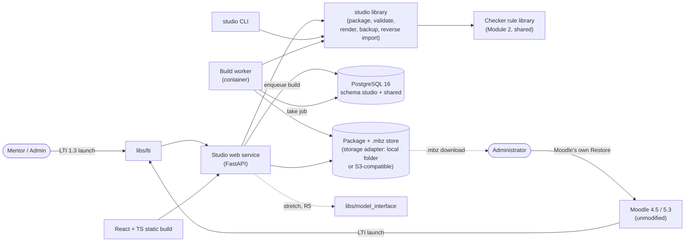

# Design document: Course Studio

**Module:** studio
**Owner:** @Akshita21-09 · **Peer reviewer:** @shraddha0103
**Release(s):** Release 2 (core), Release 5 (stretch)
**Status:** Draft

`Status` values: `Draft` → `In review` (peer reviewing) → `Approved`. **Only the guide sets
`Approved`**, in a pull request the guide merges. Feature code for this module starts only when the
status is `Approved` (foundation work listed in §13 under "Release 0" is allowed earlier).

> Reading key: **PRD** = stated by the PRD or a CLAUDE.md file. **Proposal** = my design choice, to
> be challenged in review. **Open** = the repository does not settle it; listed in §12. Items marked
> **Needs guide** require the guide's decision.

## 1. Purpose and scope

Course Studio helps mentors create and manage course content more efficiently using structured text or forms. It validates course packages, previews course content, and generates Moodle backup files (`.mbz`) that administrators can restore using Moodle's own Restore feature. It also supports importing existing Moodle backups back into editable course packages. The main goal is to let a mentor load a course in **15 minutes or less** (PRD G-1, §C1.7), compared with the current 2–3 hours (problem P1).

**PRD chapter and goals:** PRD §C1 — Course Studio; Goal G-1 — Fast course creation (≤ 15 min to load a 4-week course, vs 2–3 h; delivered in Release 2).

**Out of scope** (PRD §C1.11, complete list): editing a live Moodle course directly; quizzes and Moodle-stored rubrics; workshops; question banks. Course Studio generates backup files for administrators rather than modifying Moodle courses (PRD §A7 C-01, C-02). Also not part of this module (Proposal, follows other PRD chapters): restoring a backup into Moodle (the administrator does this with Moodle's own Restore, PRD §A5); releasing or writing grades (Module 3); video upload or processing (Module 4).

## 2. Requirements covered

Requirement wording is copied from PRD §C1.3. The "approach" and "components" columns are mine (Proposal).

| Requirement | Release | Approach in one line | Main components |
|---|---|---|---|
| FR-S-01: Create and edit a course package through a web editor (forms for structure; Markdown editor for bodies). | R2 | React editor: outline and item forms for structure, Markdown textarea for bodies; saves through the API as a new package version. | Front end, web API, package library |
| FR-S-02: Import and export a course package as a zip (so it can live in Git). | R2 | Package is a folder (B1.1); import unpacks and validates a zip, export zips the folder deterministically (sorted entries). | Package library, web API, CLI |
| FR-S-03: Validate against B1 and the checker rule library (shared with M2) on every save; show errors and warnings per item. | R2 | Schema validation (B1) plus a call to the shared checker rule library; results returned as per-item errors and warnings. No rules are re-implemented here. | Validator adapter, web API, validation panel |
| FR-S-04: Render the marking table (B1.3) to HTML with `data-marking-table="v1"`. | R2 | Parse the `<!-- marking-table v1 -->` block, check that points sum to the assignment points, render an HTML table keeping the attribute. A parser for the reverse direction lives in the same module. | Marking-table module |
| FR-S-05: Learner-view preview per week (HTML render of Page and Assignment as Moodle would show them, approximately). | R2 | Server-side Markdown → sanitised HTML, shown in a preview tab with neutral styling. Approximate by definition. | Renderer, front end preview tab |
| FR-S-06: Generate a Moodle backup (`.mbz`) in `full` mode. | R2 | Build worker writes the Moodle 4.5 backup structure for page, assign, url, label (h5pactivity is also listed in PRD §C1.5; when it is built is Open, §12) with completion, availability, grade items and marking workflow, then zips it. It writes no final-project or course-feedback activity, no course completion criteria and no badge (B1.4, root rule 8); what `full` mode does about these is Open (§12). | Backup generator, build worker |
| FR-S-07: Generate a Moodle backup in `sections-only` mode that never contains protected items (B1.4). | R2 | Same generator with a section filter; protected idnumbers and the protected section are refused at validation and again as a post-build assertion on the generated tree. The assertion also checks that the backup contains no course completion criteria and no badge. | Backup generator, validator |
| FR-S-08: Reverse import: `.mbz` → course package (pages, assignments, marking tables, unlock rules, idnumbers). | R2 | Unpack `.mbz`, read backup XML for the supported activity types, write a B1 package; unsupported items are reported, not dropped silently (Open, see §12). | Reverse importer, CLI, web API |
| FR-S-09: Keep every generated `.mbz` with a version number and the package hash; allow download of any previous version. | R2 | `studio.build` rows link a package version (with its hash) to a stored `.mbz`; download route serves any build. A failed build never replaces the last good one. | Data model, storage adapter, web API |
| FR-S-10: Mentor sees and edits only packages linked to courses where they are Instructor (A5). | R2 | Every route checks the LTI session role and context against `shared.course_link`; administrators may access all courses. | Auth middleware, web API |
| FR-S-11: CLI: `studio validate`, `studio build --mode full\|sections-only`, `studio import-mbz`, each with `--dry-run`/`--check`. | R2 | Thin CLI over the same library the web service uses; exit codes 0/1/2 (OPS-05). | CLI |
| FR-S-12: *(Stretch)* Practice step: AI drafts (via B5) of checkpoint questions, drag-and-drop/ordering and one branching scenario; review cards (question, correct answer, distractors, explanation; keep / edit / regenerate / drop); preview with an open-source H5P player; approved items packed as ungraded H5P (B7). | R5 | **Not designed in detail now.** Starts only after Releases 1–4 meet their exit criteria and after the guide's go (PRD §C5, `modules/studio/CLAUDE.md`). Behind the `STUDIO_PRACTICE_ENABLED` feature flag (EXT-05, default off). Direction only: AI calls through `libs/model_interface`, review cards in the editor, output as ungraded `.h5p` plus a `course.yaml` entry. A separate design addendum is required before any code. | Future: practice drafter, review UI, H5P packer |

Deferrals: none inside Release 2. FR-S-12 is deferred to Release 5 by the PRD, not by me.

Release 2 also includes extending the harness to build → check → restore (PRD §D1). That harness is Module 2's code; Studio supplies the build step and fixtures (see §11).

## 3. Architecture

| Part | Kind | Notes |
|---|---|---|
| Studio web service | Web service (FastAPI) | Editor API, validation on save, preview, build requests, downloads. Serves the static React build. Does no heavy work. |
| Front end | Static React + TypeScript build | Outline, item editor with validation panel, preview tab, build page (PRD §C1.4). |
| Build worker | Worker container | Generates `.mbz` from a package version. Runs outside request handlers (PRD OPS-10). |
| Reverse import | Library function, called by the worker (web) or CLI | Proposal: web requests enqueue it like a build, because large `.mbz` files take time. |
| `studio` CLI | CLI | `validate`, `build`, `import-mbz` over the same library. |
| Studio library | Module-internal Python package | Package model, validation, rendering, backup writer and reader. Shared code that other modules need lives in `libs/`, not here. |
| Shared libraries used | `libs/lti`, `libs/contracts`, `libs/model_interface` (R5), `libs/media_paths` (slugs) | Never copied. |

**Where Studio touches other systems (PRD C-02):**
- **Moodle:** only through a backup file that the administrator restores with Moodle's own Restore, and through LTI 1.3 launches. Studio calls no Moodle web-service function itself in R2. B3 says the LTI context is mapped to the Moodle course through web services (B4) and stored in `shared.course_link`; which component does that lookup is Open (§12 item 27).
- **BigBlueButton:** not touched.
- **Model interface:** not used in Release 2. R5 only, through `libs/model_interface` (C-10).
- **Media store:** not written by Studio. Studio stores only relative paths and slugs where a package references media (C-08).

**Worker on a separate host (PRD OPS-10, EXT-04; Proposal, Needs guide, §12 item 29):** OPS-10 requires that workers can run on a different host from the web service "by configuration alone". The design meets this by letting the two sides share only two things, both reached through configuration:
1. **The PostgreSQL database** (`STUDIO_DATABASE_URL`). The worker connects to it over the network, claims queued builds there, and writes the result back. The worker accepts no inbound requests: it only polls the database and reads and writes storage.
2. **The package and `.mbz` storage, through a storage adapter** (EXT-04: "local folder or S3-compatible"). `STUDIO_STORAGE_BACKEND=local` uses a folder and works only when web service and worker can see the same folder (same host or a shared mount). `STUDIO_STORAGE_BACKEND=s3` uses an S3-compatible bucket and works across hosts. Moving the worker to another host is therefore a change of environment variables, not of code.

Downloads of `.mbz` go through the web service (it reads from the same adapter), so no signed media URL is needed and B6.4 is not used. Whether the PRD's two named backends are the intended choice for Studio, and whether the `s3` adapter ships in Release 2 or only `local` does, is the open decision in §12 item 29. Until the guide decides, Release 2 can only claim single-host operation with certainty.

**Queue mechanism (Proposal, Needs guide):** the PRD requires "a job queue" but names none. Smallest option inside the fixed stack: a `studio.build` row with a `state` column that the worker claims using PostgreSQL row locking, so no new broker or technology is added.

## 4. Contracts

| Contract | Provided / used | Fields or functions I rely on | Change needed? |
|---|---|---|---|
| B1 Course package | Provided (owner) | `course.yaml` (`schema`, `course.shortname/fullname/slug/total_points/mode`, `sections[].number/title/idnumber/unlock.after/unlock.start_date`, `activities[].type/idnumber/title/body/points/submission/completion`), course pattern rules B1.2, marking table B1.3, protected items and modes B1.4 | none (after Release 0: additive only, via `/contract-change`) |
| B2 Course model | Used (through the checker rule library, as the PRD allows) | The model produced from a package or `.mbz`, and the rule results (CK-01…CK-13); the checker diff (FR-C-05) for the round-trip test | none |
| B3 LTI 1.3 launch | Used | Claims `sub`, `roles`, `context`, `deployment_id`; role mapping (Instructor → Mentor, Administrator → Administrator, Learner refused); session bound to (`sub`, context id); `shared.course_link` | none |
| B5 Model and speech interface | Used, R5 only | `model.run(task, inputs, output_schema)` | none |
| B6 Media paths | Used (slugs only) | Slug rules: lowercase ASCII, hyphens, immutable | none |
| B7 H5P practice output | Provided (owner), R5 | `.h5p` file plus `course.yaml` entry (`type: h5p`, `idnumber`, `graded: false`) | none |

No contract change is proposed. Two points need a contract owner's reading, listed in §12 (Open): where B1.3's allowed `Check` values are validated, and whether B1 can express "unsupported item found during reverse import".

## 5. Data model

Tables in schema `studio`. PRD §C1.5 names three tables and their main fields; the exact columns below are a **Proposal**.

| Table | Columns (Proposal beyond the PRD's named fields) | Keys |
|---|---|---|
| `studio.package` | `id`, `course_link_id` (→ `shared.course_link`), `slug`, `current_version_id`, `created_at` | PK `id`; unique (`course_link_id`, `slug`) |
| `studio.package_version` | `id`, `package_id`, `version_no`, `content_hash`, `author_sub` (LTI `sub`), `created_at`, `storage_path` (relative) | PK `id`; unique (`package_id`, `version_no`); FK `package_id` |
| `studio.build` | `id`, `package_version_id`, `mode` (`full`\|`sections-only`), `state` (`queued`\|`running`\|`succeeded`\|`failed`), `mbz_path` (relative), `result` (JSON: messages, failed element), `requested_by_sub`, `created_at`, `finished_at` | PK `id`; FK `package_version_id` |

- Audit entries for state-changing operations go to `shared.audit_log` (OPS-06). That table is owned by the `shared` schema, not this module.
- **Migrations:** versioned and reversible (OPS-07, root rule). Each migration has an `up` and a `down`; `down` drops only what that migration created. A migration test applies up, down, up on an empty database.
- **Relative vs absolute:** `storage_path` and `mbz_path` are paths relative to a configured storage root. Package media references are relative paths or slugs, never full URLs (C-08). CK-12 (checker) flags full URLs; Studio's validation rejects them through the shared rule library.
- **Identity:** `idnumber`s and slugs are stored in the package and never derived from titles (EXT-06, module rule 6). Mechanism (Proposal): the editor shows `idnumber` and `slug` as read-only once a package version is saved, and renaming a title changes only the title. The validator also compares each new package version with the previous one and reports an error when an existing activity's `idnumber`, or the course `slug`, has changed or been reused for a different activity (B1.2 rule 6).
- **Dependency on `shared.course_link`:** `studio.package.course_link_id` refers to a table in the `shared` schema whose columns the PRD does not define (B3 only says the LTI context id is stored there). The exact key is Open (§12 item 33).
- **Backup and restore (OPS-08):** the module README documents backing up and restoring the `studio` schema and the package/`.mbz` storage (folder or bucket) together, because a package version row without its stored file is unusable. The procedure is written when the first storage code exists.
- **Personal data:** only the LTI `sub` is stored for authorship. No names or emails are stored by Studio (Proposal; see §9).

## 6. Interfaces

### Web/API (Proposal; all routes need an LTI session, SEC-02)

| Route | Purpose | Allowed roles |
|---|---|---|
| `GET /health` | status and version (OPS-03) | none required |
| `POST /lti/login`, `POST /lti/launch`, `GET /lti/jwks` | LTI 1.3 endpoints via `libs/lti` (B3) | Moodle |
| `GET /api/packages` | packages linked to the launch course | Mentor (own courses), Administrator (all) |
| `POST /api/packages` | create package, or import a zip (FR-S-02) | Mentor, Administrator |
| `GET /api/packages/{id}` | current package content | Mentor (own), Administrator |
| `PUT /api/packages/{id}` | save a new version; returns validation result (FR-S-03) | Mentor (own), Administrator |
| `GET /api/packages/{id}/export` | zip download (FR-S-02) | Mentor (own), Administrator |
| `GET /api/packages/{id}/preview/{section}` | rendered learner view (FR-S-05) | Mentor (own), Administrator |
| `POST /api/packages/{id}/builds` | request a build with `mode`; returns a build id (FR-S-06, 07) | Mentor (own), Administrator |
| `GET /api/builds/{id}` | status and result (UI-04 progress) | Mentor (own), Administrator |
| `GET /api/builds/{id}/download` | `.mbz` download (FR-S-09) | Mentor (own), Administrator |
| `POST /api/imports` | upload `.mbz` for reverse import (FR-S-08) | Mentor (own), Administrator |

Rules: Learner role is refused at launch (EXT-07; the check is not removed). A mentor receives 403 for packages of courses where they are not Instructor. State-changing requests carry CSRF protection (SEC-09). Errors follow §10.

### CLI (PRD FR-S-11, OPS-05)

All commands accept `--dry-run`, `--check`, `--config <file>`. Exit codes: 0 = OK, 1 = problems found (with `--check`/validation), 2 = error.

| Command | `--dry-run` | `--check` | Undo (documented in the module README) — Proposal, Needs guide |
|---|---|---|---|
| `studio validate <pkg>` | Same as running; changes nothing | Exit 1 when errors exist | Nothing to undo (read-only) |
| `studio build <pkg> --mode full\|sections-only` | Prints which sections and activities would be written and the output path; writes nothing | Reports whether a build is current for the package hash and would validate; writes nothing | Delete the build record and its `.mbz` for that build id; earlier builds are untouched (FR-S-09) |
| `studio import-mbz <file>` | Prints the package that would be created and any unsupported items | Reports whether the file parses and which items are unsupported | Remove the package folder/version the import created |

### Configuration (all through environment variables, C-06; every variable is added to `.env.example` with a placeholder when implemented)

| Variable (Proposal) | Purpose | Default | In `.env.example` |
|---|---|---|---|
| `STUDIO_DATABASE_URL` | PostgreSQL connection | placeholder | to add |
| `STUDIO_STORAGE_BACKEND` | `local` or `s3` storage adapter (EXT-04, OPS-10) | `local` (Proposal) | to add |
| `STUDIO_STORAGE_ROOT` | root folder for packages and `.mbz` (`local` backend) | placeholder | to add |
| `STUDIO_S3_ENDPOINT`, `STUDIO_S3_BUCKET` | S3-compatible storage location (`s3` backend) | placeholder | to add |
| `STUDIO_S3_ACCESS_KEY`, `STUDIO_S3_SECRET_KEY` | credentials for the `s3` backend; environment only, never logged (C-06) | placeholder | to add |
| `STUDIO_WORKER_POLL_SECONDS` | how often the worker looks for queued builds | 5 (Proposal) | to add |
| `STUDIO_PROTECTED_IDNUMBERS` | protected idnumbers (default `final-project,course-feedback`; B1.4 says configurable) | as shown | to add |
| `STUDIO_PROTECTED_SECTION` | protected section number (B1.4 says configurable) | Open: no default stated (§12 item 13) | to add |
| `STUDIO_MAX_UPLOAD_MB` | size limit for zip and `.mbz` uploads (SEC-05) | 50 (Proposal, §12 item 30) | to add |
| `STUDIO_MAX_UNZIPPED_MB` | total unzipped size limit, zip-bomb protection (SEC-05) | 200 (Proposal, §12 item 30) | to add |
| `STUDIO_MAX_ZIP_ENTRIES` | maximum files in an uploaded archive (SEC-05) | 5000 (Proposal, §12 item 30) | to add |
| `STUDIO_PRACTICE_ENABLED` | feature flag for the practice step, FR-S-12 (EXT-05) | `false`; no effect before Release 5 | to add |
| LTI, session and secret variables | via `libs/lti` | owned by that library | by that library |
| `MODEL_PROVIDER`, `MODEL_NAME` | R5 only, via `libs/model_interface` | B5.2 | by that library |

No variable has been added to `.env.example` by this document.

## 7. Key decisions and alternatives

| Decision | Alternatives considered | Why this one | Record |
|---|---|---|---|
| Library first: one `studio` library used by the web service, worker and CLI | Separate logic per entry point | Rule "never copy code"; one behaviour for web and CLI; tests cover it once | Decision record to be written in `docs/decisions/` when this document is approved (number assigned then) |
| Build runs in a worker, request handler only enqueues | Build inside the request | PRD OPS-10 forbids heavy work in a request; UI-04 wants progress | Decision record to be written when this document is approved |
| Job queue = PostgreSQL rows claimed by the worker (Needs guide) | Redis or another broker; Celery | The stack is fixed (A10); no new service or technology | Decision record to be written when this document is approved |
| Validation delegates to the checker rule library | Re-implementing rules in Studio | `modules/studio/CLAUDE.md` rule 5 forbids it; avoids drift | No separate record: follows a PRD or CLAUDE.md rule |
| Generate only the Moodle 4.5 backup format | Version-specific outputs for 4.5 and 5.3 | Rule 3 in `modules/studio/CLAUDE.md`; must restore on both (C-03) | No separate record: follows a PRD or CLAUDE.md rule |
| Package of record = stored package versions in Studio, with zip import/export for Git (Open) | Git as the store | FR-S-02 and A15 describe zip exchange; Studio is a loading tool, Moodle is the master after first run | Decision record to be written when this document is approved |
| Preview = server-side Markdown render with neutral styling | Embedding Moodle or a headless Moodle render | FR-S-05 says "approximately"; embedding Moodle would add a route C-02 does not list | Decision record to be written when this document is approved |
| Reverse import supports only the activity types Studio generates (page, assign, url, label; h5pactivity when it is built, Open) and reports the rest | Best-effort import of everything | Round-trip rule (module rule 8) is only provable for supported types | Decision record to be written when this document is approved |
| Two-layer protection for `sections-only`: refuse at validation, assert again on the generated tree (no protected idnumber or section, no completion criteria, no badge) | Validation only | Module rule 2 treats any attempt as an error; cheap second check | No separate record: follows a PRD or CLAUDE.md rule |

## 8. Libraries and licences

**How these were checked (2026-10-25).** Versions and licences below come from the package registries' own metadata (PyPI JSON for Python packages, the npm registry for JavaScript packages), read on that date. The "Pinned version" is the latest release listed there; it is a **proposed pin**, to be written into the lock file in the first pull request that adds each library. Licence text in the packages themselves, transitive dependencies, vulnerability scans (SEC-08) and compatibility with Python 3.12 were **not** checked. For the Python packages whose metadata loaded, the minimum Python version listed is at most 3.11, which does not prove they work on 3.12. For Pydantic and lxml the Python requirement could not be read. Anything marked **Verify** is still unconfirmed. None of these libraries has been added to the repository.

| Library | Pinned version (proposed) | Licence (registry metadata) | Why needed | Alternative |
|---|---|---|---|---|
| FastAPI | 0.162.0 | MIT | Web framework (fixed by A10) | none (stack fixed) |
| uvicorn | 0.54.0 | BSD-3-Clause | ASGI server to run FastAPI. **Verify** this is the intended server | other ASGI servers (not checked) |
| python-multipart | 0.0.32 | Apache-2.0 (also PyPI classifier) | File and form uploads in FastAPI (FR-S-02, FR-S-08). **Verify** it is required by the pinned FastAPI | none |
| Pydantic | 2.14.1 | MIT | Models for contracts and API payloads (root rule) | none |
| PyYAML | 6.0.3 | MIT | Read and write `course.yaml`. Comment preservation is not needed (**Proposal**) | ruamel.yaml (licence not checked) |
| markdown-it-py | 4.2.0 | MIT (PyPI classifier only; the licence field is empty. **Verify** from the licence file) | Render Markdown bodies for preview and for Moodle | Python-Markdown (not checked) |
| nh3 | 0.3.7 | MIT | Sanitise rendered HTML before preview and before writing into the backup | bleach (not checked) |
| lxml | 6.1.3 | BSD-3-Clause | Read and write backup XML. Must be configured not to resolve external entities or DTDs on untrusted `.mbz` content (**Verify** the exact settings at implementation) | standard-library `xml.etree` (no new dependency; weaker protection against hostile XML) |
| psycopg | 3.3.6 | **LGPL-3.0-only**: allowed by C-11 only as an unmodified library | PostgreSQL driver | asyncpg 0.32.0, Apache-2.0 (no LGPL question). Choice is §12 item 32 |
| Alembic | 1.20.1 | MIT | Reversible migrations (OPS-07) | none chosen. Alembic depends on SQLAlchemy |
| SQLAlchemy | 2.1.6 | MIT | Required by Alembic. **Verify** the dependency and any extra transitive licences | none |
| jsonschema | 4.26.0 | MIT | Validate against the B1 schema if `libs/contracts` does not provide it | `libs/contracts` validators first |
| boto3 | 1.43.118 | Apache-2.0 | `s3` storage backend only (§3). Needed only if the guide approves it (§12 item 29) | none; `local` backend needs no library |
| React | 19.3.1 | MIT | Static front end (fixed by A10) | none |
| TypeScript | 7.0.2 | Apache-2.0 | Front-end language (fixed by A10) | none |
| Vite | 8.3.5 | MIT | Build tool for the React static build. A10 names React + TypeScript but no build tool, so this is a **Proposal** (§12 item 31) | other bundlers (not checked) |
| Markdown editor component | none chosen | n/a | FR-S-01 "Markdown editor for bodies". Proposal: a plain text area with the preview tab (§12 item 31), so no new dependency | an editor library, if the guide requires one |
| ESLint | 10.13.0 | MIT | TypeScript lint (root rule 6) | none |
| Prettier | 3.9.10 | MIT | TypeScript format (root rule 6) | none |
| ruff | 0.17.2 | MIT | Python lint and format (root rule 6) | none |
| mypy | 2.4.0 | MIT | `mypy --strict` on `libs/` (root rule 6); not required inside the module | none |
| pytest | 9.1.1 | MIT | Python tests (root rule 6) | none |
| Playwright (Python) | 1.64.1 | Apache-2.0 | Browser tests (fixed by A10) | none |

Use `libs/` implementations before adding anything here (for example LTI, contract validation).

## 9. Security and privacy

| ID | Applies? | How it is met |
|---|---|---|
| SEC-01 LTI launch validation | Yes | Entirely through `libs/lti`; Studio implements none of it. |
| SEC-02 Authorisation per request | Yes | Middleware reads role and context from the server-side session; every route checks it against `shared.course_link` (FR-S-10). |
| SEC-03 Service-account token | Open | Studio's own features need no Moodle token in R2. B3 maps the LTI context to the Moodle course through web services, and the PRD does not say which module does that (§12 item 27). PRD §B.0 lists B4 as used by M2 and M3, not M1, so Studio does not take on B4 usage unless the guide and the B3/B4 owners decide so. This document changes no contract. |
| SEC-04 Sandbox | No | Studio runs no learner code. |
| SEC-05 Uploads | Yes | Zip package and `.mbz` uploads: size limit; type checked by content (zip structure), not only extension; stored outside any web root; unzip with path-traversal protection (reject entries outside the target folder) and limits on total unzipped size and file count (zip-bomb protection). The virus-free assumption is documented in the README. |
| SEC-06 Personal data | Yes | Only LTI `sub` stored for authorship (Proposal). Test data only (C-07). |
| SEC-07 Data to hosted AI | R5 only | R2 sends nothing to an AI provider. R5 will be documented here before coding. |
| SEC-08 Dependency scan | Yes | CI scan; no critical vulnerabilities at release. |
| SEC-09 CSRF and cookies | Yes | CSRF protection on state-changing routes; secure, same-site session cookies (via `libs/lti`/framework). |

Other handling:
- **Markdown/HTML:** preview and Moodle description HTML are sanitised; scripts and event handlers are removed. Mentors are trusted, but packages can be imported from elsewhere.
- **Secrets and logs:** structured JSON logs with request id, `sub`, course and action; no secrets, tokens or file contents (OPS-04).
- **Learner role:** refused (EXT-07).
- **Test data only:** no real learner data or course content is used in tests or examples.

**For `docs/data-map.md` (to be added when implemented):**

| Data item | Stored where | Sent to | Kept for | Why |
|---|---|---|---|---|
| Package versions (course text, structure) | `studio.package_version` + storage root | nowhere in R2 | Open (retention not specified by the PRD) | Version history, FR-S-09 |
| Generated `.mbz` | storage root, `studio.build.mbz_path` | downloaded by mentor/admin | Open | Download of any previous version, FR-S-09 |
| Author LTI `sub` | `studio.package_version`, `shared.audit_log` | nowhere | Open | Audit, OPS-06 |

## 10. Error handling

Messages say what happened and what to do next (UI-05). All strings live in one place in the module (UI-07, root rule 6). Examples are taken from PRD §C1.8.

| Situation | Behaviour | Example / recovery |
|---|---|---|
| Validation **error** | Blocks building; names the item and rule | "Week 3 task: marking table points add up to 8; the task is worth 10." Fix the table or the points. |
| Validation **warning** | Allows building; shown per item | Mentor decides whether to fix. |
| Protected `idnumber` in a package | Rejected in both modes with a clear message (B1.4, module rule 2) | Remove or rename the item; protected items belong to the template course. |
| Build failure | Shows which element failed; keeps the previous good version (C1.8) | Fix the item and rebuild. |
| Restore problem reported by the harness | Linked to the build (C1.8) | Mentor/admin sees the harness message on the build page. |
| Unparseable `.mbz` in reverse import | Clear message naming the file and element | Re-export from Moodle or send the file to the administrator. |
| Unsupported item in `.mbz` | Reported in the import result and left out of the package (Open) | Add it in Moodle after restore, or ask the guide whether the type should be supported. |
| Unauthorised access | 403 with a plain message | Launch Studio from the correct course. |
| Learner launch | Refused: "not available in this version" (EXT-07) | Use Moodle. |
| Session expired (2 h idle, B3) | Message to relaunch from Moodle | Unsaved edits: Proposal, keep an autosaved draft so work is not lost (Open). |
| Database or storage unavailable | Saves and builds fail with "try again later"; no partial write; build stays `queued`/`failed` with a reason | Retry; the previous version stays intact. |
| Checker rule library unavailable or erroring | **Proposal:** validation reports "checks could not run" (never "no errors"); build is blocked | Retry; report to the administrator. |
| Moodle unavailable | A new LTI launch (and any course-binding lookup) fails. A user whose Studio session is still valid (2 h idle, B3) can keep working; otherwise they must relaunch from Moodle. Nothing in Studio calls Moodle after launch. | Relaunch from Moodle when it is back. |
| BigBlueButton / model provider | Not used in R2. In R5, provider failure shows "draft unavailable" and never a partial item (B5.2: one retry, then a clear error) | Edit manually. |

## 11. Test plan

| Level | What is tested | Test data | Requirement IDs |
|---|---|---|---|
| Unit | Package read/write; `idnumber`/slug handling; calls into the shared rule library (not the rules themselves); marking-table render and parse (including bad sums); unlock-rule conversion to Moodle availability JSON; backup XML writers; protected-item refusal; generated backup contains no completion criteria or badge; reverse-import parsers; role/context checks | Small fixtures made for tests; B8.2 | FR-S-01…11 |
| Contract | `course.yaml` examples and generated/imported packages validate against the B1 schema; invalid data is rejected with a clear error | `contracts/examples/`, B8.2 | FR-S-02, FR-S-03, FR-S-08 |
| Integration (harness) | build (full) → restore on fresh 4.5 and 5.3 → checker; sections-only merge into B8.1 → protected items unchanged; full round trip (module rule 8): package → `.mbz` → restore on Moodle → Moodle backup of the restored course → package → checker diff shows no structural differences; worker run with `STUDIO_STORAGE_BACKEND` set for a separate-host setup, if the guide approves the `s3` backend (§12 item 29) | B8.1, B8.2 | FR-S-06, 07, 08 |
| End-to-end | Mentor flows in a browser: edit, see validation error, preview, build, download; wrong-role and wrong-course access denied; phone / laptop / half-width profiles | B8.2, fixed test accounts from Module 2 | FR-S-01, 03, 05, 09, 10 |
| CLI | `validate`, `build`, `import-mbz` with `--dry-run` (nothing written), `--check`, exit codes 0/1/2, documented undo | B8.2 | FR-S-11 |
| Migration | up/down/up on an empty database | none | OPS-07 |

**Acceptance criteria (PRD §C1.7) and how each is shown:**

| Criterion | Demonstration |
|---|---|
| B8.2 → `.mbz` (full) → restored on fresh 4.5 and 5.3 → checker reports 0 errors | Harness run (Module 2's harness, Studio's build step) on both lab sites; report attached to the release |
| Sections-only restored by merge into B8.1: protected items unchanged | Harness compares idnumbers, count, badge and completion criteria before and after restore |
| A package with a protected idnumber is rejected with a clear message | Unit and CLI test with a package containing `final-project` in each mode |
| Reverse import → package → rebuild gives an equivalent course (checker diff: no differences) | Harness round-trip using the checker diff (FR-C-05) |
| Mentor time for loading B8.2 ≤ 15 min | Timed, recorded session (below) |
| *(Stretch)* practice review ≤ 5 min; practice restores ungraded | R5 only |

**Metrics (PRD §C1.9) and measurement (PRD E3: from logs or recorded sessions, never estimates):**

| Metric | Method | Data | Who measures |
|---|---|---|---|
| Time to load a course (target ≤ 15 min) | Timed session from finished text (B8.2) to restored course. Start is the first import or edit in Studio, end is the successful restore on the lab site; both times from logs plus a screen recording. Record data set, method, date and the person measured (PRD E3). Steps by the administrator (the restore) are included. | B8.2 on lab Moodle 4.5 and 5.3 | Open: the PRD does not name who measures (§12 item 19). Proposal: the owner runs it, the peer reviewer observes, the guide may repeat it. |
| Validation errors caught before build | Count of errors reported at save/build vs errors found by the checker after restore | B8.2 plus planted-error variants (B8.3) | Owner |
| Restore success rate per Moodle version | Share of builds that restore cleanly on each version (harness) | harness runs | Harness report |

Page load (UI-06): Playwright end-to-end tests record load time of the editor, preview and build pages on the lab network and fail above 2 s (builds excluded).

Traceability: every requirement above is added to `docs/traceability.md` in the pull request that implements it (PRD E4).

## 12. Risks and open questions

Items marked **Needs guide** need the guide's decision. "Needs the lab" refers to PRD Appendix C items that require the lab Moodle sites.

| # | Risk or question | Needs the lab? | Plan or owner |
|---|---|---|---|
| 1 | **Undocumented Moodle backup format changes** between 4.5 and 5.3 (PRD App-D). A 4.5-format backup must restore on 5.3. | Yes | Restore on both versions in every build (E2). Owner, with Module 2's harness. |
| 2 | The exact backup XML elements needed for page, assign, url, label with completion, availability, grade items and marking workflow are not in the repository. | Yes | Study the backup format and record the findings in `docs/decisions/` before writing the generator. Owner. |
| 3 | **App-C #2:** does Restore merge a sections-only backup into a template course without touching protected items? Design of FR-S-07 depends on it. | Yes | Verify in Release 0. **Needs guide** if the answer is no. |
| 4 | **App-C #3:** restore route for the harness (admin CLI vs browser automation). Affects the "restored automatically in CI or the harness" requirement (PRD §C1.5). | Yes | Verify in Release 0 with Module 2. |
| 5 | **App-C #10:** which roles hold backup and restore by default. Affects what the mentor can do with the `.mbz` and with reverse import (a mentor may need a backup made by an admin). | Yes | Verify in Release 0. |
| 6 | **App-C #5:** exact H5P content-type versions on both Moodle versions (R5 only). | Yes | Verify in Release 0; revisit before R5. |
| 7 | **App-C #9:** Moodle 5.3's own AI features may overlap with FR-S-12 (R5). | Yes | Record overlap; adjust R5 scope. **Needs guide**. |
| 8 | **App-C #1 and #6:** B4 function check and LTI library choice. Studio uses LTI; B4 only if course binding needs it. | Yes (#1) | Follow Release 0 results. |
| 9 | **Dependency on Release 0/1 deliverables:** the repository has no frozen B1 schema, `libs/` code or checker rule library yet. FR-S-03 cannot be built or tested without them. | No | Track as blockers in §13; do not start feature code until they exist. |
| 10 | Where does the shared rule library live and what is its API? `modules/studio/CLAUDE.md` says "`libs/`/`modules/checker`". | No | **Needs guide** and Module 2 owner. |
| 11 | Who validates B1.3 `Check` values (allowed values are defined in PRD §C3.5; unknown names are CK-09)? Studio should not re-implement that rule. | No | Confirm with Module 2/3 owners that CK-09 covers it. |
| 12 | Job queue mechanism (PostgreSQL rows vs a broker). | No | **Needs guide**; recorded as a decision (§7). |
| 13 | The value of `protected_section` (B1.4 says configurable but gives no default), and how a section number "collides". | No | Confirm with the B1 owner and guide. |
| 14 | Reverse import of items Studio does not generate (quizzes, workshops, question banks): report-and-skip vs refuse. PRD is silent. | No | **Needs guide**. |
| 15 | Round-trip equivalence (module rule 8) depends on the checker diff (FR-C-05) covering all fields Studio writes. | No | Agree the compared fields with Module 2. |
| 16 | Retention of package versions and `.mbz` files; PRD gives none for Studio. | No | **Needs guide** (also needed for the data map). |
| 17 | Session expiry could lose unsaved edits (B3: 2 h idle). | No | Proposal: autosave drafts. Confirm. |
| 18 | Preview accuracy: "approximately" is not measurable. | No | Define a checklist of what the preview must show (headings, links, marking table). Confirm. |
| 19 | Who measures the 15-minute target and with which mentor? | No | **Needs guide**. |
| 20 | CLI "documented undo" form (§6 is a Proposal). | No | **Needs guide**. |
| 21 | Package of record: Studio's database vs Git (A15 says Moodle becomes master after the first run). | No | Confirm with the guide. |
| 22 | Library versions and licences in §8 come from registry metadata only (read 2026-10-25). Not checked: licence files, transitive dependencies, vulnerability scan, Python 3.12 compatibility (Pydantic and lxml requirements could not be read), and the **Verify** items in §8. | No | Re-check each library, and run the dependency scan (SEC-08), in the PR that adds it. |
| 23 | FR-S-12 detail (H5P player for preview, content types) is intentionally not designed now. | Partly | Separate addendum before R5, after the guide's go. |
| 24 | Contract concern: none proposed. If B1 needs a field (for example, an "unsupported item" marker), it goes through `/contract-change`, not this document. | No | Owner, only if needed. |
| 25 | **Protected completion criteria and badge in `full` mode.** B1.4 and root rule 8 say they are never generated, yet `full` mode is meant to produce a whole test course. Does a `full` build simply omit completion criteria and badge, or is something else intended? Sections-only is clear: none are written. | No | **Needs guide** and the B1 owner. |
| 26 | **B1.2 rules 1–2** (one guide Page and one task Assignment per week; week N unlocks when week N−1's task is submitted) have no rule in the checker catalogue CK-01…CK-13. Which module implements them, so that Studio does not re-implement rules (module rule 5)? | No | **Needs guide**, Module 2 owner. |
| 27 | **Course binding:** B3 maps the LTI context to the Moodle course via web services (B4) and stores it in `shared.course_link`. Which component performs this: `libs/lti`, `libs/moodle_ws`, or Studio? Affects SEC-03 (§9). | No | **Needs guide**, B3/B4 owners. |
| 28 | **h5pactivity timing:** PRD §C1.5 lists `h5pactivity` among the backup types but practice is R5 (FR-S-12). Is `h5pactivity` generation and reverse import part of R2 or R5? | No | **Needs guide**. |
| 29 | **Separate-host workers and storage (OPS-10, EXT-04):** the design shares only the database and a storage adapter (`local` folder or S3-compatible bucket) between web service and worker (§3). Does Release 2 need the `s3` backend (and boto3), or is `local` with a shared mount enough? Until decided, cross-host operation is not claimed. | Partly (needs a second host to test) | **Needs guide**. |
| 30 | **Upload limits:** the PRD gives no size limits for packages or `.mbz` files. The defaults in §6 (50 MB upload, 200 MB unzipped, 5000 entries) are my proposal. What sizes do real course backups reach? | Partly (size of a restored B8.1/B8.2 backup) | **Needs guide**; measure with B8.1/B8.2 first. |
| 31 | **Front-end tooling:** Vite as the build tool (A10 names none) and a plain text area plus preview as the "Markdown editor" (FR-S-01). Acceptable, or must an editor library be used? | No | **Needs guide**. |
| 32 | **Database driver licence:** psycopg is LGPL-3.0-only (allowed as an unmodified library); asyncpg is Apache-2.0. Which one? | No | **Needs guide** if LGPL is not wanted. |
| 33 | **`shared.course_link` columns:** the PRD does not define them, and `studio.package` refers to it (§5). | No | Agree the key with the B3 owner (Student 2). |
| 34 | **Backup and restore procedure (OPS-08)** for the `studio` schema and the package/`.mbz` storage is described only in outline (§5). | No | Write it in the module README with the first storage PR. |

## 13. Work breakdown

One requirement (or one tightly related group) per pull request. Feature work starts only when this document says `Status: Approved`. Items marked "Release 0" are foundation work the PRD places in Release 0, and may start earlier.

| Order | Pull request | Requirements | Depends on | Notes |
|---|---|---|---|---|
| 1 | Studio module skeleton: package layout, config loading, `/health`, logging, CI wiring | OPS-02, OPS-03, OPS-04 | Approved design | Skeleton only, no feature behaviour |
| 2 | B1 schema, examples and validators (owner of the contract) | B1 (contract) | — | **Release 0** foundation. Touches `contracts/` (outside `modules/studio`): say so in the PR. Contracts freeze at the end of Release 0. |
| 3 | B8.1 template course and B8.2 sample course | B8.1, B8.2 | 2 | **Release 0** test data (owner: Student 1) |
| 4 | Record the backup-format and restore findings (§12 items 1–5) | App-C #2, #3, #10 | Lab VMs | **Release 0**; decision records in `docs/decisions/` |
| 5 | `studio` schema migration (`package`, `package_version`, `build`), reversible | Supports FR-S-02, FR-S-09 | Approved design | Migration up/down/up test (OPS-07) |
| 6 | LTI wiring and per-course authorisation middleware | FR-S-10 | `libs/lti` (Release 0), 5; §12 item 27 | Before any route that returns package data |
| 7 | Package read/write and zip import/export | FR-S-02 | 2, 5, 6 | |
| 8 | Validation on save (B1 plus checker rule library) and the validation panel API | FR-S-03 | 2, 7, shared rule library (R1); §12 items 10, 26 | Blocked if the library is missing |
| 9 | Marking-table renderer and parser | FR-S-04 | 2 | |
| 10 | `.mbz` generator, `full` mode, and build worker | FR-S-06 | 4, 5, 7, 8, 9; §12 items 25, 28, 29 | Worker and storage adapter; the `s3` backend only if approved (§12 item 29) |
| 11 | `sections-only` mode with protected-item refusal (idnumbers, section, completion criteria, badge) | FR-S-07 | 10 | |
| 12 | Build history and downloads | FR-S-09 | 10 | |
| 13 | Reverse import | FR-S-08 | 4, 10, checker diff (R1); §12 items 14, 28 | |
| 14 | Web editor (outline, forms, Markdown editor) and preview | FR-S-01, FR-S-05 | 6, 7, 8, 9 | Phone, laptop and half-width profiles (UI-02); UI-03 accessibility |
| 15 | CLI: `validate`, `build`, `import-mbz` with `--dry-run`/`--check` and documented undo | FR-S-11 | 7, 8, 10, 13; §12 item 20 | |
| 16 | Harness extension: build → check → restore on 4.5 and 5.3; timed-load measurement | Release 2 exit criteria | 10, 11, 13, harness (R1) | Harness code is Module 2's; coordinate, and say so in the PR |
| 17 | README, `.env.example`, `docs/data-map.md`, `docs/traceability.md`, release notes | PRD §D2 items 5–6 | all | Also updated in every earlier PR as needed |
| 18 | *(R5, stretch)* addendum design, then FR-S-12 | FR-S-12 | Releases 1–4 exit criteria, guide's go | Do not start before then |

## 14. Review and approval

- [ ] Owner: I understand and can explain every section.
- [ ] Peer reviewer: checked against the PRD chapter and the contracts; comments resolved.
- [ ] Guide: approved (sets `Status: Approved`).
