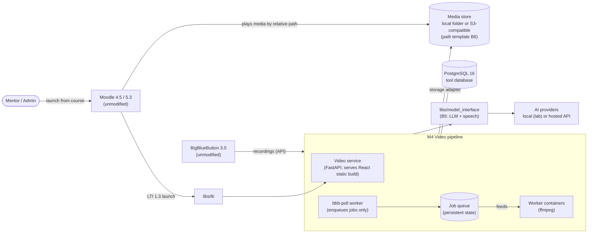

# Design document: Video pipeline

**Module:** video — Student 4, Video Pipeline
**Owner:** Nagashree V (GitHub: vnaags) · **Peer reviewer:** Harshithamanjunatha
**Release(s):** Release 3 (core), Release 5 (stretch)
**Status:** Draft

`Status` values: `Draft` → `In review` (peer reviewing) → `Approved`. **Only the guide sets
`Approved`**, in a pull request the guide merges. Feature code for this module starts only when the
status is `Approved` (foundation work listed in §13 under "Release 0" is allowed earlier).

> Reading key: design content marked with a PRD section in brackets is taken from `docs/PRD.md`; the
> structure follows `docs/design/TEMPLATE.md`. Where the PRD is silent, this revision wrote a
> **Proposed** design. The guide's assistant answered the numbered questions **Q1–Q16** on 2026-11-19
> (PR #140, §12); items he confirmed are marked **Confirmed (Qn)**. The answers address those
> questions, **not the approval**: this document stays `Draft`, the owner marks it `In review`, and
> only the guide sets `Approved`. Nothing here changes a contract or the PRD.

## 1. Purpose and scope

The video pipeline accepts large lecture videos and live-class recordings and processes them into the standard lesson folder (B6), with captions, transcript, chapters, summary, slide index and manifest, ready for Moodle to play by relative path. It is built so the future dual-stream player (F-1) needs no rework [§C4.1]. A mentor uploads a 700 MB lecture from the browser and the upload resumes if the connection drops; a live-class recording appears in the right course folder with captions and chapters without the mentor doing anything; the mentor sees the processing status of every lesson and can fix a wrong chapter title; an administrator can re-run processing for a lesson after a pipeline upgrade [§C4.2].

**PRD chapter and goals:** PRD §C4 — Video pipeline; problem P4 (videos are hard to handle and to use: large files are hard to upload; lectures and live-class recordings have no captions, chapters or index) [§A2]. Goals [§A3], all delivered in Release 3: G-6 — caption word error rate on Indian-English lectures (B8.5), measured and reported, target fixed from the first baseline run (App-C 7); G-7 — time from a 90-min recording becoming available to captions, chapters and index ready ≤ 30 min; G-8 — a 700 MB file through a proxy that limits requests to 100 MB, with one interruption, succeeds and resumes.

**Out of scope** (PRD §C4.11, complete list): the dual-stream player (F-1) and importing BigBlueButton's separate streams (F-2), both of which belong to the extension track (§C6); live streaming; video editing.

## 2. Requirements covered

Requirement wording is copied from PRD §C4.3. The "approach" and "components" columns repeat only what other PRD sections state about the requirement.

| Requirement | Release | Approach in one line | Main components |
|---|---|---|---|
| FR-V-01: Resumable chunked upload (tus protocol), chunk size configurable (default 90 MB, below a 100 MB proxy limit), max file 4 GB; accepts mp4, mov, mkv, webm. | R3 | Upload page with drag-and-drop, per-file progress, resume after reload [§C4.4]; size limit, type check by content, stored outside any web root until processed [SEC-05]. | Upload page [§C4.4]; `video.upload` [§C4.5] |
| FR-V-02: Upload form chooses course (from LTI context), module and lesson (number + title → slug); accepts optional `camera` and `screen` tracks (stored and listed, not processed beyond validation in v1). | R3 | Lesson folder follows the B6.1 path template; slugs lowercase ASCII, hyphens, immutable [§B6.1]; `camera`/`screen` are reserved track roles [§B6.3], listed in the manifest in addition to the required `main` track (`720p.mp4`) [§B6.2, §B6.3], never instead of it in v1 (see §4). | Upload page [§C4.4] |
| FR-V-03: Transcode to `720p.mp4` (H.264/AAC) when needed; optional `360p.mp4`; extract `poster.jpg`. | R3 | ffmpeg for transcode and poster [§C4.5] in worker containers [OPS-10]; `360p.mp4` behind a feature flag [§B6.2], listed with role `main-low` [§B6.3]; `poster.jpg` is required [§B6.2] but has no manifest field in B6.3 (see §4). | Workers; ffmpeg |
| FR-V-04: Transcribe via B5.4; write `transcript.en.json` and `captions.en.vtt`. | R3 | `speech.transcribe(audio_path, language="en")` [§B5.4]; transcript in the B5.4 segment shape [§B6.2]; transcription runs in workers [OPS-10]. Only the PRD text of B5.4 is relied on; the B5 contract is not yet merged (see §4). | Workers; speech interface |
| FR-V-05: Chapters via B5.1 from the transcript; write `chapters.json`; mentor can edit titles. | R3 | `model.run(task, inputs, output_schema)` [§B5.1]; `chapters.json` is `[{start, end, title}]` [§B6.2]; chapters editable on the lesson detail page [§C4.4]. | Model interface; lesson detail page |
| FR-V-06: Summary via B5.1; write `summary.en.md` (feature flag). | R3 | `model.run` [§B5.1]; optional file behind a feature flag [§B6.2]. | Model interface |
| FR-V-07: Slide index: detect slide changes, write `slides.json` and thumbnails (feature flag, on by default). | R3 | ffmpeg for scene detection [§C4.5] in workers [OPS-10]; `slides.json` is `[{t, thumb, text?}]`, thumbnails 320 px wide [§B6.2]. | Workers; ffmpeg |
| FR-V-08: Write `lesson.json` (B6.3) last, only when all required files exist. | R3 | Outputs written to a temporary folder and moved into place atomically [§C4.5]; partial outputs never exposed [§C4.8]. | Worker step `manifest` (last step of a job; see §5 and §13) |
| FR-V-09: BigBlueButton intake: poll recordings via the BigBlueButton API (shared secret), fetch the **video** format output, map it to course and cohort using the recording metadata set by Moodle's BigBlueButton activity, and process it into the live-class path. | R3 | Live-class path `courses/{course_slug}/live-{cohort}/{nn}-{topic_slug}/` [§B6.1]; lab BigBlueButton has the video recording format enabled [§A11]; metadata fields verified in Release 0 [App-C 4]. The single **video** format output becomes the lesson's `main` track; the folder holds the same required B6.2 files as an uploaded lesson [§B6.2]. Separate camera and slide streams are F-2, out of scope [§C4.11]. `source.kind` for intake is `bbb`, with no `uploaded_by` (§4, Q5). | `bbb-poll` worker (Proposed, §3); BigBlueButton adapter |
| FR-V-10: Status page per course: queued / processing (step) / ready / failed, with retry. | R3 | Failed step shown with reason and retry [§C4.8]; long operations show progress and can be left and resumed [UI-04]. | Status list [§C4.4]; `video.job`, `video.step` [§C4.5] |
| FR-V-11: Re-process a lesson (new `pipeline_version`) without changing its path or deleting the previous outputs until the new ones are complete. | R3 | `pipeline_version` is recorded in the manifest's `processing` object [§B6.3]. Proposed: a re-process is a new job that writes into a new temporary folder and swaps it in only when every step has succeeded; until then the lesson stays `ready` and the previous outputs keep being served (§5). | Worker steps; administrator-only route (§6) |
| FR-V-12: Storage adapter: local folder or S3-compatible bucket, chosen by configuration (EXT-04). | R3 | Swapping a backend is configuration, not code [EXT-04]. | Storage adapter |
| FR-V-13: Embed snippet: give the mentor the relative path and an HTML snippet (video + captions track) to paste into a Moodle Page. | R3 | Copy-snippet button on the lesson detail page [§C4.4]; media stored by relative path [C-08]. | Lesson detail page [§C4.4] |
| FR-V-14: *(Stretch)* Checkpoint questions per chapter via B5 → B7 items (separate activity) and `cues.json` entries. | R5 | AI-drafted only, mentor-approved, ungraded; starts only when Releases 1–4 meet their exit criteria [§C5]. Not designed here; to be added to this document before Release 5 starts. | Model interface; B7; `cues.json` |
| FR-V-15: Retention: raw uploads and BigBlueButton intake files are deleted a configurable number of days after the lesson is ready (default 30); published lesson folders are never deleted automatically; a CLI lists and, with confirmation, removes lessons older than a configurable age (default off). | R3 | CLI with `--dry-run`, `--check` and a documented undo [C-05, OPS-05]. | CLI |

Deferrals: none from Release 3, the release this document designs. FR-V-14 is deferred to Release 5 by the PRD [§C4.10] and is not designed here.

Release 3 also includes a harness smoke test for this module [§D1]. The integration harness is Module 2's [§C2].

## 3. Architecture

The diagram shows the components and flows named in PRD §A8, §A10, §C4.5, OPS-10 and FR-V-12. **Confirmed** (Q1, Q2, Q3): PostgreSQL (the fixed database) holds the persistent job queue, so no queue product is added; a separate `bbb-poll` worker container polls BigBlueButton and only enqueues jobs; workers read and write media only through the storage adapter. **Confirmed** (Q11): the tus protocol is served by a separate `tusd` server, not written in FastAPI.

| Part | Kind | Notes |
|---|---|---|
| Video service | Web service (FastAPI) [§A10] | Exposes `GET /health` [OPS-03]. Transcoding, transcription and scene detection never run inside web request handlers [OPS-10]. |
| Front end | React + TypeScript, built to static files served by the tool [§A10] | Upload page (drag-and-drop, per-file progress, resume after reload); status list; lesson detail (chapters editable, slide thumbnails, captions preview, copy-snippet button). Meets A14 [§C4.4]. |
| Job queue | Persistent state; survives restart [§C4.5] | Feeds the workers [OPS-10]. **Confirmed (Q1):** the `video.job` and `video.step` tables in PostgreSQL; a worker claims a job with `SELECT … FOR UPDATE SKIP LOCKED`, so no queue product is needed (CLAUDE.md §5 allows no other database). |
| Workers | Worker containers [OPS-10] | ffmpeg for transcode, poster and scene detection [§C4.5]. Steps are idempotent (re-running a step overwrites only its own outputs); outputs are written to a temporary folder and moved into place atomically [§C4.5]. Can run on a different host by configuration alone [OPS-10]. |
| BigBlueButton poller | Worker container (**Confirmed**, Q2) | `video bbb-poll` runs on a timer, calls the BigBlueButton API, and enqueues one `bbb_intake` job per new recording. It does no heavy work itself, so OPS-10 holds. |
| Upload server | `tusd`, a separate server (**Confirmed**, Q11) | Serves the tus protocol for FR-V-01 (resumable, chunked). The video service owns the `video.upload` rows and the type and size checks (**Proposed:** through `tusd` hooks); the licence is checked in §8 before it is added. It is a Go program run as its own container, not a Python dependency. |
| Storage adapter | Adapter [EXT-04] | Local folder or S3-compatible bucket, chosen by configuration [FR-V-12]. |
| Retention CLI | CLI | Lists and, with confirmation, removes lessons older than a configurable age [FR-V-15]. |
| Shared libraries used | `libs/lti`, `libs/model_interface`, `libs/contracts`, `libs/media_paths` [EXT-09] | Modules import them and never copy code [EXT-09]. |

**Where the video pipeline touches other systems (PRD C-02):**
- **Moodle:** LTI 1.3 launches [§B3]; Moodle plays media by relative path [§A8]; the mentor pastes an HTML snippet into a Moodle Page [FR-V-13]. Moodle is never modified [C-01].
- **BigBlueButton:** its API, with a shared secret; the **video** format output [FR-V-09]. BigBlueButton is never modified [C-01].
- **Model interface:** all AI calls through the model interface, all speech-to-text through the speech interface [C-10].
- **Media store:** through the storage adapter [FR-V-12]; relative paths only [C-08].

**Worker on a separate host [OPS-10]:** workers can be deployed on a different host from the web services by configuration alone. **Confirmed** (Q3): workers never read the service's local disk. Raw uploads, intermediate files and outputs move only through the storage adapter, so a worker on another host needs the same S3-compatible bucket, or a shared mount when the local-folder backend is used (the guide: a remote worker needs S3 or a shared mount for local storage). The speech interface needs `audio_path` readable by the calling worker (`docs/design/grading.md` §4.2), so the worker extracts the audio into its own scratch folder first and deletes it when the transcription step ends.

## 4. Contracts

| Contract | Provided / used | Fields or functions I rely on | Change needed? |
|---|---|---|---|
| B6 Media paths and lesson manifest | Provided (owner: Student 4) [§B.0] | Path templates `courses/{course_slug}/{module_nn}-{module_slug}/{lesson_nn}-{lesson_slug}/` and `courses/{course_slug}/live-{cohort}/{nn}-{topic_slug}/`; slugs lowercase ASCII, hyphens, immutable; numbers zero-padded to two digits [§B6.1]. Lesson-folder files [§B6.2]. Manifest fields `schema`, `course_slug`, `lesson_id`, `title`, `duration_s`, `tracks` (`role`, `file`, `height`), `captions` (`lang`, `file`), `transcript`, `chapters`, `slides`, `cues`, `summary`, `source` (`kind`, `uploaded_by`, `original_name`), `processing` (`pipeline_version`, `completed_at`); all paths relative to the lesson folder; track roles `main` and `main-low` (from the B6.3 example), reserved roles `camera`, `screen`; a v1 reader ignores roles it doesn't play [§B6.3]. `media_signing.sign(relative_path, ttl_seconds=3600)`; implementations `none`, `hmac`, `s3`; the baseline pipeline never calls it [§B6.4]. Used by M1 (lesson slugs) [§C1.6], M2 (CK-12) [§C2.6] and F-1 [§B.0] | none (after Release 0: additive only, via `/contract-change`). B6.1, B6.4 (`libs/media_paths`) and B6.2/B6.3 (`contracts/`) are merged and on `main`; see below |
| B3 LTI 1.3 launch | Used | Claims `sub`, `name`, `email` (if shared), `roles`, `context` (course id, title), `resource_link`, `deployment_id`; role mapping (Instructor → Mentor, Administrator → Administrator, Learner refused by baseline tools); session bound to (`sub`, context id), expires after 2 h idle; `shared.course_link` [§B3] | none. |
| B5 Model and speech interface | Used | `model.run(task, inputs, output_schema)` → `result.data`, `result.meta` [§B5.1]; on invalid output one retry, then a clear error [§B5.2]; prompts are versioned files in `/libs/model_interface/prompts/`; every call logs `meta` to `shared.model_calls` [§B5.3]; `speech.transcribe(audio_path, language="en")` → `segments` (`start`, `end`, `text`, `words`), `meta` [§B5.4]. The B5 schema `contracts/model-interface.v1.schema.json` and decision `docs/decisions/0001-b5-model-interface-v1.md` are on `main` (PR #25); that decision still needs the guide's review. The speech engine behind the lab endpoint stays **PENDING** until the non-secret lab facts are recorded (`docs/decisions/0002-speech-options.md`, draft PR #98; Q9: no IP addresses, VM addresses or credentials are recorded) | none. |
| B7 H5P practice output | Used, R5 only [§C4.6] | Standard `.h5p` file plus `course.yaml` entry (`type: h5p`, `idnumber`, `graded: false`); never graded; video checkpoints as a separate activity (default) and as `cues.json` entries [§B7] | none |
| B8.5 Lecture videos | Provided (owner: Student 4) [§B8] | ≥ 5 Indian-English technical lectures (≥ 30 min total, enough for the first word-error-rate baseline run, App-C 7) with reference transcripts; recorded with written consent or openly licensed (licence verified and recorded). Status on `main` (refreshed 2026-11-23): **COMPLETE** under decision 0004 since PR #169: five lectures, 2380 s, transcripts marked `checked`, four written consent lines. The durations, hashes, file names, official-set provenance and speaker briefings are the owner's statements, not independently verified; no word error rate has been measured. The guide's temporary exceptions (four lectures, no 1800 s total) are not used | none. |

Lesson-folder files [§B6.2]: `720p.mp4` (main track, H.264/AAC, 1280×720; required); `360p.mp4` (optional, feature flag); `poster.jpg` (required); `captions.en.vtt` (required); `transcript.en.json` (required); `chapters.json` (required); `summary.en.md` (optional, feature flag); `slides.json` + `slides/NNN.jpg` (optional, feature flag, on by default); `cues.json` (optional); `camera.mp4`, `screen.mp4` (optional; accepted and listed, not played in v1); `lesson.json` (required).

**Questions the B6 contract left open, as they stand now.** B6.2 and B6.3 are merged (PRs #32 and #93), and the PRD text now settles four of them:
- **Poster:** `poster.jpg` has no manifest field and is found by its fixed name [§B6.3]. *Settled.*
- **Required manifest fields:** `schema`, `course_slug`, `lesson_id`, `title`, `duration_s`, `tracks`, `captions`, `transcript`, `chapters` [§B6.3]. *Settled.*
- **Main track:** every manifest has exactly one `main` track, so a lesson with only `camera` and `screen` tracks is not a valid v1 manifest [§B6.3]. *Settled.*
- **Scope of the B6 schemas:** one schema each for `lesson.json`, `chapters.json`, `slides.json` and `cues.json`; `transcript.en.json` follows B5.4 [§B6.2]. *Settled.*
- **`source` for BigBlueButton intake:** `source.kind` is `bbb`; `uploaded_by` is **omitted** (B6.3 requires only `kind`); `video.lesson.created_by_sub` is null for intake. *Confirmed (Q5).*

The `chapters.json` / `slides.json` / `cues.json` rules in PRD §B6.2 (times in seconds, no overlap, `thumb` under `slides/`) are validated by `libs/contracts`; the pipeline calls the validators before it writes `lesson.json`.

No contract change is proposed. Every module validates contract data it reads and writes against the schema; invalid data is rejected with a clear error [§B.0].

## 5. Data model

Tables in schema `video` are the four the PRD names [§C4.5]. The columns and states below are **Confirmed as proposed (Q4)**; the design approval is separate. Primary keys are `uuid`; all times are UTC.

**`video.lesson`**: one row per lesson folder.

| Column | Type | Notes |
|---|---|---|
| `id` | uuid, PK | |
| `course_slug`, `lesson_id` | text | `lesson_id` is the path below the course folder, as in B6.3 (relative only [C-08]); unique together |
| `lti_context_id`, `iss` | text | keys into `shared.course_link` [§B3]; no Moodle course id stored here |
| `title` | text | |
| `kind` | text | `upload` or `bbb` (same value as `source.kind`; Q5) |
| `source_ref` | text, null | BigBlueButton recording id; unique when set, so the poller never creates a lesson twice |
| `state` | text | `uploading`, `queued`, `processing`, `ready`, `failed` |
| `duration_s` | double precision, null | unrounded, as in the manifest |
| `pipeline_version` | text, null | of the outputs now served |
| `created_by_sub` | text, null | LTI `sub`; null for intake |
| `created_at`, `ready_at`, `raw_deleted_at` | timestamptz | `raw_deleted_at` is set by retention [FR-V-15] |

**`video.upload`**: one row per file of a lesson.

| Column | Type | Notes |
|---|---|---|
| `id`, `lesson_id` | uuid | FK to `video.lesson` |
| `tus_id` | text | the tus upload identifier; unique |
| `role` | text | `main`, `camera` or `screen` |
| `size_bytes`, `offset_bytes` | bigint | the offset is the resume point |
| `storage_key` | text | relative to the storage root, never a full URL [C-08] |
| `state` | text | `in_progress`, `complete`, `aborted` |
| `created_at`, `completed_at` | timestamptz | |

**`video.job`**: one row per run of the pipeline for a lesson.

| Column | Type | Notes |
|---|---|---|
| `id`, `lesson_id` | uuid | FK |
| `kind` | text | `process`, `reprocess`, `bbb_intake`, `bbb_poll` |
| `state` | text | `queued`, `running`, `succeeded`, `failed` |
| `pipeline_version` | text | recorded in `processing.pipeline_version` [§B6.3] |
| `attempts`, `max_attempts` | int | |
| `run_after` | timestamptz | back-off for retries and for an unreachable BigBlueButton [§C4.8] |
| `locked_by`, `locked_at` | text, timestamptz | worker claim |
| `error_code`, `error_message` | text, null | plain English, no file contents or secrets [OPS-04, UI-05] |
| `created_by_sub`, `created_at`, `finished_at` | | `bbb_poll` jobs have no lesson; the latest `finished_at` of a successful one is the "last successful poll" the status page shows [§C4.8] |

**`video.step`**: one row per step of a job: `validate`, `transcode`, `poster`, `extract_audio`, `transcribe`, `chapters`, `summary`, `slides`, `manifest`, `publish`. Columns: `id`, `job_id`, `name`, `state` (`pending`, `running`, `succeeded`, `failed`, `skipped`), `attempts`, `error_code`, `error_message`, `started_at`, `finished_at`. A step overwrites only its own outputs, so it can be re-run [§C4.5].

**Lesson state, as the status list shows it [FR-V-10]:** `uploading` → `queued` → `processing` (with the current step) → `ready`, or `failed` with the failed step and a retry. A re-process leaves the lesson `ready` and its old outputs in place; only the job shows `running` until every step succeeds, then the new folder replaces the old one atomically [FR-V-11].

- Audit entries (who, what, when, course) for every state-changing operation go to `shared.audit_log` [OPS-06]. Chapter-title edits are audited, and the metric "manual chapter edits per lesson" [§C4.9] is counted from those entries.
- The LTI context id is mapped to the Moodle course id and stored in `shared.course_link` [§B3].
- Model and speech call metadata are logged to `shared.model_calls` by the model interface [§B5.3].
- **Migrations:** versioned and reversible [OPS-07]. **Confirmed (Q7):** plain SQL `up` and `down` scripts with a small runner; no ORM and no migration product.
- **Relative vs absolute:** any media URL stored by a tool is a relative path, never a full fixed URL [C-08]; all manifest paths are relative to the lesson folder [§B6.3]; `video.upload.storage_key` is relative to the storage root.
- **Backup and restore:** a documented procedure for the tool database and media store [OPS-08]; written with the Release 3 README.
- **Personal data:** beyond what LTI provides (name, email if shared, role) the tool itself adds no personal data [SEC-06]. **Lecture video and audio, transcripts and their derived outputs can contain personal data** (the voice and face of the speaker, and spoken names). In this project they are test data only: B8.5 recordings are made by the team with each speaker's written consent, and their handling (retention, lab storage, names and transcripts, processing services) is set by `docs/decisions/0011-b8-5-data-handling.md` (PR #104) and `docs/data-map.md`. For a real deployment, the recordings, extracted audio, transcripts, captions, chapters, summaries and slide text must be treated as personal data, with the retention of FR-V-15, and the operator is responsible for consent [C-07]; the manifest records `source.uploaded_by` as the LTI `sub` [§B6.3]; `source.original_name` is not written in v1 (guide decision recorded in the schema).
- Tables `video.watch` and `video.cue_response` belong to the extension track (Release 6) [§C6.5] and are not part of this module's baseline.

## 6. Interfaces

### Web/API

Routes **confirmed as proposed (Q4)**. Every state-changing request needs CSRF protection [SEC-09]. A user sees lessons of the course they launched from; an administrator sees all [§A5]. Learner launches are refused [EXT-07].

| Route | Purpose | Allowed roles |
|---|---|---|
| `GET /health` | Status and version [OPS-03] | None required (no data returned) |
| Login initiation, launch (redirect), JWKS | LTI 1.3 endpoints, one registration per tool [§B3] | Moodle |
| `POST /lessons` | Create a lesson from the upload form: course from the LTI context, module and lesson numbers and titles become slugs; optional `camera` and `screen` [FR-V-02] | Mentor (own course), Administrator |
| tus endpoints under `/uploads/` (`POST`, `HEAD`, `PATCH`, `DELETE`), served by `tusd` behind the same proxy (Q11) | Resumable chunked upload [FR-V-01] | Mentor (own course), Administrator |
| `GET /lessons` | Status list for the launched course [FR-V-10] | Mentor, Administrator |
| `GET /lessons/{id}` | Lesson detail: steps, captions preview, slide thumbnails | Mentor, Administrator |
| `POST /lessons/{id}/retry` | Retry the failed step [FR-V-10] | Mentor, Administrator |
| `PATCH /lessons/{id}/chapters` | Edit chapter **titles only**; the result is validated against the chapters schema [FR-V-05] | Mentor, Administrator |
| `GET /lessons/{id}/snippet` | The relative path and the HTML snippet (video + captions track) [FR-V-13] | Mentor, Administrator |
| `POST /lessons/{id}/reprocess` | Re-run processing with a new `pipeline_version` [FR-V-11, §C4.2] | Administrator |

Payloads are Pydantic models. Rules: a launch with any role not listed is refused with a clear message; authorisation on every request from the LTI session: role + course context [SEC-02].

### CLI (PRD C-05, OPS-05)

Every CLI supports `--dry-run` (prints intended changes, changes nothing), `--check` (read-only status, exit code 0 = OK, 1 = problems found) and `--config <file>`; exit code 2 = error [OPS-05]. Every CLI has a documented undo [C-05].

**Confirmed (Q6)** commands (names from `modules/video/CLAUDE.md`, "Typical commands"). Every command has `--dry-run`, `--check` and `--config`, and its own undo:

| Command | Purpose | Undo |
|---|---|---|
| `video process <lesson>` | Run the pipeline for a lesson that has uploaded files | `video remove <lesson>` puts the lesson folder in the trash prefix (below) |
| `video reprocess <lesson>` | New `pipeline_version`; old outputs stay until the new ones are complete [FR-V-11] | Re-run with the earlier `pipeline_version` while the raw files still exist; otherwise restore the previous folder from the backup [OPS-08] |
| `video bbb-poll` | Poll BigBlueButton once and enqueue new recordings [FR-V-09] | `video remove <lesson>` for a lesson it created |
| `video retention --check` | List raw files past their age and lessons older than the removal age (exit 1 when there are any) [FR-V-15] | Read-only |
| `video retention --apply` | Delete raw files past `RETENTION_RAW_DAYS`; with `--lessons` and a confirmation, remove old lessons [FR-V-15] | Raw files: none by design after the retention period (restore from backup). Lessons: moved to a `.trash/` prefix in the media store and kept for 30 days; `video retention --restore <lesson>` moves one back |

### Configuration (all through environment variables; `.env.example` lists every variable with a safe default or a placeholder [OPS-02])

Names already in `.env.example` are used as they are. **Confirmed (Q8):** the only new flag is `FEATURE_BBB_INTAKE`; the 360p flag keeps its existing name `FEATURE_LOWRES_360P`. The other new names are **Proposed** and are added to `.env.example` in the pull request that needs each one.

| Setting | Variable | Default | In `.env.example` |
|---|---|---|---|
| Upload chunk size | `UPLOAD_CHUNK_MB` | 90 | Yes [FR-V-01] |
| Maximum file size | `VIDEO_MAX_UPLOAD_BYTES` | 4294967296 (4 GB) | New [FR-V-01] |
| Storage backend | `MEDIA_STORAGE` (`local` or `s3`) | `local` | Yes [FR-V-12] |
| Local storage folder | `MEDIA_ROOT` | `/srv/learnops-media` | Yes |
| S3-compatible endpoint, bucket, access key, secret key | `MEDIA_S3_ENDPOINT`, `MEDIA_S3_BUCKET`, `MEDIA_S3_ACCESS_KEY`, `MEDIA_S3_SECRET_KEY` | placeholders; keys are secrets, environment only [C-06] | New |
| Media base URL, signing | `MEDIA_BASE_URL`, `MEDIA_SIGNING` | as in `.env.example` | Yes |
| Path template | `MEDIA_PATH_TEMPLATE` | B6.1 templates | Yes [§B6.1] |
| Days before raw files are deleted | `RETENTION_RAW_DAYS` | 30 | Yes [FR-V-15] |
| Lesson age for the removal CLI | `VIDEO_LESSON_MAX_AGE_DAYS` | empty (off) | New [FR-V-15] |
| Feature flag: slide index | `FEATURE_SLIDE_INDEX` | true | Yes [FR-V-07] |
| Feature flag: summary | `FEATURE_SUMMARIES` | **false** (Q8); `.env.example` says true today, so the PR that implements FR-V-06 changes it | Yes [FR-V-06] |
| Feature flag: 360p copy | `FEATURE_LOWRES_360P` | false | Yes [§B6.2, EXT-05] |
| Feature flag: BigBlueButton intake | `FEATURE_BBB_INTAKE` | false | New, the only new flag (Q8) |
| BigBlueButton address and shared secret | `BBB_URL`, `BBB_SECRET` | placeholders; the secret is environment only [C-06] | Yes [FR-V-09] |
| BigBlueButton poll interval | `VIDEO_BBB_POLL_SECONDS` | 300 | New |
| Model and speech provider | `MODEL_PROVIDER`, `MODEL_NAME`, `SPEECH_PROVIDER`, … | owned by `libs/model_interface` | Yes [§B5.2] |

No variable has been added to `.env.example` by this document.

## 7. Key decisions and alternatives

The first eight rows are decisions the PRD itself makes, so no alternatives are weighed. The nine rows after the PRD's own are this document's choices, with the alternatives considered; the guide confirmed each on 2026-11-19 (Q1–Q4, Q6, Q7, Q10–Q12). The ones marked ADR are recorded in `docs/decisions/` [WW-04].

| Decision | Alternatives considered | Why this one | Record |
|---|---|---|---|
| Resumable upload with the tus protocol, default chunk 90 MB | None (fixed by PRD) | Below a 100 MB proxy limit; uploads must resume [FR-V-01, G-8] | Follows the PRD |
| ffmpeg for transcode, poster and scene detection | None (fixed by PRD) | Fixed stack [§A10, §C4.5] | Follows the PRD |
| Whisper-family speech-to-text in the lab, through the speech interface | None (fixed by PRD) | Fixed stack [§A10]; C-10 | Follows the PRD |
| Heavy work in worker containers fed by a job queue with persistent state | None (fixed by PRD) | [OPS-10, §C4.5] | Follows the PRD |
| Storage adapter: local folder or S3-compatible | None (fixed by PRD) | Swapping is configuration, not code [EXT-04] | Follows the PRD |
| Manifest lists every track and derived file | None (fixed by PRD) | Later camera and screen tracks need no change to existing lessons [EXT-03] | Follows the PRD |
| Slide index produced now for the future player | None (fixed by PRD) | F-1 will display it [EXT-08] | Follows the PRD |
| BigBlueButton **video** recording format | None (fixed by PRD) | [FR-V-09, §A11] | Follows the PRD |
| Job queue stored in PostgreSQL (`SKIP LOCKED` claims) | A separate queue product (for example Redis-based) | CLAUDE.md §5 allows no other database; PostgreSQL 16 is fixed; one tool to back up [OPS-08]. **Confirmed** | Q1; ADR to be written |
| BigBlueButton polling in its own `bbb-poll` worker | Inside the web service; a cron job in the service container | Keeps the web service free of timers and long calls [OPS-10]; the poller only enqueues. **Confirmed** | Q2; ADR to be written |
| Workers read and write media only through the storage adapter | A shared local disk assumed everywhere | Required for a worker on another host [OPS-10, EXT-04]. **Confirmed** | Q3 |
| Chapter edits change titles only | Editing times as well | Start and end come from the transcript; the schema rules (no overlap) stay safe. **Confirmed** | Q4 |
| Lesson removal moves the folder to a `.trash/` prefix for 30 days | Immediate hard delete | The PRD requires a documented undo for every CLI [C-05]. **Confirmed** | Q6 |
| tus served by a separate `tusd` server | Writing the tus protocol in FastAPI | The protocol and its edge cases are not re-implemented. **Confirmed** | Q11; licence checked in §8 |
| Plain SQL `up`/`down` migrations with a small runner | An ORM or a migration product | No new framework (CLAUDE.md §5). **Confirmed** | Q7 |
| `boto3` as the S3 client | Another S3 client | **Confirmed**; licence checked and version pinned in §8 | Q12 |
| ffmpeg as a separate process, an LGPL build, no GPL-only parts | Linking ffmpeg; a GPL build | C-11. **Confirmed**; the build must be checked first (§8) | Q10 |

## 8. Libraries and licences

The PRD fixes the stack but not library versions or licences. Versions below were read from the PyPI and npm package metadata on 2026-11-18; the project's own text is needed for items not marked verified.

| Library | Pinned version | Licence | Why needed | Alternative |
|---|---|---|---|---|
| FastAPI | 0.163.2 (verified; the version used by the Video demo, PR #129; it replaced 0.121.0 so that Starlette could be patched) | MIT (verified) | Web framework [§A10] | none (stack fixed) |
| Starlette (installed by FastAPI) | 1.3.1 (verified; fixes the five open Dependabot alerts and CVE-2025-62727, so FastAPI must allow ≥ 1.3.1) | BSD-3-Clause (verified) | Used by FastAPI, including `FileResponse` | none |
| OpenTelemetry API (installed by FastAPI 0.163.2, new with it) | 1.45.2 (verified) | Apache-2.0 (verified) | Required by FastAPI 0.163.2 for its native telemetry. FastAPI turns tracing, metrics and logs on by default through the *global* providers, which here are the no-op proxy providers, because only the API is installed (no SDK, no exporter) and `FASTAPI_OTEL_AUTO_CONFIGURE` is off by default. So nothing is recorded or exported, and no uploaded file content or request data is touched. Span attributes were not audited. If an SDK or exporter is ever added, FastAPI would start emitting spans, and that needs its own review (CLAUDE.md §6: never log file contents) | none |
| React | 19.3.1 (verified) | MIT (verified) | Front end, static build [§A10] | none (stack fixed) |
| TypeScript | 7.0.2 (verified) | Apache-2.0 (verified) | Front end [§A10] | none (stack fixed) |
| Playwright (Python) | 1.65.2 (verified) | Apache-2.0 (verified) | Browser tests [§A10] | none (stack fixed) |
| PostgreSQL | 16 [§A10]; minor version TO VERIFY: https://www.postgresql.org/support/versioning/ | TO VERIFY: https://www.postgresql.org/about/licence/ | Database [§A10] | none (stack fixed) |
| ffmpeg | TO VERIFY: the lab image's `ffmpeg -version` output, including its configuration line (Q10). Record the version and build configuration in the decision record and the release notes | **LGPL build, no GPL-only parts (Q10).** Called as a separate process, never linked. Many builds enable the GPL encoder libx264 (a common Windows build is one; the Lesson Processor demo, PR #129, uses `libx264` for local demonstration only and is **not** an approved build), so the chosen LGPL build must still be able to write the H.264/AAC output that FR-V-03 and B6.2 require; if the lab build is GPL, use an LGPL build, or the guide decides an exception | Transcode, poster and scene detection [§C4.5] | none (stack fixed) |
| LTI 1.3 library | See `docs/decisions/0001-lti-library.md` (Proposed, pending the guide) [App-C 6] | Recorded there | LTI 1.3 launches [§B3] | Chosen in Release 0 |
| `tusd` (separate server) | v2.10.1 (latest release at 2026-11-19; pin it in the PR that adds it) | MIT (repository `LICENSE.txt`, read through the GitHub API on 2026-11-19; re-check the licence of the release you pin) | FR-V-01 resumable upload (Q11, **Confirmed**) | none (the guide ruled out writing the tus protocol in FastAPI) |
| Database migrations | Plain SQL scripts and a small runner of our own; no library (Q7, **Confirmed**) | Our code, Apache-2.0 | OPS-07 | none |
| `boto3` | 1.44.6 (PyPI, 2026-11-19; pin it in the PR that adds it) | Apache-2.0 (PyPI metadata, 2026-11-19) | S3-compatible backend [FR-V-12] (Q12, **Confirmed**) | none |
| Docker + Docker Compose | TO VERIFY: https://docs.docker.com/engine/release-notes/ and https://docs.docker.com/compose/releases/release-notes/ | TO VERIFY: https://github.com/moby/moby/blob/master/LICENSE and https://github.com/docker/compose/blob/main/LICENSE | Containers [§A10] | none (stack fixed) |

Licences must be permissive OSI-approved (MIT, BSD, Apache-2.0, ISC, PSF-2.0 and similar); LGPL or MPL-2.0 only unmodified; no GPL or AGPL: PRD C-11. Transitive licences for the FastAPI set are listed in `requirements-video-demo.txt` (PR #129); certifi is MPL-2.0 and must stay unmodified.

## 9. Security and privacy

| ID | Applies? | How it is met |
|---|---|---|
| SEC-01 LTI launch validation | Yes | Launches validated fully (signature, issuer, audience, nonce, expiry, deployment id) [SEC-01] |
| SEC-02 Authorisation per request | Yes | Role + course context from the LTI session on every request [SEC-02]; mentor: own course's lessons; administrator: all [§A5] |
| SEC-03 Service-account token | No (**Confirmed**, Q13) | The Video module calls no Moodle web service; B4 is listed as used by M2 and M3 [§B.0]. Course mapping for intake uses the metadata BigBlueButton returns, and the course link comes from the LTI launch (`shared.course_link`) |
| SEC-04 Sandbox | No | Applies to untrusted learner code in Module 3 [SEC-04] |
| SEC-05 Uploads | Yes | Size limit (max 4 GB [FR-V-01]); type check by content, not only extension; virus-free assumption documented; stored outside any web root until processed [SEC-05] |
| SEC-06 Personal data | Yes | The tool adds no personal data beyond what LTI provides (name, email if shared, role). **The media itself can contain personal data** (voice, face, spoken names) and so can transcripts, captions and slide text: in this project they are test data only, recorded with written consent and handled as in decision 0011 and the data map; a real deployment treats them as personal data under FR-V-15 [SEC-06, C-07] |
| SEC-07 Data to hosted AI | Yes | Data sent limited to what the task needs; provider and data sent documented in the data map [SEC-07] |
| SEC-08 Dependency scan | Yes | Dependencies scanned in CI; no known critical vulnerabilities at release [SEC-08] |
| SEC-09 CSRF and cookies | Yes | CSRF protection on state-changing requests; secure, same-site cookies for LTI sessions [SEC-09] |

Other handling:
- **Secrets and logs:** no secrets in the repository; configuration through environment variables [C-06]. Logs are structured JSON with request id, user (LTI `sub`), course (LTI context id) and action; no secrets or file contents [OPS-04].
- **Learner role:** refused by baseline tools [EXT-07].
- **Test data only:** test data only (§B8) [C-07]; B8.5 lectures are recorded with written consent or openly licensed; no real learner data in any set [§B8].
- **Untrusted input:** uploads, handled as SEC-05.

**For `docs/data-map.md`** (every data item stored or sent, where, for how long, and why [§E6]):

| Data item | Stored where | Sent to | Kept for | Why |
|---|---|---|---|---|
| Raw uploads and BigBlueButton intake files | Outside any web root until processed [SEC-05] | Nowhere (read by workers through the storage adapter) | Configurable days after the lesson is ready (default 30) [FR-V-15] | Processing |
| Lesson folder files (B6.2) | Media store [§A8] | Played by Moodle by relative path [§A8] | Never deleted automatically [FR-V-15] | Lesson playback |
| Audio for transcription | Worker scratch folder only (**Proposed**) | Speech provider, local or hosted [§B5.4]; **B8.5 audio never goes to a hosted provider (Q14).** A hosted production provider stays open; if one is chosen, lesson audio may go to it under SEC-07 and the data map (Q14) | Deleted when the transcription step ends (**Proposed**) | FR-V-04 |
| Transcript | Lesson folder [§B6.2] | Model provider, local or hosted [§B5.2], for chapters [FR-V-05] | As the lesson folder [FR-V-15] | FR-V-04, FR-V-05 |
| Uploader LTI `sub` | Manifest `source.uploaded_by` [§B6.3]; `video.lesson.created_by_sub`; `shared.audit_log` [OPS-06] | Nowhere | As the lesson; in `shared.audit_log` **90 days, including the LTI `sub`** (Q15, **Confirmed**; recorded in the data map) | Audit |

## 10. Error handling

Messages say what happened and what to do next, in plain English [UI-05]. All user-facing strings live in one place in the module [UI-07]. Behaviours are from PRD §C4.8 and the sections given.

| Situation | Behaviour | Recovery |
|---|---|---|
| Upload interrupted | Resumable [§C4.8, FR-V-01] | Resume after reload [§C4.4] |
| Wrong file type or size | Clear messages for type/size [§C4.8] | Accepted: mp4, mov, mkv, webm; max file 4 GB [FR-V-01] |
| Processing step fails | Failed step shown with reason and retry [§C4.8, FR-V-10] | Retry from the status page |
| Partial outputs | Never exposed [§C4.8]; `lesson.json` written last [FR-V-08] | The temporary folder is removed by the next run of that step; the status page shows the failed step with a retry |
| BigBlueButton unreachable | Retry with back-off; status shows last successful poll [§C4.8] | Automatic |
| Invalid model output | One retry, then a clear error; never a silent partial result [§B5.2] | The step fails with a message; the mentor retries from the status page. A failed `chapters` step stops the lesson from becoming ready, because `chapters.json` is required [§B6.2] (**Proposed**) |
| Session expired (2 h idle) | Session ends [§B3] | Re-launch from Moodle to continue [§B3] |
| Role not allowed / Learner launch | Refused with a clear message [§A5, EXT-07] | Use Moodle |

## 11. Test plan

| Level | What is tested | Test data | Requirement IDs |
|---|---|---|---|
| Unit | Functions and validators (contracts, rules, parsers) [§E1] | Proposed: small fixture files written for the tests and the B6 example files; no real recordings [§B8] | Proposed: FR-V-01 (type and size checks), FR-V-02 (slug rules), FR-V-08 (manifest written last), FR-V-12 (storage adapter), FR-V-15 (retention age) [§C4.3] |
| Contract | Every example and generated file validates against its schema [§E1]; `lesson.json` validates against B6.3 [§C4.7] | At least one valid example file per contract [§B.0] | FR-V-08 |
| Integration (harness) | Module smoke test in the harness [§D1, §E1]; restore + role tests + module smoke tests on fresh Moodle 4.5 and 5.3 sites every release [§E2] | Proposed: B8.5 lecture videos with reference transcripts [§B8.5]; a recording from a lab course on the lab BigBlueButton [§C4.7] | Proposed: FR-V-01, FR-V-03, FR-V-04, FR-V-05, FR-V-07, FR-V-08, FR-V-09 (§C4.7 criteria 1–5) |
| End-to-end | Mentor flows in a real browser [§E1]; pasted snippet plays with captions in a Moodle Page on 4.5 and 5.3 [§C4.7] | Lab Moodle sites [§A11] | FR-V-13 |

**Acceptance criteria (PRD §C4.7) and how each is shown**:

| Criterion | Demonstration |
|---|---|
| 700 MB file uploaded through a 100 MB-limited proxy with one forced interruption: completes and plays. | Final demonstration step 3 includes a browser upload with an interruption [§E5] |
| For a 90-minute recording: lesson ready (captions, transcript, chapters, slide index, manifest) ≤ 30 min after it becomes available. | Measured for G-7 [§A3] |
| Caption word error rate measured on B8.5 and reported against the target set from the first baseline run (App-C 7). | Measured on B8.5 against the App-C 7 target |
| `lesson.json` validates against B6.3; all paths relative; existing single-track lessons remain valid when `camera`/`screen` tracks are added later. | Contract tests [§E1] |
| A BigBlueButton recording from a lab course appears in the correct live-class folder without manual steps. | Final demonstration step 3 [§E5] |
| Pasted snippet plays the video with captions in a Moodle Page on 4.5 and 5.3. | Final demonstration step 3 [§E5]; end-to-end test |

Final demonstration [§E5, step 3]: a lecture is uploaded from the browser (with an interruption); a live class runs on BigBlueButton and is recorded; both appear with captions, chapters and slide index; the snippet plays in a Moodle Page.

**Metrics (PRD §C4.9)** — processing time per minute of video; word error rate; upload success rate; manual chapter edits per lesson. Numbers come from logs or recorded sessions, never estimates; each measurement states the data set, method, date and who measured [§E3].

Traceability: every FR is mapped to test(s), demonstration step and Bloom level in `docs/traceability.md`, updated in every pull request that adds or changes an FR [§E4].

## 12. Risks and open questions

Project risks from PRD Appendix D that apply to this module:

| # | Risk | Needs the lab? | Plan or owner |
|---|---|---|---|
| 1 | Lab downtime | Yes (proposed): integration and end-to-end tests and BigBlueButton intake run on the lab [§E1] | VM images backed up; tools rebuildable with `docker compose` [App-D] |
| 2 | Contract drift between modules | No (proposed): contract tests run in CI on every pull request [§E1] | Freeze at Release 0; B.0 change rule; contract tests in CI [App-D] |
| 3 | Scope pressure | No (proposed): a planning risk handled by release order, not by lab work | Releases are independent; stretch only after Releases 1–4 [App-D] |

PRD Appendix C items that affect this module (results in `docs/decisions/`). **PRD §D1 and App-C now say** items 6 and 9 are verified in Release 0 and each other item in the first release that relies on it, so items 4, 7 and 8 belong to Release 3 for this module. Status on `main` as of 2026-11-20 (the rows are historical unless one says it was refreshed; row 8 was refreshed on 2026-11-23):

| App-C | Item | Needs the lab? | Status | Plan or owner |
|---|---|---|---|---|
| 4 | BigBlueButton recording metadata fields set by Moodle's BigBlueButton activity, and the video-format output location (FR-V-09) | Yes | Record merged (PR #96, decisions 0005 and 0006); **NOT VERIFIED**, no lab observation | Student 4; §13 order 4 |
| 5 | Exact H5P content-type versions on both Moodle versions | Yes | Decision 0008 exists; concerns FR-V-14 (Release 5) only | Student 1 owns B7 |
| 6 | LTI 1.3 library choice and licence (§8) | No | `0001-lti-library.md` is Proposed, pending the guide | Guide |
| 7 | Caption word-error-rate target (G-6) from a first baseline run | Yes | PENDING; evaluation preparation is merged (#103) | Student 4; §13 order 4 |
| 8 | Licence or consent for every B8.5 video | No | Four written consent lines in decision 0004 (PR #169, merged); the audit #104 is merged; each speaker's briefing and the official-set provenance are the owner's statements | Student 4; §13 orders 3–4 |
| 9 | Which AI features Moodle 5.3 itself provides (for overlap with chapters or summaries) | No | Not started. **In scope (Q16):** Student 4 checks Moodle 5.3's own AI features for overlap with chapters and summaries | Student 4 |

### Guide's answers (2026-11-19, PR #140)

The answers address the questions Q1–Q16 and the sections they name; they are not the design approval.

| # | Answer | Where it is applied |
|---|---|---|
| Q1 | Yes: `video.job` and `video.step` in PostgreSQL, claimed with `SKIP LOCKED`; no queue product. | §3, §7 |
| Q2 | Yes: a separate `bbb-poll` worker that only enqueues. | §3, §7 |
| Q3 | Yes: workers use the storage adapter only; a remote worker needs S3, or a shared mount for local storage. | §3, §7 |
| Q4 | Confirmed as proposed: columns, states and routes; chapter edits change titles only; re-process is administrator-only. | §5, §6 |
| Q5 | `source.kind` is `bbb`; omit `uploaded_by`; `created_by_sub` is null for intake. | §4, §5 |
| Q6 | Yes: `.trash/` with a 30-day restore, and the proposed CLI with `--dry-run`, `--check`, `--config`; every command has its undo. | §6, §7 |
| Q7 | Plain SQL `up`/`down` scripts with a small runner; no ORM or migration product. | §5, §8 |
| Q8 | Keep `FEATURE_LOWRES_360P=false` (existing name); `FEATURE_SLIDE_INDEX=true`; `FEATURE_SUMMARIES=false`; add only `FEATURE_BBB_INTAKE=false`. | §6 |
| Q9 | Same as #98: record the non-secret lab facts (no IPs, VM addresses or credentials); the engine stays PENDING until recorded. | §4 |
| Q10 | Separate ffmpeg process, never linked; an LGPL build, no GPL-only parts; send the lab image's `ffmpeg -version` configuration before relying on it; H.264/AAC must be possible from the LGPL build; record version and configuration in the decision record and release notes. | §8 |
| Q11 | A separate `tusd` server; verify its licence before adding it; do not write the tus protocol in FastAPI. | §3, §8 |
| Q12 | `boto3`; verify the licence and pin it. | §8 |
| Q13 | No Moodle service-account token; the module calls no Moodle web service. | §9 |
| Q14 | A hosted production provider stays open; if chosen, lesson audio may go under SEC-07 and the data map. B8.5 audio never goes to a hosted provider. | §9 |
| Q15 | `shared.audit_log` kept 90 days, including the LTI `sub`; record it in the data map. | §9 |
| Q16 | App-C 9 is in scope: Student 4 checks Moodle 5.3's own AI features for overlap with chapters and summaries. | §12 |

### Still open after the answers

- **Q9, the speech engine:** stays PENDING until the non-secret lab facts are recorded (draft PR #98).
- **Q10, the ffmpeg build:** the lab image's `ffmpeg -version` output (with its configuration) must be sent to the guide first. Until then the H.264/AAC output from an LGPL build is not shown to be possible. **Compliance status:** the Lesson Processor demo (PR #129) runs whatever ffmpeg is installed locally or by `apt` in CI, and encodes with `libx264`, which is a GPL encoder. That build has not been checked against C-11 and is **not** an approved production build: it is a local demonstration, and its encoder must not be read as the build chosen for the pipeline. The production build is the LGPL build of Q10, once its configuration is shown.
- **Q14, a hosted production provider:** not chosen.
- **`tusd` and `boto3`:** licences read on 2026-11-19; versions are pinned in the PR that adds each one.
- **Approval:** this document stays `Draft`. The owner marks it `In review`; only the guide sets `Approved`, in a pull request he merges.

Other items stay in §4 and §13: the B8.5 evidence, App-C 4 (lab run) and App-C 7 (WER baseline) need lab work, not a decision.

## 13. Work breakdown

One requirement (or one tightly related group) per pull request. Feature work starts only when this document says `Status: Approved`. Items marked "Release 0" are foundation work the PRD places in Release 0 [§D1] and may start earlier. Release 3 depends on Release 0; Release 5 depends on Releases 2 and 3 [§D1].

| Order | Pull request | Requirements | Depends on | Notes |
|---|---|---|---|---|
| 1 | B6 contract: schema and at least one valid example | B6 (contract) | none | **Release 0.** **Merged**: B6.3 PR #32, B6.2 PR #93. Frozen at the end of Release 0 |
| 2 | `media_paths` shared library, including B6.4 with the `none` implementation | B6.1, B6.4 | 1 | **Release 0.** **Merged**: PRs #84, #85, #86 (split of #38) |
| 3 | B8.5 lecture videos | B8.5 | none | **Release 0 test data.** Dataset checker and tests merged (#82, #89, #99, #125); the data (five lectures, 2380 s, transcripts, four consent lines) merged in #169 and the status is COMPLETE under decision 0004 |
| 4 | Appendix C verification of items that concern the video pipeline | App-C #4, #7, #8 (and #6, #9, which are Release 0) | Lab; 3 for #7 and #8 | **Release 3** for #4, #7, #8 (PRD App-C: the first release that relies on them); #6 and #9 are Release 0. #4 record merged but NOT VERIFIED (#96); #7 preparation merged (#103); #8 audit #104 merged and four written consent lines in #169 (merged); speech ADR #98 (draft). Preparation may start earlier |
| 5 | Storage adapter | FR-V-12 | Q3, Q12 (decided); 2 | Release 3. Moved before the upload because the upload stores through it |
| 6 | Data model and job queue: migrations, `video.lesson/upload/job/step`, worker loop | §C4.5, OPS-07, OPS-10 | Q1, Q4, Q7 (decided); 5 | Release 3 |
| 7 | Resumable upload | FR-V-01 | Q11 (decided: `tusd`); 5, 6 | Release 3 |
| 8 | Upload form | FR-V-02 | 7; B3 launch | Release 3 |
| 9 | Transcode and poster | FR-V-03 | Q10 (open: LGPL build check); 6 | Release 3 |
| 10 | Transcription and captions | FR-V-04 | Q9 (open: lab facts); 6; B5 | Release 3 |
| 11 | Chapters | FR-V-05 | 10 (chapters are made from the transcript) | Release 3 |
| 12 | Summary | FR-V-06 | 10; Q8 (decided: off by default) | Release 3. Feature flag |
| 13 | Slide index | FR-V-07 | 9 | Release 3. Feature flag, on by default |
| 14 | Manifest | FR-V-08 | 9, 10, 11 (all required B6.2 files) | Release 3. `lesson.json` written last |
| 15 | Status page | FR-V-10 | 6 | Release 3 |
| 16 | Re-process | FR-V-11 | 14 | Release 3 |
| 17 | Embed snippet | FR-V-13 | 14 | Release 3 |
| 18 | Retention | FR-V-15 | Q6 (decided); 14 | Release 3 |
| 19 | BigBlueButton intake | FR-V-09 | App-C #4 verified; Q2, Q5 (decided); 14 | Release 3 |
| 20 | Harness smoke test | Release 3 [§D1] | 1–19 | The harness is Module 2's |
| 21 | README, `.env.example`, changelog, traceability, data map, release notes | §D2 items 5–7, §E4, §E6 | All | Release 3 exit criteria |
| 22 | *(R5, stretch)* Checkpoints | FR-V-14 | Releases 2 and 3 [§D1]; Releases 1–4 exit criteria [§C5] | Release 5. Design added before it starts |

Demonstration code outside this plan: the paths demo (PR #117, merged) and the lesson processor demo (PR #129, merged 2026-11-23) are local demonstrations, not the Release 3 pipeline. The guide answered on PR #129 (2026-11-19) that the demo may merge as an **explicit one-PR demonstration exception** to CLAUDE.md §6a.2 and §7 item 7. That exception covers that PR only: this design stays `Draft`, no design approval is implied, and feature work for the Release 3 pipeline waits until this document says `Status: Approved`.

## 14. Review and approval

- [ ] Owner: I understand and can explain every section.
- [ ] Peer reviewer: checked against the PRD chapter and the contracts; comments resolved.
- [ ] Guide: approved (sets `Status: Approved`).
