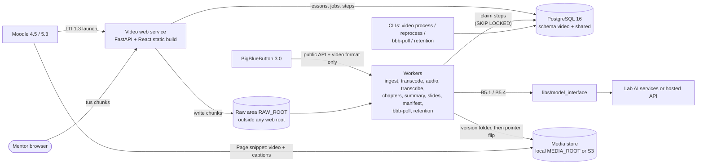

# Design document: video

**Module:** video
**Owner:** @vnaags · **Peer reviewer:** @Harshithamanjunatha
**Release(s):** Release 3 (core), Release 5 (stretch: FR-V-14)
**Status:** Draft

`Status` values: `Draft` → `In review` (peer reviewing) → `Approved`. **Only the guide sets
`Approved`**, in a pull request the guide merges. Feature code for this module starts only when the
status is `Approved` (foundation work listed in §13 under "Release 0" is allowed earlier).

**How to read this document.** **[PRD §x]** = a requirement stated in `docs/PRD.md` (or in the
module's `CLAUDE.md`, cited as "module rule n"). **[Proposed – owner to confirm]** = my proposed
design choice; each one has a row D-n in §7 with the alternatives considered. Where the PRD or the
repository does not settle a decision, this document does not invent an answer: the limitation is
stated in the section where it applies, marked **Limitation:**. Work outside this file is never done
in this document's pull request; it is listed under "To be done in separate pull requests".

## 1. Purpose and scope

Mentors find large lecture videos hard to upload, and lectures and live-class recordings have no
captions, chapters or index [§A2 P4]. This module lets a mentor upload a lecture from the browser
(the upload resumes if the connection drops), collects BigBlueButton recordings automatically, and
turns each video into a standard lesson folder with captions, transcript, chapters, an optional
summary, a slide index and a manifest [§C4.1]. The mentor checks progress, corrects chapter titles,
reviews the AI-made captions and chapters, approves the lesson, and then copies a snippet into a
Moodle Page. The folder is built so the future dual-stream player (F-1) needs no rework [EXT-03,
EXT-08].

- **Serves:** [§C4]; goals G-6, G-7, G-8 [§A3].
- **Out of scope [§C4.11]:** the dual-stream player (F-1) and import of BigBlueButton's separate
  streams (F-2), both extension track [§C6]; live streaming; video editing.
- **Not in the baseline:**
  - processing `camera`/`screen` tracks beyond validation [module rule 3, FR-V-02];
  - **reading BigBlueButton's internal or published presentation files.** The baseline uses only
    BigBlueButton's public API and the **video** recording format [module rule 8]; reading the
    presentation files is F-2 [§C6.5];
  - Learner launches (refused, [EXT-07]);
  - calling the B6.4 signing interface (first user is F-1 [§B6.4]);
  - OCR of slide text (D-18);
  - caption text editing and replacing a lesson's video (not in the PRD; §12 #21, #22).
- **Moodle and grades:** this module never writes to Moodle, never uses Moodle web services and never
  touches grades [C-01, C-02, C-09]. The only way content reaches learners is a snippet the mentor
  pastes into a Moodle Page after approving the lesson (§6, D-7).

## 2. Requirements covered

IDs and releases from [§C4.3] and [§D1]. Every R3 requirement is covered; nothing is proposed for
deferral. FR-V-14 (R5) is kept as a stretch item (D-22).

| Requirement | Release | Approach in one line | Main components |
|---|---|---|---|
| FR-V-01 | R3 | tus 1.0 core + creation + termination, served by the FastAPI web service (D-2); `UPLOAD_CHUNK_MB` (default 90); 4 GB maximum [FR-V-01] enforced at create and on every chunk; mp4/mov/mkv/webm checked by content in the ingest step | Web service (tus), upload page, worker (ingest) |
| FR-V-02 | R3 | Course from the LTI context (`video.course`, D-9); mentor enters module nn + title and lesson nn + title → slugs via `libs/media_paths`; a module number keeps the slug set by its first lesson (D-23); optional `camera`/`screen` uploads stored, validated (probe only) and listed in the manifest, not transcoded (file naming: §3 "Extra tracks") | Upload page, `media_paths`, worker (ingest) |
| FR-V-03 | R3 | Worker step `transcode`: ffmpeg → `720p.mp4` (H.264/AAC) unless the source is already conformant (then remux); `poster.jpg`; `360p.mp4` when `FEATURE_LOWRES_360P=true`. Encoder licence: §12 #6 | Worker |
| FR-V-04 | R3 | Worker steps `extract_audio` → `transcribe` via `speech.transcribe` [§B5.4] → `transcript.en.json` (B5.4 segment shape) and `captions.en.vtt` | Worker |
| FR-V-05 | R3 | Worker step `chapters`: windowed `model.run` calls plus one merge call (D-13) → `chapters.json` `[{start, end, title}]`; mentor edits titles on the lesson page (D-8) | Worker, lesson page |
| FR-V-06 | R3 | Worker step `summary` when `FEATURE_SUMMARIES=true`: windowed `model.run` + merge → `summary.en.md` | Worker |
| FR-V-07 | R3 | Worker step `slides` when `FEATURE_SLIDE_INDEX=true` (default on): ffmpeg scene detection (D-5) → `slides.json` `[{t, thumb}]` (no `text`, D-18) + `slides/NNN.jpg` 320 px wide | Worker |
| FR-V-08 | R3 | Step `manifest` runs last: checks every required file [§B6.2], validates `lesson.json` against the B6.3 schema, writes it last into a new version folder; the version is made live by one atomic pointer flip (D-4) | Worker, `media_paths`, `contracts` |
| FR-V-09 | R3 | Poll job every `BBB_POLL_INTERVAL_S` when `FEATURE_BBB_INTAKE=true`: `getRecordings` through the public API with the shared secret; download only the **video** format output; map to course and cohort from the recording metadata (D-10, D-11) and build the live-class path; recordings that cannot be mapped are held in `video.bbb_recording`; then the normal pipeline | Poller (worker) |
| FR-V-10 | R3 | Status list per course from `video.lesson`/`video.step`: queued / processing (current step) / ready / failed, plus `published`; retry button re-queues failed steps | Status page |
| FR-V-11 | R3 | `video reprocess` creates a new version folder with a new `pipeline_version`; path unchanged; the old version stays live until the new one is complete **and**, for a published lesson, approved (D-4, D-7); one previous version kept for rollback (D-24) | Worker, CLI, lesson page |
| FR-V-12 | R3 | Storage adapter in `libs/` with two implementations, `local` and `s3`, chosen by `MEDIA_STORAGE` [EXT-04] (D-3) | Storage adapter |
| FR-V-13 | R3 | Lesson page shows the relative path and, **only after approval**, an HTML snippet (`<video>` + `<track>`) built from `MEDIA_BASE_URL` + relative path (D-12) | Lesson page |
| FR-V-14 | R5 | Stretch: checkpoint questions per chapter via B5 → B7 items and `cues.json` entries. Designed before R5 (D-22). R3 already writes an empty `cues.json` (D-15) | — |
| FR-V-15 | R3 | Daily retention job: raw uploads and BigBlueButton intake files deleted `RETENTION_RAW_DAYS` (30) after the lesson first became ready; lesson folders never deleted automatically; `video retention` lists and, with confirmation, soft-deletes lessons older than `LESSON_REMOVAL_AGE_DAYS` (default off) (D-16); purging removed lessons is also a confirmed CLI command, never the scheduled job | Scheduled job, CLI |

Non-functional requirements covered in this design: A14 UI-01…07 (§3, §6, §11), OPS-01…11 (§3, §5,
§6, §10), SEC-01…09 (§9), C-01…C-12 (throughout). Mentor approval before publishing (D-7) has no FR
ID of its own: it implements C-09 and is traced to C-09, not to a new requirement.

## 3. Architecture



**Components**
- **Web service** [§A10, OPS-10]: LTI launch through `libs/lti` (Learner refused, [EXT-07]); tus
  upload endpoints (only store the received bytes under `RAW_ROOT`, or under the bucket's private
  `raw/` prefix with `MEDIA_STORAGE=s3` (D-19); no parsing); status, lesson and course pages;
  approval; `GET /health` [OPS-03]. It never runs ffmpeg or calls AI.
- **Workers** [§C4.5, OPS-10]: one container image, `WORKER_CONCURRENCY` steps in parallel. They claim
  steps from the PostgreSQL queue (D-1). Every step is idempotent: it writes only into its job's
  version folder and only its own outputs [module rule 5]. The worker container also exposes
  `GET /health` (status, version, last heartbeat) on `WORKER_HEALTH_PORT`, reachable only inside
  the deployment network [OPS-03: each service] **[Proposed – owner to confirm]** (D-25).
- **Poller and retention:** not separate services. A scheduler loop in the worker enqueues a
  `bbb_poll` job every `BBB_POLL_INTERVAL_S` and a `retention` job daily; the CLIs enqueue the same
  jobs on demand. The scheduled `retention` job only deletes raw files that are due and superseded
  version folders of lessons that are not `removed` (D-24); it never removes or purges a lesson
  folder, and never touches a trashed lesson's version folders [FR-V-15, module rule 7].
- **Containers** [OPS-01]: two Compose services, `video-web` and `video-worker` (scaled by
  replicas), started by the single `docker compose up` on the tools host, with volumes for
  `RAW_ROOT`, `MEDIA_ROOT` (local storage) and `WORKER_SCRATCH_DIR` **[Proposed – owner to
  confirm]** (D-25).
- **Media host** (not built by this module): in local mode, a web server provided by the deployment
  serves `MEDIA_ROOT` at `MEDIA_BASE_URL`, and must not serve `RAW_ROOT` [SEC-05]. D-4 needs it to
  follow symlinks and D-12 needs it to send CORS headers. **Limitation:** the PRD names no media
  host (A11 lists none), so its software and configuration are a lab check (§12 #10, #11).
- **CLIs:** a Python console entry `video` [module "Typical commands"]; they talk to the database and
  enqueue jobs, and never process media in-process.
- **Shared libraries** [EXT-09]: `lti`, `model_interface` (owned by Module 3), `contracts`,
  `media_paths` (owned by me: path template, slugs, B6.4 signer `none`), and the storage adapter
  (FR-V-12, to live in `libs/media_paths` or its own `libs/` package; §12 #36).

**Pipeline of one lesson (steps and dependencies)**

```
ingest (probe, content-type, size, sha256)
 ├─ transcode (720p.mp4, poster.jpg, 360p.mp4 if flag) ─────────────┐
 ├─ extract_audio → transcribe → captions ──┬─ chapters ────────────┤
 │                                          └─ summary (flag) ──────┤
 ├─ slides (flag) ──────────────────────────────────────────────────┤
 └─ validate_extra_tracks (camera/screen: probe only) ──────────────┤
                                                       manifest (last; writes cues.json [] + lesson.json)
```

Transcode, transcription and slide detection run in parallel; this is what makes G-7 reachable (§11).

**Extra tracks (`camera`, `screen`)** [FR-V-02, B6.2, module rule 3]: validated by probe only and
never transcoded. An mp4 extra track is copied unchanged into the version folder as `camera.mp4` or
`screen.mp4` and listed in `lesson.json`. **Limitation:** FR-V-01 accepts mov, mkv and webm, B6.2
names the extra-track files `.mp4`, and FR-V-02 allows no processing beyond validation. The PRD does
not say how a non-mp4 extra track gets its B6.2 name (for example a container-only remux, or
refusing non-mp4 extra tracks). This design does not choose; it must be settled before PR 12 (§13).

**Allowed routes only** [C-01, C-02, C-10]
- Moodle: LTI 1.3 launch only. No Moodle web services, no service-account token (SEC-03 not
  applicable; §12 #15). Playback in Moodle is the mentor's pasted snippet.
- BigBlueButton: public API (`getRecordings`) with the shared secret, and download of the **video**
  format output only. No BigBlueButton files are read from disk and nothing is ever deleted or
  changed on BigBlueButton [module rule 8].
- AI: `model.run` and `speech.transcribe` only, through `libs/model_interface` [C-10].
- Media store: only through the storage adapter.

**Workers on another host** [OPS-10] (D-19)
- With `MEDIA_STORAGE=local`, **both** `RAW_ROOT` and `MEDIA_ROOT` must be visible to the web service
  and to every worker host (one Docker volume on one host; the same network mount on several hosts).
  The web service needs `MEDIA_ROOT` only for reading `lesson.json` for the lesson page and for
  writing nothing else.
- With `MEDIA_STORAGE=s3`, each received tus chunk is written through the storage adapter to the
  bucket's `raw/` prefix as it arrives (one multipart part per chunk; an interrupted chunk is
  discarded and resent from the last confirmed offset), so no whole-file copy runs inside a request
  [OPS-10]. The media store is the bucket, so no shared filesystem is needed. The `raw/` prefix is
  not publicly readable (bucket policy), so raw files stay outside any web root [SEC-05] (D-19).
  Multipart rules of this design (D-19):
  - every part except the last must meet the provider's minimum part size, so a non-final `PATCH`
    smaller than that minimum (offset + length < `Upload-Length`) is refused with a clear error;
    the default 90 MB chunk is far above it. **Limitation:** the minimum depends on the chosen
    S3-compatible provider and is verified with it (§12 #10); no value is assumed here;
  - the multipart upload id is kept in `video.upload.s3_multipart_id`; `DELETE /api/uploads/{id}`
    (tus termination) aborts that multipart upload;
  - abandoned multipart uploads are found from `video.upload` rows still in `receiving` and listed
    by `video retention --check` with their row id, size and age only; the bucket is never listed to
    users and no raw object or part is ever exposed.
- Workers always copy their input to local scratch (`WORKER_SCRATCH_DIR`) before running ffmpeg, and
  clean it after the step.

**UI** [§C4.4, A14]: a React + TypeScript static build served by the web service: upload page
(drag-and-drop, per-file progress, resume after reload), status list, lesson detail (captions preview,
chapter editing, slide thumbnails, summary, approve, copy snippet), course settings, and an
administrator page for unmapped recordings. Bootstrap-compatible styling so a site can restyle it
(UI-01); all strings in one messages file per front end and back end (UI-07). Layout tested on the
three screen profiles (UI-02); details in §6 and §11.

**Extension check (nothing here blocks F-1/F-2)** [§A9, §C6]
- `camera`/`screen` roles accepted, validated and listed in `lesson.json` [EXT-03, FR-X-02].
- `slides.json` and `cues.json` are produced now [EXT-08]; `cues.json` is `[]` until R5 (D-15).
- B6.4 signer (`none`) ships in `media_paths` from Release 0; the S3 media gateway (D-4) can later
  redirect to pre-signed URLs for FR-X-11.
- Learner refusal (EXT-07) is left untouched in `libs/lti`.
- Lessons are identified by slug and relative path, never by position or title [EXT-06].

## 4. Contracts

No B6 schema exists in `contracts/` yet (the only schema there is B1,
`course-package.v1.schema.json`); B6 is Release 0 work owned by me. **No contract change is proposed
by this document.**

| Contract | Provided / used | Fields or functions I rely on | Change needed? |
|---|---|---|---|
| B6 Media paths and lesson manifest | Provided (owner) | B6.1 path templates and slug rules; B6.2 file list; B6.3 manifest (`schema`, `course_slug`, `lesson_id`, `title`, `duration_s`, `tracks[role,file,height]`, `captions`, `transcript`, `chapters`, `slides`, `cues`, `summary`, `source`, `processing.pipeline_version`, `processing.completed_at`); B6.4 `media_signing.sign` (`none` only) | none. The R0 schema will make optional every file B6.2 marks optional. Mentor approval ("published") is **not** a manifest field; it lives only in `video.lesson` |
| B3 LTI 1.3 launch | Used | `sub`, `name`, `roles`, `context` (id, title), `resource_link`, `deployment_id`; role mapping; 2 h idle session; `shared.course_link` (LTI context id → Moodle course id) | none |
| B5.1 Language-model call | Used | `model.run(task, inputs, output_schema)` → `result.data`, `result.meta`; one retry then a clear error [§B5.2] | none. New tasks and prompts for chapter/summary windows and merges are registered in `libs/model_interface` with Module 3 (§12 #17) |
| B5.4 Speech interface | Used | `speech.transcribe(audio_path, language="en")` → `segments[{start,end,text,words}]`, `meta` | none (long-audio handling: §12 #16) |
| B7 H5P practice output | Used, R5 stretch only | checkpoint items; `cues.json` mode | none |
| B8.5 Lecture videos | Provided (set owner) | ≥ 5 Indian-English lectures, ≥ 3 h, reference transcripts, written consent or verified licence | none |
| B4 Moodle web services | **Not used** | — | none (§12 #15) |

**Limitation (B6.3, live-class lessons):** the B6.3 example shows only `source.kind: "upload"`
(with `uploaded_by` and `original_name`) and the `lesson_id` of a recorded lesson
(`01-setup/02-install-python`). B6.3 does not define the `source` block of a BigBlueButton recording
or the `lesson_id` form of a live-class lesson. This design does not invent those fields or values;
they are settled in the Release 0 B6 schema pull request, cross-reviewed under §B.0, before PR 24
(§13).

## 5. Data model

Schema `video` [§A10, §C4.5]. Four tables are named by the PRD; two more, `video.course` and
`video.bbb_recording`, are **[Proposed – owner to confirm]** (D-9, D-10, §12 #13). All timestamps are `timestamptz` (UTC). Columns
below are the design; the first migration PR defines them exactly and is reviewed there.

### 5.1 Tables

**`video.course`** (proposed): one row per Moodle course that has used the Video tool.

| Column | Type | Notes |
|---|---|---|
| `id` | `bigint` identity | PK |
| `lti_context_id` | `text` not null | unique; the key used in `shared.course_link` [§B3] |
| `moodle_course_id` | `bigint` null | copied from `shared.course_link` at launch (§12 #28); used for BigBlueButton mapping (D-10) |
| `course_slug` | `text` not null | unique; `^[a-z0-9]+(-[a-z0-9]+)*$`; immutable once a lesson exists; must equal the B1 slug (D-9) |
| `created_by_sub`, `created_at`, `updated_at` | `text`, `timestamptz` | |

**`video.lesson`**: one row per lesson folder.

| Column | Type | Notes |
|---|---|---|
| `id` | `bigint` identity | PK |
| `course_id` | `bigint` not null | FK → `video.course` |
| `kind` | `text` | check in (`recorded`, `live`) |
| `module_nn`, `lesson_nn` | `smallint` null | recorded lessons; 1–99 |
| `module_slug`, `lesson_slug` | `text` null | recorded lessons; immutable; derived from the submitted titles with the B6.1 slug rules; `module_slug` is the same for every lesson with the same (`course_id`, `module_nn`) (D-23). No module title is stored |
| `cohort`, `live_nn`, `topic_slug` | `text`, `smallint`, `text` null | live lessons; `cohort` from the recording metadata (D-11) |
| `title` | `text` not null | display title; editable; never used as an identifier [EXT-06] |
| `rel_path` | `text` not null | unique; relative to the media root; check: no `://`, no leading `/`, no `..` [C-08] |
| `state` | `text` not null | see 5.2 |
| `live_version` | `text` null | name of the version folder now served (D-4) |
| `previous_version` | `text` null | one older version kept for rollback |
| `pending_job_id` | `bigint` null | FK → `video.job`; a re-processed version waiting for approval |
| `pipeline_version` | `text` null | of the live version (mirrors `lesson.json`) |
| `chapter_overrides` | `jsonb` null | mentor-edited titles `[{start, title}]` (D-8) |
| `source_kind` | `text` | check in (`upload`, `bbb`); a live lesson is linked from `video.bbb_recording.lesson_id` |
| `duration_s` | `integer` null | from probe |
| `created_by_sub` | `text` | LTI `sub` or `system:bbb-poll` |
| `ready_at`, `published_at`, `removed_at` | `timestamptz` null | `ready_at` = first time ready (drives retention) |
| `published_by_sub` | `text` null | |

Indexes: unique (`rel_path`); (`course_id`, `state`); unique (`course_id`, `module_nn`, `lesson_nn`)
where `kind='recorded'`; unique (`course_id`, `cohort`, `live_nn`) where `kind='live'`. The
"one slug per module number" rule (D-23) spans rows, so it is enforced in the create-lesson
transaction (course row locked): the slug derived from the submitted `module_title` is compared with
the stored `module_slug` of that (`course_id`, `module_nn`), and a different slug is refused with
409. It is covered by a unit test.

**`video.bbb_recording`** (proposed): one row per BigBlueButton recording seen by the poller,
including recordings that could not be mapped (D-10, D-11). It exists because an unmapped recording
has no course, so it cannot be a `video.lesson` row.

| Column | Type | Notes |
|---|---|---|
| `id` | `bigint` identity | PK |
| `bbb_record_id` | `text` not null | unique; the recording id from the API |
| `name` | `text` null | recording name, if the API gives one (§12 #29) |
| `start_time` | `timestamptz` null | recording start as reported by the API (field: App-C 4, §12 #1); orders `live_nn` (D-11) |
| `mapping_metadata` | `jsonb` | only the Moodle-set metadata fields used for course and cohort mapping; never checksums or secrets |
| `detected_at` | `timestamptz` not null | first seen by a poll |
| `state` | `text` | check in (`unmapped`, `ignored`, `importing`, `imported`) |
| `reason` | `text` null | message key for `unmapped` (no course, no cohort, metadata missing) |
| `course_id` | `bigint` null | FK → `video.course`; set when mapped or assigned by an Admin |
| `lesson_id` | `bigint` null | unique; FK → `video.lesson`; set on import |
| `decided_by_sub`, `decided_at` | `text`, `timestamptz` null | Admin who assigned or ignored it |

Indexes: unique (`bbb_record_id`); (`state`).

Lifecycle **[Proposed – owner to confirm]** (D-10):
- A poll inserts a row for each recording it has not seen. If course and cohort map (D-10, D-11),
  the row goes to `importing`: the `video.lesson` row is created and a `process` job starts with the
  `bbb_download` step. Otherwise it stays `unmapped` with a `reason`.
- `unmapped` → `importing` when an Admin assigns a course (cohort rules of D-11 still apply);
  `unmapped` → `ignored` when an Admin ignores it.
- `importing` → `imported` when the download is complete and the normal pipeline is queued.
- `imported` → `ignored` only as part of the `video bbb-poll` undo (§6.2).
- The video-format output is downloaded **only after** the recording is mapped, so no raw file
  exists for an `unmapped` or `ignored` recording, and raw retention always has a lesson and its
  `ready_at` to count from.
- `unmapped` and `ignored` rows hold metadata only, never media. They are not deleted
  automatically, because the row is what stops later polls from listing or importing the recording
  again. **Limitation:** the PRD sets no retention period for this metadata (FR-V-15 covers raw
  files and lesson folders only); this design does not invent one.

**`video.upload`**: one row per file received (browser track or BigBlueButton download).

| Column | Type | Notes |
|---|---|---|
| `id` | `uuid` | PK; also the tus upload id |
| `lesson_id` | `bigint` not null | FK → `video.lesson` |
| `track_role` | `text` | check in (`main`, `camera`, `screen`) |
| `source` | `text` | check in (`browser`, `bbb`) |
| `original_name` | `text` | shown to the mentor; stored in `lesson.json` `source` |
| `declared_size` | `bigint` | ≤ 4 GB [FR-V-01]; checked by the web service before anything is stored, and by a check constraint |
| `received_bytes` | `bigint` default 0 | tus offset |
| `raw_rel_path` | `text` | relative to `RAW_ROOT` or the `raw/` prefix [C-08] |
| `s3_multipart_id` | `text` null | only with `MEDIA_STORAGE=s3`: the open multipart upload, aborted on tus termination (§3, D-19) |
| `sha256` | `text` null | set by ingest; duplicate check (D-17) |
| `detected_container`, `detected_codecs` | `text` null | from probe |
| `state` | `text` | check in (`receiving`, `complete`, `validated`, `rejected`, `raw_deleted`) |
| `reject_reason` | `text` null | a message key (UI-07), never file contents |
| `uploaded_by_sub` | `text` | |
| `created_at`, `last_chunk_at`, `completed_at`, `raw_deleted_at` | `timestamptz` | |

Indexes: (`lesson_id`); (`sha256`); (`state`, `completed_at`) for retention.

**`video.job`**: a unit of requested work.

| Column | Type | Notes |
|---|---|---|
| `id` | `bigint` identity | PK |
| `kind` | `text` | check in (`process`, `reprocess`, `bbb_poll`, `retention`, `chapters_write`, `swap`) |
| `lesson_id` | `bigint` null | null for `bbb_poll` and for the scheduled `retention` run; set for a `retention` job that acts on one lesson |
| `pipeline_version` | `text` null | version of the pipeline code that runs it |
| `version_folder` | `text` null | relative path of the version folder it writes (D-4) |
| `options` | `jsonb` | e.g. `{"regenerate_chapters": true}`; for `retention`, `{"action": "scheduled" \| "remove" \| "restore" \| "remove_lessons" \| "purge_trash"}` **[Proposed – owner to confirm]**; never secrets |
| `state` | `text` | check in (`queued`, `running`, `awaiting_approval`, `succeeded`, `failed`, `cancelled`) |
| `requested_by_sub` | `text` | LTI `sub`, `cli:<os user>` or `system` |
| `created_at`, `started_at`, `finished_at` | `timestamptz` | |
| `error_code` | `text` null | message key |

Indexes: (`lesson_id`, `created_at`); (`kind`, `state`, `finished_at`) for "last successful poll".
The last successful BigBlueButton poll is the latest `bbb_poll` job with `state='succeeded'`, so no
extra table is needed. Removal, restore and purge reuse the `retention` kind with `options.action`,
so `kind` needs no new values. Ignoring a recording (web or `video bbb-poll --ignore`) is a database
state change on `video.bbb_recording` only, with an audit entry, and needs no job.

**`video.step`**: the queue unit; workers claim steps, not jobs (D-1).

| Column | Type | Notes |
|---|---|---|
| `id` | `bigint` identity | PK |
| `job_id` | `bigint` not null | FK → `video.job` on delete cascade |
| `name` | `text` | `ingest`, `transcode`, `extract_audio`, `transcribe`, `captions`, `chapters`, `summary`, `slides`, `validate_extra_tracks`, `manifest`, `swap`, `bbb_poll`, `bbb_download`, `retention`, `chapters_write` |
| `depends_on` | `text[]` | step names in the same job |
| `state` | `text` | check in (`pending`, `queued`, `running`, `succeeded`, `failed`, `skipped`) |
| `attempts` | `smallint` default 0 | ≤ `JOB_MAX_ATTEMPTS` |
| `locked_by` | `text` null | worker id |
| `locked_until` | `timestamptz` null | lease; renewed by heartbeat every `JOB_LEASE_S`/3 |
| `run_after` | `timestamptz` | back-off for retries |
| `output_rel_paths` | `text[]` | relative to the version folder |
| `started_at`, `finished_at` | `timestamptz` null | |
| `duration_ms` | `integer` null | feeds the processing-time metric (§11) |
| `error_code` | `text` null | message key |
| `error_detail` | `text` null | short technical reason, never file contents or secrets [OPS-04] |

Indexes: unique (`job_id`, `name`); partial index on (`run_after`) where `state='queued'`.

### 5.2 Lesson states

| State | Meaning | Learner-visible? |
|---|---|---|
| `awaiting_upload` | Lesson created, upload not complete | No |
| `queued` | Upload complete, job queued | No |
| `processing` | A step is running (status page shows which) | No |
| `ready` | All required files exist, `lesson.json` written, version live in the store; **AI drafts waiting for mentor review** | No snippet is offered (D-7); the files can still be fetched by direct path (see below) |
| `published` | Mentor (or administrator) approved captions, transcript, chapters and summary | Yes, once the mentor pastes the snippet |
| `failed` | A step failed after its retries; reason and retry shown | No |
| `removed` | Soft-deleted by the retention CLI; restorable until an Admin purges it with the confirmed CLI command, which acts only on lessons removed more than `LESSON_TRASH_DAYS` ago (D-16) | No |

"Learner-visible" means offered to learners through a snippet pasted into Moodle. With
`MEDIA_SIGNING=none` the media store has no access control [B6.4], so any file it serves, including
a `ready` lesson's files and the version folders under `_versions/` (D-4), can be fetched by anyone
who knows or guesses its path (§12 #19).

Transitions: `awaiting_upload → queued → processing → ready → published`; any processing state →
`failed → queued` (retry); `ready|published → removed → (restore) previous state`.

**Re-processing (FR-V-11) and the states** (D-4, D-7)
- `ready` lesson: the new version is built in its own folder; when complete the pointer flips to it
  (`swap` step) and the lesson stays `ready`.
- `published` lesson: the lesson **stays `published` on its old version** while the new one is built.
  When complete, the job becomes `awaiting_approval` and `pending_job_id` is set. The mentor reviews
  the new captions and chapters and approves (pointer flips, `published_at` updated) or rejects (the
  new folder is deleted). No snippet ever points at unapproved output, and the published path keeps
  serving the approved version until approval; the pending folder can be fetched only by direct
  path (§12 #19).
- `failed` lesson: re-processing is the same as retry with a new version folder.
- One previous version is kept after each flip for `video reprocess --rollback`; older ones are
  deleted by the retention job (D-24). A `removed` lesson's version folders are never treated as
  superseded; they stay until `video retention --purge-trash` (D-16).
- **Limitation:** FR-V-11 asks for "a new `pipeline_version`" but does not say whether that is the
  version of the pipeline code (unchanged when the same code runs again) or a value per run. This
  design records the code version in `video.job.pipeline_version` and in `lesson.json`
  `processing.pipeline_version`, and does not decide how a re-run of unchanged code is numbered; it is
  settled with the `processing` block in the Release 0 B6 schema pull request.

**Retention (FR-V-15) and the states**
- Raw files: deleted `RETENTION_RAW_DAYS` after `ready_at`, whatever the publish state; the upload row
  becomes `raw_deleted`. **Limitation:** the PRD does not say what re-processing uses once the raw
  files are deleted [FR-V-11, FR-V-15]. This design does not choose a substitute source:
  `video reprocess --check` and the lesson page report whether the raw source still exists, and
  re-processing is not started without it.
- Abandoned uploads (state `receiving`, never completed): FR-V-15 counts days from "ready", so they
  are not deleted automatically. `video retention --check` lists them; the uploader or an Admin
  cancels them with tus termination (`DELETE /api/uploads/{id}`).
- Lesson folders: never deleted automatically [FR-V-15, module rule 7]; removal is only through the
  CLI with confirmation, and is a soft delete (D-16). Purging after the trash period is also a
  confirmed CLI command; the scheduled job never purges.
- **Limitation:** FR-V-15 uses "published" without defining it. This design reads it as the
  `published` state (mentor approval, D-7). It never deletes a lesson folder automatically, whether
  `ready` or `published`, so the rule holds under either reading.

### 5.3 Relative vs absolute [C-08, module rule 1]

- Every path in a row or a file is **relative**: `rel_path` and `version_folder` to the media root;
  `raw_rel_path` to `RAW_ROOT` or the `raw/` prefix; `output_rel_paths` and all manifest paths to the
  lesson/version folder [§B6.3]. A database check constraint rejects `://`, a leading `/` and `..`.
- Absolute locations (`MEDIA_ROOT`, `RAW_ROOT`, the bucket, `MEDIA_BASE_URL`) exist only in
  configuration and are joined at use time; no full URL is stored anywhere.

### 5.4 Migrations [OPS-07]

- Alembic, one revision per change, each with a `downgrade`. Order: (1) `video.course`, (2)
  `video.lesson`, (3) `video.upload`, (4) `video.bbb_recording`, (5) `video.job` + `video.step`,
  (6) indexes.
- Downgrade of a create-table revision drops the table and loses its rows. The documented undo is:
  take the OPS-08 backup first, then `alembic downgrade -1`. Column additions are downgraded by
  dropping the column; no revision rewrites data in place.
- State-changing actions are written to `shared.audit_log` [OPS-06]: lesson created, upload
  completed, processing requested, retry, chapter edit, approve, reject version, reprocess, rollback,
  recording mapped/assigned/ignored, raw files deleted, lesson removed/restored/purged, course slug set.

## 6. Interfaces

### 6.1 Web/API

All routes except `/health` and the LTI endpoints need the LTI session [§B3, SEC-02]. "Mentor" =
LTI Instructor, limited to the course of the launch context; "Admin" = Administrator, all courses
[§A5]. Learner launches are refused at the gateway [EXT-07]. State-changing requests need the CSRF
header token and the same-site session cookie [SEC-09]. Request and response bodies are Pydantic
models; errors are `{code, message}` where `message` comes from the module messages file [UI-05,
UI-07]. Route paths are relative to the tool's base path.

| Method and route | Purpose | Request → response | Roles |
|---|---|---|---|
| `GET /lti/login`, `POST /lti/launch`, `GET /lti/jwks` | LTI 1.3 login, launch, keys (from `libs/lti`) | B3 | Moodle platform; Learner refused |
| `GET /health` | Status and version [OPS-03] | → `{status, version, db: ok|error, queue_depth}`; no course data, no secrets | No login (network-restricted by deployment) |
| `GET /` and static assets | React app | — | Mentor, Admin |
| `GET /api/course` | Course settings for the launch context | → `{course_slug?, suggested_slug, slug_locked}` | Mentor, Admin |
| `PUT /api/course` | Set `course_slug` (once; refused after the first lesson) | `{course_slug}` → course | Mentor, Admin |
| `POST /api/lessons` | Create a recorded lesson | `{module_nn, module_title, lesson_nn, lesson_title}` → `{id, rel_path, state}`; 409 if the lesson number is taken, or if `module_nn` already exists in the course and the slug derived from `module_title` differs from its stored `module_slug` (D-23) | Mentor, Admin |
| `POST /api/uploads` (tus creation) | Start an upload | headers `Upload-Length`, `Upload-Metadata` (`lesson_id`, `track_role`, `filename`) → `201`, `Location`; `413` if `Upload-Length` > 4 GB | Mentor, Admin (own course) |
| `HEAD /api/uploads/{id}` | Current offset (resume) | → `Upload-Offset` | Uploader or Admin |
| `PATCH /api/uploads/{id}` | Append one chunk (≤ `UPLOAD_CHUNK_MB`) | `Upload-Offset` + body → `204`, new offset | Uploader or Admin |
| `DELETE /api/uploads/{id}` | Cancel an upload (tus termination); with `MEDIA_STORAGE=s3` also aborts the multipart upload (D-19) | → `204` | Uploader or Admin |
| `GET /api/lessons?state=` | Status list (FR-V-10) | → `[{id, title, rel_path, state, current_step?, error?, updated_at}]` + `last_bbb_poll_at` | Mentor (own course), Admin |
| `GET /api/lessons/{id}` | Lesson detail | → state, steps, chapters (with overrides), slide thumbnails, captions preview path, summary text, pending version (if any), warnings | Mentor, Admin |
| `PUT /api/lessons/{id}/chapters` | Edit chapter titles only (times unchanged) | `[{start, title}]` → lesson; enqueues `chapters_write` | Mentor, Admin |
| `POST /api/lessons/{id}/retry` | Re-queue failed steps | → lesson | Mentor, Admin |
| `POST /api/lessons/{id}/approve` | Approve AI drafts and publish (D-7); for a pending re-processed version, approve the swap | `{confirm: true}` → lesson (`published`) | Mentor, Admin |
| `POST /api/lessons/{id}/reject-version` | Discard a pending re-processed version | → lesson | Mentor, Admin |
| `GET /api/lessons/{id}/snippet` | Relative path + HTML snippet (FR-V-13) | → `{rel_path, html}`; **409 until `published`** (before approval only `rel_path` is shown on the page) | Mentor, Admin |
| `POST /api/lessons/{id}/reprocess` | Re-process (FR-V-11); refused while the raw source is deleted (§5.2) | `{regenerate_chapters?: bool}` → job | Admin [§C4.2 names only the administrator; §A5 lists no re-process capability, so Mentor access is not added] |
| `GET /api/live/unmapped` | Recordings that could not be mapped to a course (`video.bbb_recording`, state `unmapped`) | → `[{bbb_record_id, name?, start_time?, reason}]` | Admin |
| `POST /api/live/unmapped/{record_id}` | Assign to a course, or ignore | `{course_id}` or `{ignore: true}` → result | Admin |
| `GET /media/{rel_path}` | **Only with `MEDIA_STORAGE=s3`:** media gateway, 302 to the live version's object under the lesson prefixes, never `raw/` (D-4) | → `302` / `404` | Public, like the media store itself |

**Upload authorisation across the 2-hour idle session** (D-14) [§B3]
- Every chunk is a normal authenticated request, so each one renews the idle timer; a running upload
  never times out. A 90 MB chunk at 1 Mbit/s takes about 12 minutes, well inside 2 hours.
- If the session does expire (laptop asleep, more than 2 h without a chunk), the next chunk gets
  `401` with "Your session expired. Open the Video tool again from your Moodle course; the upload
  will continue where it stopped." After relaunch, the client asks `HEAD` for the offset and resumes;
  the server checks that the new session's `sub` and context match `uploaded_by_sub` and the
  lesson's course. Upload state lives on the server, so nothing is lost.
- Abandoned uploads are not deleted automatically; they are listed and cancelled as described in
  §5.2 "Retention".

**UI requirements** [§C4.4, A14]
- Pages: upload, status list, lesson detail, course settings, unmapped recordings (Admin).
- UI-02: no horizontal scrolling on phone 375×812, laptop 1366×768 at 100/125/150 % zoom, half-width
  683×768; tables collapse to stacked cards on narrow screens.
- UI-03: every control keyboard-operable with visible focus; labelled fields; drag-and-drop has a
  "Choose file" button; WCAG 2.1 AA contrast.
- UI-04: uploads and processing show progress and can be left and resumed (status page).
- UI-06: pages (not processing) load in < 2 s on the lab network: static build, one API call per page,
  status list paged.
- UI-07: English only; all strings in one messages file (front end) and one (back end).

### 6.2 CLI [C-05, OPS-05, module "Typical commands"]

Every command supports `--dry-run` (prints intended changes, changes nothing), `--check` (read-only
status; exit 0 = OK, 1 = problems found), `--config <file>`; exit 2 = error. `<lesson>` is the
lesson's relative path (or its id). Every state change writes an audit entry.

| Command | What it does | `--check` reports | Undo (documented in the README) |
|---|---|---|---|
| `video process <lesson>` | Queues processing of a lesson whose upload is complete | upload state, missing files, queued/failed steps | Nothing reaches learners before approval. To discard the outputs: `video retention --remove <lesson>` (soft delete), then `--restore` if needed |
| `video reprocess <lesson> [--regenerate-chapters]` | New version with a new `pipeline_version` (FR-V-11) | live and pending versions, raw source still present? | Before approval: `reject-version` (web) or `video reprocess <lesson> --reject`. After approval: `video reprocess <lesson> --rollback` flips back to the kept previous version |
| `video bbb-poll` | One poll now: lists new recordings, maps and imports them | reachability, last successful poll, unmapped recordings | `video retention --remove <lesson>` and mark the recording ignored (`video bbb-poll --ignore <record_id>`, sets `video.bbb_recording.state` to `ignored`), so the next poll does not import it again. Nothing on BigBlueButton is changed or deleted |
| `video retention` | Deletes raw files that are due and superseded version folders of lessons that are not `removed` (D-24); with `--remove-lessons` lists lessons older than `LESSON_REMOVAL_AGE_DAYS` and, after typed confirmation, soft-deletes them; `--remove <lesson>`; `--restore <lesson>`; `--purge-trash` lists lessons removed more than `LESSON_TRASH_DAYS` ago and, after typed confirmation, deletes them. The scheduled daily job runs only the first part (raw files and superseded versions) | raw files due, abandoned uploads, removal candidates, trash contents | Lesson removal: `video retention --restore <lesson>` before purge restores the same path (Moodle Pages work again). **Raw-file deletion and purge: no undo except the OPS-08 backup**; whether that is enough for C-05 is §12 #18 |

### 6.3 Configuration [OPS-02, C-06]

**Existing variables in `.env.example`, used as they are**

| Variable | Default / placeholder in `.env.example` | Use here |
|---|---|---|
| `DATABASE_URL` | `postgresql://learnops:CHANGE_ME@db:5432/learnops` | tool database |
| `LTI_ISSUER`, `LTI_CLIENT_ID`, `LTI_DEPLOYMENT_ID`, `LTI_PRIVATE_KEY_PATH` | `https://moodle45.lab.invalid`, `CHANGE_ME`, `CHANGE_ME`, `/run/secrets/lti_private_key.pem` | via `libs/lti` |
| `MODEL_PROVIDER`, `MODEL_NAME`, `MODEL_LOCAL_URL`, `MODEL_HOSTED_API_KEY` | `local`, `CHANGE_ME`, `http://ai.lab.invalid:11434`, empty | via `libs/model_interface` |
| `SPEECH_PROVIDER`, `SPEECH_LOCAL_URL`, `SPEECH_HOSTED_API_KEY` | `local`, `http://ai.lab.invalid:9000`, empty | via the speech interface |
| `MEDIA_STORAGE`, `MEDIA_ROOT`, `MEDIA_BASE_URL`, `MEDIA_SIGNING`, `MEDIA_PATH_TEMPLATE` | `local`, `/srv/learnops-media`, `https://media.lab.invalid`, `none`, `courses/{course_slug}/{module_nn}-{module_slug}/{lesson_nn}-{lesson_slug}/` | storage adapter, `media_paths`, snippet |
| `UPLOAD_CHUNK_MB` | `90` | tus client chunk size and server per-request limit |
| `RETENTION_RAW_DAYS` | `30` | retention |
| `BBB_URL`, `BBB_SECRET` | `https://bbb.lab.invalid/bigbluebutton/`, `CHANGE_ME` | poller; secret only from the environment, never logged |
| `FEATURE_SUMMARIES`, `FEATURE_SLIDE_INDEX`, `FEATURE_LOWRES_360P` | `true`, `true`, `false` | step flags [EXT-05] |

**New variables this design needs — to add to `.env.example` in a separate pull request** (§12)

| Variable | Default / placeholder | Purpose |
|---|---|---|
| `FEATURE_BBB_INTAKE` | `false` (lab: `true`) | BigBlueButton intake on/off [EXT-05] |
| `LESSON_REMOVAL_AGE_DAYS` | empty = off | FR-V-15 removal age |
| `LESSON_TRASH_DAYS` | `30` | minimum time in trash before `video retention --purge-trash` may delete a lesson (D-16) |
| `WORKER_HEALTH_PORT` | `8081` | worker `GET /health`, internal network only [OPS-03] (D-25) |
| `BBB_POLL_INTERVAL_S` | `120` | poll interval |
| `MEDIA_LIVE_PATH_TEMPLATE` | `courses/{course_slug}/live-{cohort}/{nn}-{topic_slug}/` | B6.1 live-class template |
| `RAW_ROOT` | `/srv/learnops-raw` | raw area, outside any web root (SEC-05) |
| `WORKER_SCRATCH_DIR` | `/var/tmp/learnops-video` | local scratch for ffmpeg |
| `WORKER_CONCURRENCY` | `3` | parallel steps per worker |
| `WORKER_MIN_FREE_GB` | `10` | refuse to start a step below this free space |
| `JOB_LEASE_S` | `300` | step lease; crashed worker's step is re-queued after it |
| `JOB_MAX_ATTEMPTS` | `3` | retries per step |
| `MEDIA_S3_ENDPOINT_URL`, `MEDIA_S3_BUCKET`, `MEDIA_S3_REGION` | `https://s3.lab.invalid`, `CHANGE_ME`, `CHANGE_ME` | S3 adapter |
| `MEDIA_S3_ACCESS_KEY_ID`, `MEDIA_S3_SECRET_ACCESS_KEY` | `CHANGE_ME` | S3 credentials (secrets: placeholders only) |
| `VIDEO_TRANSCRIPT_CHUNK_TOKENS` | `3000` | transcript window for chapters/summary (D-13) |
| `SLIDE_SCENE_THRESHOLD` | `0.3` (to tune on B8.5) | slide detection (D-5) |
| `MEDIA_CORS_ORIGINS` | `https://moodle45.lab.invalid,https://moodle53.lab.invalid` | allowed origins for the captions track (D-12) |

## 7. Key decisions and alternatives

All rows are **[Proposed – owner to confirm]** unless marked "guide". Nothing is decided until it is
recorded in `docs/decisions/` (separate pull requests, §12).

| # | Decision | Alternatives considered | Why this one | Record |
|---|---|---|---|---|
| D-1 | Job queue in PostgreSQL: `video.step` rows claimed with `SELECT … FOR UPDATE SKIP LOCKED`, lease + heartbeat, back-off retry; survives restart [§C4.5] | Procrastinate (PostgreSQL queue library; licence to verify); Celery/RQ with Redis | Stays inside the fixed stack (no new data store, §A10); a few hundred lines; steps are visible to the status page directly | `docs/decisions/NNNN-video-job-queue.md` |
| D-2 | tus server: minimal tus 1.0 core + creation + termination in FastAPI; `tus-js-client` in the browser | A Python tus library (licence and maintenance to verify); tusd (Go) | tusd is another language, not allowed without the guide [§A10]; the needed part of the protocol is small | `…-video-upload.md` |
| D-3 | Both `local` and `s3` adapters in R3, local first, S3 as its own PR | Local only, S3 deferred | FR-V-12 is R3; deferring would need the guide | — |
| D-4 | **Atomic publish and swap through version folders and a pointer.** Each run writes a complete set into `_versions/{rel_path}/{version}/` (lesson.json last). Going live is one atomic step: **local** = replace a relative symlink at `rel_path` (rename of a symlink is atomic); **S3** = update `video.lesson.live_version` in one transaction, read by the `GET /media/{rel_path}` gateway that redirects to the live version's object (lesson prefixes only, never `raw/`). The old set stays complete until the flip; nothing mixed is ever served [§C4.8, FR-V-08, FR-V-11] | (a) Copy new objects over old keys, `lesson.json` last: leaves a window with new video and old captions, which breaks C4.8 — rejected. (b) Take the lesson offline during the copy: no mixed state but a visible outage. (c) Versioned file names in the manifest: breaks B6.2 file names — contract change, rejected | Only option with no mixed state and no contract change. **Cost:** storage for up to two versions (+ a pending one); on S3 every media request goes through one redirect from the video service (a light route, no streaming), the gateway must be up for playback, and readers of the bucket must use the gateway; on local the media web server must follow symlinks and backups must keep them. Needs the guide (§12 #10) | `…-video-atomic-swap.md` |
| D-5 | Slide detection: ffmpeg scene filter on frames sampled at 1 fps, downscaled; threshold `SLIDE_SCENE_THRESHOLD` tuned on B8.5; minimum 5 s between slides [§C4.5] | Frame difference in Python on sampled frames | ffmpeg is named by the PRD for scene detection; no new library | — |
| D-6 | Summary and slide index both in the first R3 cut, behind their flags | Ship with the flags off | The slide index is part of the G-7 criterion [§C4.7]; the summary is cheap once transcript windows exist | — |
| D-7 | **C-09 approval.** Captions, transcript, chapters and summary are AI drafts. A lesson is `ready` after processing; the mentor reviews the captions preview, chapters and summary and presses "Approve and publish" → `published` (audited). Before approval the page shows only the relative path; **the snippet is not offered**, the preview plays only inside the tool. Re-processed outputs of a published lesson never replace it before approval. Nothing touches Moodle grades. The files are not access-controlled with `MEDIA_SIGNING=none` (§5.2, §12 #19). This approval implements C-09 and has no FR ID of its own | Lesson usable as soon as it is ready, with the mentor's act of embedding counting as approval | C-09 says AI output is a draft until a mentor approves it. Conflict with "appears without manual steps" [§C4.7]: proposed reading is "appears = ready in the correct folder". Guide (§12 #9) | `…-video-approval.md` |
| D-8 | Mentor-edited chapter titles survive re-processing: if `chapter_overrides` exists, the `chapters` step reuses the current `chapters.json` with overrides; `--regenerate-chapters` makes new chapters, drops the overrides (kept in the audit log) and needs approval again | Match old titles to new chapters by start time | Simplest; never loses mentor work silently | — |
| D-9 | `course_slug`: on the first Video launch in a course, the mentor confirms the slug (suggested from the context title, slug rules applied). It **must equal the B1 `course.slug`** of the course package when one exists, because media paths use that slug [§B1.1, §B6.1]; once a lesson exists it is locked. Stored in a proposed `video.course` table | Take it from the Course Studio package; one `course_slug` column per lesson without a course table | LTI gives only context id and title [§B3]; a person must check the slug. Consistency with Module 1: §12 #14; the proposed extra tables (`video.course`, `video.bbb_recording`) need the guide's ruling: §12 #13 | `…-video-course-slug.md` |
| D-10 | BigBlueButton → course mapping without a launch-time context: read the Moodle course identifier from the recording metadata set by Moodle's BigBlueButton activity (exact field: App-C 4, §12 #1) → `video.course.moodle_course_id` (copied from `shared.course_link` at launch). Requires one earlier Video launch in that course; otherwise the recording is stored in `video.bbb_recording` as `unmapped` and listed for the Admin. The recording is downloaded only after it is mapped (lifecycle in §5.1). **No Moodle web services**. **Limitation:** the PRD does not say whether such a one-time earlier launch counts as a "manual step" under C4.2 and C4.7 (§12 #15) | Look the course up through B4 web services (B4 is not assigned to Module 4; guide, §12 #15) | Stays inside the allowed routes and the assigned contracts | `…-video-bbb-mapping.md` |
| D-11 | Live-class path: `cohort` = the cohort in the recording metadata set by Moodle's BigBlueButton activity [FR-V-09] (exact field: App-C 4, §12 #1), slug-normalised; a recording without a usable cohort is stored as `unmapped` with reason "no cohort" and not processed. `nn` = next number for (course, cohort) in order of recording start time, assigned once and never changed; `topic_slug` = slug of the recording name from the API (§12 #29), else `class-YYYY-MM-DD`. **Limitation:** if App-C 4 shows that Moodle sets no cohort field, the PRD gives no other source, and this design does not add one | Cohort set by the mentor per course (not the source FR-V-09 names, and an extra manual step); cohort from the recording date | FR-V-09 names the recording metadata as the source; immutable as B6.1 needs | same as D-10 |
| D-12 | **Snippet URL:** `<video src="{MEDIA_BASE_URL}/{rel_path}720p.mp4" …><track src="{MEDIA_BASE_URL}/{rel_path}captions.en.vtt" crossorigin="anonymous" …>`; the media host sends CORS headers for `MEDIA_CORS_ORIGINS` so the captions track loads cross-origin. The tool still stores only the relative path [C-08] | Root-relative `/media/…` served through a proxy rule on the Moodle site's web server (same origin, no CORS) | A proxy rule changes the platform host and may conflict with C-01/C-02; it needs the guide's ruling. **Both need the lab** (§12 #11, #12). Note: checker rule CK-12 flags "media referenced by a full fixed URL" [§C2.3]; how the pasted snippet and CK-12 fit together needs the guide (§12 #12) | `…-video-snippet.md` |
| D-13 | Transcript windows for a small local model: split on segment boundaries into windows of `VIDEO_TRANSCRIPT_CHUNK_TOKENS` with one-segment overlap; per window `model.run` returns candidate chapter starts + titles (summary: window summary); one merge call over the candidates (or window summaries) gives the final list; chapter times are snapped to segment starts and validated (sorted, inside duration, minimum length) | One call with the whole transcript (fails on small context limits); chapters from slide changes only | Respects the lab model's context; each call validated by `output_schema` [§B5.1] | — |
| D-14 | Upload across session expiry: each chunk renews the session; on expiry relaunch and resume from the server offset | A separate upload-scoped token valid for e.g. 24 h | No new credential type beside B3; resume already works | — |
| D-15 | `cues.json`: write a valid empty `[]` in R3 and list it in the manifest; fill it from R5 (FR-V-14). **Decision for the owner or the guide** | Omit the file until R5 (B6.2 marks it optional) | EXT-08 says the pipeline produces `cues.json` "now" | — |
| D-16 | Lesson removal is a soft delete: local = move the pointer (symlink) to `_trash/`; S3 = gateway returns 404 for `removed`. Restore any time before purge. Purge only with `video retention --purge-trash` and typed confirmation, for lessons removed more than `LESSON_TRASH_DAYS` ago; the scheduled job never purges [FR-V-15] | Hard delete with backup restore as the undo; automatic purge by the daily job (rejected: deletes a lesson folder automatically, against FR-V-15) | C-05 asks for a documented undo; restore keeps the same path, so Moodle Pages work again | — |
| D-17 | Duplicate upload: ingest computes `sha256`; if the same hash exists in the course the step stops with a message and a "Process anyway" button | Block always; ignore | Avoids silent double processing; mentor decides | — |
| D-18 | `slides.json` entries are `{t, thumb}`; the optional `text` is **omitted in v1** (no OCR) | OCR with an extra library | Not required by the PRD; no extra licence or GPU need | — |
| D-19 | Shared files for workers on another host: local storage → `RAW_ROOT` **and** `MEDIA_ROOT` on a shared mount; S3 → each tus chunk written straight to the bucket's `raw/` prefix (one multipart part per chunk; non-final parts at least the provider's minimum part size; multipart id in `video.upload`, aborted on tus termination) and the bucket as media store; ffmpeg always on local scratch. The `raw/` prefix is not publicly readable (bucket policy); only lesson prefixes are served [SEC-05] | Workers fetch inputs from the web service over HTTP; copy the finished file from `RAW_ROOT` to `raw/` after the upload (a whole-file copy in a request, or a worker on the web host) | No heavy transfer through the web service [OPS-10]; raw files never web-reachable [SEC-05] | — |
| D-20 | Database driver: asyncpg (expected Apache-2.0) with SQLAlchemy | psycopg 3 (LGPL; allowed only as an unmodified library) | Avoids the LGPL condition | — |
| D-21 | ffmpeg build and H.264 encoder: **guide** (§12 #6). Proposal: an LGPL ffmpeg build with OpenH264 (expected BSD-2-Clause) and ffmpeg's native AAC encoder, called as a separate, unmodified process | A GPL build with libx264 called as a separate process, plus a guide ruling on shipping it in our image | C-11 does not list GPL | `…-ffmpeg-licence.md` |
| D-22 | FR-V-14 stays an R5 stretch item; this document is updated before R5 | Design it now | R5 starts only after R1–R4 meet their exit criteria [§C5] | — |
| D-23 | A module number's slug is set by the first lesson created in that module (B6.1 slug rules applied to its `module_title`) and reused by every later lesson with the same (course, `module_nn`). For a later lesson, the slug derived from the submitted `module_title` is compared with the stored `module_slug`; if they differ the request is refused (409). No module title is stored | Accept the new title and rename the module folder (breaks slug immutability and existing Moodle Pages); store a module title and compare titles; a separate `video.module` table | B6.1: slugs are immutable, so one module number must map to one folder; comparing slugs needs no new column | — |
| D-24 | Keep one previous version folder after each flip so `video reprocess --rollback` can undo a re-process; the scheduled retention job deletes older, superseded versions. The live version and the kept previous version are never deleted automatically, and a `removed` lesson's version folders are never treated as superseded: they stay until the confirmed `--purge-trash` (D-16) | Keep every version (storage growth, §12 #30); keep none (no undo for a re-process) | C-05 needs a documented undo; FR-V-11 only protects previous outputs until the new ones are complete | — |
| D-25 | Deployment shape: Compose services `video-web` and `video-worker`; the worker exposes `GET /health` (status, version, last heartbeat) on `WORKER_HEALTH_PORT` (default `8081`), internal network only | Worker health only through the web service's `/health` (from a heartbeat row) | OPS-01 needs one `docker compose up`; OPS-03 asks every service for `GET /health` | — |

## 8. Libraries and licences

Licences must be MIT, BSD or Apache-2.0 (LGPL only as an unmodified library) [C-11]. Nothing is
pinned yet and no licence is confirmed from the repository; every row is **to verify before
pinning** (§12 #7) in the pull request that adds it. "Expected" is what I believe the licence to be;
it is not a confirmation.

| Library | Pinned version | Licence | Why needed | Alternative |
|---|---|---|---|---|
| ffmpeg / ffprobe | to verify before pinning | **Build-dependent. ffmpeg's usual H.264 encoder, libx264, is GPL, which C-11 does not allow.** Guide ruling needed (§12 #6, D-21) | transcode, poster, audio extract, scene detection, probe [§A10] | LGPL build + OpenH264; GPL build as a separate process if the guide allows |
| OpenH264 (if D-21 accepted) | to verify before pinning | expected BSD-2-Clause; to verify | H.264 encoding without libx264 | libx264 (GPL) |
| FastAPI | to verify before pinning | expected MIT; to verify | web service [§A10] | — (fixed stack) |
| uvicorn | to verify before pinning | expected BSD-3-Clause; to verify | ASGI server | hypercorn |
| Pydantic | to verify before pinning | expected MIT; to verify | contracts and API payloads | — |
| SQLAlchemy | to verify before pinning | expected MIT; to verify | database access | plain asyncpg queries |
| asyncpg | to verify before pinning | expected Apache-2.0; to verify | PostgreSQL driver (D-20) | psycopg 3 (LGPL) |
| Alembic | to verify before pinning | expected MIT; to verify | reversible migrations [OPS-07] | hand-written SQL migrations |
| Job queue | — (own code, D-1) | Apache-2.0 (ours) | persistent queue | Procrastinate (licence to verify) |
| tus server | — (own code, D-2) | Apache-2.0 (ours) | FR-V-01 | Python tus library (licence to verify) |
| tus-js-client | to verify before pinning | expected MIT; to verify | resumable upload in the browser | Uppy (licence to verify) |
| boto3 | to verify before pinning | expected Apache-2.0; to verify | S3 adapter | minio-py (licence to verify) |
| httpx | to verify before pinning | expected BSD-3-Clause; to verify | BigBlueButton API calls and downloads | — |
| XML parsing of BigBlueButton responses | Python standard library `xml.etree.ElementTree` | Python's own licence (part of the runtime) | `getRecordings` responses; response size capped | defusedxml (PSF licence, not in C-11 → guide, §12 #8) |
| jsonschema | to verify before pinning | expected MIT; to verify | validate every `lesson.json` against the B6.3 schema [§B.0 rule 4]; already used by `libs/contracts/tests` | — |
| S3-compatible test server (not chosen) | to verify before pinning | to verify; the MinIO server is expected to be AGPL-3.0, which C-11 does not allow, so it is not proposed | S3 adapter integration test (§11.1) | an S3 stub in unit tests only |
| jiwer | to verify before pinning | expected Apache-2.0; to verify | word error rate (G-6) | own word-level edit distance |
| React, React DOM | to verify before pinning | expected MIT; to verify | UI [§A10] | — (fixed stack) |
| TypeScript | to verify before pinning | expected Apache-2.0; to verify | UI | — |
| Vite | to verify before pinning | expected MIT; to verify | static build | another bundler (licence to verify) |
| Bootstrap (CSS) | to verify before pinning | expected MIT; to verify | Bootstrap-compatible style (UI-01) | plain CSS |
| ESLint, Prettier | to verify before pinning | expected MIT; to verify | TS lint/format (root CLAUDE.md §6) | — |
| ruff, mypy | to verify before pinning | expected MIT; to verify | Python lint/types | — |
| pytest | to verify before pinning | expected MIT; to verify | tests | — |
| Playwright (Python) | to verify before pinning | expected Apache-2.0; to verify | end-to-end and screen-profile tests [§A10] | — |
| Accessibility checker (e.g. axe-core) | to verify before pinning | axe-core is expected to be MPL-2.0, not in C-11 → guide (§12 #8) | WCAG 2.1 AA checks (UI-03) | manual checklist + Playwright keyboard tests |
| nginx (test proxy, lab only) | to verify before pinning | expected BSD-2-Clause; to verify | 100 MB request-limit proxy for the G-8 test | lab-provided proxy (§12 #23) |
| pip-audit | to verify before pinning | expected Apache-2.0; to verify | dependency scan in CI [SEC-08] | — |
| npm audit | part of npm | npm's licence; to verify | front-end dependency scan [SEC-08] | — |

## 9. Security and privacy

| Item | How it is met |
|---|---|
| SEC-01 | LTI validation in `libs/lti` (library choice: App-C 6, §12 #4) |
| SEC-02 | Every route checks role + course from the session (§6.1); an Instructor sees only the launch course; Admin all [§A5] |
| SEC-03 | **Not applicable:** Module 4 never uses the Moodle service-account token or web services (§12 #15) |
| SEC-04 | Not applicable (no learner code) |
| SEC-05 | Size limit at tus create and on every PATCH (4 GB [FR-V-01], chunk ≤ `UPLOAD_CHUNK_MB`); **type check by content** in the ingest step (ffprobe container and codecs must be mp4/mov/mkv/webm with a video stream; the extension alone is not trusted); raw files stored under `RAW_ROOT` (local; never served by the media host) or the bucket's `raw/` prefix (not publicly readable, D-19), **outside any web root**, until processed; virus-free assumption documented in the README; media parsed only in workers, never in the web service; `original_name` used only as text, never as a path |
| SEC-06 | Only LTI identity stored: uploader `sub` (and `name` is not stored); no other personal data |
| SEC-07 | Only what each task needs goes to providers: audio to speech; transcript text to the model; listed in the data map |
| SEC-08 | `pip-audit` and `npm audit` in CI; no known critical vulnerabilities at release |
| SEC-09 | CSRF header token on every state-changing request; secure, same-site session cookies (from `libs/lti`) |
| C-06 | `BBB_SECRET`, S3 credentials and provider keys only from the environment; never logged; BigBlueButton API checksums never logged |
| OPS-04 | Structured JSON logs to stdout with request id, `sub`, course context id and action; never file contents, transcript text, secrets or full URLs with checksums |
| OPS-06 | Audit entries for every state change (list in §5.4) in `shared.audit_log` |
| OPS-08 | Backup/restore procedure in the README covers the `video` schema, `RAW_ROOT`, `MEDIA_ROOT` (keeping symlinks) or the bucket |

**Untrusted input:** uploaded files and BigBlueButton downloads (parsed only by ffprobe/ffmpeg inside
workers, with time limits); BigBlueButton XML (size-capped, standard parser; §12 #8); recording names
(used only after slug normalisation); chapter titles from the model and the mentor (HTML-escaped).

**Rows for `docs/data-map.md` [§E6] — to be added in a separate pull request**

| Data item | Stored where | Sent to | Kept for | Why |
|---|---|---|---|---|
| Lecture audio (from uploads and live classes) | worker scratch only during the step | speech provider (lab service or hosted API) | scratch deleted after the step; provider retention per its terms | captions and transcript |
| Transcript text | `transcript.en.json`, `captions.en.vtt` in the media store | model provider, for **chapters and summary** | until the lesson is removed | chapters, summary, captions |
| Chapter titles and summary text (AI drafts and mentor edits) | `chapters.json`, `summary.en.md`, `video.lesson.chapter_overrides` | — | until the lesson is removed | navigation |
| Original file names | `video.upload`, `lesson.json` `source` | — | until the lesson is removed | identify the source for the mentor |
| Uploader LTI `sub` | `video.upload`, `video.lesson`, `lesson.json`, audit log | — | until removed; audit per audit policy | accountability. `lesson.json` is in the media store, so with `MEDIA_SIGNING=none` the `sub` can be read by anyone who knows the path (B6.3 includes it; §12 #19) |
| BigBlueButton recording metadata (record id, name, start time, course and cohort fields) | `video.bbb_recording`, `video.lesson` | — | imported: until the lesson is removed; `unmapped` and `ignored` rows (metadata only, no media): not deleted automatically, no retention period set by the PRD (§5.1) | mapping to course and path; stops re-import |
| Raw uploads and intake files of lessons that became ready | `RAW_ROOT` / `raw/` | — | `RETENTION_RAW_DAYS` after the lesson first became ready | processing and re-processing |
| Abandoned uploads (never completed, so never ready) | `RAW_ROOT` / `raw/` (S3: open multipart upload) | — | until cancelled by the uploader or an Admin (tus termination); listed by `video retention --check` | resume of an interrupted upload |
| Live-class recordings | media store | speech and model providers as above | until removed | **may contain learners' voices and names**; the data map must say so |

## 10. Error handling

Every message says what happened and what to do next [UI-05], comes from the module messages file
[UI-07], and is shown on the status page with the failed step. Retries use back-off
(`run_after`), up to `JOB_MAX_ATTEMPTS`.

| Situation | Detection | Behaviour and recovery | Message to the mentor (example) |
|---|---|---|---|
| Wrong type | ingest probe | upload `rejected`; raw file deleted | "This file is not a supported video (mp4, mov, mkv or webm). Export it in one of these formats and upload again." |
| Too large | tus create / PATCH | `413`, nothing stored | "This file is larger than 4 GB. Split or compress it, then upload again." |
| Corrupt or unreadable file | probe/transcode fails on the content | step `failed`, no automatic retry (same input fails again); the Retry button stays available [C4.8] | "The video could not be read. Check that it plays on your computer, then upload it again." |
| Duplicate upload | same `sha256` in the course | ingest stops (D-17) | "This video was already uploaded as lesson 02-03. Choose 'Process anyway' if you want a second copy." |
| Interrupted upload | client | resumes from `HEAD` offset | "Upload paused. It will continue when you are back online." |
| Session expired during upload | `401` on a chunk | relaunch, then resume (D-14) | "Your session expired. Open the Video tool again from your Moodle course; the upload will continue where it stopped." |
| Storage unavailable | adapter error | step fails and is retried; nothing goes live because the pointer flips only after a complete set (D-4) | "The media store is not reachable. Processing will retry automatically; if it keeps failing, contact your administrator." |
| Disk full | free space < `WORKER_MIN_FREE_GB` before a step, or write error | step fails before writing; partial version folder deleted; retried later | "The server is out of disk space. Your administrator has been told; processing will continue when space is free." (plus an error log for the admin) |
| Speech provider unavailable | B5.4 error | step retried with back-off, then `failed` | "Captions could not be made because the speech service is not available. Press Retry later." |
| Model provider unavailable | B5.1 error | chapters/summary retried with back-off, then `failed` | "Chapters could not be made because the AI service is not available. Press Retry later." |
| Invalid model output | B5.1 validation | the interface retries once, then raises a clear error [§B5.2]; our step fails, never writes a partial `chapters.json` | "The AI returned chapters that could not be used. Press Retry; if it fails again, you can add chapter titles by hand after retry succeeds." |
| Worker crash mid-step | lease expired (`locked_until` passed) | step re-queued; it rewrites only its own outputs in the job's version folder (idempotent) | none unless retries run out; then "Processing stopped unexpectedly. Press Retry." |
| BigBlueButton unreachable | poll error | retry with back-off; status shows the last successful poll [§C4.8] | "BigBlueButton could not be reached. Last successful check: <time>. New recordings will appear when it is back." |
| Recording cannot be mapped to a course | no matching `video.course`, no cohort, or metadata missing | stored in `video.bbb_recording` as `unmapped` and listed for the Admin; not processed | Admin: "This recording could not be matched to a course (<reason>). Assign it to a course or ignore it." |
| Required file missing at manifest time | manifest check | `lesson.json` not written; lesson not `ready` [FR-V-08] | "Processing did not produce all files (<file>). Press Retry." |
| Contract validation fails | `libs/contracts` | step fails with a clear error [§B.0 rule 4] | "The lesson manifest was invalid. This is a tool error; contact your administrator." |
| Snippet requested before approval | `409` | — | "Approve the captions and chapters first. The snippet appears after approval." |
| Learner launch | `libs/lti` role mapping [§B3] | refused [EXT-07]; nothing stored | "This tool is not available in this version." |
| Launch fails validation (signature, issuer, audience, nonce, expiry, deployment id) | `libs/lti` [SEC-01] | refused; nothing stored | "The launch from Moodle could not be verified. Open the Video tool again from your Moodle course." |
| Moodle unavailable | no launch arrives | the tool needs Moodle only for LTI launches: running steps, the poller and the media store carry on; a page reached after the session expired asks for a relaunch [§B3] | "Your session has ended. Open the Video tool again from your Moodle course." |

## 11. Test plan

Nothing has been built or run; all entries are planned.

### 11.1 Levels

| Level | What is tested | Test data | Requirement IDs |
|---|---|---|---|
| Unit | Path templates, slugs, immutability, relative-path checks; one slug per module number (D-23): the same `module_nn` with a title giving the same slug is accepted, a title giving a different slug returns 409 | strings, test database | FR-V-02, FR-V-08, C-08 |
| Unit | Transcode decision ("when needed"), ffmpeg argument builder, 360p flag, poster time | ffprobe JSON fixtures | FR-V-03 |
| Unit | B5.4 segments → `transcript.en.json` and WebVTT (timing format, line length, escaping) | synthetic segments | FR-V-04 |
| Unit | Transcript windowing, overlap, merge, snapping, validation; overrides kept on reprocess (D-8); stubbed `model.run` incl. one invalid output | synthetic transcripts | FR-V-05 |
| Unit | Summary step runs only with the flag; window/merge with stub | synthetic transcripts | FR-V-06 |
| Unit | Scene-change list → `slides.json` (min gap, thumbnail names, no `text`); flag off → no step | synthetic frame-score fixtures; 30 s synthetic clip | FR-V-07 |
| Unit | Manifest: required-file rule, `cues.json` `[]`, camera/screen listed, schema validation | fixture folders | FR-V-08 |
| Unit | `getRecordings` XML parsing, video-format selection, mapping, cohort/nn/topic rules, unmapped reasons | recorded XML fixtures (from the lab, test data only) | FR-V-09 |
| Unit | Lesson/step state machine, retry, lease expiry, last-poll calculation | in-memory / test database | FR-V-10 |
| Unit | Version folders, pointer flip (local symlink; S3 gateway pointer), pending approval, reject, rollback | temp dirs, S3 stub | FR-V-11, FR-V-12 |
| Unit | Snippet builder (CORS attribute, relative path join), 409 before publish | — | FR-V-13 |
| Unit | Retention selection, soft delete, restore, confirmed purge, scheduled job never removes or purges a lesson and never deletes a `removed` lesson's version folders, abandoned uploads listed not deleted, removal age off by default | test database + temp dirs | FR-V-15 |
| Unit | `video.bbb_recording` lifecycle (D-10): download only after mapping, Admin assign and ignore, ignored recordings not re-imported; S3 multipart rules (D-19): small non-final chunk refused, termination aborts the multipart upload | test database, S3 stub | FR-V-09, FR-V-01, FR-V-12 |
| Unit | Role checks (Instructor own course, Admin, Learner refused), CSRF required | fake sessions | SEC-02, SEC-09, EXT-07 |
| Contract | Every B6 example and every generated `lesson.json` validates against B6.3; all paths relative | B6 examples | FR-V-08 |
| Integration (harness) | Full pipeline on a short clip; reprocess with approval swap; both storage adapters (local; S3-compatible test server); BigBlueButton intake; workers on a separate container with shared mounts | B8.5 subset; lab BigBlueButton | FR-V-03…09, 11, 12 |
| End-to-end (Playwright) | Upload with a forced interruption; status; chapter edit; approve; copy snippet; paste into a Moodle Page; play with captions on 4.5 and 5.3 | B8.5 lecture; lab Moodle 4.5 and 5.3 | FR-V-01, 02, 05, 10, 13 |
| End-to-end (Playwright) | LTI launch as Instructor and as Administrator; Learner launch refused | lab Moodle 4.5 and 5.3 | C-03, SEC-01, SEC-02, EXT-07 |
| End-to-end (A14) | Each page on phone 375×812, laptop 1366×768 at 100/125/150 % zoom, half-width 683×768: no horizontal scroll; keyboard-only flow for upload → approve → copy; focus visible; contrast check; page load < 2 s | lab | UI-01…07 |
| CI | ruff, mypy, pytest, ESLint, Prettier, schema validation, `pip-audit`, `npm audit` | — | SEC-08 |

**Harness smoke test** [§D1 Release 3, FR-C-08]: lives in `tests/integration/` [§A10 layout] and
runs the short-clip pipeline from upload to `ready`, then checks `lesson.json` against B6.3. The
Module 2 harness runs it on fresh Moodle 4.5 and 5.3 sites [§E2]. **Limitation:** neither the PRD
nor `docs/design/checker.md` (§13 order 9, "M3 and M4 smoke-test interfaces") defines how the harness
calls a module smoke test or the report format; it is agreed with Student 2 in the harness pull
request (§13 order 26).

### 11.2 Acceptance criteria [§C4.7]

| Criterion | Test | Data | Method |
|---|---|---|---|
| 700 MB upload through a 100 MB-limited proxy with one forced interruption completes and plays | Playwright e2e | 700 MB synthetic or B8.5 file | Lab proxy with a 100 MB request limit (§12 #23); network cut mid-upload with Playwright's offline mode; assert completion, `sha256` equals the source, lesson plays |
| 90-min recording ready (captions, transcript, chapters, slide index, manifest) ≤ 30 min after it becomes available | Timed harness run | a 90-minute lab BigBlueButton recording (§12 #25) | Two start points are recorded, each timed to `ready_at`: `video.bbb_recording.detected_at` (first seen by the poll) and the recording time reported by the API (field per App-C 4, §12 #1); step times from `video.step.duration_ms`; repeated 3 times. **Limitation:** the PRD does not define the moment a recording "becomes available", so the report states both and does not pick one |
| Caption WER measured on B8.5 and reported against the Release 0 target | WER script (jiwer) | B8.5 with reference transcripts | Same normalisation for reference and hypothesis (lower case, no punctuation, numbers as words); per-lecture and pooled WER vs the App-C 7 target (§12 #2) |
| `lesson.json` validates; all paths relative; single-track lessons stay valid when `camera`/`screen` are added | Contract tests | B6 examples + generated manifests | Validate; add `camera`/`screen` tracks to an existing example and validate again |
| A BigBlueButton recording appears in the correct live-class folder without manual steps | Harness on the lab | lab course with one earlier Video launch (D-10) | Run a recorded meeting from Moodle's BigBlueButton activity; wait for the poll; assert `rel_path` (cohort from the metadata, D-11) and `ready`. **Limitation:** whether the one earlier launch counts as a manual step is not settled by the PRD (§12 #15) |
| Pasted snippet plays the video with captions in a Moodle Page on 4.5 and 5.3 | Playwright e2e | approved lesson | Paste snippet into a Page as a mentor; as a learner, play and check the captions track loads (needs §12 #11) |

### 11.3 Metrics [§C4.9], measured by me (owner), recorded with data set, method, date and who measured [§E3]

| Metric | Data set | Method |
|---|---|---|
| Processing time per minute of video | B8.5 + lab recordings | sum of `video.step.duration_ms` on the critical path, and wall time from the `process` job's `created_at` to `ready_at`, each divided by `duration_s` |
| Word error rate | B8.5 | jiwer script as above |
| Upload success rate | all lab uploads during R3 testing | completed uploads ÷ created uploads, from `video.upload` |
| Manual chapter edits per lesson | all processed lessons | count of chapter-edit audit entries per lesson |

### 11.4 G-7 time budget (90-minute recording, no local GPU) [§A3 G-7, OPS-11]

**Estimates only; every number needs a lab measurement (§12 #24).** The BigBlueButton video output
format is not assumed (App-C 4), so a full transcode is in the budget.

| Stage | Budget | Runs | Assumption to measure |
|---|---|---|---|
| Recording available → detected | ≤ 2 min | — | `BBB_POLL_INTERVAL_S=120` |
| Download of the video-format output | ~2 min | — | lab network |
| Ingest (probe, hash) | ~1 min | — | — |
| Audio extract | ~1 min | path A | — |
| Transcription | ≤ 15 min | path A | lab speech service or hosted API at ≥ 6× real time (no local GPU needed, OPS-11) |
| Captions + chapters (windows + merge) | ≤ 4 min | path A | lab LLM latency |
| Transcode to 720p (+ poster) | ≤ 20 min | path B, parallel with A | CPU encoder at ≥ 4.5× real time with the chosen encoder (§12 #6) |
| Slide detection | ≤ 5 min | path C, parallel | 1 fps sampled, downscaled |
| Manifest + pointer flip | < 1 min | — | — |
| **Total** | **≈ 2 + 2 + 1 + max(A ≈ 20, B ≈ 20, C ≈ 5) + 1 ≈ 26 min** | | needs `WORKER_CONCURRENCY ≥ 3`; summary (not in G-7) runs in parallel with chapters; 360p off |

If the measured transcription or transcode speed misses the budget, options are a faster hosted
speech provider (configuration only), more worker CPUs, or a faster encoder preset; each is a guide
decision, not a code change.

## 12. Risks and open questions

| # | Risk or question | Needs the lab? | Plan or owner |
|---|---|---|---|
| 1 | **App-C 4:** which recording metadata fields Moodle's BigBlueButton activity sets (course identifier for D-10, cohort for D-11, recording start time), the recording name (D-11), and where the **video** format output is fetched from and in which container/codecs | Yes | Owner, Release 0; record in `docs/decisions/` |
| 2 | **App-C 7:** caption WER target (G-6) from a first baseline run on B8.5 | Yes | Owner, Release 0 |
| 3 | **App-C 8:** written consent or verified licence for every B8.5 video; finding ≥ 5 Indian-English lectures (≥ 3 h) with reference transcripts. Without them G-6 cannot be measured | No | Owner + guide, Release 0; `testdata/README.md` |
| 4 | **App-C 6:** LTI 1.3 library and licence; affects session renewal per request (D-14), CSRF and Learner refusal | No | Student 2 (B3 owner) |
| 5 | **App-C 9:** whether Moodle 5.3 itself offers AI captions/transcription or summaries that would overlap with this module | Yes | Owner + guide, Release 0 |
| 6 | **ffmpeg H.264 encoder licence:** libx264 is GPL; how to meet C-11 (LGPL build + OpenH264, GPL build as a separate process, or another ruling). Affects quality and G-7 speed | No | **Guide** (D-21), before the first worker PR |
| 7 | Every library in §8: version and licence to verify before pinning | No | Owner, in each PR that adds one |
| 8 | defusedxml (PSF) and axe-core (expected MPL-2.0) are outside C-11's list: allowed or not? | No | **Guide** |
| 9 | **C-09 vs C4.7:** mentor approval before publishing vs "appears without manual steps" (D-7) | No | **Guide** |
| 10 | **Atomic swap vs C4.8 "partial outputs never exposed"** on S3 (no rename): proposed pointer + media gateway (D-4) costs an extra service hop and double storage; copy-in-place would expose a mixed lesson. Also: does the lab media web server follow symlinks (local), and does the S3 bucket policy keep `raw/` private while serving the lesson prefixes (D-19)? | Yes (symlinks, gateway, bucket policy) | **Guide** + owner |
| 11 | Snippet in a Moodle Page on 4.5 and 5.3: does the Page keep `<video>`/`<track>` after Moodle's HTML cleaning; does Moodle's media filter rewrite it; does the captions track load cross-origin with CORS | Yes | Owner, before FR-V-13 |
| 12 | Snippet route: `MEDIA_BASE_URL` + relative path (proposed) vs proxy rule on the Moodle web server (C-01/C-02?); and how a full URL in a Page fits checker rule CK-12 | Yes | **Guide** + Student 2 (checker) |
| 13 | Tables `video.course` and `video.bbb_recording` beyond the four tables named in §C4.5 | No | **Guide** |
| 14 | Keeping `course_slug` consistent with the B1 `course.slug` used by Course Studio (Module 1): who is the source of truth, and how a mismatch is detected | No | **Guide** + Student 1 |
| 15 | Module 4 uses no Moodle web services (B4) and no service-account token; mapping relies on a prior Video launch. Is that acceptable, or should B4 be extended to Module 4? | No | **Guide** + Student 3 (B4 owner) |
| 16 | B5.4 with 90-minute audio: does `speech.transcribe` accept long files and handle provider size limits inside the interface? | Yes | Student 3 (B5 owner) |
| 17 | Registering chapter/summary window and merge tasks and prompts in `libs/model_interface` | No | Student 3 + owner |
| 18 | **C-05 undo for raw-file deletion and for the confirmed trash purge (D-16):** does the OPS-08 backup count as the documented undo, or should raw files go to a quarantine folder for a few days first? Trade-off: privacy (live-class recordings contain learners' voices) vs recoverability | No | **Guide** |
| 19 | With `MEDIA_SIGNING=none`, files of a `ready` (not yet approved) lesson, pending re-processed versions under `_versions/`, and the uploader `sub` in `lesson.json` are reachable if someone guesses the path. Accept for the baseline, or restrict the media host? | No | **Guide** |
| 20 | Sources smaller than 720 p or not 16:9: what goes into `720p.mp4` (upscale, pad, or keep native height in `tracks[].height`)? To settle in the B6 schema in Release 0 | No | Owner (B6), guide |
| 21 | Replacing a lesson's video is not in the PRD; today a mentor must ask an Admin to re-process | No | Guide |
| 22 | Caption text editing is not in the PRD; a mentor can only approve or retry captions | No | Guide |
| 23 | Which proxy with a 100 MB request limit the lab provides for the G-8 test | Yes | **Guide** (lab) |
| 24 | G-7 budget: real speed of the lab speech service and of the CPU encoder | Yes | Owner; time one long recording early in R3 |
| 25 | A 90-minute lab BigBlueButton recording (test data only) for G-7 and the intake criterion | Yes | Owner |
| 26 | Does `libs/lti` renew the 2-hour idle timer on every request (D-14)? | No | Student 2 |
| 27 | `cues.json` as `[]` in R3 (D-15) | No | Owner or guide |
| 28 | Does `shared.course_link` hold the Moodle course id after a Video launch (B3 says it is mapped via web services)? | No | Student 2 |
| 29 | Is the recording name available from the API for `topic_slug` (depends on #1)? | Yes | Owner |
| 30 | Storage growth: up to three version folders per lesson during re-processing | No | Owner; the retention job deletes superseded versions (D-24) |
| 31 | Risk: Indian-English speech recognition quality too low for usable captions (G-6) | Yes | Owner; compare options in `0002-speech-options.md` |
| 32 | Risk: a small local model gives poor chapter titles | Yes | Owner; mentor edits (D-8); measure edits per lesson |
| 33 | Project risk (App-D): lab downtime | Yes | VM images backed up; `docker compose` rebuild |
| 34 | Project risk (App-D): contract drift (I own B6) | No | Freeze at Release 0; contract tests in CI; `/contract-change` only |
| 35 | Project risk (App-D): AI drafts wrong; scope pressure | No | Draft-only approval (D-7); FR-V-14 only after R1–R4 |
| 36 | Where the storage adapter lives (`libs/media_paths` or its own `libs/` package) | No | Owner + guide |
| 37 | **App-C 5:** exact H5P content-type versions available on Moodle 4.5 and 5.3; affects FR-V-14 checkpoints (B7), Release 5 only | Yes | Student 1 (B7 owner) |

**To be done in separate pull requests (not in this document's PR)**
- `.env.example`: the new variables in §6.3.
- `docs/data-map.md`: the rows in §9.
- `docs/traceability.md`: FR-V rows, added with each implementing PR [§E4].
- `docs/decisions/`: `0002-speech-options.md` (GETTING-STARTED task), job queue (D-1), upload (D-2),
  atomic swap (D-4), approval (D-7), course slug (D-9), BigBlueButton mapping (D-10/11), snippet
  (D-12), ffmpeg licence (D-21), App-C 4/7/8/9 results.
- `contracts/`: B6 schema `lesson-manifest.v1.schema.json` and examples (Release 0).
- `libs/media_paths` (path template, slugs, B6.4 `none`) and the storage adapter.
- `testdata/README.md`: B8.5 sources, consent and licences.
- Literature survey (≥ 6 sources, each opened and verified) in this document or
  `docs/literature-video.md`.
- Module README (install, configure, run, check, undo, backup/restore) [OPS-08, OPS-09].

## 13. Work breakdown

One requirement (or tight group) per pull request. "Release 0" items may start before approval.

| Order | Pull request | Requirements | Depends on | Notes |
|---|---|---|---|---|
| 1 | B6 schema + examples in `contracts/` | B6 | — | **Release 0** |
| 2 | `libs/media_paths`: templates, slugs, B6.4 signer `none` | B6 | 1 | **Release 0** |
| 3 | B8.5 plan, consent/licence records in `testdata/README.md` | B8.5 | — | **Release 0** |
| 4 | `docs/decisions/0002-speech-options.md` | G-6 | — | **Release 0** |
| 5 | App-C 4, 7, 8, 9 results in `docs/decisions/` | — | lab, 3 | **Release 0** |
| 6 | Literature survey (≥ 6 verified sources) | — | — | **Release 0** |
| 7 | Migrations for schema `video` | §C4.5, OPS-07 | approval | |
| 8 | Job queue + worker skeleton + scheduler + worker `GET /health` + `video` CLI skeleton (`--dry-run`, `--check`, `--config`) | OPS-10, OPS-03, C-05 | 7 | worker health per D-25 |
| 9 | Storage adapter, local | FR-V-12 (local) | 2, 8 | moved early: every step writes through it |
| 10 | LTI wiring, course settings, role checks, `/health` | B3, SEC-02, OPS-03 | 7, `libs/lti` | |
| 11 | Front-end shell (layout, messages file, screen profiles) | UI-01…07 | 10 | |
| 12 | Resumable upload + upload page + ingest | FR-V-01, FR-V-02 | 8, 9, 11 | naming of non-mp4 `camera`/`screen` tracks settled first (§3 "Extra tracks") |
| 13 | Transcode + poster + 360p flag | FR-V-03 | 12 | encoder per §12 #6 |
| 14 | Manifest + version folders + pointer flip | FR-V-08 | 13 | tested with fixture transcript, caption and chapter files; a real lesson reaches `ready` only after 15 and 16 |
| 15 | Transcription + captions | FR-V-04 | 14 | |
| 16 | Chapters + title editing | FR-V-05 | 15 | |
| 17 | Summary | FR-V-06 | 15 | flag |
| 18 | Slide index | FR-V-07 | 14 | flag |
| 19 | Status page + retry | FR-V-10 | 14 | |
| 20 | Approval and publish | C-09 (FR-V-10/13) | 16, 19 | §12 #9 |
| 21 | Embed snippet | FR-V-13 | 20 | §12 #11, #12 |
| 22 | Re-process with approval swap and rollback | FR-V-11 | 14, 20 | |
| 23 | S3 adapter + media gateway | FR-V-12 (S3) | 9, 14 | §12 #10 |
| 24 | BigBlueButton intake | FR-V-09 | 14, §12 #1, B6 schema (§4 live-class `source` and `lesson_id`) | |
| 25 | Retention job + CLI (soft delete, restore, confirmed purge) | FR-V-15 | 14 | §12 #18 |
| 26 | Harness smoke test, A14 Playwright profiles, measurements | C4.7, C4.9 | all, Module 2 harness | Release 3 exit; harness interface agreed with Student 2 (§11.1) |
| 27 | `.env.example`: new variables in §6.3 | OPS-02, C-06 | — | separate PR; before PR 8 |
| 28 | `docs/data-map.md`: rows from §9 | E6, SEC-07 | — | separate PR; before PR 15 (first provider call) |
| — | Checkpoints | FR-V-14 | Release 3, B7 | Release 5 stretch (D-22) |

## 14. Review and approval

- [ ] Owner: I understand and can explain every section.
- [ ] Peer reviewer: checked against the PRD chapter and the contracts; comments resolved.
- [ ] Guide: approved (sets `Status: Approved`).
