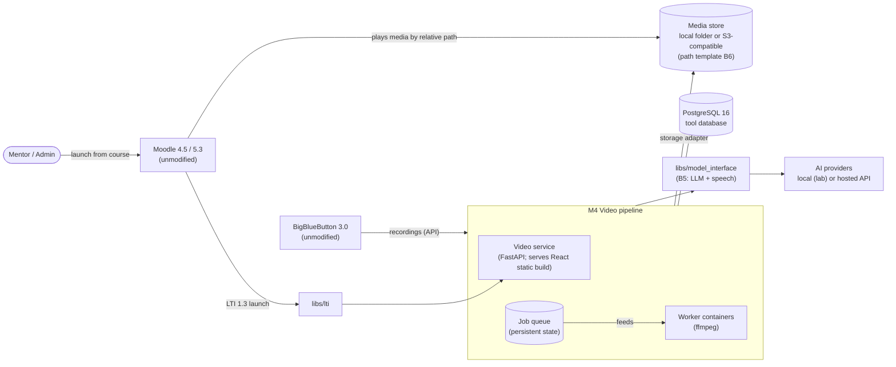
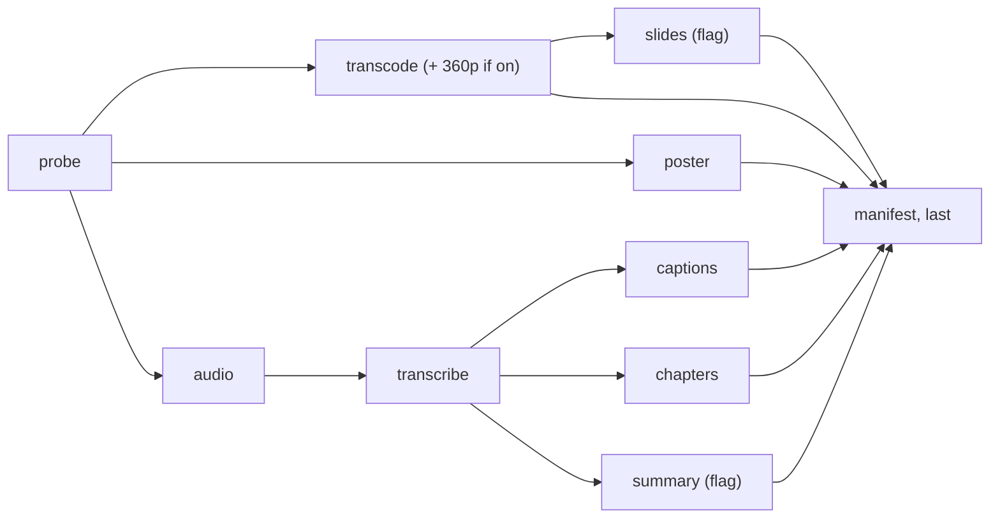

# Design document: Video pipeline

**Module:** video — Student 4, Video Pipeline
**Owner:** Nagashree V (GitHub: vnaags) · **Peer reviewer:** Harshithamanjunatha
**Release(s):** Release 3 (core), Release 5 (stretch)
**Status:** Draft

`Status` values: `Draft` → `In review` (peer reviewing) → `Approved`. **Only the guide sets
`Approved`**, in a pull request the guide merges. Feature code for this module starts only when the
status is `Approved` (foundation work listed in §13 under "Release 0" is allowed earlier).

> Reading key: the design content is taken from `docs/PRD.md` (section given in brackets); the
> structure follows `docs/design/TEMPLATE.md`. Where the PRD does not decide something, the choice is marked
> **Proposal** (my design choice, to be challenged in review; not approved architecture). A Proposal that also needs
> the guide's decision before the affected pull request starts is marked **Needs guide**.

## 1. Purpose and scope

The video pipeline accepts large lecture videos and live-class recordings and processes them into the standard lesson folder (B6), with captions, transcript, chapters, summary, slide index and manifest, ready for Moodle to play by relative path. It is built so the future dual-stream player (F-1) needs no rework [§C4.1]. A mentor uploads a 700 MB lecture from the browser and the upload resumes if the connection drops; a live-class recording appears in the right course folder with captions and chapters without the mentor doing anything; the mentor sees the processing status of every lesson and can fix a wrong chapter title; an administrator can re-run processing for a lesson after a pipeline upgrade [§C4.2].

**PRD chapter and goals:** PRD §C4 — Video pipeline; problem P4 (videos are hard to handle and to use: large files are hard to upload; lectures and live-class recordings have no captions, chapters or index) [§A2]. Goals [§A3], all delivered in Release 3: G-6 — caption word error rate on Indian-English lectures (B8.5), measured and reported, target fixed in Release 0; G-7 — time from a 90-min recording becoming available to captions, chapters and index ready ≤ 30 min; G-8 — a 700 MB file through a proxy that limits requests to 100 MB, with one interruption, succeeds and resumes.

**Out of scope** (PRD §C4.11, complete list): the dual-stream player (F-1) and importing BigBlueButton's separate streams (F-2), both of which belong to the extension track (§C6); live streaming; video editing.

## 2. Requirements covered

Requirement wording is copied from PRD §C4.3. The "approach" and "components" columns start with what other PRD sections state about the requirement; the parts marked **Proposal** are my design choices, to be challenged in review.

| Requirement | Release | Approach in one line | Main components |
|---|---|---|---|
| FR-V-01: Resumable chunked upload (tus protocol), chunk size configurable (default 90 MB, below a 100 MB proxy limit), max file 4 GB; accepts mp4, mov, mkv, webm. | R3 | Upload page with drag-and-drop, per-file progress, resume after reload [§C4.4]; size limit, type check by content, stored outside any web root until processed [SEC-05]. **Proposal:** the tus 1.0.0 core, creation and termination extensions are implemented in the web service; the browser uses `tus-js-client` with a 90 MB chunk size; the type is checked by content with `ffprobe` after the last chunk. **Needs guide** (tus implementation, §7). | Upload page [§C4.4]; upload endpoint; `video.upload` [§C4.5] |
| FR-V-02: Upload form chooses course (from LTI context), module and lesson (number + title → slug); accepts optional `camera` and `screen` tracks (stored and listed, not processed beyond validation in v1). | R3 | Lesson folder follows the B6.1 path template; slugs lowercase ASCII, hyphens, immutable [§B6.1]; `camera`/`screen` are reserved track roles [§B6.3]. **Proposal:** the course is fixed by the LTI session; its `course_slug` is entered once per course on first use and then locked; "module" is a numbered group of lessons (a Moodle week or section) entered as number and title on the form; the form creates the lesson record first and the tus uploads carry its id; extra tracks must be H.264/AAC MP4 files, probed and stored without transcoding, and any other format is refused with a clear message. **Needs guide** (course slug source; non-MP4 extra tracks). | Upload page [§C4.4]; web API; `libs/media_paths` |
| FR-V-03: Transcode to `720p.mp4` (H.264/AAC) when needed; optional `360p.mp4`; extract `poster.jpg`. | R3 | ffmpeg for transcode and poster [§C4.5] in worker containers [OPS-10]; `360p.mp4` behind a feature flag [§B6.2]. **Proposal:** `ffprobe` decides; a source that is already H.264/AAC at 720p or smaller is remuxed (stream copy) into `720p.mp4`, otherwise it is transcoded with x264 (CRF 23, `veryfast`); the true height is written to the manifest; `360p.mp4` only when its flag is on; `poster.jpg` is a non-black frame at about 10 % of the duration. **Needs guide** (ffmpeg build and H.264 encoder licence, §8). | Worker steps: `probe`, `transcode`, `poster`; ffmpeg |
| FR-V-04: Transcribe via B5.4; write `transcript.en.json` and `captions.en.vtt`. | R3 | `speech.transcribe(audio_path, language="en")` [§B5.4]; transcript in the B5.4 segment shape [§B6.2]; transcription runs in workers [OPS-10]. **Proposal:** the worker extracts 16 kHz mono audio with ffmpeg and calls `speech.transcribe`; long audio is cut at silences into chunks of about 10 minutes and merged with time offsets; the segments are written unchanged to `transcript.en.json` and WebVTT cues are built from them (line-length and duration limits). | Worker steps: `audio`, `transcribe`, `captions`; speech interface |
| FR-V-05: Chapters via B5.1 from the transcript; write `chapters.json`; mentor can edit titles. | R3 | `model.run(task, inputs, output_schema)` [§B5.1]; `chapters.json` is `[{start, end, title}]` [§B6.2]; chapters editable on the lesson detail page [§C4.4]. **Proposal:** a registered task `lecture_chapters` with a Pydantic output `[{start, end, title}]`; long transcripts are handled in windows and merged; the worker checks order, coverage and bounds; a mentor edits titles only (times unchanged) and the file is rewritten atomically. The task and its prompt are added to `libs/model_interface` with its owner (Student 3). | Worker step: `chapters`; model interface; lesson detail page |
| FR-V-06: Summary via B5.1; write `summary.en.md` (feature flag). | R3 | `model.run` [§B5.1]; optional file behind a feature flag [§B6.2]. **Proposal:** a registered task `lecture_summary`; the step is skipped when the flag is off, and `summary` is then left out of the manifest. | Worker step: `summary`; model interface |
| FR-V-07: Slide index: detect slide changes, write `slides.json` and thumbnails (feature flag, on by default). | R3 | ffmpeg for scene detection [§C4.5] in workers [OPS-10]; `slides.json` is `[{t, thumb, text?}]`, thumbnails 320 px wide [§B6.2]. **Proposal:** ffmpeg scene-change score on the 720p track; threshold and minimum gap are configurable and tuned on B8.5; thumbnails are 320 px wide at `slides/NNN.jpg`; `slides.json` entries are `{t, thumb}` (no `text` in v1); at least one entry is always written. | Worker step: `slides`; ffmpeg |
| FR-V-08: Write `lesson.json` (B6.3) last, only when all required files exist. | R3 | Outputs written to a temporary folder and moved into place atomically [§C4.5]; partial outputs never exposed [§C4.8]. **Proposal:** a final `manifest` step checks that every required B6.2 file exists, builds the manifest, validates it against the B6 schema, then moves the staged files into the lesson folder and writes `lesson.json` last. | Worker step: `manifest`; `libs/contracts`; storage adapter |
| FR-V-09: BigBlueButton intake: poll recordings via the BigBlueButton API (shared secret), fetch the **video** format output, map it to course and cohort using the recording metadata set by Moodle's BigBlueButton activity, and process it into the live-class path. | R3 | Live-class path `courses/{course_slug}/live-{cohort}/{nn}-{topic_slug}/` [§B6.1]; lab BigBlueButton has the video recording format enabled [§A11]; metadata fields verified in Release 0 [App-C 4]. **Proposal:** a scheduled poller process (same image as the workers) calls the BigBlueButton recordings API, keeps only published recordings not yet taken, maps their metadata to a course, downloads the **video** format output and creates a normal job for the live-class path. The course comes from the recording's course metadata (fields to be confirmed in Release 0, App-C 4); the cohort is the course's default cohort; the topic is the meeting name as a slug; `{nn}` is the next free number. A recording that cannot be mapped is listed as *needs attention* and is never guessed. **Needs guide** (cohort and topic source). | BBB poller (worker); `video.bbb_recording`; `video.lesson` |
| FR-V-10: Status page per course: queued / processing (step) / ready / failed, with retry. | R3 | Failed step shown with reason and retry [§C4.8]; long operations show progress and can be left and resumed [UI-04]. **Proposal:** state comes from `video.job` and `video.step`; a failed step shows its reason and a Retry button that re-queues from the failed step; transient failures are also retried automatically (up to 3 attempts with back-off) before the step is marked failed. | Status list [§C4.4]; `video.job`, `video.step` [§C4.5] |
| FR-V-11: Re-process a lesson (new `pipeline_version`) without changing its path or deleting the previous outputs until the new ones are complete. | R3 | `pipeline_version` is recorded in the manifest's `processing` object [§B6.3]. **Proposal:** a new job builds all outputs in the lesson's staging area; on success the previous files are moved to `.previous/` inside the lesson folder, the new ones are moved in and `lesson.json` is written last; `video rollback` restores `.previous/`. Mentor-edited chapter titles are kept unless the administrator asks to regenerate them. The source is the raw upload if it still exists, otherwise the published `720p.mp4`. | Worker; CLI `video reprocess`, `video rollback` |
| FR-V-12: Storage adapter: local folder or S3-compatible bucket, chosen by configuration (EXT-04). | R3 | Swapping a backend is configuration, not code [EXT-04]. **Proposal:** one `MediaStore` interface (put, move, exists, list, delete, open) with `local` and `s3` adapters, selected by `VIDEO_STORAGE_BACKEND`; all keys are relative paths. | Storage adapter |
| FR-V-13: Embed snippet: give the mentor the relative path and an HTML snippet (video + captions track) to paste into a Moodle Page. | R3 | Copy-snippet button on the lesson detail page [§C4.4]; media stored by relative path [C-08]. **Proposal:** the snippet's `src` is a root-relative path under a media prefix on the Moodle site's own origin (`VIDEO_MEDIA_PREFIX`, read from configuration and never stored); the snippet is offered only after the mentor approves the AI outputs (§3). Serving the media store under that prefix is a web-server setting of the adopting site, not a change to Moodle; the snippet is tested in a Moodle Page on 4.5 and 5.3 in Release 3. **Needs guide**. | Lesson detail page [§C4.4] |
| FR-V-14: *(Stretch)* Checkpoint questions per chapter via B5 → B7 items (separate activity) and `cues.json` entries. | R5 | AI-drafted only, mentor-approved, ungraded; starts only when Releases 1–4 meet their exit criteria [§C5]. **Proposal:** direction only; a design addendum is written before Release 5 work starts: per-chapter drafts through `libs/model_interface`, mentor review shared with Course Studio's practice step (FR-S-12), output as ungraded B7 items and `cues.json` entries `{t, type, ref, label}`. `cues.json` is not produced in Release 3. | Future (Release 5) |
| FR-V-15: Retention: raw uploads and BigBlueButton intake files are deleted a configurable number of days after the lesson is ready (default 30); published lesson folders are never deleted automatically; a CLI lists and, with confirmation, removes lessons older than a configurable age (default off). | R3 | CLI with `--dry-run`, `--check` and a documented undo [C-05, OPS-05]. **Proposal:** a daily scheduled job deletes raw files after `VIDEO_RETENTION_RAW_DAYS` and records `raw_deleted_at`; `video lessons remove` moves a lesson to a trash folder and `video lessons restore` brings it back; only `video trash purge` deletes permanently, after typed confirmation. **Needs guide** (undo for deletion). | Retention job; CLI |

Deferrals: none. FR-V-14 is Release 5 by the PRD [§C4.10].

Release 3 also includes a harness smoke test for this module [§D1]. The integration harness is Module 2's [§C2].

## 3. Architecture

The diagram shows only the components and flows named in PRD §A8, §A10, §C4.5, OPS-10 and FR-V-12. The sections after the table add my proposals for what the PRD does not specify: the queue, the poller, the processing steps, staging and how workers on other hosts reach files.



| Part | Kind | Notes |
|---|---|---|
| Video service | Web service (FastAPI) [§A10] | Exposes `GET /health` [OPS-03]. Transcoding, transcription and scene detection never run inside web request handlers [OPS-10]. |
| Front end | React + TypeScript, built to static files served by the tool [§A10] | Upload page (drag-and-drop, per-file progress, resume after reload); status list; lesson detail (chapters editable, slide thumbnails, captions preview, copy-snippet button). Meets A14 [§C4.4]. |
| Job queue | Persistent state; survives restart [§C4.5] | Feeds the workers [OPS-10]. **Proposal:** rows in PostgreSQL with leases (below). |
| Workers | Worker containers [OPS-10] | ffmpeg for transcode, poster and scene detection [§C4.5]. Steps are idempotent (re-running a step overwrites only its own outputs); outputs are written to a temporary folder and moved into place atomically [§C4.5]. Can run on a different host by configuration alone [OPS-10]. |
| Storage adapter | Adapter [EXT-04] | Local folder or S3-compatible bucket, chosen by configuration [FR-V-12]. |
| BBB poller | Worker process, same image, scheduled loop (Proposal) | Polls recordings, downloads the video output and creates jobs; the status page shows the last successful poll [§C4.8]. |
| Retention CLI | CLI | Lists and, with confirmation, removes lessons older than a configurable age [FR-V-15]. |
| Shared libraries used | `libs/lti`, `libs/model_interface`, `libs/contracts`, `libs/media_paths` [EXT-09] | Modules import them and never copy code [EXT-09]. |

**Where the video pipeline touches other systems (PRD C-02):**
- **Moodle:** LTI 1.3 launches [§B3]; Moodle plays media by relative path [§A8]; the mentor pastes an HTML snippet into a Moodle Page [FR-V-13]. Moodle is never modified [C-01].
- **BigBlueButton:** its API, with a shared secret; the **video** format output [FR-V-09]. BigBlueButton is never modified [C-01].
- **Model interface:** all AI calls through the model interface, all speech-to-text through the speech interface [C-10].
- **Media store:** through the storage adapter [FR-V-12]; relative paths only [C-08].

**Worker on a separate host [OPS-10]:** workers can be deployed on a different host from the web services by configuration alone. **Proposal:** a worker on the same host as the web service may use the local storage adapter; a worker on a different host needs the S3-compatible adapter, so every host reaches the same raw files and media store through the storage adapter.

**Job queue (Proposal).** Jobs and their steps live in PostgreSQL (`video.job`, `video.step`); a worker claims a runnable step with `SELECT … FOR UPDATE SKIP LOCKED` and holds a lease (`locked_until`) that another worker may take over when it expires. This meets §C4.5 (persistent state, survives restart), adds no new service to the fixed stack (§A10), and lets a worker run on another host with only a database connection and access to the storage adapter (OPS-10). Alternatives are in §7.

**Where raw files live (Proposal).** Raw uploads and BigBlueButton downloads go to an incoming area that is never served: `VIDEO_RAW_DIR` for the local adapter, a separate incoming bucket or prefix for S3. It is outside any web root (SEC-05), is addressed by relative path, and its files are deleted after the retention period (FR-V-15).

**BigBlueButton poller (Proposal).** One poller process runs a poll cycle every `VIDEO_BBB_POLL_SECONDS` (default 60) using a database advisory lock, so two pollers never run together. When BigBlueButton does not answer it backs off (60 s, 2 min, 4 min and so on up to `VIDEO_BBB_BACKOFF_MAX_SECONDS`) and the status page shows the last successful poll [§C4.8]. The download host must be the configured BigBlueButton host. Intake is skipped for recordings already seen (`video.bbb_recording`).

**Processing steps (Proposal).** One job per lesson. Each box is one row in `video.step`; a step becomes runnable when the steps it depends on have succeeded, so independent branches run in parallel (G-7). Optional steps (summary, slides, 360p) are skipped when their flag is off.



Time budget for a 90-minute recording against the 30-minute target (G-7). These are targets to prove in the lab, not measurements:

| Step | Budget (min) | Runs alongside |
|---|---|---|
| BigBlueButton poll and download (live classes only) | ≤ 4 | none |
| `probe` and `audio` | ≤ 2 | `transcode`, `poster` |
| `transcribe` and `captions` (chunks in parallel) | ≤ 12 | `transcode`, `slides` |
| `chapters` and `summary` | ≤ 5 | `slides` |
| `transcode` (remux, or x264 `veryfast`) | ≤ 18 | `audio`, `transcribe`, `slides` |
| `slides` | ≤ 8 | `transcode`, `transcribe` |
| `manifest` | ≤ 2 | none |

The longer branch is the video branch (about 2 + 18 + 2 = 22 min) against the speech branch (about 2 + 12 + 5 + 2 = 21 min), plus up to 4 minutes for BigBlueButton intake: about 26 minutes, leaving a margin of about 4.

- Each step writes only its own outputs, first into the lesson's staging area and then into place (§C4.5); re-running a step overwrites only its own outputs.
- `manifest` runs last and only when every required B6.2 file exists (FR-V-08).

**Staging and visibility (Proposal).** Staging lives beside the lesson (`<lesson folder>/.staging/<job id>/`) and is hidden from the media server's configuration. On the local adapter a move is an atomic rename within one file system. S3 has no atomic move (copy, then delete), so there the guarantee is that `lesson.json` is written last: a reader that starts from the manifest never sees a partial lesson. During a re-process there is a short window in which new files sit beside the old manifest; the previous set is kept in `.previous/` until the new manifest is written.

**AI output stays a draft (C-09) (Proposal, Needs guide).** The pipeline ends with the lesson in state `ready` and review state `awaiting_review`: the files exist, but the embed snippet (FR-V-13) is offered only after a mentor opens the lesson detail page and approves the captions, chapters and summary. The approval is written to `shared.audit_log`. Editing a chapter title does not approve the lesson. Learners reach a video only through a Moodle Page the mentor edits, so no AI output is shown to learners before approval. BigBlueButton intake therefore needs no manual step to put the recording in the right folder; approval is a separate mentor action.

**Who maps the LTI context to a course (Proposal, Needs guide).** The pipeline uses no Moodle web services (B4 is listed for Modules 2 and 3 only), so SEC-03 does not apply here. The course is identified by the LTI context id from the launch (`shared.course_link`, B3); its media settings (`course_slug`, default cohort) are stored in `video.course_media`.

## 4. Contracts

| Contract | Provided / used | Fields or functions I rely on | Change needed? |
|---|---|---|---|
| B6 Media paths and lesson manifest | Provided (owner: Student 4) [§B.0] | Path templates `courses/{course_slug}/{module_nn}-{module_slug}/{lesson_nn}-{lesson_slug}/` and `courses/{course_slug}/live-{cohort}/{nn}-{topic_slug}/`; slugs lowercase ASCII, hyphens, immutable; numbers zero-padded to two digits [§B6.1]. Lesson-folder files [§B6.2]. Manifest fields `schema`, `course_slug`, `lesson_id`, `title`, `duration_s`, `tracks` (`role`, `file`, `height`), `captions` (`lang`, `file`), `transcript`, `chapters`, `slides`, `cues`, `summary`, `source` (`kind`, `uploaded_by`, `original_name`), `processing` (`pipeline_version`, `completed_at`); all paths relative to the lesson folder; reserved roles `camera`, `screen`; a v1 reader ignores roles it doesn't play [§B6.3]. `media_signing.sign(relative_path, ttl_seconds=3600)`; implementations `none`, `hmac`, `s3`; the baseline pipeline never calls it [§B6.4] | none (after Release 0: additive only, via `/contract-change`). Before the freeze, see the proposals below. |
| B3 LTI 1.3 launch | Used | Claims `sub`, `name`, `email` (if shared), `roles`, `context` (course id, title), `resource_link`, `deployment_id`; role mapping (Instructor → Mentor, Administrator → Administrator, Learner refused by baseline tools); session bound to (`sub`, context id), expires after 2 h idle; `shared.course_link` [§B3] | none. The LTI context id identifies the course; see §3. |
| B5 Model and speech interface | Used | `model.run(task, inputs, output_schema)` → `result.data`, `result.meta` [§B5.1]; on invalid output one retry, then a clear error [§B5.2]; prompts are versioned files in `/libs/model_interface/prompts/`; every call logs `meta` to `shared.model_calls` [§B5.3]; `speech.transcribe(audio_path, language="en")` → `segments` (`start`, `end`, `text`, `words`), `meta` [§B5.4] | none to the contract. **Proposal:** two new registered tasks (`lecture_chapters`, `lecture_summary`) and their versioned prompts are added to `libs/model_interface` by pull request, reviewed by its owner (Student 3). If the speech service cannot take a 90-minute recording, the pipeline cuts the audio into chunks (§3). |
| B7 H5P practice output | Used, R5 only [§C4.6] | Standard `.h5p` file plus `course.yaml` entry (`type: h5p`, `idnumber`, `graded: false`); never graded; video checkpoints as a separate activity (default) and as `cues.json` entries [§B7] | none |
| B8.5 Lecture videos | Provided (owner: Student 4) [§B8] | ≥ 5 Indian-English technical lectures (≥ 3 h total) with reference transcripts; recorded with written consent or openly licensed (licence verified and recorded) | none. The source and licence or consent of every lecture are recorded in `testdata/README.md`; the recordings are not committed to the repository (§11). |

Lesson-folder files [§B6.2]: `720p.mp4` (main track, H.264/AAC, 1280×720; required); `360p.mp4` (optional, feature flag); `poster.jpg` (required); `captions.en.vtt` (required); `transcript.en.json` (required); `chapters.json` (required); `summary.en.md` (optional, feature flag); `slides.json` + `slides/NNN.jpg` (optional, feature flag, on by default); `cues.json` (optional); `camera.mp4`, `screen.mp4` (optional; accepted and listed, not played in v1); `lesson.json` (required).

**Proposal for the B6 contract, Needs guide:** to be agreed by all B6 users and the guide in the contract pull request, before the Release 0 freeze. Everything below is additive and optional, so a v1 reader that ignores unknown fields stays valid (EXT-02):

1. **Files.** `contracts/lesson-manifest.v1.schema.json` with examples for a single-track lesson, a lesson with `camera` and `screen` tracks, a live-class lesson, and a lesson with its optional steps off. Small schemas for `chapters.json`, `slides.json` and `cues.json` (shapes as in B6.2) so that every file the pipeline writes can be validated.
2. **Poster.** `poster.jpg` is a required file in B6.2 but B6.3 has no field for it: add an optional string field `poster` (relative path).
3. **Source kind.** `source.kind` takes `upload` or `bbb`; for `bbb` an optional `source.record_id` holds the BigBlueButton record id.
4. **Live-class lesson id.** `lesson_id` is the folder path below `courses/{course_slug}/`: `{module_nn}-{module_slug}/{lesson_nn}-{lesson_slug}` for module lessons (as in the PRD example) and `live-{cohort}/{nn}-{topic_slug}` for live classes.
5. **Cues.** `cues` stays optional; the pipeline does not write `cues.json` until FR-V-14 (Release 5).

Every module validates contract data it reads and writes against the schema; invalid data is rejected with a clear error [§B.0].

## 5. Data model

Tables in schema `video`. PRD §C4.5 names four tables (`video.lesson`, `video.upload`, `video.job`, `video.step`) but gives no columns, so the columns below are a **Proposal**. `video.course_media`, `video.bbb_recording` and `video.bbb_poll` are my additions. Types are PostgreSQL 16; states are `text` columns with `CHECK` constraints; times are `timestamptz` in UTC.

**`video.course_media`** (one row per course)

| Column | Type | Notes |
|---|---|---|
| `course_link_id` | `bigint` PK, FK to `shared.course_link` | The LTI context of the course (B3) |
| `course_slug` | `text` not null, unique | Lowercase ASCII and hyphens; entered once, then immutable (trigger); the first part of every media path |
| `default_cohort` | `text` null | Used for live-class recordings |
| `created_by`, `created_at` | `text`, `timestamptz` | LTI `sub` |

**`video.lesson`**

| Column | Type | Notes |
|---|---|---|
| `id` | `uuid` PK | |
| `course_link_id` | `bigint` FK, not null | |
| `kind` | `text` check in (`module`, `live`) | |
| `module_nn`, `module_slug`, `module_title` | `smallint`, `text`, `text` | For `module` lessons; null for live classes |
| `cohort` | `text` null | For live classes |
| `lesson_nn`, `lesson_slug` | `smallint`, `text` not null | Slug immutable after creation (B6.1) |
| `title` | `text` not null | Display name; may change, the path does not |
| `path` | `text` not null, unique | Relative lesson folder below the media root, e.g. `courses/build-ai-assistant/01-setup/02-install-python/`. Never a URL (C-08). Immutable (FR-V-11) |
| `source_ref` | `text` null, unique | BigBlueButton record id for live lessons; stops double intake |
| `state` | `text` check in (`queued`, `processing`, `ready`, `failed`) | Taken from the latest job and stored for fast listing |
| `review_state` | `text` check in (`awaiting_review`, `approved`) | Mentor approval of AI outputs (C-09); `approved_by`, `approved_at` record who and when |
| `pipeline_version`, `ready_at` | `text`, `timestamptz` null | Of the published files; `ready_at` starts the retention clock (FR-V-15) |
| `chapter_edits` | `integer` default 0 | For the metric "manual chapter edits per lesson" |
| `created_by`, `created_at`, `updated_at` | `text`, `timestamptz` | LTI `sub`, or `bbb-intake` |

A lesson number is unique per module or cohort: unique on (`course_link_id`, `kind`, `module_nn`, `cohort`, `lesson_nn`) with `NULLS NOT DISTINCT`.

**`video.upload`**

| Column | Type | Notes |
|---|---|---|
| `id` | `uuid` PK | The tus upload id |
| `lesson_id` | `uuid` FK, not null | The form creates the lesson first |
| `role` | `text` check in (`main`, `camera`, `screen`) | |
| `source_kind` | `text` check in (`browser`, `bbb`) | |
| `original_name` | `text` | Shown to the mentor and written to `source.original_name`; never used as a path |
| `declared_size`, `received_offset` | `bigint` | tus `Upload-Length` and current offset |
| `raw_path` | `text` | Relative to the incoming area |
| `state` | `text` check in (`receiving`, `complete`, `rejected`, `expired`) | |
| `reject_reason` | `text` null | A message key (UI-07) |
| `uploaded_by` | `text` | LTI `sub` |
| `created_at`, `completed_at`, `raw_deleted_at` | `timestamptz` | |

**`video.job`**

| Column | Type | Notes |
|---|---|---|
| `id` | `uuid` PK | |
| `lesson_id`, `upload_id` | `uuid` FKs | `upload_id` is null when re-processing from the published `720p.mp4` |
| `kind` | `text` check in (`process`, `reprocess`) | |
| `pipeline_version` | `text` not null | A constant in the code |
| `state` | `text` check in (`queued`, `processing`, `ready`, `failed`) | A partial unique index allows one `queued` or `processing` job per lesson |
| `requested_by` | `text` | LTI `sub`, CLI user or `bbb-intake` |
| `created_at`, `started_at`, `finished_at` | `timestamptz` | |
| `error_code`, `error_message` | `text` null | The code maps to a user message (§10) |

**`video.step`**

| Column | Type | Notes |
|---|---|---|
| `job_id`, `name` | PK (`uuid`, `text`) | `name` in (`probe`, `transcode`, `poster`, `audio`, `transcribe`, `captions`, `chapters`, `summary`, `slides`, `manifest`) |
| `state` | `text` check in (`waiting`, `queued`, `running`, `done`, `skipped`, `failed`) | `skipped` when a flag is off |
| `queue`, `depends_on` | `text`, `text[]` | `cpu` or `ai`; the steps that must be `done` or `skipped` first |
| `attempts` | `integer` | Automatic retries stop at `VIDEO_STEP_MAX_ATTEMPTS` |
| `locked_by`, `locked_until` | `text`, `timestamptz` | Worker lease |
| `progress_pct` | `smallint` | For the status page (UI-04) |
| `started_at`, `finished_at` | `timestamptz` | Used for the processing-time metric |
| `error_code`, `error_detail` | `text` | The detail goes to logs only, with no file contents (OPS-04) |
| `outputs` | `jsonb` | The relative paths this step wrote, with size and SHA-256 |

**`video.bbb_recording`** (Proposal): `record_id` PK, `lesson_id` FK null, `meeting_name`, `course_ref` (the course metadata exactly as BigBlueButton sent it), `first_seen_at`, `state` in (`discovered`, `needs_attention`, `queued`, `done`, `failed`, `ignored`), `last_error`. **`video.bbb_poll`** (Proposal): one row per configured server with `server_key` PK, `last_attempt_at`, `last_success_at`, `consecutive_failures`, `last_error_code`.

- **Audit:** audit entries (who, what, when, course) for every state-changing operation (upload complete, job queued, retry, approval, re-process, removal) go to `shared.audit_log` [OPS-06].
- The LTI context id is mapped to the Moodle course id and stored in `shared.course_link` [§B3].
- Model and speech call metadata are logged to `shared.model_calls` by the model interface [§B5.3].
- **Migrations:** versioned and reversible [OPS-07]. **Proposal:** the migration tool is whichever the project chooses in Release 0; one migration per pull request that needs it, each with a downgrade that drops what it added; CI runs upgrade, downgrade, upgrade on an empty database. A downgrade that would drop a table holding rows refuses to run unless a data-loss switch is set.
- **Relative vs absolute:** any media URL stored by a tool is a relative path, never a full fixed URL [C-08]; all manifest paths are relative to the lesson folder [§B6.3]. In the database, lesson paths are relative to the media-store root and raw paths are relative to the incoming area; the only absolute values are the configured roots in the environment. The BigBlueButton download address is not stored, only the record id.
- **Backup and restore:** a documented procedure for the tool database and media store [OPS-08]. **Proposal:** the README describes a `pg_dump` of the `video` and `shared` schemas plus a copy of the media store; the incoming area is not backed up because it is deleted after the retention period.
- **Personal data:** no personal data beyond what LTI provides (name, email if shared, role) [SEC-06]; the manifest records `source.uploaded_by` as the LTI `sub` [§B6.3]; the database stores the `sub` only, not the name or email.
- Tables `video.watch` and `video.cue_response` belong to the extension track (Release 6) [§C6.5] and are not part of this module's baseline.

## 6. Interfaces

### Web/API

Everything below is a **Proposal** (the PRD names the pages, not the routes). Roles come from the LTI launch: **Mentor** is the Instructor of the launched course, **Admin** is the Administrator for all courses. Every route except `GET /health` and the LTI endpoints sits behind the LTI session. Errors are returned as JSON with a `code` and a plain-English message that says what to do next [UI-05].

| Route | Who | Request → response |
|---|---|---|
| `GET /health` | anyone | `{status, version}` [OPS-03]; no details about other systems |
| LTI login initiation, launch (redirect), JWKS | Moodle | Provided by `libs/lti` [§B3] |
| `GET /api/session` | Mentor, Admin | Role, course, CSRF token and the enabled feature flags |
| `PUT /api/course/media` | Mentor, Admin | `{course_slug, default_cohort?}`; sets the course slug once; refused if it is already set or not a valid slug |
| `POST /api/lessons` | Mentor, Admin | `{module_number, module_title, lesson_number, lesson_title}` (slugs are suggested and can be edited) → the lesson with its `path`; refused if the path already exists |
| `OPTIONS`, `POST`, `HEAD`, `PATCH`, `DELETE /api/uploads` | uploader, Admin | tus 1.0.0 (core, creation, termination). Required metadata: `lesson_id`, `role`, `filename`. Sizes over `VIDEO_UPLOAD_MAX_GB` and unknown extensions are refused at creation; each chunk is at most `VIDEO_UPLOAD_CHUNK_MB` |
| `GET /api/lessons` | Mentor, Admin | The launch course's lessons with state, review state and last update |
| `GET /api/lessons/{id}` | Mentor, Admin | Detail: steps, chapters, slide list, caption preview, snippet |
| `PUT /api/lessons/{id}/chapters` | Mentor, Admin | `[{index, title}]` with `If-Match`; titles only; atomic rewrite of `chapters.json`; counts one edit |
| `POST /api/lessons/{id}/approve` | Mentor, Admin | Marks the AI outputs approved (C-09); audit entry |
| `GET /api/lessons/{id}/snippet` | Mentor, Admin | `{relative_path, html}`; refused until the lesson is approved |
| `POST /api/lessons/{id}/retry` | Mentor, Admin | Re-queues the job from the failed step |
| `POST /api/lessons/{id}/reprocess` | Admin | New job with the current `pipeline_version`; refused while a job is running |
| `GET /api/lessons/{id}/files/{relpath}` | Mentor, Admin | Streams a small file for the tool's own preview; `relpath` must be listed in the lesson's manifest |
| `GET /api/bbb/status`, `POST /api/bbb/recordings/{record_id}/assign` | Mentor, Admin | Last successful poll and recordings that need attention; assign a cohort and topic to one |

The embed snippet is a plain `<video>` with one `<source>`, one `<track kind="captions">` and the poster, all using root-relative paths under `VIDEO_MEDIA_PREFIX`:

```html
<video controls preload="metadata" poster="/learnops-media/courses/build-ai-assistant/01-setup/02-install-python/poster.jpg">
  <source src="/learnops-media/courses/build-ai-assistant/01-setup/02-install-python/720p.mp4" type="video/mp4">
  <track kind="captions" srclang="en" label="English" src="/learnops-media/courses/build-ai-assistant/01-setup/02-install-python/captions.en.vtt" default>
</video>
```

The pages in §3 (upload, status, lesson detail) serve mentors for their own course's lessons and administrators for all courses [§A5].

Rules: a launch with any role not listed is refused with a clear message; a user sees only data for the course they launched from, except administrators [§A5]. Learner launches are refused by the baseline tools [EXT-07]. Authorisation on every request from the LTI session: role + course context [SEC-02]. CSRF protection on all state-changing web requests [SEC-09].

### CLI (PRD C-05, OPS-05)

Every CLI supports `--dry-run` (prints intended changes, changes nothing), `--check` (read-only status, exit code 0 = OK, 1 = problems found) and `--config <file>`; exit code 2 = error [OPS-05]. Every CLI has a documented undo [C-05]. Command names and undos are a **Proposal**; the retention commands also serve FR-V-15.

| Command | Purpose | `--dry-run` | `--check` | Undo |
|---|---|---|---|---|
| `video process <lesson-path>` | Queue processing of a lesson's uploaded file (`--now` runs it in the foreground) | Prints the steps and output paths | Lesson state; 1 if failed or incomplete | Nothing is published until the manifest is written; remove with `video lessons remove` |
| `video worker --queues cpu,ai` | Run a worker | Prints the steps it would claim | 1 if leases have expired or the oldest waiting step is too old | Stop it; interrupted steps return when their lease expires |
| `video reprocess <lesson-path>` | New job with a new `pipeline_version` | Lists the files that would be replaced | 1 if the published version is older than the code | `video rollback <lesson-path>` |
| `video rollback <lesson-path>` | Restore `.previous/` and the previous manifest | Lists the files | Whether a previous set exists | Run it again (the current set is kept as `.previous/`) |
| `video bbb-poll` | One poll cycle | Lists recordings that would be taken and their folders | Age of the last successful poll; 1 if older than 3 × the interval or unreachable | `video lessons remove` for the lessons it created (listed with `source_ref`) |
| `video lessons list [--older-than-days N]` | List lessons with age and size | Read-only | Read-only | None needed |
| `video lessons remove <lesson-path>` | Move a lesson to the trash (typed confirmation) | Lists what would move | 1 if lessons are older than the configured age | `video lessons restore --trash-id <id>` |
| `video retention run` | Delete raw uploads and BigBlueButton intake files past their date [FR-V-15] | Lists what would be deleted | 1 if raw files are overdue | None for raw files, by design; the lesson folder is untouched and a re-process from the published `720p.mp4` is possible. **Needs guide** |
| `video trash purge --older-than-days N` | Permanently delete trashed lessons (typed confirmation) | Lists what would be deleted | 1 if trash is older than its keep period | None; restore from the media-store backup [OPS-08]. **Needs guide** |
| `video eval-wer --dataset <dir> --out <file>` | Measure the caption word error rate on B8.5 | Lists the clips | Whether the dataset is complete | Delete the output file |

### Configuration (all through environment variables; `.env.example` lists every variable with a safe default or a placeholder [OPS-02])

Names and the defaults marked Proposal are my choice; each variable is added to `.env.example`, with a placeholder where it is a secret or a path, in the pull request that introduces it. No variable has been added to `.env.example` by this document.

| Variable | Default | Setting [source] |
|---|---|---|
| `VIDEO_UPLOAD_CHUNK_MB` | `90` | Upload chunk size [FR-V-01]; keep below the proxy limit |
| `VIDEO_UPLOAD_MAX_GB` | `4` | Maximum file size [FR-V-01]; may be set lower, not higher |
| `VIDEO_UPLOAD_EXPIRE_HOURS` | `48` (Proposal) | Unfinished uploads expire |
| `VIDEO_RAW_DIR` | placeholder path | Incoming area for the local adapter, outside any web root [SEC-05] |
| `VIDEO_STORAGE_BACKEND` | `local` | `local` or `s3` [FR-V-12] |
| `VIDEO_STORAGE_LOCAL_ROOT` | placeholder path | Media root for the local adapter |
| `VIDEO_S3_ENDPOINT`, `VIDEO_S3_REGION`, `VIDEO_S3_BUCKET_MEDIA`, `VIDEO_S3_BUCKET_INCOMING` | placeholders | S3-compatible storage |
| `VIDEO_S3_ACCESS_KEY_ID`, `VIDEO_S3_SECRET_ACCESS_KEY` | placeholders | Secrets; environment only [C-06] |
| `VIDEO_PATH_TEMPLATE_LESSON`, `VIDEO_PATH_TEMPLATE_LIVE` | the B6.1 templates | B6.1 says the template is configurable |
| `VIDEO_MEDIA_PREFIX` | `/learnops-media/` (placeholder) | Root-relative path under which the web server exposes the media store; used only to build snippets, never stored |
| `VIDEO_SUMMARY_ENABLED` | `true` (Proposal) | Feature flag [FR-V-06] |
| `VIDEO_SLIDES_ENABLED` | `true` | Feature flag, on by default [FR-V-07] |
| `VIDEO_LOWRES_360P_ENABLED` | `false` (Proposal) | Optional `360p.mp4` [§B6.2] |
| `VIDEO_BBB_INTAKE_ENABLED` | `false` (Proposal) | Feature flag [EXT-05] |
| `VIDEO_BBB_URL`, `VIDEO_BBB_SECRET` | placeholders | BigBlueButton API address and shared secret (secret, never logged) [FR-V-09] |
| `VIDEO_BBB_POLL_SECONDS`, `VIDEO_BBB_BACKOFF_MAX_SECONDS` | `60`, `900` (Proposal) | Poll interval and back-off ceiling |
| `VIDEO_SLIDES_SCENE_THRESHOLD`, `VIDEO_SLIDES_MIN_GAP_S` | tuned on B8.5 | Scene-change sensitivity and minimum spacing |
| `VIDEO_TRANSCODE_PRESET`, `VIDEO_TRANSCODE_CRF` | `veryfast`, `23` (Proposal) | x264 settings for `720p.mp4` |
| `VIDEO_STEP_MAX_ATTEMPTS`, `VIDEO_LEASE_SECONDS` | `3`, `120` (Proposal) | Automatic retry and worker lease |
| `VIDEO_RETENTION_RAW_DAYS` | `30` | Days before raw uploads and BigBlueButton intake files are deleted [FR-V-15] |
| `VIDEO_RETENTION_LESSON_MAX_AGE_DAYS` | empty (off) | Lesson age for the removal CLI [FR-V-15] |
| `VIDEO_TRASH_KEEP_DAYS` | `14` (Proposal) | How long trashed lessons are kept |
| `MODEL_PROVIDER`, `MODEL_NAME` | — | Owned by `libs/model_interface` [§B5.2]; the speech provider settings and the database and LTI variables follow the shared libraries |

## 7. Key decisions and alternatives

The first eight rows are decisions the PRD itself makes, so no alternatives are weighed. The rest are **Proposals**; each gets a short record in `docs/decisions/NNNN-title.md` [WW-04] when it is accepted. `0001` (LTI library, Student 2) and `0002` (speech options, mine, below) are already planned; the next free number is used for the others.

| Decision | Alternatives considered | Why this one | Record |
|---|---|---|---|
| Resumable upload with the tus protocol, default chunk 90 MB | None (fixed by PRD) | Below a 100 MB proxy limit; uploads must resume [FR-V-01, G-8] | Follows the PRD |
| ffmpeg for transcode, poster and scene detection | None (fixed by PRD) | Fixed stack [§A10, §C4.5] | Follows the PRD |
| Whisper-family speech-to-text in the lab, through the speech interface | None (fixed by PRD) | Fixed stack [§A10]; C-10 | Follows the PRD |
| Heavy work in worker containers fed by a job queue with persistent state | None (fixed by PRD) | [OPS-10, §C4.5] | Follows the PRD |
| Storage adapter: local folder or S3-compatible | None (fixed by PRD) | Swapping is configuration, not code [EXT-04] | Follows the PRD |
| Manifest lists every track and derived file | None (fixed by PRD) | Later camera and screen tracks need no change to existing lessons [EXT-03] | Follows the PRD |
| Slide index produced now for the future player | None (fixed by PRD) | F-1 will display it [EXT-08] | Follows the PRD |
| BigBlueButton **video** recording format | None (fixed by PRD) | [FR-V-09, §A11] | Follows the PRD |
| Job queue in PostgreSQL (`SKIP LOCKED` and leases) | Redis with Celery or RQ; RabbitMQ | No new service in the fixed stack (§A10); state survives restarts (§C4.5); a worker on another host needs only a database connection (OPS-10) | `docs/decisions/` record to write |
| tus server inside the FastAPI service (core, creation, termination) with `tus-js-client` in the browser | tusd (Go, separate container); a third-party Python tus package | The stack is Python (§A10) and tusd adds another runtime; Python packages found are unverified for licence and maintenance. Cost: protocol code to test against the client. **Needs guide** | `docs/decisions/` record to write |
| Speech provider: Whisper-family through B5.4, local in the lab; options compared in a decision record | Other local models; hosted speech APIs | Student 4's Release 0 task: accuracy on Indian-English lectures, cost, licence, local vs hosted | `docs/decisions/0002-speech-options.md` |
| Remux instead of transcode when the source is already H.264/AAC at 720p or smaller | Always transcode | Saves time toward G-7; same output contract | Not needed (follows from FR-V-03) |
| Steps as a graph with parallel branches | One function per job | G-7: transcode and transcription run in parallel; a failed step retries alone | `docs/decisions/` record to write |
| Slide index from ffmpeg's scene score | Perceptual hashing in Python; OCR | No new dependency; OCR would need one; two settings to tune | `docs/decisions/` record to write |
| Publish by staging, `.previous/` and `lesson.json` last | Versioned folders; swapping whole folders | FR-V-11 forbids changing the path (snippets in Moodle Pages point at it); works on both storage adapters | `docs/decisions/` record to write |
| Snippet with a root-relative path under a media prefix on Moodle's own origin | Absolute URL; signed URLs (B6.4) | C-08 forbids stored full URLs; same origin avoids cross-origin set-up for captions; it is a web-server setting, not a Moodle change. **Needs guide** | `docs/decisions/` record to write |
| Mentor approves AI outputs with one click before the snippet is offered | No gate; pasting the snippet counts as approval | C-09 says AI output stays a draft until a mentor approves it, while BigBlueButton intake must need no manual step. **Needs guide** | `docs/decisions/` record to write |
| Course slug entered once per course and then locked | Taken from Course Studio's B1 package; looked up through B4 web services | This module uses no Moodle web services (B4 lists Modules 2 and 3), and the slug is immutable (B6.1). **Needs guide**, with Students 1 and 2 | `docs/decisions/` record to write |
| BigBlueButton mapping: course from the recording metadata, cohort from the course default, topic from the meeting name, otherwise *needs attention* | Guess from time and room; an administrator-kept mapping table | A wrong guess misfiles a class without anyone noticing. **Needs guide** | `docs/decisions/` record to write |
| Deletion by trash and restore; only `trash purge` is permanent | Immediate delete | C-05 requires a documented undo; raw-file deletion is irreversible by design (FR-V-15). **Needs guide** | `docs/decisions/` record to write |
| `camera` and `screen` files must be H.264/AAC MP4 | Remux other containers | FR-V-02 says they are not processed beyond validation; B6.2 names `camera.mp4` and `screen.mp4`. **Needs guide** | `docs/decisions/` record to write |
| No placeholder chapters: invalid model output fails the step with Retry | A fixed-interval fallback | B5.2 forbids silent partial results | Not needed (follows B5.2) |
| Workers on another host use the S3 adapter | A shared network file system | One rule meets OPS-10 | `docs/decisions/` record to write |

## 8. Libraries and licences

The PRD fixes the stack but not library versions or licences. Versions are pinned in the pull request that first adds each library, after its licence has been checked for that exact version; the licences below are what I expect and must be confirmed then. I have not looked up current versions.

| Library | Pinned version | Licence | Why needed | Alternative |
|---|---|---|---|---|
| FastAPI | pin in the first Release 3 pull request | MIT (expected) | Web framework [§A10] | none (stack fixed) |
| Pydantic | pin when first used | MIT (expected) | Request models and the manifest model | none |
| Uvicorn | pin when first used | BSD-3-Clause (expected) | ASGI server | Hypercorn (MIT) |
| PostgreSQL 16 | 16 [§A10] | PostgreSQL Licence (expected) | Database [§A10] | none (stack fixed) |
| PostgreSQL driver | as chosen project-wide in Release 0 | e.g. asyncpg: Apache-2.0; psycopg 3: LGPL-3.0, allowed only as an unmodified library | Database and queue | the other of the two |
| Migration tool | as chosen project-wide in Release 0 | e.g. Alembic: MIT | Reversible migrations [OPS-07] | none |
| React + TypeScript | pin when the UI is first built | MIT, Apache-2.0 (expected) | Front end, static build [§A10] | none (stack fixed) |
| `tus-js-client` | pin when the upload page is built | MIT (expected) | Browser side of tus: chunking, retry, resume | Uppy with its tus plugin (MIT) |
| boto3 | pin with the S3 adapter | Apache-2.0 (expected) | S3-compatible adapter [FR-V-12] | MinIO's Python client (Apache-2.0) |
| httpx | pin with the BigBlueButton intake | BSD-3-Clause (expected) | BigBlueButton API calls and downloads | requests (Apache-2.0) |
| jiwer | pin in Release 0 (measurement only) | Apache-2.0 (expected) | Word error rate on B8.5 [G-6] | Own edit-distance code |
| ffmpeg and ffprobe (binary in the worker image) | pin in the worker image | LGPL-2.1+ or GPL-2+ depending on the build; x264 is GPL-2+. Run as an unmodified separate program, never linked or copied. **Needs guide** | Transcode, audio, poster and scene detection [§A10] | An ffmpeg build with the OpenH264 encoder (BSD-2-Clause) |
| LTI 1.3 library | Chosen and recorded in Release 0 [§A10, App-C 6] | Must be compatible [§A10] | LTI launches | See `docs/decisions/0001-lti-library.md` (Student 2) |
| pytest, a fake S3 server for tests (for example moto) | pin when the first tests are written | MIT, Apache-2.0 (expected) | Unit and integration tests | unittest |
| Playwright (Python) | Owned by the harness (Module 2) | Apache-2.0 (expected) | Browser tests [§A10] | none (stack fixed) |
| Docker + Docker Compose | current | Not a code dependency | Containers [§A10] | none (stack fixed) |

Licences must be MIT, BSD or Apache-2.0 (LGPL only as an unmodified library): PRD C-11. I do not plan to use Redis or Celery (extra service and licence concerns), Pillow or OpenCV (not needed, §7), or any provider SDK directly (C-10).

## 9. Security and privacy

| ID | Applies? | How it is met |
|---|---|---|
| SEC-01 LTI launch validation | Yes | Launches validated fully (signature, issuer, audience, nonce, expiry, deployment id) [SEC-01] |
| SEC-02 Authorisation per request | Yes | Role + course context from the LTI session on every request [SEC-02]; mentor: own course's lessons; administrator: all [§A5] |
| SEC-03 Service-account token | No (Proposal) | B4 is listed as used by M2 and M3 [§B.0]. This module calls no Moodle web service, so it holds no token; if that changes, the contract is changed first |
| SEC-04 Sandbox | No | Applies to untrusted learner code in Module 3 [SEC-04] |
| SEC-05 Uploads | Yes | Size limit (max 4 GB [FR-V-01], set by `VIDEO_UPLOAD_MAX_GB`, never higher); type check by content, not only extension; virus-free assumption documented; stored outside any web root until processed [SEC-05]. **Proposal:** the extension is checked at upload creation, and `ffprobe` checks the container and codecs after the last chunk; the file is refused if it has no video stream, or its container is not one of mp4, mov, mkv, webm. The original file name is metadata only and is never used to build a path. Containment of processing is below |
| SEC-06 Personal data | Yes | No personal data beyond what LTI provides; test data only in the lab [SEC-06, C-07] |
| SEC-07 Data to hosted AI | Yes | Data sent limited to what the task needs; provider and data sent documented in the data map [SEC-07] |
| SEC-08 Dependency scan | Yes | Dependencies scanned in CI; no known critical vulnerabilities at release [SEC-08] |
| SEC-09 CSRF and cookies | Yes | CSRF protection on state-changing requests; secure, same-site cookies for LTI sessions [SEC-09] |

Other handling:
- **Secrets and logs:** no secrets in the repository; configuration through environment variables [C-06]. Logs are structured JSON with request id, user (LTI `sub`), course (LTI context id) and action; no secrets or file contents [OPS-04]. The BigBlueButton secret and the S3 keys appear only in the environment, and are masked if ever printed.
- **Learner role:** refused by baseline tools [EXT-07].
- **Test data only:** test data only (§B8) [C-07]; B8.5 lectures are recorded with written consent or openly licensed; no real learner data in any set [§B8]. **Proposal (Needs guide):** the PRD requires real lecture recordings for B8.5, while the repository rules forbid real recordings in git. Both are met by keeping the recordings out of the repository: they live in the lab's media store, and `testdata/README.md` lists each one with its source, licence or consent and the date checked. Tests that run in CI use small synthetic clips generated by ffmpeg (test pattern and tone), which contain no real person or content. The PRD and the guide decide if this reading is right.
- **Untrusted input:** uploads, handled as SEC-05. **Proposal for containment:** the whole worker is the sandbox, since ffmpeg parses untrusted files. Worker containers run as a non-root user with a read-only root file system, a small writable scratch area, CPU, memory and time limits per step, and a network that reaches only the database, the storage adapter, the model and speech interface and (for the poller) the BigBlueButton host. ffmpeg and ffprobe are started with a fixed argument list (no shell), `-nostdin` and a protocol allow-list limited to local files, so a crafted playlist cannot make them fetch other addresses. A step that exceeds its time limit is killed and marked failed. No upload is ever served back from the incoming area.

**For `docs/data-map.md`** (every data item stored or sent, where, for how long, and why [§E6]). Rows beyond the PRD's own statements are a **Proposal**:

| Data item | Stored where | Sent to | Kept for | Why |
|---|---|---|---|---|
| Raw uploads and BigBlueButton intake files | Outside any web root until processed [SEC-05]; the incoming area (`VIDEO_RAW_DIR` or the incoming bucket) | — | Configurable days after the lesson is ready (default 30) [FR-V-15] | Processing |
| Lesson folder files (B6.2) | Media store [§A8] | Played by Moodle by relative path [§A8] | Never deleted automatically [FR-V-15] | Lesson playback |
| Audio for transcription | The worker's scratch and staging area only (16 kHz mono) | Speech provider, local or hosted [§B5.4]: the audio only, with no file name, course or user data | Deleted when the job reaches `ready` or `failed`; never in the lesson folder | FR-V-04 |
| Transcript | Lesson folder [§B6.2] | Model provider, local or hosted [§B5.2], for chapters [FR-V-05] and the summary [FR-V-06]: the transcript text and the task prompt only | As the lesson folder [FR-V-15] | FR-V-04, FR-V-05, FR-V-06 |
| Uploader LTI `sub` | Manifest `source.uploaded_by` [§B6.3]; `shared.audit_log` [OPS-06]; `video.upload.uploaded_by`, `video.lesson.created_by` | — | In the manifest as long as the lesson folder; in the audit log as long as the shared audit-log rule says. The database keeps no name or email | Audit |
| Model and speech call metadata | `shared.model_calls` (written by the model interface) [§B5.3] | — | As the shared rule says | Cost and audit |
| BigBlueButton recording metadata | `video.bbb_recording` | — | As long as the lesson exists | Avoid double intake; show *needs attention* |
| Original file name | `video.upload.original_name`; manifest `source.original_name` | — | As the lesson | Show the mentor what they uploaded |

## 10. Error handling

Messages say what happened and what to do next, in plain English [UI-05]. All user-facing strings live in one place in the module [UI-07]. Behaviours are from PRD §C4.8 and the sections given; recovery details marked Proposal are mine.

| Situation | Behaviour | Recovery |
|---|---|---|
| Upload interrupted | Resumable [§C4.8, FR-V-01] | Resume after reload [§C4.4]. **Proposal:** an unfinished upload is kept for `VIDEO_UPLOAD_EXPIRE_HOURS`, then expires and its partial file is deleted |
| Wrong file type or size | Clear messages for type/size [§C4.8] | Accepted: mp4, mov, mkv, webm; max file 4 GB [FR-V-01] (the limit is configurable downwards) |
| Processing step fails | Failed step shown with reason and retry [§C4.8, FR-V-10] | Retry from the status page. **Proposal:** transient failures are retried automatically up to `VIDEO_STEP_MAX_ATTEMPTS` with back-off; after that the step is `failed` and waits for a manual Retry |
| Partial outputs | Never exposed [§C4.8]; `lesson.json` written last [FR-V-08] | — |
| BigBlueButton unreachable | Retry with back-off; status shows last successful poll [§C4.8] | Automatic |
| Invalid model output | One retry, then a clear error; never a silent partial result [§B5.2] | **Proposal:** the `chapters` or `summary` step is marked `failed` with a message and a Retry button on the status page; no placeholder is written and no manifest is made until it succeeds (a mentor can turn the summary flag off for the lesson's course instead) |
| Model or speech provider unavailable | **Proposal:** the step is retried with back-off as a transient failure, then marked `failed` | Retry when the provider is back; other steps already done are kept |
| Storage unavailable | **Proposal:** the step that needed it fails with a clear message and nothing is published; the service itself keeps running | Retry once the storage is back |
| Database unavailable | **Proposal:** the service answers `503` with a clear message and `GET /health` reports it; workers wait and reconnect; leases expire so work resumes | Automatic when the database returns |
| Worker stops mid-step | **Proposal:** its lease expires and another worker takes the step again; steps are idempotent [§C4.5] | Automatic |
| Lesson path already exists | **Proposal:** refused when the lesson is created | Choose another lesson number or title |
| Snippet requested before approval | **Proposal:** refused with a message | A mentor approves the AI outputs first |
| Session expired (2 h idle) | Session ends [§B3] | Re-launch from Moodle to continue [§B3] |
| Role not allowed / Learner launch | Refused with a clear message [§A5, EXT-07] | Use Moodle |

**Proposal: user-facing messages** (the wording is a starting point and lives in the one strings file [UI-07]):

| Key | Message |
|---|---|
| `upload.type_not_allowed` | "This file type isn't supported. Upload an MP4, MOV, MKV or WebM video." |
| `upload.too_large` | "This file is larger than the {limit} limit. Compress it or split it, then upload again." |
| `upload.interrupted` | "The upload stopped. Reload this page and choose the same file to continue where it left off." |
| `upload.no_video` | "We couldn't find a video track in this file. Check that the file plays on your computer, then upload it again." |
| `job.step_failed` | "Step '{step}' failed: {reason}. Select Retry. If it fails again, contact your administrator and quote reference {job_id}." |
| `job.ai_unavailable` | "The AI service didn't respond. Your files are safe. Select Retry in a few minutes." |
| `job.ai_invalid` | "The AI service returned a result we couldn't use, so no draft was saved. Select Retry." |
| `job.storage_unavailable` | "The media storage can't be reached, so nothing was published. Select Retry once your administrator confirms it is back." |
| `bbb.unreachable` | "BigBlueButton can't be reached. The last successful check was {time}. We will try again automatically." |
| `bbb.needs_attention` | "We couldn't tell which course or class this recording belongs to. Choose the cohort and topic to continue." |
| `snippet.needs_approval` | "Review and approve the captions, chapters and summary first. They are drafts until you do." |
| `session.expired` | "Your session has ended. Open this tool again from your Moodle course." |
| `role.not_allowed` | "This tool is for mentors and administrators. Use your Moodle course to watch lessons." |

## 11. Test plan

| Level | What is tested | Test data | Requirement IDs |
|---|---|---|---|
| Unit | Functions and validators (contracts, rules, parsers) [§E1]. **Proposal:** slug and path building and the URL-rejecting validator (`libs/media_paths`); the remux-or-transcode decision from `ffprobe` output; audio chunking and merge; WebVTT building; chapter validation (order, coverage, bounds); slide-list building; manifest building; retention selection; the mapping from BigBlueButton metadata to course, cohort and topic; the step state machine and lease rules | Small synthetic clips generated by ffmpeg (test pattern and tone); recorded `ffprobe` JSON; recorded BigBlueButton API responses (no real recordings or people) | FR-V-02, FR-V-03, FR-V-04, FR-V-05, FR-V-07, FR-V-08, FR-V-09, FR-V-10, FR-V-15, C-08 |
| Contract | Every example and generated file validates against its schema [§E1]; `lesson.json` validates against B6.3 [§C4.7] | At least one valid example file per contract [§B.0]. **Proposal:** examples for single-track, camera+screen, live-class and optional-steps-off lessons, plus invalid files that must be rejected (absolute URL, missing required file) | FR-V-08, FR-V-12 |
| Integration | **Proposal:** tus upload against a test client including resume; the full pipeline on a short synthetic clip with a fake speech and model provider that return fixed results; worker killed mid-step (lease takeover); storage adapter contract tests run against the local and a fake S3 backend; BigBlueButton intake against a fake API server; re-process and rollback; the approval gate for the snippet | Synthetic clips; fixed fake provider responses | FR-V-01, FR-V-04…FR-V-06, FR-V-08…FR-V-12, FR-V-13, C-09 |
| Integration (harness) | Module smoke test in the harness [§D1, §E1]; restore + role tests + module smoke tests on fresh Moodle 4.5 and 5.3 sites every release [§E2] | Lab Moodle sites | Release 3 [§D1], EXT-07 |
| End-to-end | Mentor flows in a real browser [§E1]; pasted snippet plays with captions in a Moodle Page on 4.5 and 5.3 [§C4.7] | Lab Moodle sites [§A11] | FR-V-01, FR-V-02, FR-V-10, FR-V-13 |

**Acceptance criteria (PRD §C4.7) and how each is shown** (how each is run and with what data is a **Proposal**):

| Criterion | Demonstration |
|---|---|
| 700 MB file uploaded through a 100 MB-limited proxy with one forced interruption: completes and plays. | Final demonstration step 3 includes a browser upload with an interruption [§E5]. Automated: a Compose profile puts a reverse proxy with a 100 MB request limit in front of the service; a Playwright test uploads a 700 MB file generated by ffmpeg at test time (never committed), cuts the connection once partway, and checks that the upload resumes, completes and the result plays |
| For a 90-minute recording: lesson ready (captions, transcript, chapters, slide index, manifest) ≤ 30 min after it becomes available. | Measured for G-7 [§A3]. Data: a 90-minute lab recording (or B8.5 lectures joined to that length) on the lab worker hardware, whose specification is recorded. The clock starts when the upload completes (last chunk accepted) or, for BigBlueButton, when the recording is published; it stops when `lesson.json` is written. Times come from `video.job` and `video.step` |
| Caption word error rate measured on B8.5 and reported against the Release 0 target. | Measured on B8.5 against the App-C 7 target with `video eval-wer`. Release 0 reports a first baseline; Release 3 reports the final figure |
| `lesson.json` validates against B6.3; all paths relative; existing single-track lessons remain valid when `camera`/`screen` tracks are added later. | Contract tests [§E1]: the single-track example must still validate against the schema after the camera and screen fields exist |
| A BigBlueButton recording from a lab course appears in the correct live-class folder without manual steps. | Final demonstration step 3 [§E5]. A class is recorded on the lab BigBlueButton with the lab's consent rules, and the test checks the folder, the manifest and the absence of manual steps |
| Pasted snippet plays the video with captions in a Moodle Page on 4.5 and 5.3. | Final demonstration step 3 [§E5]; end-to-end test on both lab sites |

Final demonstration [§E5, step 3]: a lecture is uploaded from the browser (with an interruption); a live class runs on BigBlueButton and is recorded; both appear with captions, chapters and slide index; the snippet plays in a Moodle Page.

**Metrics (PRD §C4.9)** — processing time per minute of video; word error rate; upload success rate; manual chapter edits per lesson. Numbers come from logs or recorded sessions, never estimates; each measurement states the data set, method, date and who measured [§E3].

| Metric | Method | Data | Measured by |
|---|---|---|---|
| Processing time per minute of video | (time `lesson.json` is written − time the file becomes available) ÷ video minutes, from `video.job` and `video.step` timestamps | B8.5 lectures and the 90-minute lab recording | Me (Student 4), at the Release 3 exit run; the peer reviewer checks the query |
| Word error rate | `video eval-wer` compares `transcript.en.json` with the B8.5 reference transcripts after the same text normalisation (lower case, punctuation removed), per clip and overall | B8.5 | Me, in Release 0 (baseline) and Release 3 |
| Upload success rate | Uploads that reach `complete` ÷ uploads started, excluding ones the user cancelled, from `video.upload` | Test runs and recorded lab sessions | Me, at the Release 3 exit run |
| Manual chapter edits per lesson | Average of `video.lesson.chapter_edits` | Recorded mentor sessions in the lab | Me, with the mentors who take part |

Traceability: every FR is mapped to test(s), demonstration step and Bloom level in `docs/traceability.md`, updated in every pull request that adds or changes an FR [§E4].

## 12. Risks :

Project risks from PRD Appendix D that apply to this module. The "Needs the lab?" column is my reading of what each risk asks of the lab:

| # | Risk | Needs the lab? | Plan or owner |
|---|---|---|---|
| 1 | Lab downtime | Yes: the lab BigBlueButton, the two Moodle sites and the worker hardware for speech all run there | VM images backed up; tools rebuildable with `docker compose` [App-D]. **Proposal:** the pipeline is tested against fake providers and a fake BigBlueButton so most work continues during downtime; I keep a copy of the B8.5 set outside the lab |
| 2 | Contract drift between modules | No | Freeze at Release 0; B.0 change rule; contract tests in CI [App-D]. **Proposal:** I own B6 and publish its schema and examples early |
| 3 | Scope pressure | No | Releases are independent; stretch only after Releases 1–4 [App-D]. **Proposal:** if time runs short, the order is: drop FR-V-14, then the summary and slide index (both behind flags), never the manifest, captions or upload |

**Proposal: risks specific to this module**:

| # | Risk | Plan or owner |
|---|---|---|
| 4 | The 90-minute recording takes longer than 30 minutes to process | Run steps in parallel (§3); measure speech speed on lab hardware in Release 0 (speech options record); choose a smaller model or chunk in parallel if needed; me |
| 5 | The BigBlueButton metadata does not carry the course or cohort | Verify in Release 0 (App-C 4); recordings that cannot be mapped go to *needs attention* instead of being guessed; me |
| 6 | ffmpeg's licence (x264 is GPL) conflicts with the licence rule | Run it as an unmodified separate program; choose the build with the guide (§8); me and the guide |
| 7 | Moodle 5.3 already provides captions or summaries | Check in Release 0 (App-C 9); the features are behind flags, so overlap can be switched off; the guide to name who verifies |
| 8 | A B8.5 recording has no clear licence or consent | It is not used until the source and licence are recorded in `testdata/README.md`; me |
| 9 | Large uploads fill the disk | Upload expiry, retention (FR-V-15), and a free-space check before a job starts; me |

## 13. Work breakdown

One requirement (or one tightly related group) per pull request. Feature work starts only when this document says `Status: Approved`. Items marked "Release 0" are foundation work the PRD places in Release 0 [§D1] and may start earlier. Release 3 depends on Release 0; Release 5 depends on Releases 2 and 3 [§D1]. **Proposal:** the order below; rows 5, 6, 7 and 8 are new (Release 0 tasks and the foundation every later pull request needs), and the storage adapter comes before the features that write files.

| Order | Pull request | Requirements | Depends on | Notes |
|---|---|---|---|---|
| 1 | B6 contract: schema and at least one valid example | B6 (contract) | — | **Release 0** [§D1, §B.0]. Owner: Student 4. Frozen at the end of Release 0. The changes proposed in §4 are agreed in this pull request, which all four students approve |
| 2 | `media_paths` shared library, including B6.4 with the `none` implementation | B6.4 | — | **Release 0** [§D1, §B6.4]. Path template, slug rules, a validator that rejects full URLs, the `none` signing implementation and unit tests |
| 3 | B8.5 lecture videos | B8.5 | — | **Release 0** test data [§D1]. Plan first: each source and its licence or consent recorded in `testdata/README.md`; recordings are not committed to git (§9) |
| 4 | Appendix C verification of items that concern the video pipeline | App-C #4, #7, #8 | Lab | **Release 0**; results in `docs/decisions/` [App-C]. App-C #6 is Student 2's decision record `0001`; the PRD does not name who verifies #9 (Moodle 5.3 AI features), so the guide is asked |
| 5 | Speech options decision record | App-C #7, FR-V-04 | Row 3 | **Release 0.** `docs/decisions/0002-speech-options.md`: the Whisper-family options compared on a B8.5 clip for accuracy on Indian-English lectures, speed on lab hardware, licence and local against hosted. Includes whether the service accepts a 90-minute recording and the audio format it expects |
| 6 | BigBlueButton public documentation reading and literature survey | FR-V-09, G-6 | — | **Release 0.** At least six sources, each opened and checked by me, in §12 or `docs/literature-video.md` |
| 7 | Foundation: service skeleton with `GET /health`, `video` schema migrations, job and step queue, worker loop with leases | OPS-03, OPS-07, OPS-10, §C4.5 | Release 0 | Release 3. Reversible migrations (upgrade, downgrade, upgrade in CI) |
| 8 | Storage adapter | FR-V-12 | Rows 2, 7 | Release 3 |
| 9 | Resumable upload | FR-V-01 | Rows 7, 8 | Release 3 |
| 10 | Upload form | FR-V-02 | Rows 2, 7, 9 | Release 3 |
| 11 | Transcode and poster | FR-V-03 | Rows 7, 8 | Release 3 |
| 12 | Transcription and captions | FR-V-04 | Rows 5, 7, 8 | Release 3 |
| 13 | Chapters | FR-V-05 | FR-V-04 (chapters are made from the transcript) | Release 3. Adds the `lecture_chapters` task to `libs/model_interface` with its owner |
| 14 | Summary | FR-V-06 | Row 12 | Release 3. Feature flag. Adds the `lecture_summary` task with its owner |
| 15 | Slide index | FR-V-07 | Row 11 | Release 3. Feature flag, on by default |
| 16 | Manifest | FR-V-08 | All required files of B6.2; row 1 | Release 3. `lesson.json` written last |
| 17 | Status page | FR-V-10 | Rows 7, 16 | Release 3 |
| 18 | Embed snippet and mentor approval | FR-V-13, C-09 | Rows 16, 17 | Release 3. Tested in a Moodle Page on 4.5 and 5.3 |
| 19 | Re-process | FR-V-11 | Row 16 | Release 3 |
| 20 | BigBlueButton intake | FR-V-09 | App-C #4 (row 4), row 16 | Release 3 |
| 21 | Retention | FR-V-15 | Row 8 | Release 3 |
| 22 | Harness smoke test | Release 3 [§D1] | Release 3 features | The harness is Module 2's |
| 23 | README, `.env.example`, changelog, traceability, data map, release notes | §D2 items 5–7, §E4, §E6 | All | Release 3 exit criteria. Tag `r3-v1.0`; the adoption test is run |
| 24 | *(R5, stretch)* Checkpoints | FR-V-14 | Releases 2 and 3 [§D1]; Releases 1–4 exit criteria [§C5] | Release 5. A design addendum is written before this work starts |

Every pull request follows the project's working rules: branch `video/<FR-id>-<short-name>`, commit messages starting with the requirement ID, squash merge, the requirement IDs listed in the description, `/preflight` passing, tests added, `docs/traceability.md` updated and a peer approval. Where the PRD is unclear on a point, I raise an issue titled "PRD question: …" and tell the guide instead of deciding alone.

## 14. Review and approval

- [ ] Owner: I understand and can explain every section.
- [ ] Peer reviewer: checked against the PRD chapter and the contracts; comments resolved.
- [ ] Guide: approved (sets `Status: Approved`).
